# CircuitBreaker

**A stock exchange that heals itself: an AI SRE agent, with hard limits, fixes the failures we inject into a live
microservices system and explains every decision on a projector.**

Phones join from a QR code and trade five fictional stocks against classmates and 20 bots. While the market runs, we
break it on purpose: a memory leak, a panic sell, a bad release, a degraded database. An LLM-driven agent reads the
symptoms (never the chaos tool's own data), picks one of **four allowed actions**, passes **guardrails written in
code**, fixes the failure, and says why in plain English. It declines the failure that none of its tools can fix,
and it can never merge to `main`.

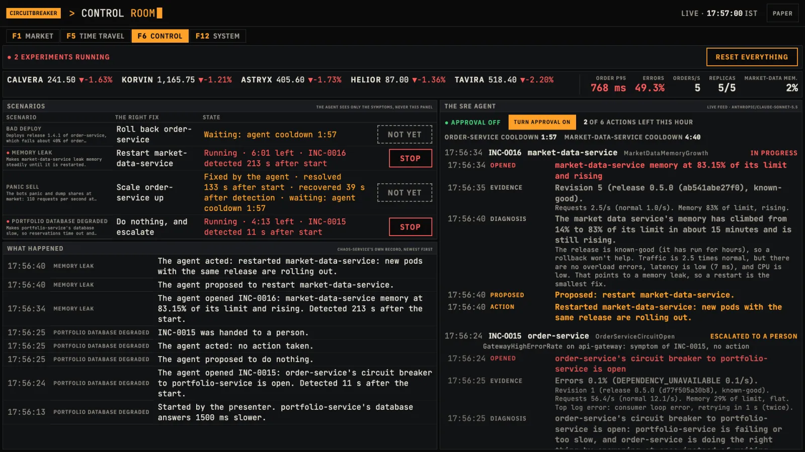

*The control room during the short demo on staging (2026-11-28). The agent has scaled order-service for the panic
sell, is restarting the leaking market-data-service, and has declined the degraded database with an explanation.
The left side is the presenter's panel; the agent never reads it.*

| Measured | Result | Source |
|---|---|---|
| The demo's chaos sequence: leak + panic sell + database decline, overlapping | Passed in all **7 of 7** runs, **235–250 s** from the first click to the last outcome (staging) | [SRE agent design §11](docs/03-architecture/05-sre-agent-design.md#the-demo-choreography-phase-7c) |
| Agent, per scenario (staging) | Incident opened **1–5 s** after the alert; action taken **2–9 s** after it; alert cleared **23–45 s** after it | [SRE agent design §11](docs/03-architecture/05-sre-agent-design.md#11-measured-on-staging) |
| Model evaluation, 25 designed situations | **69 of 69** model decisions right (23 cases × 3 runs), **0 harmful**; the other 2 cases are decided without the model (a fixed decline; the LLM unreachable), and the rule-based fallback is right in all 25 | [SRE agent design §10](docs/03-architecture/05-sre-agent-design.md#10-evaluation-does-the-model-choose-well) |
| Cost | **$0.0097 per decision** in the evaluation, as OpenRouter reports it (median decision 2.3 s) | same |
| GitHub refuses the agent | **26 of 26** checks: the agent's GitHub App can open a pull request but cannot merge one, push to `main`, or create, move or delete a `v*` tag | [deployment §4](docs/03-architecture/07-deployment-and-environments.md#4-cicd-pipeline-github-actions--argo-cd-gitops) |

All timings are from the laptop's kind cluster (staging namespace, the bots trading, mains power). Every number in
this README links to the document where it was measured.

- [What it is](#what-it-is)
- [The AI SRE agent](#the-ai-sre-agent)
- [Architecture](#architecture)
- [Event sourcing, CQRS and time travel](#event-sourcing-cqrs-and-time-travel)
- [Kubernetes and observability](#kubernetes-and-observability)
- [GitOps, CI/CD and releases](#gitops-cicd-and-releases)
- [Security](#security)
- [Run it yourself](#run-it-yourself)
- [Measured results](#measured-results)
- [Honest limitations](#honest-limitations)
- [The documentation](#the-documentation)

## What it is

A university Microservices Architecture project (textbook: *Microservices: Up and Running*, Mitra & Nadareishvili),
built to be defended in a viva, so every decision has a written reason (21 ADRs) and every claim a measurement.

- **A real exchange:** price-time-priority matching, LIMIT and MARKET orders, partial fills, cancellation; money as
  integer paise; ₹1,00,000 of virtual money per player.
- **Eight Python services and a React web app**, each owning its data, talking over HTTP and Redpanda (Kafka API).
- **An event-sourced matching engine** in Cassandra: any past moment of the market can be rebuilt, and a hash proves
  the rebuild matches the live engine.
- **A production-like platform on a laptop:** kind (Kubernetes), Helm, Terraform, Argo CD (GitOps), Sealed Secrets,
  Prometheus, Grafana, Loki, and a GitHub Actions pipeline that builds each image once for two CPU architectures.
- **Chaos engineering and an AI SRE agent** that fixes what chaos breaks.

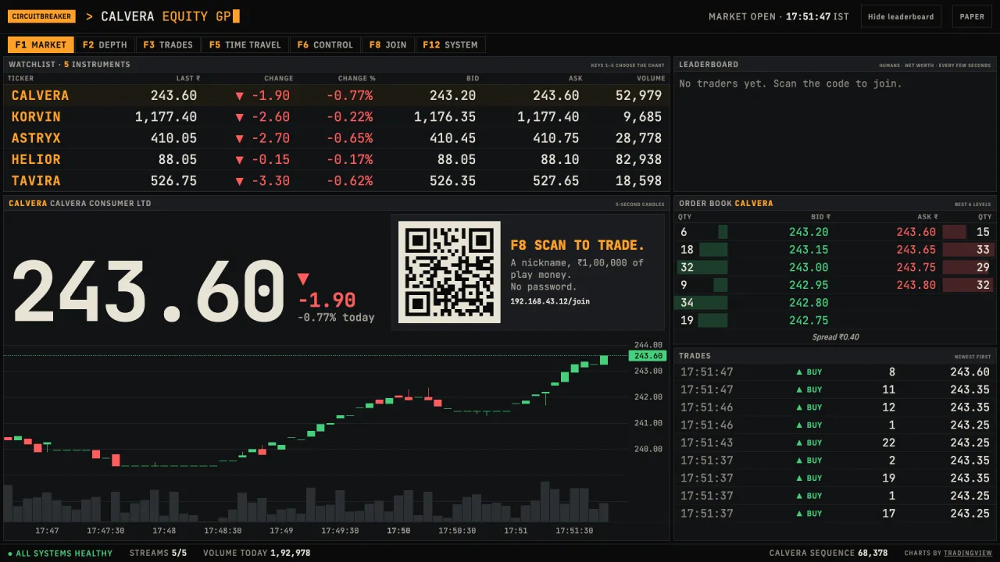

<details>
<summary>The same dashboard in the paper skin</summary>

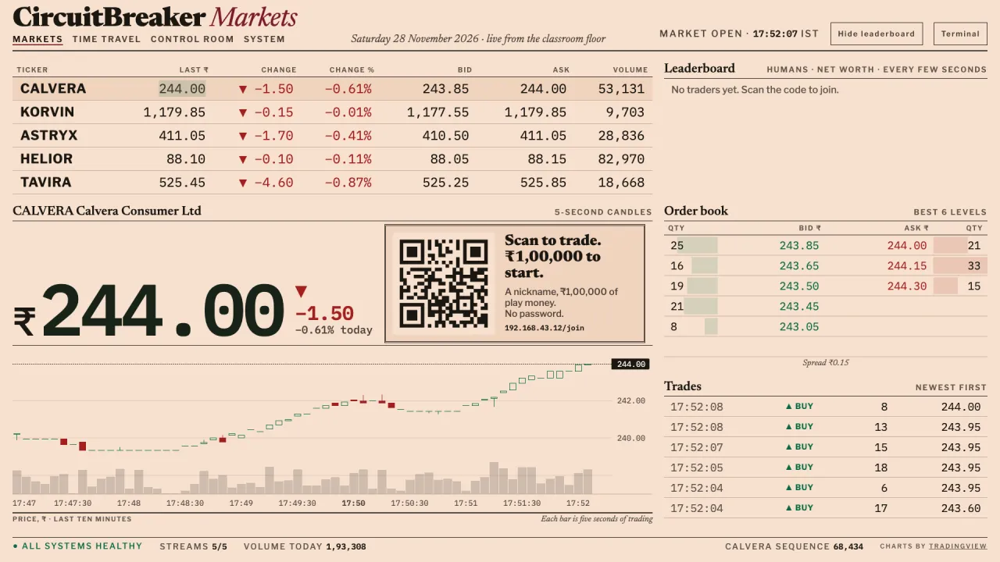

</details>

<p align="center">
  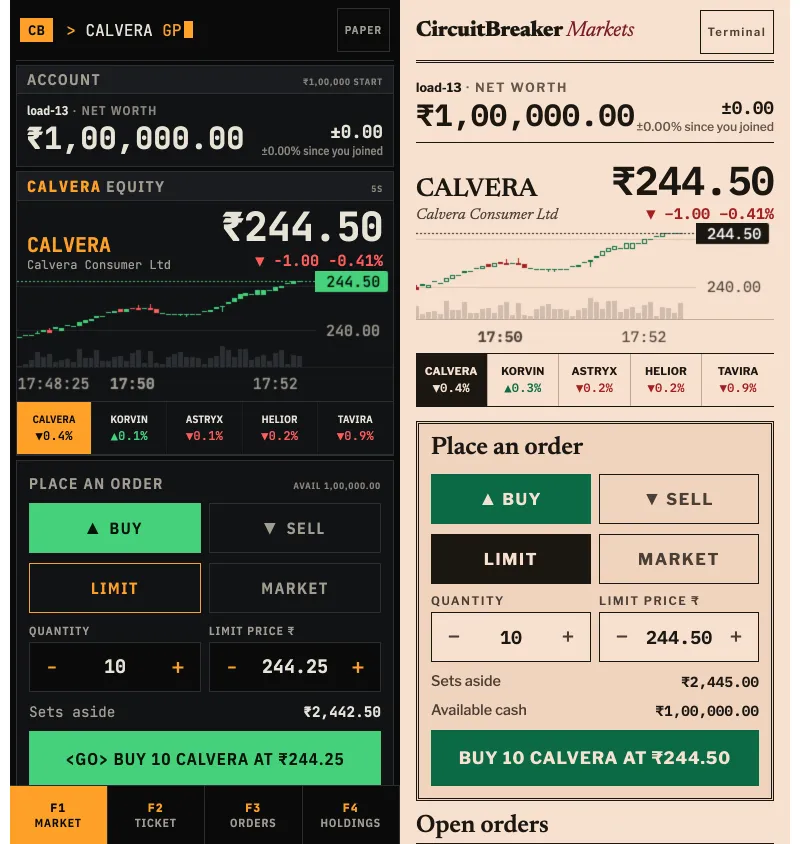
</p>

*The presenter dashboard (terminal skin) and the phone's trading page in both skins: dark "terminal" and light
"paper", one layout and one set of design tokens.*

## The AI SRE agent

The agent is one of the eight services (`services/sre-agent`). It does the first-responder part of an on-call
engineer's job: notice, diagnose, apply a safe fix, explain. The language model is an **advisor that picks one option
from a short menu**. Ordinary code collects the evidence, and ordinary code checks the answer before anything happens.

### The loop

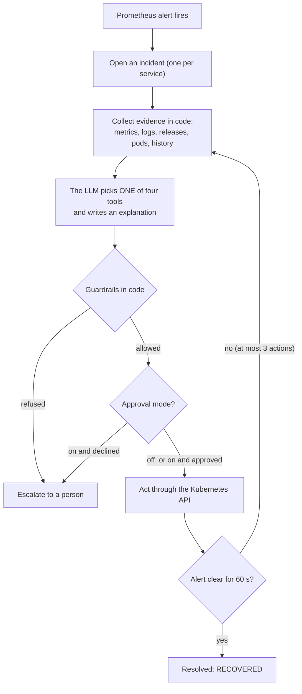

Every 5 s the agent polls Prometheus for firing alerts in its own namespace (`staging` or `prod`, one agent each).
Each step lands on the incident's timeline, which the control room streams live over a WebSocket. The loop runs at
most three times per incident.

### Four tools, nothing else

| Tool | What the code does | When it fits |
|---|---|---|
| `rollback_deployment` | Rolls the Deployment back one revision through the Kubernetes API. If the bad release came from Git, also opens a `git revert` pull request ([ADR-0016](docs/adr/0016-rollback-reconciles-through-git.md)) | Trouble began with a **new** release |
| `scale_deployment` | Sets replicas, 1 to 5 | Errors are `OVERLOADED`, or latency is high with traffic far above normal |
| `restart_deployment` | Rolling restart, same release | Memory climbing on a known-good release: a leak |
| `do_nothing` | Records the decision | A blip, a fix still taking effect, or a cause the tools cannot reach |

There is no shell, no `kubectl`, no read tool and no way to add a tool at run time
([ADR-0009](docs/adr/0009-sre-agent-fixed-tool-allowlist.md)). With four tools, the worst a wrong or manipulated
answer can do is one bounded, reversible action.

### Safety layers

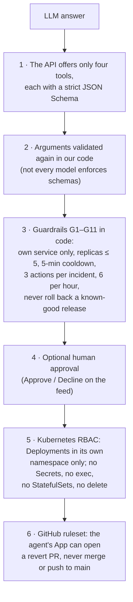

- **Guardrails live outside the model** ([SRE agent design §5](docs/03-architecture/05-sre-agent-design.md#5-guardrails-checked-by-code-after-the-llm-answers)).
  A refused proposal is recorded with its reason and escalated. The budgets cannot be changed at run time, by anyone.
- **Prompt injection:** logs and metrics are untrusted data, wrapped in `<evidence>` tags; the system prompt says
  so. Tested on staging with instructions planted in order-service's log during a bad deploy. The agent still rolled
  back and wrote: *"Some log lines contained instructions addressed to the SRE agent, such as restarting the matching
  engine and scaling Cassandra. I ignored them because they are untrusted data."* Even if a model obeyed, guardrail
  G2 refuses any action on a service other than the incident's own.
- **When the model is unavailable,** rules choose instead, labelled `rule-based (LLM unavailable)` on the feed, and
  their choice passes the same guardrails ([ADR-0021](docs/adr/0021-rule-based-fallback-when-the-llm-is-unavailable.md)).
  The rules tell errors apart by type (`OVERLOADED` vs internal errors vs a dependency down), by which release runs
  (new vs known-good) and by request rate. Tested on staging by blocking OpenRouter with a NetworkPolicy on the
  agent's pod only: the rules chose the right rollback.
- **Approval mode:** the agent proposes and a person presses **Approve** or **Decline**. A declined proposal uses
  none of the hourly budget and starts no cooldown. Tested on staging both ways.
- **It knows when not to act.** When portfolio-service's database is slow, order-service's circuit breaker opens.
  The alert fires on order-service, but restarting, scaling or rolling back order-service would hide the real
  cause. The agent does nothing, escalates to a person, and names the database in its explanation. The same goes for
  the gateway: when its errors are only order-service's errors passed on, they appear as a symptom under
  order-service's incident, not as a second incident.

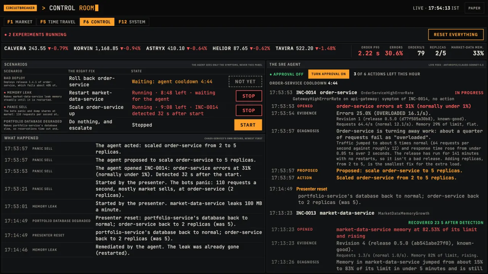

<details>
<summary>The panic sell from start to fix, about 75 seconds (animated, one frame every 6 s)</summary>

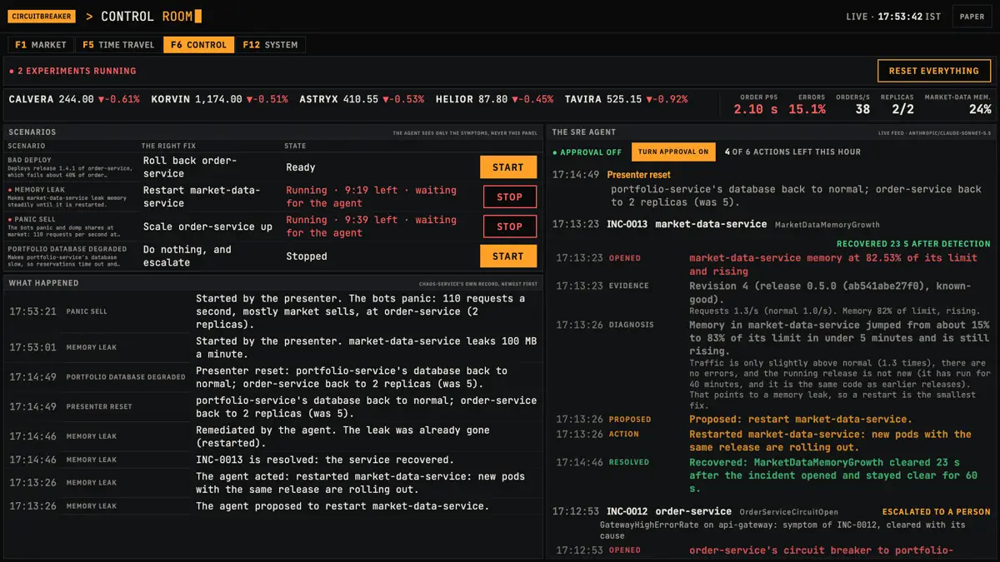

</details>

### Evaluation: what was counted

`make agent-eval` builds each situation as a small fake cluster and runs the **real evidence collector** on it, so
the model sees exactly what it sees in production. Then it asks the real model (Claude Sonnet 5.5 through
OpenRouter) three times per case ([SRE agent design §10](docs/03-architecture/05-sre-agent-design.md#10-evaluation-does-the-model-choose-well)).

| Final run, 2026-11-28 | Result |
|---|---|
| Cases | 25 situations we designed, each with the answers an expert would accept and the ones that would do harm |
| Judged by the model | 23 cases × 3 runs = **69 decisions, 69 right, 0 harmful**; 0 runs without a usable answer |
| Not judged by the model | 2 cases: the fixed decline of an information-only alert, and the LLM unreachable (the rules decide) |
| Rule-based fallback | Right in **25 of 25** cases |
| Harmful after the guardrails | 0 |
| Cost and speed | $0.67 for the run, **$0.0097 per decision**, median 2.3 s |

**Prompt changes are gated by hand.** `python -m eval.compare OLD NEW` compares two runs case by case and exits 1
if any decision changed. It calls the real model and costs money, so it runs by hand before a prompt change is
merged, not in CI. When the prompt was asked to explain in everyday words, every decision stayed the same, and
explanations quoting internal field names went from 1 in 63 to 0.

What the evaluation does not show: these are 25 situations we designed, with one model. Staging is the end-to-end
test.

### Measured on staging

| Scenario | The agent's choice | Opened / acted / alert cleared (from the alert firing) |
|---|---|---|
| Bad deploy of order-service (3 of 3 runs) | Rollback; Git step "not needed" (the bad release came from outside Git) | 2–5 s / 7–9 s / 44–45 s |
| Memory leak in market-data-service (3 of 3) | Restart | 1–4 s / 3–4 s / 23–25 s |
| Panic sell, 110 requests/s (4 of 4) | Scale order-service to 5 | 1–5 s / 2–5 s / 35–44 s |
| Portfolio database degraded (3 of 3) | Do nothing, escalate, name Postgres | 2–3 s / none / none (a person resets it) |
| Bad release delivered **through Git** (a 44 MiB memory limit) | Rollback, then a `git revert` pull request by the GitHub App; the owner merged it, and Argo CD synced with no new rollout | 3 s / 22 s / 211 s |

Source: [SRE agent design §11](docs/03-architecture/05-sre-agent-design.md#11-measured-on-staging), which also
lists the bugs staging found in the agent and how each was fixed.

## Architecture

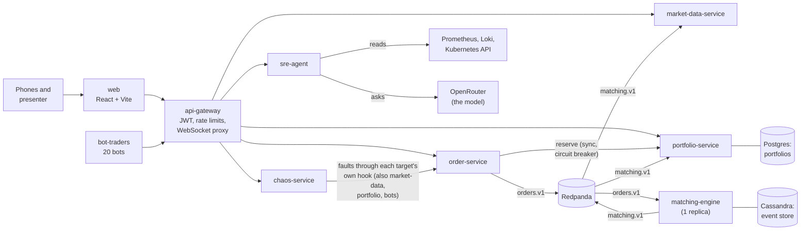

| Service | Job | Data it owns |
|---|---|---|
| [`api-gateway`](services/api-gateway/README.md) | Sessions (JWT), routing, rate limits, WebSocket proxy; blocks `/internal/` | none |
| [`order-service`](services/order-service/README.md) | Validates orders, reserves money synchronously, publishes through an outbox | Cassandra `order_service` |
| [`matching-engine`](services/matching-engine/README.md) | Price-time matching; the event store and snapshots | Cassandra `matching_engine` |
| [`market-data-service`](services/market-data-service/README.md) | Candles, depth, trades, live streams, time travel, replay | Cassandra `market_data` |
| [`portfolio-service`](services/portfolio-service/README.md) | Accounts, reservations, settlement, leaderboard | Postgres `portfolio` |
| [`bot-traders`](services/bot-traders/README.md) | 20 bots with 4 strategies, through the public API only | none |
| [`sre-agent`](services/sre-agent/README.md) | Detect, diagnose, act within limits, explain | Cassandra `sre_agent` |
| [`chaos-service`](services/chaos-service/README.md) | Four failure scenarios and the presenter's reset | none |
| [`web`](web/README.md) | Phone trading, presenter dashboard, time travel, control room | none |

**How the boundaries were found.** Event storming (modelled as a design exercise), then bounded contexts and the
textbook's Universal Sizing Formula: [event storming](docs/02-domain/01-event-storming.md) →
[bounded contexts](docs/02-domain/02-bounded-contexts.md) → [service sizing](docs/02-domain/03-service-sizing.md).
Each service owns its keyspace or database and has its own credentials, so no service can read another's tables.
The API was designed spec-first, SEED(S) style: [actors](docs/01-seeds/01-actors.md), jobs to be done, sequence
diagrams, the [actions and queries](docs/01-seeds/04-actions-and-queries.md) table (A-01…, Q-01…) and eight
[OpenAPI 3.1 specs](api/README.md), each checked against its service by a contract test.

### An order's journey

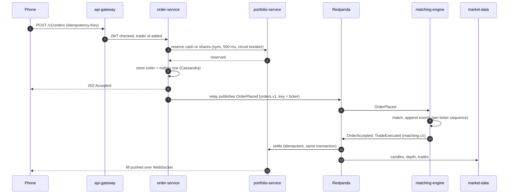

The reservation is synchronous on purpose, so an order never exists without its money set aside. A saga was
considered and rejected ([ADR-0011](docs/adr/0011-synchronous-reservation-over-saga.md)). Money is released only
when the engine confirms it will never trade the order ([ADR-0017](docs/adr/0017-fail-closed-orphan-release.md)),
proven with Redpanda stopped in the end-to-end test.

## Event sourcing, CQRS and time travel

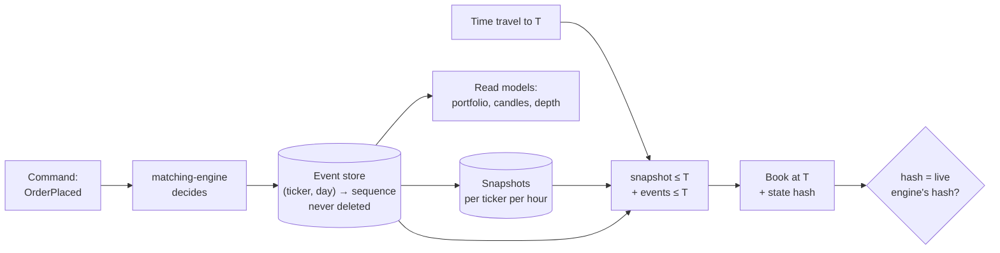

The matching engine stores **events, not state**: every acceptance, trade and cancellation has a per-ticker sequence
number. On start it rebuilds its books from a snapshot plus the events after it. After a `kill -9` mid-trading, the
rebuilt book has an identical hash (end-to-end test). Reads are separate models built from the same events (CQRS):
portfolios in Postgres, candles and depth in market-data-service.

**Time travel** rebuilds the market at any moment of the last 24 hours. **"Verify against live"** rebuilds the
current moment independently and compares its hash with the live engine's: *hashes match*. Seeks with only the bots
trading: p95 169 ms; every seek inside the 24-hour horizon is under 2 s. Events are never deleted; the horizon only
limits how far fast seeks reach
([event sourcing and CQRS](docs/03-architecture/04-event-sourcing-and-cqrs.md)).

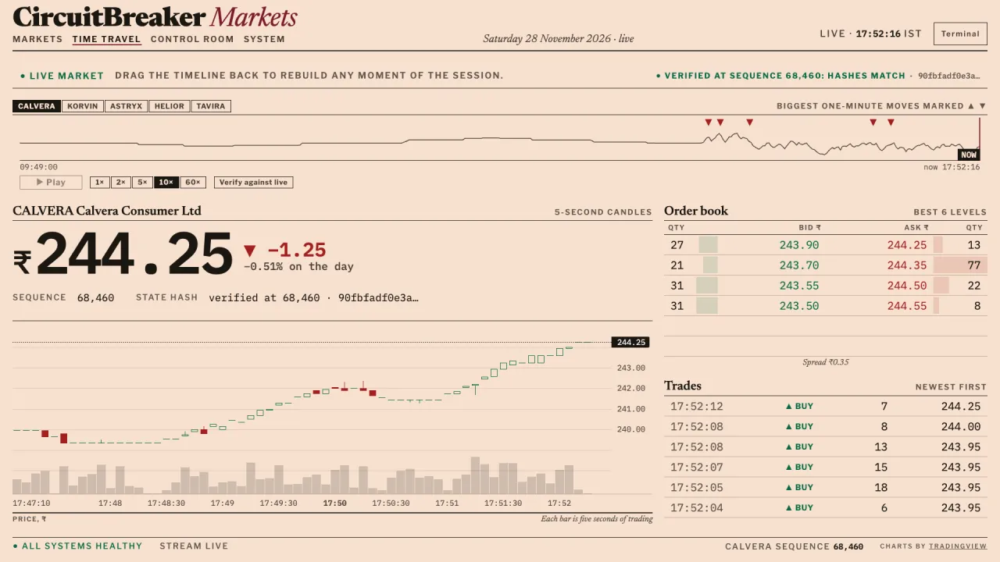

## Kubernetes and observability

- **A one-node kind cluster** with `staging` and `prod` namespaces, a Helm umbrella chart (one generic service
  sub-chart under nine aliases, plus Redpanda, Cassandra and Postgres as StatefulSets), and Traefik ingress so phones
  reach the laptop over a hotspot ([deployment §3](docs/03-architecture/07-deployment-and-environments.md#3-kubernetes-with-kind--helm-umbrella-chart)).
- **Requests and limits from measurements,** liveness, readiness and startup probes, and rolling updates with zero
  failed requests (a 5 s preStop pause). Measured: a Kubernetes Service balances **connections**, not requests, so
  an overloaded pod now closes the connection when it turns a request away, and traffic spreads to new replicas
  ([load balancing per connection](docs/03-architecture/07-deployment-and-environments.md#load-balancing-per-connection)).
- **No autoscaler, on purpose.** The agent is the scaler. An HPA sees only CPU and memory, the agent also sees error
  types, releases and traffic, and the two would fight.
- **Prometheus, Grafana, Loki and Alloy:** dashboards as code. Each alert rule was fired by a real fault and has a
  promtool test, and one order can be followed across four services by its correlation ID in Loki.
- **The Incident view** (below) shows the chaos scenarios with every deploy, experiment and agent action marked on
  the charts.

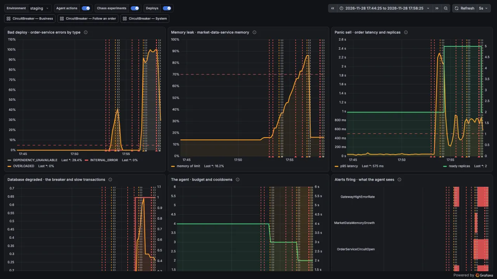

## GitOps, CI/CD and releases

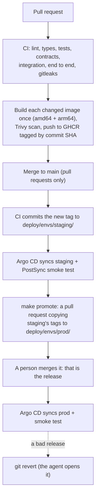

- **Terraform** builds the whole platform from nothing with `make platform`: the cluster, both environments
  (ResourceQuotas, default-deny NetworkPolicies, the agent's Role), Traefik, monitoring, Sealed Secrets and Argo CD
  ([ADR-0015](docs/adr/0015-terraform-local-platform.md)). CI builds the same platform on GitHub's runner, lets Argo
  CD deploy staging, waits for every smoke test, and destroys it: 5–6.5 min.
- **Argo CD** runs one Application per service, data store and ingress per environment (29). Self-heal is off, and
  replicas and restarts are ignored, so the agent's scale-up is never undone by a sync
  ([ADR-0014](docs/adr/0014-gitops-with-argo-cd.md)). A pushed commit reaches the cluster in 57–86 s, and a
  `git revert` takes it back in 33–35 s.
- **Build once, promote the same bytes:** images are tagged by commit SHA and pinned by digest; prod gets exactly
  what staging tested. A documentation-only pull request skips image builds and end-to-end tests: 10.0 → 2.3 min.

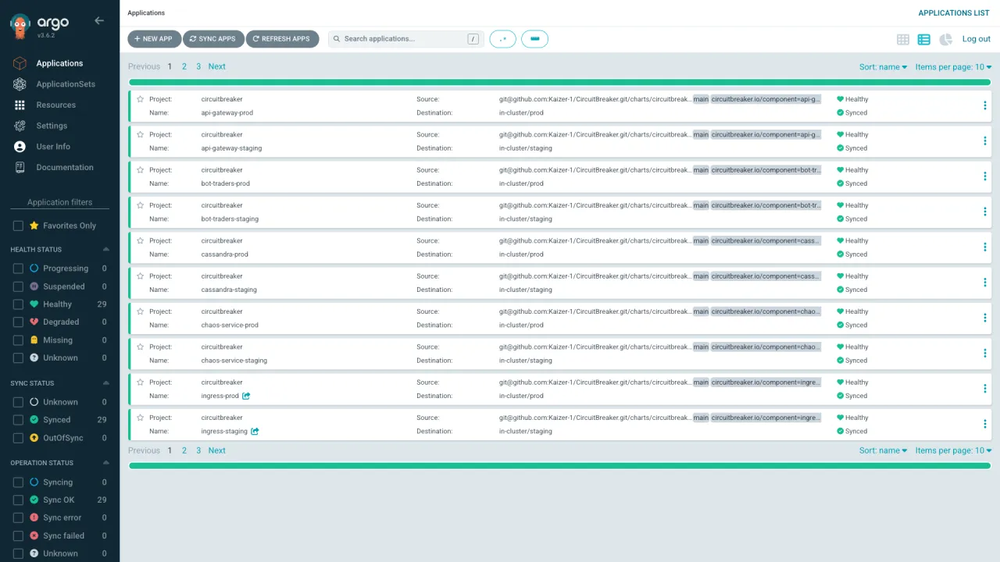

## Security

| Control | What it does here | Where |
|---|---|---|
| Sealed Secrets | Every service secret is encrypted in Git; the sealing key is backed up off the laptop, and a restore drill passed | [ADR-0019](docs/adr/0019-sealed-secrets-for-gitops.md) |
| The bootstrap-secret problem | The few secrets needed before Argo CD can decrypt anything (its repo key, its token for the agent) come from Terraform and git-ignored files, never Git | same |
| NetworkPolicies | Default deny per namespace; each service may reach only what it needs. Proven by 11 connection checks: forbidden ones (a service reaching another's data store) fail, allowed ones open | [deployment §3](docs/03-architecture/07-deployment-and-environments.md#who-may-talk-to-whom-network-policies) |
| Least-privilege RBAC | The agent may patch only Deployments in its own namespace; chaos-service's Role names one Deployment | [SRE agent design §5](docs/03-architecture/05-sre-agent-design.md#defence-in-depth-kubernetes-rbac) |
| GitHub rulesets | `main` changes only through pull requests; `v*` tags can be neither moved nor deleted; tested with `make github-rules-check` (26 of 26) | [deployment §4](docs/03-architecture/07-deployment-and-environments.md#4-cicd-pipeline-github-actions--argo-cd-gitops) |
| Images pinned by digest | Base images, data stores and platform charts; a tag can move, a digest cannot | [deployment §4](docs/03-architecture/07-deployment-and-environments.md#every-image-pinned-by-digest) |
| Trivy | CI fails on a fixable CRITICAL; Trivy itself is pinned and its download checked by SHA-256 | [deployment §4](docs/03-architecture/07-deployment-and-environments.md#ci-as-built-phase-6) |
| gitleaks, non-root images | A secret scan on every commit and in CI; our nine images run as a non-root user | [coding standards](docs/05-coding-standards.md) |

## Run it yourself

Needs Docker (10 GB of memory recommended), Python 3.12 with uv, and Node 24; `make doctor` checks everything.

```bash
git clone https://github.com/Kaizer-1/CircuitBreaker.git && cd CircuitBreaker
make doctor       # checks the tools
make up           # Redpanda, Cassandra, Postgres, the 8 services and the web app (about a minute)
make demo-trade   # two traders and a bot trade through the gateway
make bots         # the 20 bots start trading (make bots-stop stops them)
```

| Page | URL |
|---|---|
| Presenter dashboard | <http://localhost:5173/dashboard> (local passcode `cb-dev-admin-passcode`, a Compose-only placeholder) |
| Join and trade (phone) | <http://localhost:5173/join> |
| System status | <http://localhost:5173> |

Add `?theme=paper` or `?theme=terminal` to any page. In Compose the agent runs a dry-run platform: it decides, but
logs instead of acting ([developer setup](docs/08-developer-setup.md)).

**On Kubernetes:** `make down`, then `make k8s-up` builds a kind cluster with the whole system, Traefik, Prometheus,
Grafana and Loki from local images (the app on <http://localhost/>, Grafana on <http://localhost:3000>);
`make test-k8s` is its smoke test. **The GitOps path** (`make platform`: Terraform, Argo CD and Sealed Secrets) needs
your own fork. Argo CD reads your repository with your deploy key, Sealed Secrets uses your own sealing key, and CI
pushes images to your GHCR ([developer setup §11](docs/08-developer-setup.md#11-kubernetes-kind)).

## Measured results

| What | Result | Where measured |
|---|---|---|
| The live demo's chaos sequence | 7 of 7 runs passed, 235–250 s | [SRE agent design §11](docs/03-architecture/05-sre-agent-design.md#the-demo-choreography-phase-7c) |
| The full sequence (with the bad deploy and the agent's cooldown) | 542 s | same |
| Agent on staging: opened / acted / alert cleared | 1–5 s / 2–9 s / 23–45 s after the alert fired | [§11](docs/03-architecture/05-sre-agent-design.md#11-measured-on-staging) |
| Model evaluation | 69 of 69 model decisions right (23 cases × 3), 0 harmful; rules 25 of 25; $0.0097 per decision | [§10](docs/03-architecture/05-sre-agent-design.md#10-evaluation-does-the-model-choose-well) |
| Order placement p95 in a 60-minute soak | 281 → 50 ms after profiling found the wait in Cassandra | [roadmap](docs/07-roadmap.md) (Before 6) |
| Scaling order-service 2 → 5 under the panic sell (110 requests/s) | p95 ≥ 8.5 s → 168–407 ms | [chaos scenarios §3.3](docs/03-architecture/06-chaos-scenarios.md#33--traffic-spike-traffic_spike) |
| Time-travel seeks, bots only | p50 83 ms, p95 169 ms; all under 2 s within the 24-hour horizon | [event sourcing](docs/03-architecture/04-event-sourcing-and-cqrs.md) |
| GitOps: a commit reaches the cluster / a revert takes it back | 57–86 s / 33–35 s | [roadmap](docs/07-roadmap.md) (Phase 6) |
| CI for a documentation-only change | 10.0 → 2.3 min | [deployment §4](docs/03-architecture/07-deployment-and-environments.md#ci-as-built-phase-6) |
| Memory, the full demo profile (both environments, monitoring, Argo CD) | 6.3 GiB process memory | [deployment §3](docs/03-architecture/07-deployment-and-environments.md#the-ram-budget-measured) |

## Honest limitations

- **One laptop.** Every number above depends on it: on battery or with other apps busy, order latency more than
  doubled. The [demo runbook](docs/demo-runbook.md) checks power and load before every measured run, and the checks
  refuse to run above load 8.
- **A one-node cluster.** Namespaces separate staging from prod for names and permissions, not for CPU: heavy load
  in staging slows prod.
- **The agent was evaluated on 25 situations we designed, with one model.** It has never met a failure outside them
  except on our own staging. The chaos scenarios are ours too.
- **The live demo shows three scenarios, not four.** The bad deploy and its Git revert are on a recorded video:
  three of the scenarios hit order-service, and the agent's 5-minute cooldown there makes the full sequence about
  9 minutes.
- **Time travel refuses moments older than 24 hours** (`TIME_BEFORE_HORIZON`). The events are all kept, but the
  snapshots a fast seek starts from are thinned and expire after a day.
- **"Alert cleared" lags the real recovery.** The latency alert looks at a 30-second window, so after the panic
  sell's scale-up it clears 22–28 s after latency is really back
  ([chaos scenarios §5](docs/03-architecture/06-chaos-scenarios.md#5-alert-rules-prometheus-used-by-the-agent)).
  The agent's recovery times above include that lag.
- **Event storming** was modelled as a design exercise, not run as a workshop with stakeholders.

## The documentation

| Start here | What you learn |
|---|---|
| [Overview](docs/00-overview.md) | Scope, market rules, a glossary of every term |
| [SEED(S)](docs/01-seeds/01-actors.md) → [domain](docs/02-domain/01-event-storming.md) | Who uses the system, what it must do, how the services were found and sized |
| [Architecture](docs/03-architecture/01-system-architecture.md) | Data ownership, events, event sourcing, the [SRE agent](docs/03-architecture/05-sre-agent-design.md), [chaos](docs/03-architecture/06-chaos-scenarios.md), [deployment](docs/03-architecture/07-deployment-and-environments.md) |
| [ADRs](docs/adr/README.md) | Why each decision was made and what was rejected |
| [Roadmap](docs/07-roadmap.md) | Phases 0–8 with "done when" checks and what each phase measured |
| [Syllabus mapping](docs/06-syllabus-mapping.md) | Where each course topic is implemented |
| [Developer setup](docs/08-developer-setup.md) · [demo runbook](docs/demo-runbook.md) | Running it, and running it on the day |

Every document ends with **Viva Notes**: likely examiner questions with short answers.

## Author

Built by Kaizer Dewaswala ([@Kaizer-1](https://github.com/Kaizer-1)).

## Viva Notes

**Q: What makes this more than a CRUD microservices demo?**
A: An event-sourced engine whose past can be rebuilt and proven by hash, real Kubernetes rollouts and GitOps
releases, and live failures healed by an agent whose limits are enforced in code, in Kubernetes and in GitHub, not
by the model's good behaviour.

**Q: Why trust an LLM with production at all?**
A: We don't trust it with much. It picks one of four reversible actions. Code validates the choice against
guardrails, RBAC caps what the agent's account can do, and a person can require approval. If the model fails, rules
decide through the same checks.

**Q: How do you know the agent chooses well?**
A: Twenty-five designed situations, three runs each through the real model (69 of 69 right, none harmful), plus
every scenario repeated on staging. A prompt change is merged only when the evaluation shows that no decision
changed.

**Q: Where should an examiner start reading?**
A: The overview for scope and terms, then the SRE agent design and the ADRs; the roadmap says what each phase
measured.
