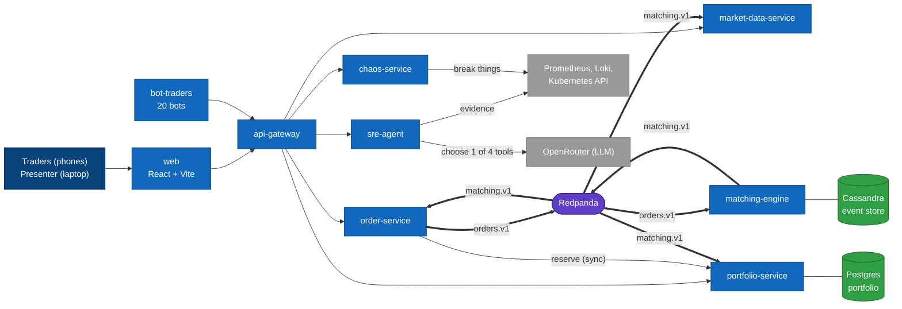

# CircuitBreaker ⚡📈

**A self-healing simulated stock exchange, built as microservices.**

Scan a QR code, get ₹1,00,000 of virtual money, and trade five fictional Indian stocks against classmates and 20 bots
while live candlestick charts move. Every order and trade is stored as an event, so the market can be **replayed to any
past moment**. Then we break it on purpose — a bad deploy, a memory leak, a traffic spike — and an **AI SRE agent**
diagnoses the failure from metrics, logs and deploy history and fixes it with one of four safe actions (rollback,
scale, restart, do nothing), explaining itself in plain English on a live incident feed.

University Microservices Architecture course project. Textbook: *Microservices: Up and Running* (Mitra &
Nadareishvili).

> **Status: Phase 2 — core trading works.** Traders join, place orders through the gateway, and trade; the matching
> engine is event sourced and rebuilds its books after a crash with an identical hash; cash and shares settle exactly;
> orphaned reservations are released fail-closed ([ADR-0017](docs/adr/0017-fail-closed-orphan-release.md)). Market
> data, the trading UI and bots come in Phase 3. See the [roadmap](docs/07-roadmap.md).

## Quick start

```bash
git clone <repository-url> CircuitBreaker && cd CircuitBreaker
make doctor     # check Docker (10 GB recommended), Python 3.12 + uv, Node 24, kind, kubectl, helm, ...
make up         # build and start Redpanda, Cassandra, Postgres, the 8 services and the web app (about a minute)
make demo-trade # two traders and a bot trade through the gateway; prints the trades and portfolios
```

Then open **<http://localhost:5173>**: the System Status page (sign in with the local passcode `cb-dev-admin-passcode`)
shows every service and dependency. `make help` lists the other commands (`make down`, `make reset`,
`make logs s=<service>`, `make lint`, `make test`, `make test-e2e`, `make status`).
Full guide with ports, measured memory use and troubleshooting: [developer setup](docs/08-developer-setup.md).

## Architecture at a glance



Full diagrams: [system architecture](docs/03-architecture/01-system-architecture.md).

| Service | Responsibility | Owner |
|---|---|---|
| [`api-gateway`](services/api-gateway/README.md) | Sessions/JWT, routing, rate limits, WebSocket proxy | MD Asif Ali |
| [`order-service`](services/order-service/README.md) | Validate, reserve, track orders | Kaizer Dewaswala |
| [`matching-engine`](services/matching-engine/README.md) | Price-time matching, market event store | Kaizer Dewaswala |
| [`market-data-service`](services/market-data-service/README.md) | Candles, depth, live streams, time travel | MD Asif Ali |
| [`portfolio-service`](services/portfolio-service/README.md) | Accounts, reservations, settlement, leaderboard | MD Asif Ali |
| [`bot-traders`](services/bot-traders/README.md) | 20 automated traders | Kaizer Dewaswala |
| [`sre-agent`](services/sre-agent/README.md) | Detect, diagnose, remediate, explain | Kaizer Dewaswala |
| [`chaos-service`](services/chaos-service/README.md) | Controlled failure injection | Mohammad Oweis |
| [`web`](web/README.md) | Trader, presenter and admin UI | Kaizer Dewaswala |

**Stack:** Python 3.12 + FastAPI · Redpanda · Cassandra · Postgres · React + Vite + TradingView Lightweight Charts ·
Docker Compose → kind + Helm · Argo CD (GitOps) · Prometheus, Grafana, Loki · Terraform · GitHub Actions · LLM via OpenRouter.

## How to navigate the docs

Read them in this order — each builds on the previous one.

| # | Document | What you learn |
|---|---|---|
| 1 | [Overview](docs/00-overview.md) | Problem, scope, market rules, **glossary of every term** |
| 2 | [SEED(S)](docs/01-seeds/01-actors.md): [actors](docs/01-seeds/01-actors.md) → [jobs](docs/01-seeds/02-jobs-to-be-done.md) → [sequence diagrams](docs/01-seeds/03-sequence-diagrams.md) → [actions & queries](docs/01-seeds/04-actions-and-queries.md) | Who uses the system and what the API must do |
| 3 | [Event storming](docs/02-domain/01-event-storming.md) → [bounded contexts](docs/02-domain/02-bounded-contexts.md) → [service sizing](docs/02-domain/03-service-sizing.md) | How the 8 services were found and sized |
| 4 | [Architecture](docs/03-architecture/01-system-architecture.md), [data ownership](docs/03-architecture/02-data-ownership.md), [event catalog](docs/03-architecture/03-event-catalog.md), [event sourcing & CQRS](docs/03-architecture/04-event-sourcing-and-cqrs.md), [SRE agent](docs/03-architecture/05-sre-agent-design.md), [chaos](docs/03-architecture/06-chaos-scenarios.md), [deployment](docs/03-architecture/07-deployment-and-environments.md) | How it all fits, talks, stores data, heals and ships |
| 5 | [API specs](api/README.md) | OpenAPI 3.1 contracts, WebSockets, error codes |
| 6 | [Team topology](docs/04-team-topology.md) | Who owns what — with a study guide per owner |
| 7 | [Coding standards](docs/05-coding-standards.md) | Layout, naming, testing, versioning, commits, setup |
| 8 | [ADRs](docs/adr/README.md) | Why each major decision was made, and what we rejected |
| 9 | [Syllabus mapping](docs/06-syllabus-mapping.md) | Where every syllabus topic is covered |
| 10 | [Roadmap](docs/07-roadmap.md) | Phases 0–8 with "done when" criteria |
| 11 | [Developer setup](docs/08-developer-setup.md) | Run it locally: prerequisites, make targets, ports, resource use, troubleshooting |

Every document ends with **Viva Notes**: likely examiner questions with short answers.

## Team

Designed with the textbook's five-step team topology ([details](docs/04-team-topology.md)); three people play
several team roles each.

| Person | Team roles |
|---|---|
| Kaizer Dewaswala | System Design (enabling) · Trading (stream-aligned) · SRE agent (enabling) |
| MD Asif Ali | Market Insights (stream-aligned) · API Team (stream-aligned) |
| Mohammad Oweis | Cloud Platform (platform) · Release & Reliability (complicated-subsystem) |

## Viva Notes

**Q: What makes this project more than a CRUD microservices demo?**
A: Real event sourcing with time travel, a real event-driven pipeline, real Kubernetes rollouts and rollbacks, and
live failure injection healed by an agent with strict safety limits.

**Q: Where should an examiner start reading?**
A: The overview for scope and terms, then the SEED(S) folder, then the architecture overview; the ADRs answer most "why"
questions.

**Q: Is any real money or real market data involved?**
A: No. Fictional companies, virtual rupees, and all cloud services emulated locally.
