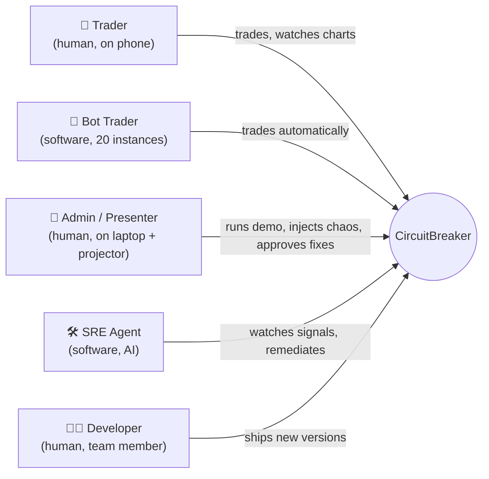

# SEED(S) Step 1 — Actors

> **What is SEED(S)?** The textbook's step-by-step process for designing services and their APIs
> *from the outside in*: start from the people (and systems) that use the software and what they are
> trying to achieve, and only then design endpoints. The steps are:
>
> 1. **Identify actors** ← *this document*
> 2. Identify the **jobs** actors have to get done ([02-jobs-to-be-done.md](02-jobs-to-be-done.md))
> 3. Discover interaction patterns with **sequence diagrams** ([03-sequence-diagrams.md](03-sequence-diagrams.md))
> 4. Derive high-level **actions and queries** ([04-actions-and-queries.md](04-actions-and-queries.md))
> 5. Describe each action and query as an **open-standard spec** (OpenAPI — see [`api/`](../../api/README.md))
> 6. Get **feedback** on the API design
> 7. Implement the **(S)ervices** (later phases, see [roadmap](../07-roadmap.md))
>
> ⚠️ VERIFY AGAINST TEXTBOOK — confirm the exact names and number of SEED(S) steps (we believe it is seven,
> with "(S)" standing for the services implementation step).

## Why start with actors?

If we started with database tables or endpoints, we would design for *our* convenience. Starting with actors
forces every later decision to be justified by somebody's real need. It also gives the examiner a clear
trail: **actor → job → sequence → action/query → endpoint**. Each API endpoint in [`api/`](../../api/README.md)
carries the ID of the action or query it comes from.

An **actor** is anyone or anything that interacts with the system to get a job done. Actors can be humans
or software.

## The actors

### 1. Trader (human)

| | |
|---|---|
| **Who** | A classmate or examiner who scans the QR code during the demo. |
| **Device** | Their own phone (small screen, possibly slow Wi-Fi). |
| **Goal** | Make as much (virtual) money as possible and top the leaderboard. |
| **Knows** | Very little about stock markets. The UI must explain itself. |
| **Starts with** | ₹1,00,000 cash, no shares, a nickname. No password. |
| **Constraints** | Cannot short sell, cannot borrow (no margin). |

### 2. Bot Trader (software)

| | |
|---|---|
| **Who** | 20 automated traders run by the `bot-traders` service. |
| **Why it exists** | (1) Keeps the market moving when no humans are trading. (2) Provides the first shares for sale, because humans start with cash only and short selling is banned. (3) Generates realistic, steady load for metrics. |
| **Strategies** | 4 market makers, 6 momentum, 5 mean-reversion, 5 noise (random) traders. |
| **Constraints** | Same market rules as humans; uses the same public API through `api-gateway`. Bots get no special shortcuts — this keeps the market fair and means the public API is constantly exercised ("dogfooding"). |

### 3. Admin / Presenter (human)

| | |
|---|---|
| **Who** | The team member running the live demo. |
| **Device** | Laptop connected to a projector. |
| **Goal** | Show the market, show the QR code, trigger chaos experiments, and show the agent healing the system. |
| **Special powers** | Chaos Panel; switches the agent's human-approval toggle on/off; approves or declines proposed fixes; can pause the agent. |
| **Auth** | Logs in with an admin passcode; receives an `admin` role token. |

### 4. SRE Agent (software, AI)

| | |
|---|---|
| **Who** | The `sre-agent` service, which uses an LLM through OpenRouter for reasoning. |
| **Goal** | Keep the exchange healthy with as little disruption as possible, and explain every decision. |
| **Sees** | Prometheus metrics and alerts, Loki logs, Kubernetes deploy (rollout) history and pod status. |
| **Can do** | Exactly four things: `rollback_deployment`, `scale_deployment` (max 5 replicas), `restart_deployment`, `do_nothing`. |
| **Cannot see** | What chaos was injected. The agent is deliberately "blindfolded" so its diagnosis is genuine. |

### 5. Developer (human) — *added actor, justification below*

| | |
|---|---|
| **Who** | One of the three team members (Kaizer, Asif, Oweis) changing code. |
| **Goal** | Ship a change to staging, test it, promote it to prod, and roll back if needed. |
| **Interacts via** | Git, GitHub Actions, Helm — not via our HTTP APIs. |

**Why add the Developer?** The syllabus (Units III and V) covers CI/CD pipelines, staging environments and
managing change. Those jobs belong to someone, and the SRE agent's "bad deploy" diagnosis relies on the deploy
history that developers create. Leaving the Developer out would hide half of the DevOps story.

## Actors we considered and rejected

| Candidate | Why rejected |
|---|---|
| **Spectator / audience** (watches the projector without trading) | Watches the Presenter's screen; no separate job of their own. Covered by Admin/Presenter. |
| **Market regulator** | Would need surveillance/halts — out of scope. |
| **Payment provider / bank** | No real money. |
| **Chaos Service** | It is a *system component* used by the Admin, not an actor with its own goals. |
| **Prometheus / Kubernetes** | Infrastructure the SRE Agent uses; they have no goals of their own. |

## Viva Notes

**Q: Why is the SRE Agent an actor and not just part of the system?**
A: An actor is anything that uses the system to get a job done. The agent observes the system from outside
(metrics, logs) and acts on it through a narrow interface, just like a human on-call engineer would. Treating it
as an actor forced us to design its permissions explicitly.

**Q: Why do bots use the public API instead of calling services directly?**
A: Fairness (same rules and latency as humans), simplicity (one entry path to secure and monitor), and
realism: their traffic exercises the same code path that humans use, so the traffic-spike scenario is realistic.

**Q: Why did you add a Developer actor?**
A: CI/CD, staging and rollback are syllabus topics, and the bad-deploy scenario depends on deploy history.
Those jobs need an owner.

**Q: Why does the agent not know which chaos was injected?**
A: If it could read the chaos log, the "diagnosis" would be cheating. It must infer the cause from signals,
the same way a real SRE does.
