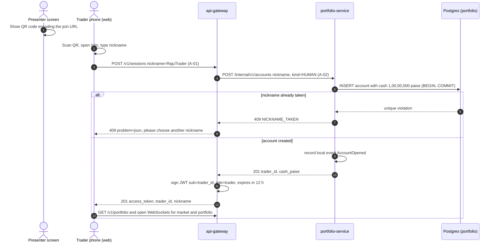
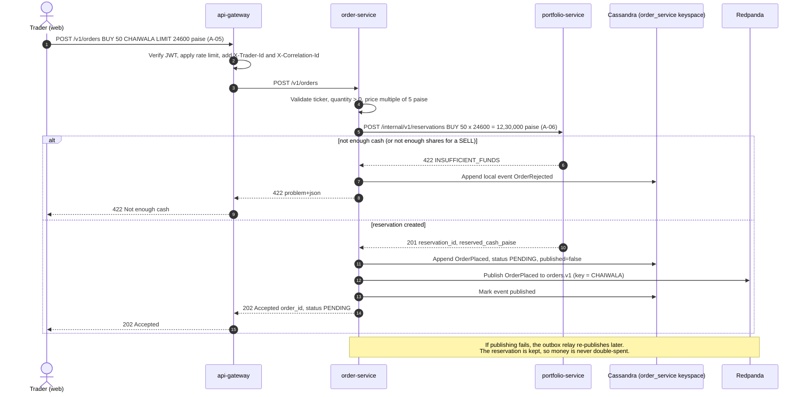
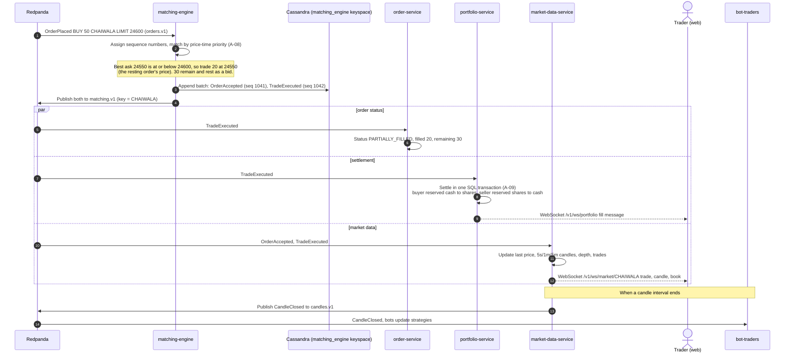
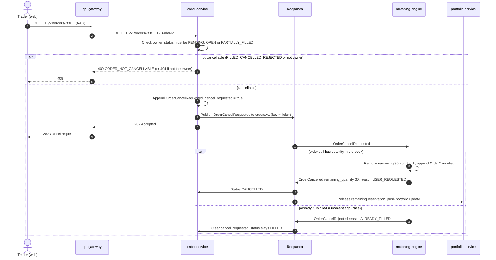
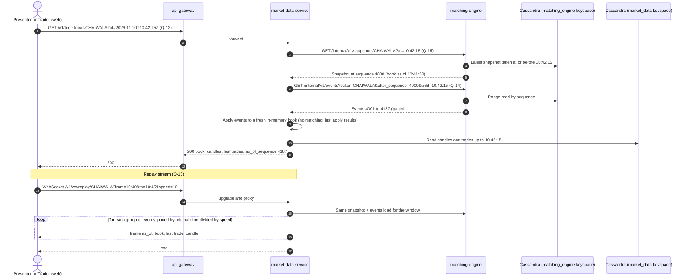
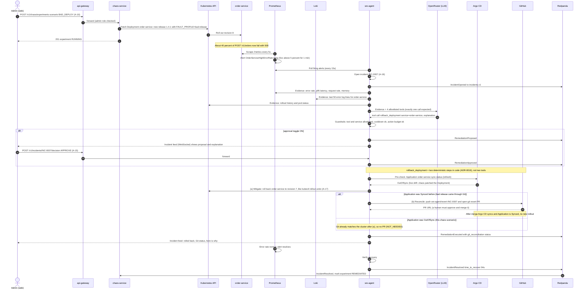
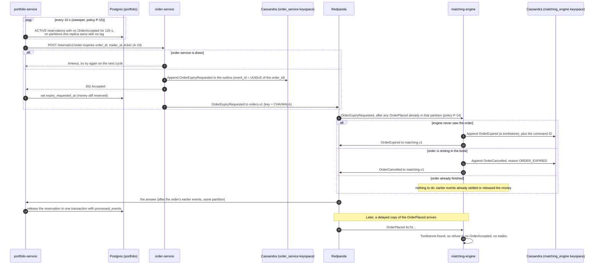

# SEED(S) Step 3 — Sequence Diagrams

> **What is a sequence diagram?** A picture of *who talks to whom, in what order* to complete one job.
> Time flows downwards. Solid arrows (`->>`) are requests or messages; dashed arrows (`-->>`) are replies.
>
> **Why this step matters:** drawing the interactions is where hidden requirements appear. For example, the
> "place order" diagram revealed that cash must be **reserved** before the order reaches the matching engine,
> which created action A-06 and [ADR-0011](../adr/0011-synchronous-reservation-over-saga.md).

**Conventions used in every diagram**

- `web` is the React app on a phone or laptop. Every external call goes through `api-gateway`.
- `Redpanda` is the event bus. Topic names (`orders.v1`, `matching.v1`, …) and event names match the
  [event catalog](../03-architecture/03-event-catalog.md) exactly.
- **Sync** = HTTP, the caller waits. **Async** = an event on Redpanda, the producer does not wait.
- Action/query IDs (`A-xx`, `Q-xx`) refer to [04-actions-and-queries.md](04-actions-and-queries.md).

---

## 1. Join via QR code (J-01 → A-01, A-02)

**Design notes**
- **Why does the gateway call portfolio-service synchronously?** The trader cannot do anything until the account
  exists, so waiting is the correct behaviour. It is one quick call.
- **Why no password?** Joining must take seconds on a phone during a demo. The JWT is stored in the browser;
  if it is lost, the trader simply joins again with a new nickname.
- **What does the phone do with a 409?** The API only says the name is taken. The web join page then tries the
  same name with a short random suffix (`RajuTrader_7k`), up to three times, and shows the suffix in a quieter colour.
  Only if all three are taken does it ask for another name. This is client behaviour; A-01 is unchanged
  ([web README](../../web/README.md#nicknames)).
- ₹1,00,000 = 1,00,00,000 paise (10,000,000).

---

## 2. Place an order (J-03, J-04 → A-05, A-06)

**Design notes**
- **Why `202 Accepted` and not `201 Created`?** The order is accepted for processing but has not been matched
  yet. Matching happens asynchronously in the matching engine; the status will change to `OPEN`,
  `PARTIALLY_FILLED` or `FILLED` via events.
- **Why reserve synchronously?** "No short selling, no margin" must be enforced *before* the order can trade.
  See [ADR-0011](../adr/0011-synchronous-reservation-over-saga.md) for sync reservation vs. async saga.
- **MARKET orders:** portfolio-service computes a *protection price* (last price ± 10%) and, for buys, reserves
  `quantity × protection price`. Unused money is released when the order finishes.
- **If order-service crashes** between reserving and publishing, the relay never publishes an `OrderPlaced` older than
  60 s (the order becomes `REJECTED`, `PUBLISH_TIMEOUT`), and the reservation is released only after the engine
  confirms the order can never trade ([§7](#7-an-orphaned-reservation-expires-j-36--a-19)).

---

## 3. A trade executes (J-31, J-32 → A-08, A-09)

Continuing from diagram 2. A resting SELL of 20 CHAIWALA at ₹245.50 (by `Bot-03`) is in the book.

**Design notes**
- **Event store first, then publish.** The engine appends events to Cassandra *before* publishing them. If it
  crashes in between, it re-publishes from the store on restart. Consumers are **idempotent** (they ignore an
  `event_id` they have already processed), so a duplicate does no harm.
- **Price improvement:** the buyer was willing to pay ₹246.00 but paid ₹245.50. The extra reserved
  ₹0.50 × 20 = ₹10 is released when the order finishes (filled or cancelled).
- Three services react to the **same** event independently — this is the main benefit of publish/subscribe.
- **Self-trade prevention:** if the next resting order the incoming order would match belongs to the same trader, the
  engine cancels the incoming order's remainder (`OrderCancelled`, reason `SELF_TRADE_PREVENTED`) instead of letting a
  trader trade with themselves (a *wash trade*). Trades it made before that point stand.

---

## 4. Cancel an order (J-06 → A-07)

**Design notes**
- **Why is cancel asynchronous?** Only the matching engine knows whether the order is *still* in the book.
  Another trader's order could fill it a millisecond before the cancel arrives. Because `orders.v1` is keyed by
  ticker, the cancel is processed strictly after the original `OrderPlaced`, so the engine always sees them in order.
- A cancel can therefore *fail* even though the API returned `202`. The UI shows "cancel requested" until the
  `OrderCancelled` or `OrderCancelRejected` event arrives.

---

## 5. Time travel and replay (J-20 → Q-12, Q-13, Q-14, Q-15)

**Design notes**
- **Replay applies *events*, not *commands*.** Re-running matching could give different results if the matching
  code has changed since. Applying the stored results (`OrderAccepted`, `TradeExecuted`, `OrderCancelled`) is
  deterministic and needs no matching logic in market-data-service.
- **Data ownership is respected:** market-data-service never reads the `matching_engine` keyspace directly; it
  asks matching-engine over HTTP.
- **Snapshots** (every 500 events per ticker) mean we replay at most 500 events, not the whole day.
- Time travel is a **query**: it never changes live state. That is CQRS in action.

---

## 6. Chaos injected → SRE agent remediates (J-15, J-21–J-25 → A-10, A-15, A-16, A-17)

Scenario shown: **bad deploy** of `order-service`. The other two scenarios follow the same shape — see
[06-chaos-scenarios.md](../03-architecture/06-chaos-scenarios.md).

**Design notes**
- **The agent never talks to chaos-service.** It diagnoses only from metrics, logs and deploy history.
- **Evidence is collected by plain code, not by the LLM.** The LLM only chooses *one* of four action tools. This
  keeps the agent's powers exactly equal to the allowlist ([ADR-0009](../adr/0009-sre-agent-fixed-tool-allowlist.md)).
- **Guardrails run after the LLM answers** and can override it: an unsafe request becomes `do_nothing` plus an
  escalation message to the admin.
- **Mitigate fast, reconcile through Git.** The rollback first fixes the cluster in seconds. If the bad version came
  from Git, the same tool's code then opens a `git revert` pull request so Git matches the cluster again
  ([ADR-0016](../adr/0016-rollback-reconciles-through-git.md)). In this chaos scenario Git never contained the bad
  version, so the `else` branch applies.

---

## 7. An orphaned reservation expires (J-36 → A-19)

Fail-closed release ([ADR-0017](../adr/0017-fail-closed-orphan-release.md)). Shown: order-service crashed after
reserving cash for order `6c7d...` and before storing it, so no `OrderPlaced` was ever sent.

**Design notes**
- **Why not just release after 120 s?** A timer cannot know what the engine decided. If the engine was down, or
  crashed after storing a trade but before publishing it, the money could be traded after it was handed back.
- **Fail-closed:** if the engine is down, the money stays reserved until it answers. If order-service is down, the
  sweeper asks again on its next cycle.
- **Why through order-service?** The expiry must be in the same `orders.v1` partition as the order so it is handled
  after any `OrderPlaced` already sent, and `orders.v1` has one producer, order-service, with an outbox.

## Viva Notes

**Q: What did sequence diagrams teach you that JTBDs didn't?**
A: Hidden steps and their ordering — e.g. reservations before matching, the race between cancel and fill, and
that the agent needs deploy history. Each became an action, an event or an ADR.

**Q: Why does placing an order return 202 instead of 201?**
A: The order is accepted for processing but not yet matched; matching is asynchronous. 202 is honest: "I have it,
the result comes later". The client watches status via events (WebSocket) or `GET /v1/orders/{order_id}`.

**Q: How do you avoid processing a cancel before the order it cancels?**
A: Both messages go to `orders.v1` with the ticker as key, so they land in the same partition, which Redpanda
delivers in order.

**Q: What happens if the matching engine crashes after saving events but before publishing?**
A: On restart it reads events from its Cassandra store that were not yet published and publishes them. Some
might be published twice; consumers deduplicate by `event_id`, so it is safe (at-least-once + idempotency).

**Q: Why doesn't replay re-run the matching algorithm?**
A: Because events are facts that already happened. Re-running decisions with today's code could produce a
different past. Applying stored facts always reproduces exactly what happened.
