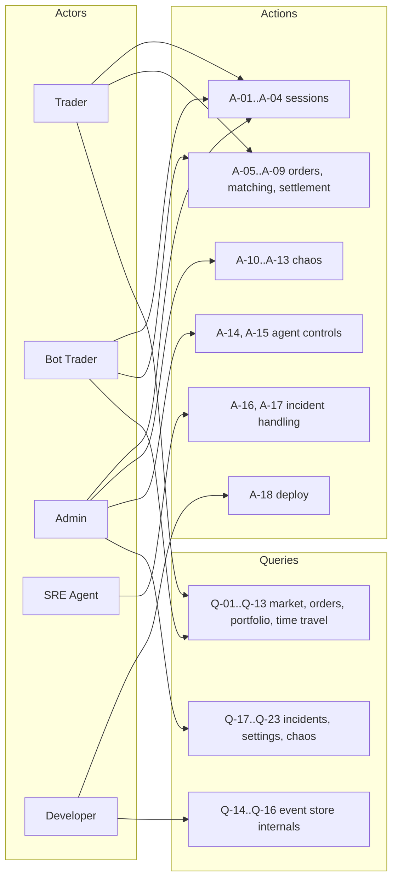

# SEED(S) Step 4 — Actions and Queries

> **Action** (also called a *command*): changes the state of the system. It can be rejected.
> **Query**: only reads state. It never changes anything, so it is always safe to repeat.
>
> **Why separate them?** (1) Queries can be cached, retried and scaled freely; actions need validation, ordering
> and idempotency. (2) The split leads naturally to **CQRS**: actions go to the *write side*
> (order-service → matching-engine) and most queries are answered by *read models*
> (market-data-service, portfolio-service). See [04-event-sourcing-and-cqrs.md](../03-architecture/04-event-sourcing-and-cqrs.md).

**This table is the contract between SEED(S) and the OpenAPI specs.** Every operation in [`api/`](../../api/README.md)
starts its description with one of these IDs. IDs never change meaning; new items get new IDs.

**Column meanings**
- **Interface** — `HTTP` (OpenAPI spec), `WS` (WebSocket channel, documented in [`api/README.md`](../../api/README.md)),
  `Event` (triggered by consuming an event, no endpoint), `Tool` (SRE agent tool call to Kubernetes), `CI` (pipeline).
- **Public?** — `Yes` = reachable from outside through `api-gateway`. `Internal` = service-to-service only, under
  `/internal/v1/…`; the gateway refuses to route any `/internal/` path.

## Actions (commands)

| ID | Action | Actor | From JTBD | Owning service | Interface | Endpoint / trigger | Public? |
|---|---|---|---|---|---|---|---|
| A-01 | Join the market as a trader | Trader | J-01 | `api-gateway` | HTTP | `POST /v1/sessions` | Yes |
| A-02 | Open a trading account | api-gateway | J-29 | `portfolio-service` | HTTP | `POST /internal/v1/accounts` | Internal |
| A-03 | Start a bot session | Bot Trader | J-10 | `api-gateway` | HTTP | `POST /v1/bot-sessions` | Yes (needs bot secret) |
| A-04 | Start an admin session | Admin | J-14 | `api-gateway` | HTTP | `POST /v1/admin/sessions` | Yes (needs passcode) |
| A-05 | Place an order (LIMIT or MARKET) | Trader, Bot | J-03, J-04, J-12 | `order-service` | HTTP | `POST /v1/orders` | Yes |
| A-06 | Reserve cash or shares for an order | order-service | J-30 | `portfolio-service` | HTTP | `POST /internal/v1/reservations` | Internal |
| A-07 | Cancel an order | Trader, Bot | J-06, J-12 | `order-service` | HTTP | `DELETE /v1/orders/{order_id}` | Yes |
| A-08 | Match an order / process a cancel request | matching-engine | J-31 | `matching-engine` | Event | consumes `OrderPlaced`, `OrderCancelRequested` | — |
| A-09 | Settle a trade / release a reservation | portfolio-service | J-32 | `portfolio-service` | Event | consumes `OrderAccepted`, `TradeExecuted`, `OrderCancelled` | — |
| A-10 | Start a chaos experiment | Admin | J-15 | `chaos-service` | HTTP | `POST /v1/chaos/experiments` | Yes (admin) |
| A-11 | Stop a chaos experiment | Admin | J-16 | `chaos-service` | HTTP | `POST /v1/chaos/experiments/{experiment_id}/stop` | Yes (admin) |
| A-12 | Inject a fault into a service | chaos-service | J-35 | `market-data-service` | HTTP | `POST /internal/v1/faults` | Internal |
| A-13 | Clear an injected fault | chaos-service | J-35 | `market-data-service` | HTTP | `DELETE /internal/v1/faults` | Internal |
| A-14 | Update agent settings (approval toggle, pause) | Admin | J-17 | `sre-agent` | HTTP | `PUT /v1/agent/settings` | Yes (admin) |
| A-15 | Approve or decline a proposed remediation | Admin | J-18, J-23 | `sre-agent` | HTTP | `POST /v1/incidents/{incident_id}/decision` | Yes (admin) |
| A-16 | Open an incident | SRE Agent | J-21 | `sre-agent` | Event | Prometheus alert detected by the agent loop; emits `IncidentOpened` | — |
| A-17 | Execute a remediation (`rollback_deployment`, `scale_deployment`, `restart_deployment`, `do_nothing`) | SRE Agent | J-22, J-23 | `sre-agent` | Tool | Kubernetes API calls; emits `RemediationExecuted` | — |
| A-18 | Deploy a new version (staging, then prod) | Developer | J-26, J-27 | (platform) | CI | GitHub Actions builds and commits the image tag; Argo CD deploys (GitOps) | — |

## Queries

| ID | Query | Actor | From JTBD | Owning service | Interface | Endpoint | Public? |
|---|---|---|---|---|---|---|---|
| Q-01 | Get my current session | Trader, Admin | J-01, J-14 | `api-gateway` | HTTP | `GET /v1/session` | Yes |
| Q-02 | List instruments with last price and change | Trader | J-02 | `market-data-service` | HTTP | `GET /v1/instruments` | Yes |
| Q-03 | Get candles for a ticker | Trader | J-02 | `market-data-service` | HTTP | `GET /v1/market/{ticker}/candles` | Yes |
| Q-04 | Get order-book depth for a ticker | Trader, Bot | J-09, J-13 | `market-data-service` | HTTP | `GET /v1/market/{ticker}/order-book` | Yes |
| Q-05 | Get recent trades for a ticker | Trader | J-02 | `market-data-service` | HTTP | `GET /v1/market/{ticker}/trades` | Yes |
| Q-06 | Stream live market data (trades, candles, book) | Trader | J-02, J-09 | `market-data-service` | WS | `/v1/ws/market/{ticker}` | Yes |
| Q-07 | List my orders | Trader, Bot | J-05 | `order-service` | HTTP | `GET /v1/orders` | Yes |
| Q-08 | Get one of my orders | Trader, Bot | J-05 | `order-service` | HTTP | `GET /v1/orders/{order_id}` | Yes |
| Q-09 | Get my portfolio (cash, holdings, P&L) | Trader, Bot | J-07, J-13 | `portfolio-service` | HTTP | `GET /v1/portfolio` | Yes |
| Q-10 | Stream my portfolio and fills | Trader | J-05, J-07 | `portfolio-service` | WS | `/v1/ws/portfolio` | Yes |
| Q-11 | Get the leaderboard | Trader, Admin | J-08 | `portfolio-service` | HTTP | `GET /v1/leaderboard` | Yes |
| Q-12 | Get the market as it was at time T (time travel) | Admin, Trader | J-20 | `market-data-service` | HTTP | `GET /v1/time-travel/{ticker}` | Yes |
| Q-13 | Stream a replay of a past time window | Admin, Trader | J-20 | `market-data-service` | WS | `/v1/ws/replay/{ticker}` | Yes |
| Q-14 | Read market events by sequence (event store) | market-data-service | J-33 | `matching-engine` | HTTP | `GET /internal/v1/events` | Internal |
| Q-15 | Get the nearest order-book snapshot at or before time T | market-data-service | J-33 | `matching-engine` | HTTP | `GET /internal/v1/snapshots/{ticker}` | Internal |
| Q-16 | Get the engine's live in-memory order book | Developer | J-34 | `matching-engine` | HTTP | `GET /internal/v1/books/{ticker}` | Internal |
| Q-17 | List incidents | Admin | J-19 | `sre-agent` | HTTP | `GET /v1/incidents` | Yes |
| Q-18 | Get one incident with its timeline | Admin | J-18, J-19 | `sre-agent` | HTTP | `GET /v1/incidents/{incident_id}` | Yes |
| Q-19 | Stream the live incident feed | Admin | J-19, J-24 | `sre-agent` | WS | `/v1/ws/incidents` | Yes |
| Q-20 | Get agent settings | Admin | J-17 | `sre-agent` | HTTP | `GET /v1/agent/settings` | Yes (admin) |
| Q-21 | List chaos scenarios | Admin | J-15 | `chaos-service` | HTTP | `GET /v1/chaos/scenarios` | Yes (admin) |
| Q-22 | List chaos experiments | Admin | J-16 | `chaos-service` | HTTP | `GET /v1/chaos/experiments` | Yes (admin) |
| Q-23 | Get one chaos experiment | Admin | J-16 | `chaos-service` | HTTP | `GET /v1/chaos/experiments/{experiment_id}` | Yes (admin) |

## Operational endpoints (not derived from JTBDs)

Every service also exposes three standard endpoints for the platform, defined once in
[05-coding-standards.md](../05-coding-standards.md#7-standard-operational-endpoints) and not repeated in each spec:
`GET /healthz` (liveness), `GET /readyz` (readiness), `GET /metrics` (Prometheus). They serve Kubernetes and
Prometheus, not an actor's job, so they have no A/Q ID. The gateway adds one more, `GET /v1/system/status` (the combined
readiness report shown on the System Status page), which is treated the same way.

## Coverage check

Totals: **18 actions** (13 HTTP, 3 event-driven, 1 agent tool, 1 CI) and **23 queries** (19 HTTP — of which 3 are
internal — and 4 WebSocket channels).

## Viva Notes

**Q: What is the difference between an action and a query?**
A: An action changes state and may be rejected (place order). A query only reads (get portfolio) and is safe to
repeat. Separating them lets us optimise reads and writes differently — the basis of CQRS.

**Q: Why are some endpoints under `/internal/`?**
A: They exist only for service-to-service calls (reservations, event store reads, fault injection). A single path
rule in the gateway ("never route `/internal/`") keeps them unreachable from the internet, and Kubernetes network
policies back that up.

**Q: Why is time travel a query, not an action?**
A: It does not change the live market; it rebuilds a *copy* of past state from stored events. So it is safe to
call any number of times.

**Q: Why are `/healthz` and `/metrics` not in the table?**
A: They don't come from an actor's job; they are platform plumbing used by Kubernetes and Prometheus, defined once
in the coding standards for all services.
