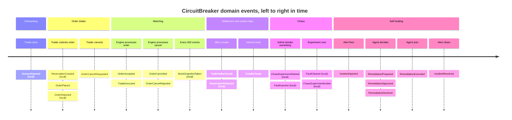
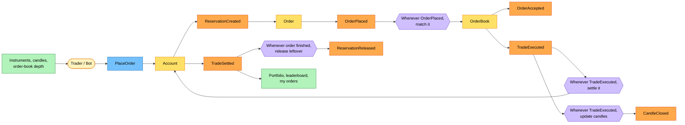
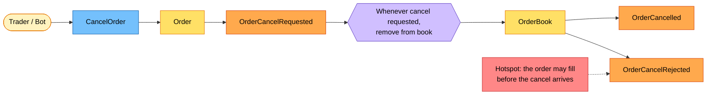
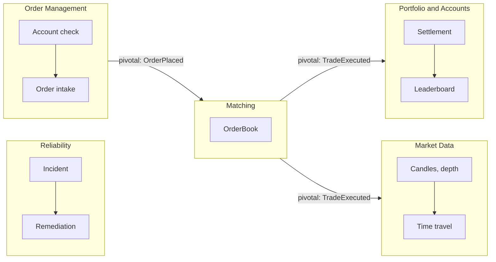

# 01 — Event Storming

> **What is Event Storming?** A workshop technique invented by Alberto Brandolini. The team puts coloured sticky
> notes on a long wall (or a digital board):
>
> 1. **Big picture:** everyone writes the *domain events* — things that happen, in past tense — and places them on
>    a timeline from left to right.
> 2. **Process level:** for each event, ask "what caused it?" (a **command**, issued by an **actor**, sometimes
>    triggered by a **policy**) and "what data does someone need to decide?" (a **read model**).
> 3. **Design level:** group commands and events around the thing that enforces the rules — the **aggregate**.
> 4. Clusters of aggregates that share one language become **bounded contexts**, which become candidate services.
>
> We ran it as a team on a digital whiteboard and transcribed the result here.

## Sticky-note legend

| Colour | Element | Meaning | Example |
|---|---|---|---|
| 🟧 Orange | **Domain event** | Something that happened (past tense) | `TradeExecuted` |
| 🟦 Blue | **Command** | Intention to do something; may be rejected | `PlaceOrder` |
| 🟨 Small yellow | **Actor** | Who issues the command | Trader |
| 🟨 Large yellow | **Aggregate** | The thing that checks rules and emits events | `OrderBook` |
| 🟪 Lilac | **Policy** | "Whenever *event*, then *command*" | "Whenever a trade executes, settle it" |
| 🟩 Green | **Read model** | Data an actor looks at before deciding | Order-book depth |
| 🩷 Pink | **External system** | Outside our control | Prometheus, Kubernetes, OpenRouter (LLM) |
| 🟥 Red | **Hotspot** | Question, conflict or risk to resolve | "Can a cancel race a fill?" |

## Step 1 — Big picture: all domain events on a timeline

**Integration events** (published on Redpanda, other services rely on them) are in **bold**; *local events* (kept
inside the owning service's store only) are in italics. The difference is explained in the
[event catalog](../03-architecture/03-event-catalog.md#integration-events-vs-local-events).

Integration events in this timeline: **OrderPlaced, OrderCancelRequested, OrderAccepted, TradeExecuted,
OrderCancelled, OrderCancelRejected, CandleClosed, IncidentOpened, RemediationProposed, RemediationApproved,
RemediationDeclined, RemediationExecuted, IncidentResolved** (13 in total).

## Step 2 — Process level: commands, actors, policies, read models

### Trading flow

### Cancel flow

### Self-healing flow

```mermaid
flowchart LR
    classDef event fill:#ffa94d,stroke:#d9480f,color:#000
    classDef command fill:#74c0fc,stroke:#1864ab,color:#000
    classDef actor fill:#fff3bf,stroke:#e67700,color:#000
    classDef aggregate fill:#ffe066,stroke:#e67700,color:#000
    classDef policy fill:#d0bfff,stroke:#5f3dc4,color:#000
    classDef external fill:#fcc2d7,stroke:#a61e4d,color:#000
    classDef readmodel fill:#b2f2bb,stroke:#2b8a3e,color:#000

    AD([Admin]):::actor --> C0[StartChaosExperiment]:::command --> AG0[ChaosExperiment]:::aggregate --> E0[ChaosExperimentStarted]:::event
    PR[(Prometheus alert)]:::external --> P1{{Whenever an alert fires,<br/>open incident}}:::policy --> C1[OpenIncident]:::command
    C1 --> AG1[Incident]:::aggregate --> E1[IncidentOpened]:::event
    E1 --> P2{{Whenever incident opened,<br/>diagnose with evidence}}:::policy --> CL[(LLM via OpenRouter)]:::external
    CL --> E2[RemediationProposed]:::event
    E2 --> P3{{If approval is off,<br/>execute at once}}:::policy --> C2[ExecuteRemediation]:::command
    AD --> C3[DecideRemediation]:::command --> E3[RemediationApproved]:::event --> C2
    C2 --> K8[(Kubernetes API)]:::external
    C2 --> E4[RemediationExecuted]:::event
    E4 --> P4{{Whenever alert clears,<br/>resolve incident}}:::policy --> E5[IncidentResolved]:::event
    E5 --> RM[Incident feed]:::readmodel
    E5 --> P5{{Whenever incident resolved,<br/>end experiment}}:::policy --> AG0
```

### All policies found

| # | Policy ("whenever … then …") | Lives in |
|---|---|---|
| P-01 | Whenever `OrderPlaced`, match the order | `matching-engine` |
| P-02 | Whenever `OrderCancelRequested`, remove the remainder from the book (or reject if already filled) | `matching-engine` |
| P-03 | Whenever 500 events have been appended for a ticker, take a snapshot | `matching-engine` |
| P-04 | Whenever `OrderAccepted` / `TradeExecuted` / `OrderCancelled` / `OrderCancelRejected`, update the order's status | `order-service` |
| P-05 | Whenever `TradeExecuted`, settle cash and shares for buyer and seller | `portfolio-service` |
| P-06 | Whenever an order is finished (filled or `OrderCancelled`), release its leftover reservation | `portfolio-service` |
| P-07 | Whenever `TradeExecuted`, update last price, candles, trades; whenever book events arrive, update depth | `market-data-service` |
| P-08 | Whenever a candle interval (5s, 1m, 5m) ends, publish `CandleClosed` | `market-data-service` |
| P-09 | Whenever `CandleClosed`, let each bot re-evaluate its strategy | `bot-traders` |
| P-10 | Whenever a Prometheus alert is firing and no incident is open for it, open an incident | `sre-agent` |
| P-11 | Whenever a remediation is proposed and approval mode is off, execute it | `sre-agent` |
| P-12 | Whenever the alert stays resolved for 60 s after a remediation, resolve the incident | `sre-agent` |
| P-13 | Whenever `IncidentResolved` arrives while an experiment is running, mark it `REMEDIATED` | `chaos-service` |

### Hotspots and how we resolved them

| 🟥 Hotspot | Resolution |
|---|---|
| Where do we check the trader has enough cash or shares? | Reserve synchronously in portfolio-service before publishing `OrderPlaced` ([ADR-0011](../adr/0011-synchronous-reservation-over-saga.md)). |
| How much cash does a MARKET buy reserve when the price is unknown? | Protection price = last price + 10%; the engine will not fill above it. |
| A cancel can race with a fill. | Async cancel; engine emits `OrderCancelRejected` with reason `ALREADY_FILLED`. Same-ticker messages are ordered by partition key. |
| Engine crashes between saving and publishing events. | Store first, publish second, re-publish unpublished events on restart; all consumers idempotent. |
| Should the agent read chaos-service's log? | No — it would be cheating. The agent only sees metrics, logs and deploy history. |
| Who owns the list of tickers? | Static reference data in deployment config (Helm values), served for the UI by market-data-service. Not a database. |
| Floating-point money. | Integer paise everywhere ([ADR-0012](../adr/0012-prices-in-integer-paise.md)). |

## Step 3 — Aggregates

| Aggregate | Invariants it protects (rules that must always hold) | Emits |
|---|---|---|
| **Account** | Available cash ≥ 0; available shares ≥ 0 per ticker; reserved + available = total | `AccountOpened`, `ReservationCreated`, `TradeSettled`, `ReservationReleased` |
| **Order** | Status only moves forward (`PENDING → OPEN → PARTIALLY_FILLED → FILLED`, or `→ CANCELLED`); only the owner can cancel | `OrderPlaced`, `OrderRejected`, `OrderCancelRequested` |
| **OrderBook** (one per ticker) | Bids sorted high→low, asks low→high, FIFO within a price; best bid < best ask after every command; sequence numbers strictly increase | `OrderAccepted`, `TradeExecuted`, `OrderCancelled`, `OrderCancelRejected`, `BookSnapshotTaken` |
| **CandleSeries** (per ticker and interval) | One candle per time bucket; high ≥ open, close ≥ low | `CandleClosed` |
| **Incident** | At most one open incident per alert; at most 3 executed remediations per incident; cooldown respected | `IncidentOpened`, `Remediation*`, `IncidentResolved` |
| **ChaosExperiment** | Only one running experiment at a time; every fault is reversible | `ChaosExperimentStarted`, `FaultInjected`, `FaultCleared`, `ChaosExperimentEnded` |

## Step 4 — How the boundaries emerged

We looked for **pivotal events** — events where the "owner" of the story changes hands — and for places where the
**same word meant different things**.

1. **Pivotal events split the timeline.** `OrderPlaced` marks the hand-over from *taking an order* (validation,
   money) to *matching it* (fairness, priority). `TradeExecuted` marks the hand-over from *matching* to
   *consequences* (settlement, charts). Each segment became a bounded context.
2. **Language changed meaning across the wall.**
   - *Order*: in Order Management it's a customer request with a **status** the trader tracks; in Matching it's a
     **book entry** with a price level and a time priority. Different models → different contexts.
   - *Price*: in Matching it's an exact limit in paise; in Market Data it's an OHLC candle; in Portfolio it's a
     valuation (last price × quantity).
   - *Position* only exists in Portfolio.
3. **Different actors and rhythms.** The Admin and the SRE Agent work only in the chaos/self-healing part of the
   wall, which never touches trading rules. That became the Reliability and Chaos contexts.
4. **Different "physics".** The OrderBook must process one ticker's commands strictly one at a time (it cannot be
   scaled out casually); order intake is stateless and can be scaled freely. Separating them lets each scale
   differently. Full reasoning: [03-service-sizing.md](03-service-sizing.md).

The resulting contexts and their relationships are in [02-bounded-contexts.md](02-bounded-contexts.md).

## Viva Notes

**Q: What is a pivotal event and why does it matter?**
A: A domain event after which a different part of the business takes over (e.g. `TradeExecuted` hands over from
matching to settlement). Pivotal events are natural places to draw bounded-context boundaries.

**Q: What is the difference between a command and an event?**
A: A command is an intention that can be refused (`PlaceOrder`); an event is a fact that already happened
(`OrderPlaced`) and cannot be refused, only reacted to. Commands are imperative, events are past tense.

**Q: What is an aggregate? Give one example.**
A: A cluster of data treated as one unit for changes, which protects invariants. `OrderBook` is one: every command
for a ticker goes through it, and it guarantees bids and asks never cross after a command.

**Q: What is a policy?**
A: An automatic reaction: "whenever event X, do command Y". Example: whenever `TradeExecuted`, settle the trade.
Policies are where services collaborate asynchronously.

**Q: Why are some events "local"?**
A: Only events that other services need become integration events (a public contract). Events like
`ReservationCreated` are internal details; keeping them private lets the owning team change them freely.
