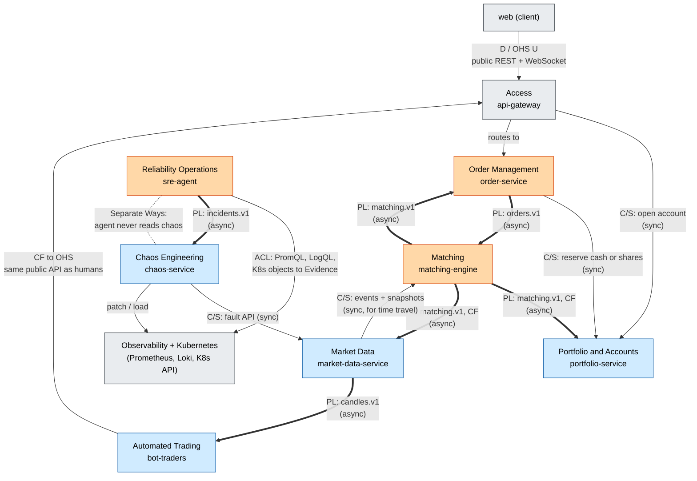

# 02 — Bounded Contexts and Context Map

> **Bounded context** (DDD): a boundary inside which every term has exactly one meaning and one model.
> Across a boundary the same word may mean something else (see "Order" below), so contexts talk through
> explicit, translated contracts — events and APIs — never by sharing tables.
>
> **Subdomain types** (DDD): **core** = what makes the product special, build it carefully in-house;
> **supporting** = needed and specific to us, but not the differentiator; **generic** = solved problem, buy or
> use off-the-shelf.

## The contexts

| # | Bounded context | Subdomain type | Implemented by | Key terms (ubiquitous language) |
|---|---|---|---|---|
| 1 | **Access** | Generic | `api-gateway` | session, nickname, role (`trader`, `bot`, `admin`), access token |
| 2 | **Order Management** | Core | `order-service` | order, order status, cancel request, rejection reason |
| 3 | **Matching** | Core (complicated) | `matching-engine` | order book, bid, ask, price level, time priority, sequence, trade, aggressor, snapshot |
| 4 | **Portfolio and Accounts** | Supporting | `portfolio-service` | account, cash, holding, reservation, settlement, net worth, leaderboard |
| 5 | **Market Data** | Supporting | `market-data-service` | instrument, last price, candle (OHLCV), depth, time travel, replay frame |
| 6 | **Automated Trading** | Supporting | `bot-traders` | bot, strategy, signal, quote, inventory |
| 7 | **Reliability Operations** | Core (for this project's story) | `sre-agent` | incident, evidence, diagnosis, remediation, guardrail, cooldown, approval |
| 8 | **Chaos Engineering** | Supporting | `chaos-service` | scenario, experiment, fault, blast radius, time to recover |
| — | *Observability* | Generic | Prometheus, Grafana, Loki (off-the-shelf) | metric, alert, log line |
| — | *Presentation* | — | `web` | Not a context: a client of the contexts' public APIs |

### Why Reliability Operations is "core"

In a real exchange, operations would be supporting. **For this project** the self-healing agent is the main thing
that makes CircuitBreaker different from any other trading demo, so we treat it as core: designed carefully,
tested heavily, owned explicitly.

## Same word, different meaning

| Word | Order Management | Matching | Portfolio and Accounts | Market Data |
|---|---|---|---|---|
| **Order** | A trader's request with a lifecycle status the trader tracks | An entry in a price level with a time priority | Only a reference on a reservation | A contributor to depth at a price |
| **Price** | Requested limit price (validated) | Exact matching price in paise | Valuation price (last price) | Candle open/high/low/close |
| **Trade** | Something that changes my order's filled quantity | The result of a match, with a sequence number | Something to settle: cash ↔ shares | A point on the chart, part of a candle |
| **Trader** | Owner of orders (`trader_id`) | Anonymous (only IDs needed for the trade record) | An account holder with a nickname | Not relevant |

This table is the strongest evidence that the contexts are real: forcing one shared `Order` model would make every
team negotiate every change — exactly the **coordination cost** microservices are meant to remove.

## Context map

> **Context map**: shows which contexts depend on which, and the *relationship pattern* between them.
> **U** = upstream (the one others depend on), **D** = downstream (the one that depends).
>
> Patterns used:
> - **Customer/Supplier (C/S):** the downstream team's needs are taken into account by the upstream team.
> - **Open Host Service (OHS):** the upstream offers a well-defined, documented API for many consumers.
> - **Published Language (PL):** a shared, documented message format — our [event catalog](../03-architecture/03-event-catalog.md) JSON schemas.
> - **Conformist (CF):** the downstream simply adopts the upstream's model as-is.
> - **Anti-Corruption Layer (ACL):** the downstream translates the upstream's model into its own, so outside
>   concepts don't leak in.
> - **Separate Ways:** deliberately no integration.

Thick arrows (`==>`) are asynchronous events; thin arrows are synchronous HTTP calls. Arrow direction = who
calls / who receives the event.

### Relationship details

| Downstream ← Upstream | Pattern | Why this pattern |
|---|---|---|
| Order Management ← Portfolio (reservations) | Customer/Supplier, sync | Order Management is the only customer of the reservation API; both teams agree its shape. |
| Matching ← Order Management (`orders.v1`) | Published Language | Matching must react to orders in strict order; the event schema is the contract. |
| Order Mgmt, Portfolio, Market Data ← Matching (`matching.v1`) | Published Language + Conformist | Matching is the source of truth for what happened in the market; consumers accept its facts as-is. |
| Market Data ← Matching (events/snapshots API) | Customer/Supplier, sync | Time travel needs raw events and snapshots; Matching exposes an internal read API rather than its database. |
| Automated Trading ← Access | Conformist to Open Host Service | Bots use the public API exactly as published — no special endpoints. |
| Reliability ← Observability/Kubernetes | Anti-Corruption Layer | The agent's prompt uses *our* words (`Evidence`, `Deployment revision`), not raw PromQL results or Kubernetes JSON. If we swapped Prometheus for something else, only the ACL changes. |
| Chaos ← Reliability (`incidents.v1`) | Conformist | Chaos only needs to know when an incident resolved, to measure time to recover. |
| Reliability ↔ Chaos | **Separate Ways** (one direction) | The agent must not learn what chaos was injected; this is a deliberate *non*-relationship. |

## Viva Notes

**Q: What is a bounded context, in one sentence?**
A: A boundary within which a model and its vocabulary have one consistent meaning; outside it, the same words may
mean something else.

**Q: How did you decide Matching and Order Management are different contexts?**
A: Language and rules differ — an "order" is a tracked request in one and a prioritised book entry in the other —
and the pivotal event `OrderPlaced` separates them. They also scale differently (stateless vs. single-writer).

**Q: What is an Anti-Corruption Layer and where do you use one?**
A: A translation layer protecting our model from an external model. The SRE agent converts Prometheus, Loki and
Kubernetes data into its own `Evidence` object before the LLM sees it.

**Q: Why is there a "Separate Ways" relationship?**
A: Between the agent and chaos-service, on purpose: the agent must diagnose from signals, not by reading what
chaos did.

**Q: Is one bounded context always one microservice?**
A: Not necessarily — a context can be several services. In our case each context maps to one service because each
is small enough for one team to own (see the sizing document).
