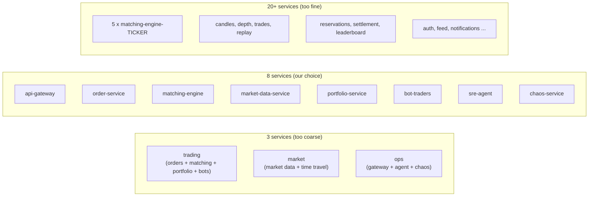

# 03 — Service Sizing: Why 8 Services, Not 3 or 20

> **The question:** how big should a microservice be? Too big and teams step on each other (high coordination,
> slow releases). Too small and every feature needs changes in many services (a *distributed monolith*), and
> operating them costs more than the benefit.

## 1. The Universal Sizing Formula

> ⚠️ VERIFY AGAINST TEXTBOOK — the wording below is our best understanding of the Universal Sizing Formula
> in *Microservices: Up and Running* (Mitra & Nadareishvili). Replace it with the textbook's exact wording
> before the viva.

Our understanding of the formula has three parts:

1. **Start with a few, coarser services**, usually one per **bounded context**, rather than guessing many tiny
   ones up front.
2. **Keep splitting when you need to**, to remove **coordination**: if two parts of a service need different
   teams, different release rhythms or different scaling, keeping them together forces people to coordinate, so
   split them.
3. **Stop splitting when a split would *add* coordination**: if two pieces would always have to change and
   deploy together, they belong in one service. Independent deployability is the test.

The underlying goal (which the textbook stresses throughout) is to **minimise coordination between teams** while
keeping each service **independently deployable** and **owning its own data**.
⚠️ VERIFY AGAINST TEXTBOOK — confirm the textbook's phrasing of this goal.

## 2. Heuristics we used to apply the formula

For every candidate split we asked six yes/no questions. The more "yes" answers, the stronger the case for a
separate service.

| # | Heuristic | Question |
|---|---|---|
| H1 | **Own data** | Does it own data that nobody else should write? |
| H2 | **Different scaling** | Does it need to scale (or *not* scale) differently from its neighbour? |
| H3 | **Different change rate** | Will it change at a different speed or for different reasons? |
| H4 | **Different team** | Is it owned by a different team (see [team topology](../04-team-topology.md))? |
| H5 | **Failure isolation** | Should its failure *not* take down its neighbour (and is it a chaos target)? |
| H6 | **No lock-step** | Can it be deployed without deploying its neighbour at the same time? |

## 3. Applying it: from bounded contexts to services

Step 1 of the formula gave us 8 bounded contexts ([02-bounded-contexts.md](02-bounded-contexts.md)). We then tested
the most tempting **merges** (would fewer services be better?) and **splits** (would more be better?).

### Merges we considered and rejected

| Candidate merge | H1 | H2 | H3 | H4 | H5 | H6 | Verdict |
|---|---|---|---|---|---|---|---|
| `order-service` + `matching-engine` | ✅ | ✅ | ✅ | ❌ | ✅ | ✅ | **Keep separate.** Order intake is stateless and scales to 5 replicas in the traffic-spike scenario; the matching engine is a single writer per ticker and must *not* be scaled casually. Merging would force the whole thing to be single-instance, or make the engine unsafe. |
| `portfolio-service` + `market-data-service` | ✅ | ✅ | ✅ | ❌ | ✅ | ✅ | **Keep separate.** Different stores (Postgres transactions vs. Cassandra time series), different load (portfolio: per-trader reads; market data: fan-out streaming to every phone), and the memory-leak scenario must hit market data without taking portfolios down. |
| `chaos-service` + `sre-agent` | ✅ | ❌ | ✅ | ✅ | ✅ | ✅ | **Keep separate.** If they lived together the agent could "know" the chaos — the experiment would be meaningless. Separate Ways is a design requirement. |
| `bot-traders` into `order-service` | ✅ | ✅ | ✅ | ❌ | ✅ | ✅ | **Keep separate.** Bots are *clients*. In the same process, a bot bug could crash order intake, and bots would bypass the public API. |
| `api-gateway` into each service | — | ✅ | ✅ | ✅ | ✅ | ✅ | **Keep separate.** One place for auth, rate limiting and `/internal/` blocking; otherwise every team re-implements security. |

### Splits we considered and rejected

| Candidate split | Why rejected |
|---|---|
| One matching engine **per ticker** (5 services) | Same code, same team, same data model, deployed in lock-step (fails H3, H4, H6). We get per-ticker isolation more cheaply with per-ticker partitions and per-ticker in-memory books inside one service. |
| Separate **candle**, **order-book depth** and **time-travel** services | All consume the same events, share the "market view" language and are owned by one team. Splitting adds three deployments and duplicated consumers with no independence gain (fails H3, H4, H6). |
| Separate **reservation** service | Reservations and settlement update the same account balances in one SQL transaction. Splitting would require a distributed transaction (fails H1, H6). |
| Separate **leaderboard** service | It's a single query over portfolio data (fails H1). |
| One service **per bot** (20 services) | Bots are identical code with different parameters. 20 deployments would add operational cost and nothing else. |
| Separate **incident feed** / notification service | The feed is just the incident read model streamed out; only `sre-agent` writes it (fails H1). |
| Separate **identity/auth** service | No passwords or user profiles; a nickname plus a signed JWT is a few lines in the gateway. Revisit if real auth is ever added. |

## 4. The two extremes compared

| Criterion | 3 services | **8 services** | 20+ services |
|---|---|---|---|
| Can scale order intake without scaling the engine? | ❌ | ✅ | ✅ |
| Agent and chaos truly independent? | ❌ (same process) | ✅ | ✅ |
| Each service owned by exactly one of our 3 teams? | ✅ | ✅ | ❌ (each team owns ~7) |
| Typical feature touches how many services? | 1 | 1–2 | 3–5 |
| Lock-step deploys needed? | Many inside each service | None | Many (per-ticker engines, split read models) |
| Chaos targets isolated (one failure doesn't take down others)? | ❌ | ✅ | ✅ |
| Operational cost for a 3-person team | Low | Moderate | Very high |
| Demonstrates microservices syllabus | Weakly | ✅ | ✅ but unmanageable |

**Conclusion:** 8 is where every remaining split *adds* coordination and every remaining merge *re-introduces*
coordination or a scaling conflict — the stopping point that the sizing formula asks for.

## 5. When we would re-size

| Trigger | Likely change |
|---|---|
| Real authentication (passwords, OAuth) is added | Extract an `identity-service` from `api-gateway` |
| Market data streaming dominates resource usage | Split live streaming from time-travel replay |
| A 4th team joins | Re-check H4 for every service; give the new team a whole service, not half of one |
| Hundreds of tickers | Shard the matching engine by ticker range (still one codebase, more replicas each owning partitions) |

## Viva Notes

**Q: What is the Universal Sizing Formula?**
A: (Check the textbook's exact wording.) In short: start with a few services aligned to bounded contexts, split
further only when it reduces coordination, and stop when a split would make services change and deploy together.

**Q: Why not merge order-service and matching-engine — they are so closely related?**
A: Different scaling physics. Order intake is stateless and we scale it to 5 replicas during a traffic spike;
the matching engine must be a single writer per ticker to keep price-time priority correct. Merged, we could not
scale one without breaking the other.

**Q: Why not one matching engine per ticker?**
A: They'd be identical code always deployed together by one team — a split with no independence gain. We get
per-ticker isolation from partitions and per-ticker books inside one service.

**Q: How do you know you haven't built a distributed monolith?**
A: Test H6: every service can be deployed alone; contracts are versioned events and APIs; no shared database;
and a typical feature touches one or two services, owned by one team.

**Q: What would make you change the number of services?**
A: A new team, real authentication, or very different load on one part — any change that makes a service need
two teams or two scaling profiles.
