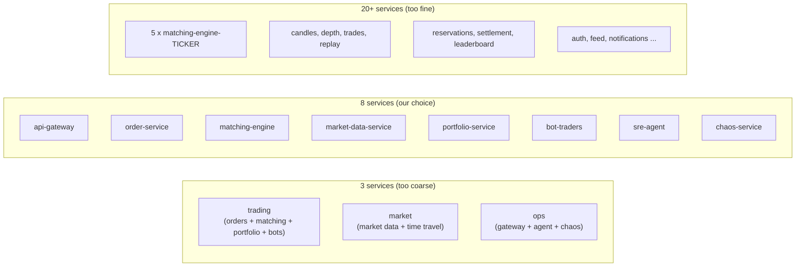

# 03 — Service Sizing: Why 8 Services, Not 3 or 20

> **The question:** how big should a microservice be? Too big and teams step on each other (high coordination,
> slow releases). Too small and every feature needs changes in many services (a *distributed monolith*), and
> operating them costs more than the benefit.

## 1. The Universal Sizing Formula

> **Source:** Mitra & Nadareishvili, *Microservices: Up and Running*, Ch. 4 ("Introducing the Universal Sizing
> Formula"). Paraphrased below.

**The goal behind it.** The textbook states the primary goal of a microservices architecture: to **minimise
coordination costs** in a complex, multi-team environment, so that teams can balance **speed and safety at scale**
(Ch. 4, restating Ch. 1). Services should therefore be cut so that the teams working on different services need to
coordinate as little as possible. Boundaries drawn by size (lines of code) or by technical function (one serverless
function = one service) don't reliably reduce coordination. The book calls boundaries based on technical needs an
anti-pattern; services should be organised around business capabilities (Ch. 4).

**The formula: three principles that work together** (Ch. 4):

1. **Start with just a few microservices**, possibly one per **bounded context**.
2. **Keep splitting as the application and services grow**, guided by the need to **avoid coordination**.
3. **Be on the right trajectory for decreasing coordination.** That direction matters far more than how "perfectly"
   the services are sized today.

**Two points the book adds** (Ch. 4):

- **Microservice boundaries are not the same as bounded contexts.** Bounded contexts are a great *starting point*.
  Service boundaries evolve, usually towards *more* granularity as the organisation and system mature. Nobody gets
  them perfect at the outset.
- **Splitting is easier than merging.** It is typically easier to split a service than to merge several back
  together or to move a capability between services. So start coarse-grained and split once you know the domain
  better. The book also warns against creating too many microservices too early.

### Why CircuitBreaker starts at 8

- **Principle 1 gives us the starting point.** Event storming found 8 bounded contexts
  ([02-bounded-contexts.md](02-bounded-contexts.md)), and we start with **one service per context**. That is the
  coarsest cut that still separates things which would otherwise force coordination: different owners, different
  scaling rules (single-writer matching vs. stateless order intake), and the agent/chaos separation. The merges
  rejected in §3 are exactly those conflicts.
- **We deliberately did not split further.** Every tempting split *below* the context level (per-ticker engines;
  separate candle, depth and time-travel services; a reservation service) was rejected in §3. Each would add services
  without removing any coordination. That follows the book's warning about too many services too early, and its
  advice that splitting later is easier than merging.
- **Principle 3 is why §5 exists.** We don't claim 8 is perfect. We name the triggers (a new team, real
  authentication, very different load) that would justify the next split, so the trajectory keeps reducing
  coordination as the system grows.

The rest of this document is how we applied the formula: six yes/no heuristics (§2), the merges and splits we tested
(§3), the extremes compared (§4) and the re-sizing triggers (§5). The heuristics are our own checklist, not the
textbook's.

## 2. Heuristics we used to apply the formula

For every candidate split we asked six yes/no questions. The more "yes" answers, the stronger the case for a
separate service.

| # | Heuristic | Question |
|---|---|---|
| H1 | **Own data** | Does it own data that nobody else should write? |
| H2 | **Different scaling** | Does it need to scale (or *not* scale) differently from its neighbour? |
| H3 | **Different change rate** | Will it change at a different speed or for different reasons? |
| H4 | **Different team** | Is it owned by a different team (see [team topology](../04-team-topology.md))? |
| H5 | **Failure isolation** | Should its failure *not* take down its neighbour (and is it a chaos target)? |
| H6 | **No lock-step** | Can it be deployed without deploying its neighbour at the same time? |

## 3. Applying it: from bounded contexts to services

Step 1 of the formula gave us 8 bounded contexts ([02-bounded-contexts.md](02-bounded-contexts.md)). We then tested
the most tempting **merges** (would fewer services be better?) and **splits** (would more be better?).

### Merges we considered and rejected

| Candidate merge | H1 | H2 | H3 | H4 | H5 | H6 | Verdict |
|---|---|---|---|---|---|---|---|
| `order-service` + `matching-engine` | ✅ | ✅ | ✅ | ❌ | ✅ | ✅ | **Keep separate.** Order intake is stateless and scales to 5 replicas in the traffic-spike scenario; the matching engine is a single writer per ticker and must *not* be scaled casually. Merging would force the whole thing to be single-instance, or make the engine unsafe. |
| `portfolio-service` + `market-data-service` | ✅ | ✅ | ✅ | ❌ | ✅ | ✅ | **Keep separate.** Different stores (Postgres transactions vs. Cassandra time series), different load (portfolio: per-trader reads; market data: fan-out streaming to every phone), and the memory-leak scenario must hit market data without taking portfolios down. |
| `chaos-service` + `sre-agent` | ✅ | ❌ | ✅ | ✅ | ✅ | ✅ | **Keep separate.** If they lived together the agent could "know" the chaos — the experiment would be meaningless. Separate Ways is a design requirement. |
| `bot-traders` into `order-service` | ✅ | ✅ | ✅ | ❌ | ✅ | ✅ | **Keep separate.** Bots are *clients*. In the same process, a bot bug could crash order intake, and bots would bypass the public API. |
| `api-gateway` into each service | — | ✅ | ✅ | ✅ | ✅ | ✅ | **Keep separate.** One place for auth, rate limiting and `/internal/` blocking; otherwise every team re-implements security. |

### Splits we considered and rejected

| Candidate split | Why rejected |
|---|---|
| One matching engine **per ticker** (5 services) | Same code, same team, same data model, deployed in lock-step (fails H3, H4, H6). We get per-ticker isolation more cheaply with per-ticker partitions and per-ticker in-memory books inside one service. |
| Separate **candle**, **order-book depth** and **time-travel** services | All consume the same events, share the "market view" language and are owned by one team. Splitting adds three deployments and duplicated consumers with no independence gain (fails H3, H4, H6). |
| Separate **reservation** service | Reservations and settlement update the same account balances in one SQL transaction. Splitting would require a distributed transaction (fails H1, H6). |
| Separate **leaderboard** service | It's a single query over portfolio data (fails H1). |
| One service **per bot** (20 services) | Bots are identical code with different parameters. 20 deployments would add operational cost and nothing else. |
| Separate **incident feed** / notification service | The feed is just the incident read model streamed out; only `sre-agent` writes it (fails H1). |
| Separate **identity/auth** service | No passwords or user profiles; a nickname plus a signed JWT is a few lines in the gateway. Revisit if real auth is ever added. |

## 4. The two extremes compared

| Criterion | 3 services | **8 services** | 20+ services |
|---|---|---|---|
| Can scale order intake without scaling the engine? | ❌ | ✅ | ✅ |
| Agent and chaos truly independent? | ❌ (same process) | ✅ | ✅ |
| Each service owned by exactly one of our 3 teams? | ✅ | ✅ | ❌ (each team owns ~7) |
| Typical feature touches how many services? | 1 | 1–2 | 3–5 |
| Lock-step deploys needed? | Many inside each service | None | Many (per-ticker engines, split read models) |
| Chaos targets isolated (one failure doesn't take down others)? | ❌ | ✅ | ✅ |
| Operational cost for a 3-person team | Low | Moderate | Very high |
| Demonstrates microservices syllabus | Weakly | ✅ | ✅ but unmanageable |

**Conclusion:** 8 is the right *starting* size. Every merge would re-introduce coordination or a scaling conflict,
and every further split would add services without removing coordination *today*. Following the formula, it is a
starting point on a trajectory, not a final answer (see §5).

## 5. When we would re-size

| Trigger | Likely change |
|---|---|
| Real authentication (passwords, OAuth) is added | Extract an `identity-service` from `api-gateway` |
| Market data streaming dominates resource usage | Split live streaming from time-travel replay |
| A 4th team joins | Re-check H4 for every service; give the new team a whole service, not half of one |
| Hundreds of tickers | Shard the matching engine by ticker range (still one codebase, more replicas each owning partitions) |

## Viva Notes

**Q: What is the Universal Sizing Formula?**
A: Three principles from Ch. 4 of the textbook: start with just a few microservices, possibly one per bounded
context; keep splitting as the system grows, guided by avoiding coordination; and stay on a trajectory of decreasing
coordination, which matters more than getting the size perfect now.

**Q: Is a microservice the same as a bounded context?**
A: No. The textbook says bounded contexts are a good starting point, but service boundaries evolve, usually towards
finer granularity. We started with one service per context and listed the triggers for future splits.

**Q: Why not merge order-service and matching-engine — they are so closely related?**
A: Different scaling physics. Order intake is stateless and we scale it to 5 replicas during a traffic spike;
the matching engine must be a single writer per ticker to keep price-time priority correct. Merged, we could not
scale one without breaking the other.

**Q: How do you know you haven't built a distributed monolith?**
A: Test H6: every service can be deployed alone; contracts are versioned events and APIs; no shared database;
and a typical feature touches one or two services, owned by one team.

**Q: What would make you change the number of services?**
A: A new team, real authentication, or very different load on one part — any change that makes a service need
two teams or two scaling profiles.
