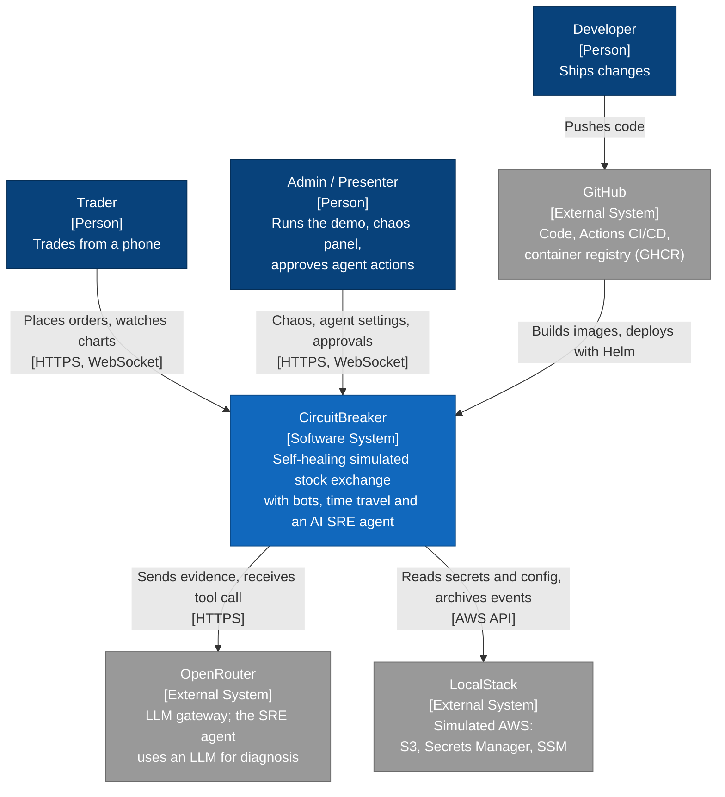
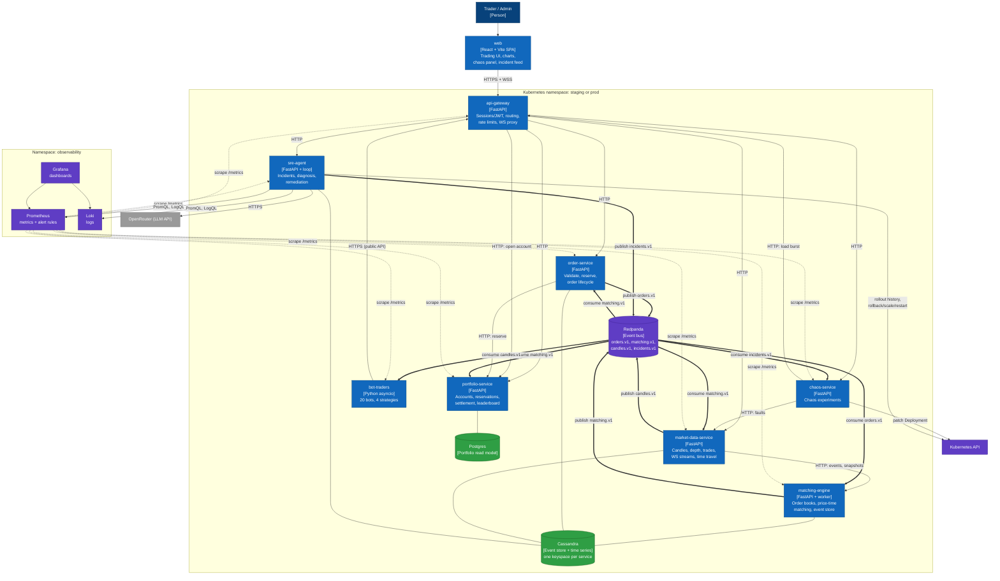

# 01 — System Architecture

> **C4 model:** a way to draw software architecture at four zoom levels — **C**ontext (the system and the people/
> systems around it), **C**ontainers (the deployable/runnable pieces), **C**omponents (inside one container),
> **C**ode. We show the first two here; component views belong to each service's README in later phases.
>
> In C4, a "container" means *anything that runs or stores data* (a service, a database, a browser app) — not
> specifically a Docker container, although here they mostly are.
>
> Diagrams are drawn with Mermaid flowcharts styled in C4 fashion (Mermaid's own C4 syntax is still experimental).

## 1. System context (C4 level 1)

Bot traders do not appear here because they are *inside* the system (the `bot-traders` service).

## 2. Containers (C4 level 2)

### Container inventory

| Container | Tech | Port (container / local dev) | Store | Replicas (default / max) |
|---|---|---|---|---|
| `web` | React + Vite + TradingView Lightweight Charts | 80 / 5173 | — | 1 / 3 |
| `api-gateway` | Python 3.12, FastAPI | 8000 / 8080 | none (stateless) | 2 / 5 |
| `order-service` | Python 3.12, FastAPI | 8000 / 8001 | Cassandra `order_service` | 2 / 5 |
| `matching-engine` | Python 3.12, FastAPI + Kafka consumer | 8000 / 8002 | Cassandra `matching_engine` | **1 / 1** (single writer) |
| `market-data-service` | Python 3.12, FastAPI | 8000 / 8003 | Cassandra `market_data` | 1 / 5 |
| `portfolio-service` | Python 3.12, FastAPI | 8000 / 8004 | Postgres `portfolio` | 2 / 5 |
| `bot-traders` | Python 3.12, asyncio (+ FastAPI for health/metrics only) | 8000 / 8005 | none | **1 / 1** (one copy of each bot) |
| `sre-agent` | Python 3.12, FastAPI + agent loop | 8000 / 8006 | Cassandra `sre_agent` | **1 / 1** (one decision-maker) |
| `chaos-service` | Python 3.12, FastAPI | 8000 / 8007 | in memory (+ logs) | **1 / 1** |
| Redpanda | Kafka-compatible broker | 9092 | its own log | 1 (dev) |
| Cassandra | Apache Cassandra 5 | 9042 | — | 1 (dev) |
| Postgres | PostgreSQL 16 | 5432 | — | 1 (dev) |

Every service listens on port **8000 inside its container**; local Docker Compose maps them to different host ports
(second number) so they can run side by side. **Max replicas** is the upper bound the SRE agent may scale to; `1/1`
means the agent may restart or roll back that service but never scale it.

## 3. Synchronous vs asynchronous communication

> **Synchronous (HTTP):** the caller waits for a reply. Simple and immediate, but couples availability — if the
> callee is down, the caller fails too.
> **Asynchronous (events on Redpanda):** the producer publishes and moves on; consumers process later. Decouples
> availability and lets many consumers react, but results are *eventually* consistent.

**Our rule of thumb:** use **sync** only when the caller *cannot continue without the answer right now*; use
**async** for everything that is a reaction to something that already happened.

| From → To | Type | Why this type |
|---|---|---|
| web → api-gateway | Sync (HTTP) + WebSocket | User is waiting; live data is pushed over WebSocket. |
| api-gateway → services | Sync (HTTP proxy) | Gateway is a pass-through. |
| api-gateway → portfolio-service (open account) | **Sync** | Trader cannot do anything without an account. |
| order-service → portfolio-service (reserve) | **Sync** | Must know *before* accepting the order whether money/shares exist ([ADR-0011](../adr/0011-synchronous-reservation-over-saga.md)). |
| market-data-service → matching-engine (events, snapshots) | **Sync** | Time travel answers a user request now; reads the owner's API, not its database. |
| chaos-service → market-data-service (faults) | **Sync** | Admin needs immediate confirmation the fault is on. |
| order-service → matching-engine | **Async** (`orders.v1`) | Matching must process in strict order per ticker; order-service shouldn't wait for matching. |
| matching-engine → order/portfolio/market-data | **Async** (`matching.v1`) | Three independent reactions to one fact; none should slow down matching. |
| market-data-service → bot-traders | **Async** (`candles.v1`) | Bots react to candles; market data must not care if bots are slow or down. |
| sre-agent → chaos-service | **Async** (`incidents.v1`) | Chaos records outcomes; the agent must not depend on (or know about) chaos. |

### Resilience rules for every synchronous call

| Rule | Value | Why |
|---|---|---|
| Timeout | 2 s default, 500 ms for reservations | Never wait forever; free up the caller. |
| Retries | Only for idempotent requests (GETs, or POSTs carrying an `Idempotency-Key`), max 2, exponential backoff with jitter | Retrying non-idempotent calls could reserve money twice. |
| **Circuit breaker** | On `order-service → portfolio-service`: open after 5 consecutive failures, half-open after 10 s | If portfolio is down, fail fast with `503 DEPENDENCY_UNAVAILABLE` instead of piling up waiting requests. This is the software pattern our project is named after. |
| Correlation | Propagate `X-Correlation-Id` header and put it in every event envelope | One ID joins logs across all services. |

## 4. Microservices vs APIs

> A common confusion: "we have an API, so we have microservices". They are different things.

| | API | Microservice |
|---|---|---|
| What it is | An **interface**: a contract describing how to interact | A **deployable unit** owning one capability and its data |
| Example here | `POST /v1/orders` (public API, served via `api-gateway`) | `order-service` (code + Cassandra keyspace + deployment) |
| Can exist without the other? | Yes — a monolith has APIs | Yes — `bot-traders` has no business API |
| Relationship | One microservice can expose several APIs (public, internal, events) | One public API can be served by several microservices (the gateway composes them) |

**In CircuitBreaker:** the *public API* the phone sees (all under `/v1/…` on the gateway) is deliberately **not**
the same shape as the service boundaries — the client doesn't need to know that orders and portfolio are separate
services. Internally, services expose *internal APIs* (`/internal/v1/…`) and *event contracts* (topics). We could
merge or split services behind the gateway without changing the public API — the API is a stable product; the
services are an implementation choice.

⚠️ VERIFY AGAINST TEXTBOOK — check how the textbook frames "microservices vs APIs" (for example, whether it
emphasises that API design comes first via SEED(S) and services are an implementation detail) and align wording.

## 5. Cross-cutting concerns

| Concern | Where it is handled |
|---|---|
| Authentication | `api-gateway` issues and verifies JWTs (HS256, 12 h expiry); downstream services trust `X-Trader-Id` and `X-Role` headers only from the gateway (enforced by Kubernetes network policies). |
| Authorisation | Gateway checks role per route (`admin` for chaos and agent routes); services check ownership (e.g. you can only cancel your own order). |
| Rate limiting | Gateway: 20 requests/s per trader, 50/s per bot token; returns `429 RATE_LIMITED`. |
| Logging | JSON logs to stdout with `service`, `level`, `correlation_id`, `trader_id` (if any); collected by Grafana Alloy into Loki. |
| Metrics | `GET /metrics` on every service (Prometheus format), standard names in [coding standards](../05-coding-standards.md). |
| Configuration | Environment variables (12-factor); secrets from Kubernetes Secrets populated from LocalStack Secrets Manager. |
| Reference data | The five instruments are defined once in Helm values (`global.instruments`) and injected into every service as config. |

## Viva Notes

**Q: What is the difference between the C4 context and container diagrams?**
A: Context shows the whole system as one box with its users and external systems. Container zooms in to show the
separately running parts — services, databases, broker — and how they communicate.

**Q: When do you use synchronous calls?**
A: Only when the caller cannot continue without the answer: opening an account, reserving funds, reading events for
time travel, and confirming a fault. Everything that reacts to something that already happened is asynchronous.

**Q: Where do you use the circuit breaker pattern and why?**
A: On order-service's call to portfolio-service. If portfolio is failing, after 5 failures we stop calling it for 10 s
and immediately return 503. This prevents threads piling up and gives portfolio time to recover.

**Q: Why can't the agent scale the matching engine?**
A: It is a single writer per ticker. Two replicas would both consume orders and produce conflicting trades and
sequence numbers. Its max replicas is 1, so the agent can only restart or roll it back.

**Q: What is the difference between an API and a microservice?**
A: An API is a contract; a microservice is a deployable unit with its own data. Our public API is stable and
client-shaped, while the services behind it can be split or merged without the phone noticing.
