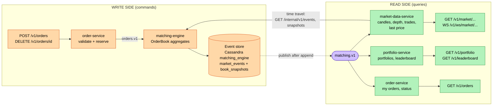

# 04 — Event Sourcing and CQRS

## 1. The two ideas in plain words

> **Event sourcing:** instead of storing *current state* ("CHAIWALA book has 30 @ ₹246.00") and overwriting it,
> store *every change* as an immutable event ("order accepted", "trade 20 @ ₹245.50", …). Current state is whatever
> you get by replaying the events in order. Like a bank statement: the balance is derived from the transactions.
>
> **CQRS (Command Query Responsibility Segregation):** use one model to *change* data (the write side) and separate
> models, shaped for each screen, to *read* data (the read side). The read models are built from the write side's
> events.

They are independent ideas that fit together well: the event stream from the write side is exactly what you need to
build read models.

## 2. Where we use them (and where we don't)

| Part | Event sourced? | Why |
|---|---|---|
| `matching-engine` (market) | ✅ **Yes — fully** | Time travel and replay need every change; a fair exchange needs a complete audit trail; the book is rebuilt from events after a crash ([ADR-0005](../adr/0005-event-sourcing-for-matching-engine.md)). |
| `order-service` | Partly — stores order events (`order_events`) plus current-state tables | Order history is useful, but queries are simple; the current-state tables answer queries directly. |
| `portfolio-service` | ❌ No — a CQRS **read model** in Postgres, built from `matching.v1` | Balances need transactions and constraints; they can always be re-derived from the market event store ([ADR-0006](../adr/0006-cqrs-portfolio-read-model.md)). |
| `market-data-service` | ❌ No — CQRS **read models** (candles, depth, trades) | Pure projections of market events. |
| `sre-agent` | Append-only timeline per incident | Natural audit log of agent decisions. |

**Why not event-source everything?** Event sourcing adds complexity (snapshots, versioning, replay tooling). We use it
where it pays for itself — the market — and use simpler models elsewhere.

## 3. The write side and the read side



`order-service` appears on both sides: it accepts commands (write) and also keeps an order-status projection from
`matching.v1` (read). That's fine — CQRS separates *models*, not necessarily *services*.

## 4. How the event store works

### Appending (inside matching-engine)

For each incoming command (`OrderPlaced`, `OrderCancelRequested` or `OrderExpiryRequested`) from `orders.v1`:

1. **Deduplicate:** if `command_id` (the incoming `event_id`) is in `processed_commands`, skip to step 5.
2. **Decide:** run the matching algorithm on the in-memory `OrderBook` for that ticker. This *produces* events
   (`OrderAccepted`, zero or more `TradeExecuted`, maybe `OrderCancelled`; or `OrderExpired`) — it does not mutate yet.
3. **Append:** write those events with consecutive `sequence` numbers to `market_events`, plus the `command_id` into
   `processed_commands`, as one Cassandra **logged batch** (all-or-nothing).
4. **Apply:** apply the events to the in-memory book (the *same* `apply(event)` function used during replay).
5. **Publish:** send any events after the `publish_cursor` to `matching.v1`, then advance the cursor.
6. **Commit** the Kafka offset of the command.

If the process crashes anywhere, restart = load latest snapshot + replay later events to rebuild books → publish
anything after the cursor → resume consuming from the last committed offset. Duplicates are possible, losses are not.

> **Decide vs apply.** "Decide" contains the business rules (matching) and can change between versions. "Apply"
> is dumb: "an `OrderAccepted` adds the order to the book; a `TradeExecuted` reduces both orders; remaining 0 removes
> it; an `OrderCancelled` removes it; an `OrderExpired` marks the ID as dead". Replay only ever calls *apply*. This is
> why history never changes even if we fix a bug in matching.

### Snapshots

Every **500 events per ticker**, the engine saves the whole book for that ticker into `book_snapshots` with its
`sequence` and time (local event `BookSnapshotTaken`). To rebuild a book at any point we load the nearest earlier
snapshot and apply at most ~500 events, instead of the whole day.

### Single writer per ticker

Price-time priority needs **one** decision-maker per ticker: two engines on the same book could both match the same
resting order. We guarantee this by running **one matching-engine replica** (its max replicas is 1) and keying
`orders.v1` by ticker. If we ever needed more throughput, the safe way is to give each replica *different
partitions* (and therefore different tickers) — never two replicas on one ticker.

### The outbox in order-service

order-service has the same "save + publish" problem: it appends `OrderPlaced` to `order_events` with
`published = false`, publishes to `orders.v1`, then sets `published = true`. A background **outbox relay** re-publishes
any rows still `false` after 5 seconds. Result: once the API returns `202`, the order *will* reach the engine,
possibly twice — and the engine deduplicates via `processed_commands`. One limit: the relay never publishes an
`OrderPlaced` older than **60 s**; it marks the order `REJECTED` (`PUBLISH_TIMEOUT`) instead, so the trader learns quickly
that the order did not get through ([ADR-0011](../adr/0011-synchronous-reservation-over-saga.md)). Its Kafka client drops a
message it could not deliver within 10 s, and the relay starts no `OrderPlaced` send after 50 s, so nothing lands after
60 s ([ADR-0017 note](../adr/0017-fail-closed-orphan-release.md#note-making-the-60-s-rule-true-phase-3)). The same outbox carries
`OrderCancelRequested` and `OrderExpiryRequested`; a cancel or expiry for an order is never published before that order's
`OrderPlaced`. Those two have **no time limit**: until the engine answers them, the trader's money stays reserved, so the
relay retries them however long Redpanda was away. It reads the outbox from a saved cursor (the oldest minute that may
still hold a row), not just the last few minutes, and a retried A-07 or A-19 sends the same request again
([ADR-0017 note](../adr/0017-fail-closed-orphan-release.md#note-no-time-limit-for-cancels-and-expiries-phase-4)).

**Orphaned reservations are released fail-closed** ([ADR-0017](../adr/0017-fail-closed-orphan-release.md)): after 120 s
without `OrderAccepted`, portfolio-service asks order-service to publish an `OrderExpiryRequested`. It lands in the same
partition as the order, so the engine answers only after any `OrderPlaced` already sent: it cancels a resting order
(`ORDER_EXPIRED`) or records an `OrderExpired` tombstone for one it never saw. Money is released only on that answer.

> **Outbox pattern:** write the outgoing message into your own database in the same step as your state change, and
> publish it from there. It avoids the "saved but not published" (or the reverse) problem without distributed
> transactions.

## 5. Time travel and replay

Sequence diagram: [01-seeds/03-sequence-diagrams.md §5](../01-seeds/03-sequence-diagrams.md#5-time-travel-and-replay-j-20--q-12-q-13-q-14-q-15).

> **Time travel:** showing the market exactly as it was at any past moment, rebuilt from the stored events.
> **Replay:** playing a stretch of the past forward at a chosen speed, event group by event group.
> **State hash:** a fingerprint of a whole order book (SHA-256 of a fixed text form of it). Two books with the same
> hash are identical, order by order; one changed order or quantity gives a completely different hash.

### Rebuilding the market at a moment T (Q-12)

`GET /v1/time-travel/{ticker}?at=T` is answered by market-data-service in five steps:

1. **The nearest snapshot at or before T** (matching-engine Q-15). The engine stores one every 500 events per ticker
   (policy P-03): the whole book, plus `closed`, every order it had finished or expired by then.
2. **The events after that snapshot, up to T** (Q-14, `after_sequence` = the snapshot's sequence, `until` = T).
3. **Apply them to a fresh book, never decide.** `OrderAccepted` adds an order, `TradeExecuted` reduces both orders,
   `OrderCancelled` removes what is left, `OrderExpired` records a tombstone. There is no matching code in
   market-data-service (`domain/replay_book.py`), so the past comes out exactly as it was recorded, even if the
   engine's rules change later.
4. **Candles and trades up to T** from market-data's own tables: the last 60 one-minute candles (the minute T falls in
   is recomputed from the trades before T, so it is not "from the future"), the latest 50 trades at or before T, and the
   last price (the newest trade at or before T, or the reference price before the first trade).
5. **The state hash** of the rebuilt book, in the canonical form of `api/matching-engine.yaml` (`BookState.state_hash`):
   the JSON object `{as_of, asks, bids, closed, sequence, ticker}` with sorted keys and no spaces, hashed with SHA-256.
   The live engine computes the same hash for its own book (Q-16).

### A worked example

CHAIWALA, rebuilt at T = 10:42:15. Shortened order and trader IDs, to keep it readable.

| Step | Sequence | Time | What it says | Book afterwards |
|---|---|---|---|---|
| Snapshot (Q-15) | 4000 | 10:41:50.120 | — | bid ₹245.00 × 30 (Raju, `o-1`); ask ₹246.00 × 20 (Meera, `o-2`) |
| Event | 4001 | 10:42:01.248 | `OrderAccepted` `o-3`: Asha buys 50 at ₹245.50 | bids ₹245.50 × 50, ₹245.00 × 30 |
| Event | 4002 | 10:42:01.263 | `OrderAccepted` `o-4`: bot-01 sells 20 at ₹245.50 | (it is matching) |
| Event | 4003 | 10:42:01.263 | `TradeExecuted` 20 at ₹245.50, `o-3` has 30 left, `o-4` has 0 | `o-4` FILLED; bid ₹245.50 × 30 |
| Event | 4004 | 10:42:09.870 | `OrderCancelled` `o-1` (30) | `o-1` CANCELLED; bid ₹245.50 × 30 only |
| Not applied | 4005 | 10:42:16.002 | after T | — |

The rebuilt book in canonical form (what is hashed):

```json
{"as_of":"2026-11-20T10:42:09.870Z","asks":[[24600,[["o-2","meera",20,3996]]]],"bids":[[24550,[["o-3","asha",30,4001]]]],"closed":[["o-1","CANCELLED","raju"],["o-4","FILLED","bot-01"]],"sequence":4004,"ticker":"CHAIWALA"}
```

Its SHA-256 is `6e0cb1787948f3c0f9312f73baf60adf70962160eb05f29030bc055461157ea5` (computed by market-data's own
`ReplayBook` from exactly these inputs; the snapshot alone hashes to `f4811f98…`). If the live engine's book at sequence
4004 had any difference, even one share or the order of two orders at a price, its hash would not match.

### Proving it is exact

- **At "now"** (T at or after market-data's latest event for the ticker): market-data first reads the live book from
  the engine (Q-16: sequence S and its hash), then rebuilds to **exactly** sequence S (`until_sequence`) and compares.
  The answer carries `verification {live_sequence, live_state_hash, matches}`, and the presenter's screen shows
  "Verified at sequence S: hashes match". Trading never has to stop: the rebuild stops at S, whatever the bots do next.
  A `T` up to 2 seconds ahead counts as now, because the browser's clock and the server's are never quite equal.
- **In the past:** a property test rebuilds at random moments of a random trading history and compares with the live
  book's hash at that moment; the end-to-end test records the live engine book at three moments while the bots trade
  and rebuilds each one later from snapshot plus events: same sequence, same hash.
- **Replays:** the `end` message carries the hash of the book at `to`, equal to Q-12's at `to`; and the frames carry
  every fill (`trades`), equal to the engine's `TradeExecuted` events in that window, in order (end-to-end test).

### Why snapshots make it fast

Without snapshots a seek near the end of an hour of bot trading would replay every event since the start, about 6,000
per ticker. With a snapshot every 500 events, a seek never applies more than about 500. Measured on the dev stack over a
full hour of bot trading (`scripts/time_travel_check.py`): 100 seeks to random moments, **p50 41 ms, p95 70 ms**, the
slowest 143 ms, never more than 498 events after a snapshot. The brief's target was under 2 seconds.

### Replay (Q-13)

`WS /v1/ws/replay/{ticker}?from=…&to=…&speed=…` rebuilds the book at `from` as above and sends it as the first frame.
Then it walks the events up to `to` and sends one `frame` per **command**: all events with the same `causation_id`
(an order's acceptance and its fills), so a viewer never sees half a match. Between frames it waits for the market
time that passed, divided by the speed (1, 2, 5, 10 or 60). The client can pause, resume and change speed. At the end
it sends `end` with the state hash at `to`. A replay window is at most 30 minutes; seeking (Q-12) has no such limit.

### Why replay can never affect live trading

1. **It only reads.** market-data-service asks the engine for snapshots, events and the live book with GET requests
   (Q-14, Q-15, Q-16). It never sends a command, never writes to `orders.v1`, and cannot reach the engine's keyspace.
2. **A private copy.** Every rebuild and every replay builds its own book in memory, for that one request. The live
   projection (candles, depth, trades) is a different object that a replay never touches.
3. **A different process.** Replays run in market-data-service. The single-writer engine only answers reads, which
   use their own worker thread.
4. **Bounded cost.** Each market-data replica plays at most 4 replays and runs at most 4 rebuilds at once, one of each
   kept for the presenter (role admin), so the demo is never refused. Beyond that: `503 OVERLOADED` or close `1013`. A
   disconnect ends a replay at once; one paused for over 5 minutes is closed.
5. **Measured.** The end-to-end test plays four replays at once while the bots trade: a fifth viewer is told to come
   back later, the presenter is not, every live book still verifies, and placing an order stays fast
   (95th percentile of placing an order: 24 ms without replays, 20 ms during four, on the dev laptop).

### Time travel is not a database backup

A **backup** is a copy of the whole state at the moments it was taken (say, nightly). Restoring one replaces the live
data and loses everything since. **Time travel** derives any moment, to the exact event, from the history the system
already keeps, reads it next to the live market without changing it, and proves its result with the hash. They answer
different questions: "what did the market look like at 10:42:15?" versus "how do we get our data back if the disk
dies?". Time travel does not replace backups: if the event store itself were lost, so would be the history it reads.

**Rebuilding a read model from scratch** (e.g. after a bug in candle calculation): drop the projection tables and
re-read the full history from matching-engine's events API — not from Redpanda, whose retention is only 7 days. How each
projection works, and how clients resync over WebSockets: [the read side](08-read-side.md).

## 6. Eventual consistency — what the user actually sees

Read models are updated *after* the write side, usually within tens of milliseconds. Consequences we design for:

| Situation | What happens | How the UI handles it |
|---|---|---|
| Order just placed | `POST` returns `202` with status `PENDING` | Shows "pending" spinner until the WebSocket brings `OPEN`/fill. |
| Trade just happened | Chart may update a few ms before the portfolio | Acceptable; both converge quickly. |
| Leaderboard | Recomputed every 2 s from Postgres | Labelled "updated every few seconds". |
| market-data-service is down (memory-leak scenario) | Charts freeze; trading and portfolios still work | UI shows "market data reconnecting"; after restart the service catches up from Redpanda offsets. |

## 7. Idempotency summary

| Consumer | Dedup key | Stored where |
|---|---|---|
| matching-engine | `command_id` (= incoming `event_id`) | `processed_commands` (same logged batch as the events) |
| order-service | `event_id` | `processed_events` |
| portfolio-service | `event_id` | `processed_events` (same SQL transaction as settlement) |
| market-data-service | `sequence` per ticker (ignore ≤ last applied) | in memory + `last_prices` |
| bot-traders | `event_id` (deterministic for `CandleClosed`) | in memory |
| chaos-service | `event_id` | in memory |

## Viva Notes

**Q: What is event sourcing, in one sentence?**
A: Storing every change as an immutable event and deriving current state by replaying those events, rather than
overwriting the current state.

**Q: What is CQRS and how do you use it?**
A: Separating the model that handles commands from the models that answer queries. Our write side is order-service plus
matching-engine with its event store; our read side is market-data-service and portfolio-service, built from
`matching.v1` events.

**Q: How does time travel work, and how do you know it is exact?**
A: Take the nearest snapshot at or before T, apply only the stored events up to T to a fresh in-memory book, and hash
the result. At "now", market-data reads the live engine's sequence and hash first, rebuilds to exactly that sequence and
compares: "hashes match" on the screen is that comparison.

**Q: Why snapshots?**
A: Without them, every seek replays every event since the start (about 6,000 per ticker after an hour of bot trading).
A snapshot every 500 events caps that at about 500: seeks measured p50 41 ms, p95 70 ms.

**Q: Why can't a replay affect live trading?**
A: It only reads (GET requests to the engine), on its own copy of the book, in a different service, with at most 4 at a
time per replica. The end-to-end test runs four at once while the bots trade and checks the live books still verify.
