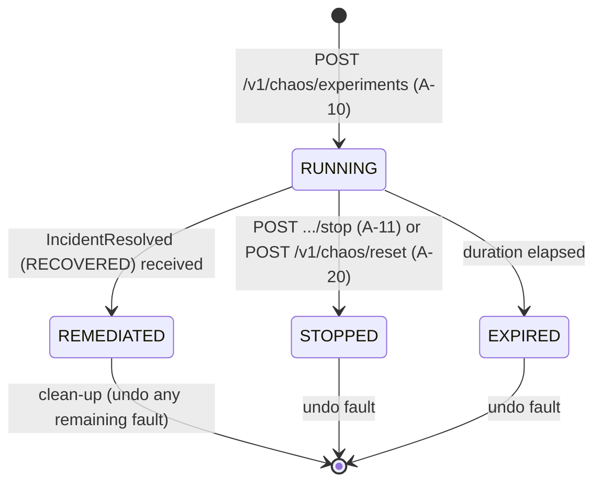

# 06 — Chaos Scenarios

> **Chaos engineering:** deliberately injecting failures in a controlled way to check that the system (and its
> people) respond well. A **chaos experiment** has a hypothesis ("if X breaks, the agent restores service within
> 3 minutes"), a controlled injection, observation, and an end.

## 1. Principles for our experiments

| Principle | How we apply it |
|---|---|
| **One experiment per affected service** | Each scenario lists the services whose alerts it makes fire. Two experiments may run together only if those sets do not meet; otherwise `409 EXPERIMENT_ALREADY_RUNNING`. Every incident keeps one cause, and the leak can grow while the bad deploy runs (owner's decision, 2026-11-24, [ADR-0020](../adr/0020-chaos-triggers-through-each-targets-own-hook.md); it was "one experiment at a time"). |
| **Every fault is reversible** | Each scenario has an explicit undo, used by `POST /v1/chaos/experiments/{experiment_id}/stop` (A-11), and **`POST /v1/chaos/reset`** (A-20) undoes every fault at once, judged by what is actually running, so it works even after chaos-service restarted. |
| **Bounded duration** | Each experiment auto-expires (default 5 minutes; 10 for the memory leak, which needs time to grow) and cleans up. |
| **Small blast radius** | A fault lives in the service it breaks, behind an internal hook only chaos-service can reach (NetworkPolicy) and only when `CHAOS_HOOKS_ENABLED=true`. chaos-service's Kubernetes Role names one object, `deployments/order-service`. It holds no secret and can reach no data store (tested); no data is lost. |
| **Blind diagnosis** | The SRE agent never reads chaos-service, its metrics or the faults' INFO logs. It sees only symptoms. |
| **Measured** | chaos-service records time to detect (`IncidentOpened` − start), action taken, and time to recover (`IncidentResolved` − start). |

## 2. The four scenarios at a glance

| | 💥 Bad deploy | 🧠 Memory leak | 🌊 Traffic spike (panic sell) | 🗄️ Portfolio database degraded |
|---|---|---|---|---|
| **Scenario ID** | `BAD_DEPLOY` | `MEMORY_LEAK` | `TRAFFIC_SPIKE` | `PORTFOLIO_DB_DEGRADED` (Phase 7, ADR-0020) |
| **Target** | `order-service` | `market-data-service` | `order-service` (through `api-gateway`) | portfolio-service's database |
| **Affects** (overlap rule) | order-service | market-data-service | order-service | order-service, portfolio-service |
| **How injected** | New rollout revision with `FAULT_PROFILE=bad-release` | `POST /internal/v1/faults` on market-data (A-12) | `POST /internal/v1/faults` on bot-traders (A-23): the bots' accounts sell at market, 110 requests/s | `POST /internal/v1/faults` on portfolio (A-21): a row in its own Postgres |
| **Symptom users see** | ~40% of orders fail with "something went wrong" | Charts get slow, then freeze when the pod is killed | Prices fall; orders slow; some get `503` | Every order gets `503` at once ("portfolio-service is not responding") |
| **Primary metric signal** | 5xx `INTERNAL_ERROR` ≫ baseline, right after a new revision | Memory rising linearly toward the limit; no deploy | Request rate far above baseline; p95 high; `503 OVERLOADED`; CPU saturated; no deploy | order-service's breaker to portfolio open; portfolio's Postgres transactions slow; no deploy |
| **Alert** | `OrderServiceHighErrorRate` | `MarketDataMemoryGrowth` | `OrderServiceHighLatency` | `OrderServiceCircuitOpen` (`remediable=false`) |
| **Expected agent fix** | `rollback_deployment(order-service)` | `restart_deployment(market-data-service)` | `scale_deployment(order-service, 4–5)` | `do_nothing`, escalate |
| **Why that fix** | The cause is the new code; restarting or scaling it keeps the bug | The leak is in-process state; a fresh process starts clean; no deploy to roll back | Not a code problem; more replicas share the load | The cause is a data store, which the agent may never touch; the fault survives a restart, a rollback and more replicas |
| **Wrong fixes and why** | Scale: more copies of broken code. Restart: same broken image | Rollback: the previous revision is the same code. Scale: each replica still leaks | Rollback: no bad deploy (even right after one was rolled back: the running revision is the known-good one). Restart: drops in-flight requests and doesn't add capacity | Any action on order-service hides the cause; restarting or scaling portfolio-service finds the same slow database |
| **Undo (stop or reset)** | Remove `FAULT_PROFILE` (the previous pod template returns) | `DELETE /internal/v1/faults` (A-13; gives the memory back) | `DELETE` on bot-traders (A-24); reset also puts order-service's replicas back | `DELETE` on portfolio (A-22) |
| **Success criteria** | Error ratio < 1% within 3 min of detection | Memory back to baseline; charts live again | p95 latency < 500 ms (the alert's line) while load continues | The agent declines and escalates with the cause in plain words; a person fixes the database (here: reset) |

## 3. Scenario details

### 3.1 💥 Bad deploy (`BAD_DEPLOY`)

**Hypothesis:** if a release that breaks order placement is deployed, the agent links the error spike to the deploy
and rolls back within 3 minutes of detection.

**Injection (by chaos-service):**
1. Patch the `order-service` Deployment: set env `FAULT_PROFILE=bad-release` and annotation
   `kubernetes.io/change-cause: "release 1.4.1"`. This creates a **real new rollout revision**, exactly like a
   developer's deploy would.
2. With `bad-release`, order-service raises an unhandled error in ~40% of `POST /v1/orders` calls (returns `500`)
   and logs `ValueError: price_band not configured` — a believable "forgot a config value" bug. It fails before
   anything is reserved (`FAULT_ERROR_RATE` sets the share; `application/fault_profile.py`).

*As built (Phase 7):* chaos-service patches only those two variables and the change-cause, through a strategic merge
patch with its own ServiceAccount, whose Role allows `get`/`patch` on `deployments/order-service` and nothing else.
The 500s are counted as `http_problems_total{code="INTERNAL_ERROR"}`, which is how the agent (and its rule-based
fallback) tells a bad release from overload (`OVERLOADED`).

> **Honesty note:** we simulate the bad code with a config flag baked into the same image, rather than building a
> separate broken image. From Kubernetes' and the agent's point of view it is indistinguishable: a new revision whose
> pods misbehave. Rolling back restores the previous pod template, without the flag.

> **GitOps note:** the patch is made live, not through Git. Argo CD's self-heal is off
> ([ADR-0014](../adr/0014-gitops-with-argo-cd.md)), so it leaves the patch in place and marks the `order-service`
> Application `OutOfSync`. `rollback_deployment` works in two steps ([ADR-0016](../adr/0016-rollback-reconciles-through-git.md)):
> **(a)** roll back in the cluster; **(b)** open a `git revert` pull request *if the bad version came from Git*. Its
> pre-check sees the Application was already `OutOfSync`, meaning the drift came from outside Git. After (a) the
> Deployment matches Git again and the Application returns to `Synced`, so (b) records `NOT_NEEDED`. The audience can
> watch `OutOfSync` → `Synced` in the Argo CD UI.

**Rehearsing step (b): a Git-delivered bad release (staging only, not a chaos-service scenario).** To show the
revert pull request, the Release & Reliability Team merges a deliberately bad image tag for `order-service` into
`deploy/envs/staging/`, and Argo CD syncs it. The Application is now `Synced` *to the bad release*. The agent rolls
back (a), then opens the `git revert` pull request (b). Merging it returns the Application to `Synced` with no new
rollout. chaos-service itself never writes to Git, which keeps its blast radius small.

**Demo plan:** the **live** demo uses the chaos-patch `BAD_DEPLOY` above, which is fast and reliable with no wait for
Argo CD. The Git-revert path is shown as a **pre-recorded clip** in the presentation, because waiting up to ~3
minutes for Argo CD's polling in front of a panel is a poor use of the time.

**Signals:**
```promql
# 5xx ratio for order-service, alert if above 5% for 20 s (observability/alerts/services.yaml)
sum(rate(http_requests_total{service="order-service",status=~"5..",route!~"/healthz|/readyz|/metrics"}[30s]))
  / sum(rate(http_requests_total{service="order-service",route!~"/healthz|/readyz|/metrics"}[30s])) > 0.05
```
plus deploy history showing revision 8 created ~40 s before errors started.

**Expected agent reasoning:** "Errors began right after revision 8. Traffic and memory are normal. New error message
in logs. → rollback."

### 3.2 🧠 Memory leak (`MEMORY_LEAK`)

**Hypothesis:** if market-data-service leaks memory, the agent restarts it *before* Kubernetes kills it for running
out of memory, and trading continues unaffected throughout.

**Injection:** `chaos-service` calls `POST /internal/v1/faults` on market-data-service with
`{"fault": "MEMORY_LEAK", "rate_mb_per_minute": 100}` (a parameter; 100 is the default since 2026-11-27, the live
demo's rate, below; it was 80 from Phase 7, and at the first design's 40 MB a minute the pod, idling at about 60 MiB,
needed about 8 minutes to reach the alert's 70% line). The
service keeps another `rate / 60` MiB every second in a list nobody reads (a realistic "cache that never evicts"
bug), in anonymous memory with every page written, so the container's working set climbs in a straight line. It
grows on a timer, not per WebSocket broadcast as first designed, so the rate does not depend on how many charts are
open. Clearing the fault (A-13) gives the memory back, so a reset needs no restart; the agent's restart also clears
it for good, because the leak lives only in the process (tested: memory stays flat after the restart). Measured
(2026-11-25, staging; the limit is 512 MiB, the alert's line 70% = 358 MiB):

| Leak rate | Alert after the click (after crossing 70%) | Left before the pod would be killed, once the alert fires | Runs |
|---:|---|---:|---:|
| **80 MB/min** | **266–275 s** (30–32 s) | about 84 s | 5 of 5 |
| 120 MB/min | 175–191 s (32 s) | about 45 s | 2 of 2 |
| 160 MB/min | 147–155 s (30–32 s) | about 26 s | 2 of 2 |

After the restart the alert cleared within 8–18 s and memory stayed flat for 2 minutes in every run. A faster leak
makes the demo shorter but leaves less room before Kubernetes would kill the pod for its memory, and then Kubernetes,
not the agent, would fix it. **With the agent acting** (Phase 7c, staging): at 120 MB a minute market-data reached
**90.9%** of its limit before the agent's restart replaced it (9% left), at 80 MB a minute 84.3%. The owner's line is
about 10%, so the default (the Chaos Panel's button, the live demo) is **100 MB a minute**, and `make demo-chaos
mode=full` keeps 80. The internal fault endpoint exists **only** when the service is started with
`CHAOS_HOOKS_ENABLED=true` (staging and the demo prod; disabled in any real deployment) and is reachable only from
chaos-service (network policy).

**Signals:**
```promql
# Memory above 70% of the limit and still climbing (observability/alerts/services.yaml)
(container_memory_working_set_bytes{container="market-data-service"}
  / container_spec_memory_limit_bytes{container="market-data-service"} > 0.7)
and
(deriv(container_memory_working_set_bytes{container="market-data-service"}[2m]) > 0)
```
plus deploy history showing **no** recent revision and request rate at baseline.

**Expected agent reasoning:** "Memory has climbed in a straight line for 8 minutes with normal traffic and no deploy.
That's a leak in the running process. → restart."

**What it demonstrates beyond the agent:** **failure isolation**. Trading, portfolios and the leaderboard keep
working while market data struggles, because they own their own data and do not call market-data-service.

### 3.3 🌊 Traffic spike (`TRAFFIC_SPIKE`)

**Hypothesis:** if order traffic jumps 5–10×, the agent scales order-service up (max 5) and latency recovers while
the load continues.

**Injection: a panic sell** (owner's direction, 2026-11-04; mix fixed 2026-11-14; rate calibrated 2026-11-23). For
5 minutes, **110 requests/s** in total reach `api-gateway`: **90% `POST /v1/orders` MARKET SELL** of 1 share, spread over the five tickers, and
**10% `GET /v1/orders`** (traders checking what happened). The sellers are the bots' accounts (`bot-01` … `bot-20`):
only accounts that hold shares can sell, and the bots hold 1,000 of each ticker. The audience sees prices fall on the
dashboard while order-service is flooded and the agent scales it. A sell that finds no bid is cancelled by its
protection price (last price −10%), which releases its shares, so the burst never runs out of shares; MARKET orders
never rest, so there is nothing to clean up afterwards. Using 20 accounts keeps each under the gateway's per-bot rate
limit (50/s), just like a real crowd of many sellers.

**The market must come back** (owner, 2026-11-27). Within 30 s after the panic ends every ticker has a bid and an ask
again, so a phone can sell (`make demo-chaos` and the agent check test it). The panic ends when its **last order is
answered**: the burst stops with the experiment, but the orders it already sent are answered for a while after (the
tail, about 20 s on staging, reported separately). The first runs on staging left every
ticker without a bid for minutes: the market makers had spent all their cash buying the panic's shares. They now pull
a bid that one-sided selling keeps eating and come back when it stops
([bot-traders README](../../services/bot-traders/README.md)).

Why this mix and not Phase 5's (70% `GET /v1/orders`, 30% resting 1-share buys): a crowd that panics *sells*, and
the scenario must be one that more order-service pods actually fix. Phase 5 found `GET /v1/orders` limited by a
history scan, which scaling did not help; since the open-orders table (2026-11-14) that read costs only what is open,
and every request of this mix is work an order-service pod does in parallel.

**Where the time went, and the fix (profiling, 2026-11-15 to 11-23).** The first measurement (2026-11-14, a cluster
with 19 hours of trading and load tests) found 2 → 5 replicas cutting order p95 from over 10 s only to 1–2 s. Timing
every stage of a placement (`order_place_stage_seconds`) and py-spy on the pods showed the wait was **not** in the
reservation (portfolio-service's Postgres pool wait p95 1 ms) but in **Cassandra**: query p95 141–291 ms, 2.6 times the
CPU per order of a fresh cluster, paused for garbage collection 7–10% of the time. Two causes, both fixed: the engine's
snapshot table grew without bound (one 2 GB partition per ticker; [event sourcing](04-event-sourcing-and-cqrs.md#snapshots)),
and Cassandra was sized for the laptop instead of its container (12 GC threads on 2 CPUs; [deployment, Cassandra's
memory budget](07-deployment-and-environments.md#cassandras-memory-budget)). So the bottleneck the agent scales is
still order-service, as designed.

**The rate, calibrated on the demo laptop** (2026-11-23, kind, 16 GB MacBook on mains power, 2 hours of bot trading
plus an hour at 40 orders/s; `scripts/k8s_checks.py profile` and `scale`; Mac load average logged every 10 s). The
rate has to be above what 2 replicas carry and within what 5 carry:

| Offered (panic sell) | 2 replicas: got through, order-service p95 | 5 replicas: order-service p95 (client p95) | Mac load (median) |
|---:|---|---|---:|
| 90 req/s | all 91, **262 ms (no breach)** | 88 ms (82 ms) | 9 |
| 100 req/s | 72, ≥ 10 s | 262 ms (258 ms) | 16 |
| **110 req/s** | 76–96, 8.5 s to ≥ 10 s, in all 5 runs | **168, 223, 237, 407 ms; once 861 ms** (147–986 ms) | 9–11 |
| 120 req/s | 76–83, ≥ 10 s | 358, 423 ms (331, 339 ms) | 11 |
| 150 req/s | 77, ≥ 10 s | 1,373 ms (9.5 s): too much for the laptop | 10 |

**110 requests/s** it is: 2 replicas breach the 500 ms alert line in every run (they carry 72–96 requests/s; on a quieter
night, 2026-11-15, they carried 100), and 5 replicas recovered below it in 4 of 5 runs. The one miss (861 ms) was the
first run after Redpanda had restarted. **What one 16 GB laptop can do:** at 5 replicas the whole exchange needs 6–7 of
the Mac's 12 cores (order-service 2, gateway 1.2, Cassandra 1, the rest), so above about 120 requests/s the laptop, not
order-service, is the limit, and a busy Mac (other apps, an OS update, a dev server) narrows the window. Hence the demo
runbook's first step: mains power, other apps closed, host load checked. `make k8s-check c=scale` runs this check at
110 requests/s.

Each order-service pod handles at most 50 requests at once (a concurrency limit) and returns `503 OVERLOADED`
beyond that — so more pods really do mean more capacity, even on one laptop. *Built in Phase 7 (it was documented
from Phase 0 but not in the code when the rate was first calibrated).* With it, 2 overloaded replicas turn part of
the burst away at once instead of queueing everything, so `OrderServiceHighErrorRate` can fire as well as
`OrderServiceHighLatency`. The errors are `OVERLOADED`, not `INTERNAL_ERROR`, and no revision is new: the agent
must still scale, never roll back (tested in the agent's evaluation, Phase 7b).

**Re-calibrated with the limit in place** (2026-11-25, staging, chaos-service's real trigger and the bots trading;
`scripts/k8s_checks.py chaos --only panic --panic-rate R`; mains power, the Mac's load at most 8 before each run and
logged during it, a run above 12 marked noisy):

| Offered (panic sell) | At 2 replicas | Mac load (max) |
|---:|---|---:|
| 60–90 req/s | `OrderServiceHighLatency` did not fire within 4 minutes (once at 60, 110 s after its condition, in a noisy run). Only `ConsumerLagHigh` fired: order-service falls behind on `matching.v1` before its p95 crosses 500 ms | 8–13 |
| 100 req/s | fired in 3 of 5 runs, once 159 s after the click | 8–13 |
| **110 req/s** | **fired in 5 of 5 runs, 40–62 s after the click** (30–32 s after p95 crossed 500 ms). order-service p95 about 2 s; a trader's order took 0.6–0.8 s (median) and 1 to 3 in 25 were refused `503 OVERLOADED` | 9–10.5 |

So **110 requests/s stays**: the lowest rate that breaches every time, and the Mac stays below load 12 with it
(a busier Mac also makes the dashboard and Grafana slow on stage).

**How fast it recovers, and how much of that is measurement.** After scaling to 5, each of the 5 runs at 110 req/s
timed when the new pods were Ready, when a trader's orders were back under 500 ms (a probe placing an order through
the gateway every second, no averaging window) and when the alert cleared:

| Run | 5 pods Ready | A trader's orders < 500 ms | Alert cleared | Click → recovered |
|---:|---:|---:|---:|---:|
| 1 | 56 s | 24 s | 48 s | 94 s |
| 2 | 56 s | 20 s | 48 s | 110 s |
| 3 | 41 s | 76 s | 98 s | 162 s |
| 4 | 35 s | 106 s | 128 s | 170 s |
| 5 | 31 s | 23 s | 47 s | 90 s |

- **The alert clears 22–28 s after the orders are fast again**, in every run: that is the measurement (a 30 s rate
  window, evaluated every 10 s), not the exchange. A 20 s window would save about 10 s and make the alert jumpier, so
  it stays.
- **Real recovery took 20–24 s in 3 runs and 76–106 s in 2.** In those 2, all pods were Ready after 35–41 s; our
  explanation, not yet proven, is the requests already queued when the scale happened.
- **A new pod was held out of service for 20–50 s by its readiness.** It takes over a `matching.v1` partition with
  the backlog the overload built, and was Ready only once it had caught up, although order-service's answers do not
  depend on its own consumer (recorded from every new pod's `/readyz`: the consumer was the only check failing).
- **The measured bound at first** (2026-11-25): **click → recovered 90–110 s, at worst 170 s**. Recovery held for
  60 s at 5 replicas in every run.

**Two changes after measuring (2026-11-26).** (1) order-service and portfolio-service are ready once they can answer
correctly, without waiting for their consumer ([coding standards §7](../05-coding-standards.md#7-standard-operational-endpoints),
amended). That alone made recovery *slower*: the new pods were ready in 7 s but got almost no orders, because a
Kubernetes Service balances connections, not requests, and the gateway's busy keep-alive connections stayed with the
old pods. (2) So a request turned away with `503 OVERLOADED` now also closes its connection, and the gateway's next one
may land on a new pod ([deployment, load balancing per
connection](07-deployment-and-environments.md#load-balancing-per-connection)). 5 runs each at 110 requests/s:

| After the scale from 2 to 5 | Waits for the consumer | Ready at once | **Ready at once + close on overload** |
|---|---|---|---|
| All 5 pods Ready | 11–61 s | 4–7 s | **7–9 s** |
| Orders on the 3 new pods at +60 s (a fair share is 60%) | 23–46% | 7–38% | **16–45%** (median 38%) |
| A trader's orders under 500 ms again | 9–48 s | 0–232 s | **1–120 s** (median 7 s) |
| **Click → recovered** | 77–122 s (median 90) | 83–235 s (median 132) | **69–182 s (median 81)** |

The overload itself is unchanged: the alert fired 38–44 s after the click, the old pods' p95 was about 2.3 s and
10–28% of their orders got a 5xx (without the change: 42–48 s, 2.1 s, 4–22%). One run in five still recovered slowly
(182 s; its new pods got 9–27% of the orders): only turned-away requests reconnect, so moving the load is likely, not
certain. Two of the five runs were noisy (the Mac's load reached 18–22). **The measured bound for the demo:
click → recovered 69–113 s in 4 runs of 5, at worst 182 s.**

**How the panic is triggered (Phase 7, [ADR-0020](../adr/0020-chaos-triggers-through-each-targets-own-hook.md)).**
chaos-service calls bot-traders' internal hook A-23 (`{"fault": "PANIC_SELL", "requests_per_second": 110,
"duration_seconds": 300}`); the bots' own accounts send the mix above through api-gateway. The credentials never
leave bot-traders. It is **open loop**: request *n* goes out at start + *n* / rate whether or not earlier ones were
answered, and none is retried, like a crowd (a bot strategy, first planned, decides once per candle and waits for
answers, so under overload it would slow down with order-service and hide the overload). The normal strategies keep
trading meanwhile: the market makers' bids are what the panic sells into, which is why the price falls.
`scripts/load_orders.py --mix panic` still sends the same mix from the laptop (with the bots stopped) for
`make k8s-check c=scale`.

**Signals:**
```promql
# p95 latency above 500 ms for 30 s (observability/alerts/services.yaml)
histogram_quantile(0.95, sum by (le) (rate(http_request_duration_seconds_bucket{service="order-service"}[30s]))) > 0.5
```
plus request rate far above the previous hour's baseline, CPU near the limit, no recent deploy, normal memory.

**Expected agent reasoning:** "Requests are 8× normal, CPU is saturated and latency is high. No deploy, memory flat.
This is load, not a bug. → scale order-service from 2 to 5."
**Follow-up:** after the spike ends, an `OrderServiceOverProvisioned` warning (CPU < 20% with > 2 replicas for 10
minutes) lets the agent scale back down — after its 5-minute cooldown.

### 3.4 🗄️ Portfolio database degraded (`PORTFOLIO_DB_DEGRADED`)

**Hypothesis:** if the cause of an alert is outside everything the agent may touch, the agent does not act; it
escalates and says why.

**Injection (Phase 7, [ADR-0020](../adr/0020-chaos-triggers-through-each-targets-own-hook.md)):** chaos-service calls
portfolio-service's internal hook A-21 (`{"fault": "DB_DEGRADED", "delay_ms": 1500}`). **portfolio-service** stores
the switch as a row in its own database (`chaos_faults`); chaos-service never connects to Postgres (it has no
credential, and Postgres' NetworkPolicy admits only portfolio-service: both tested). While the row exists, every
reservation (A-06) makes Postgres wait 1.5 s inside its transaction (`pg_sleep`), as a struggling database would.
order-service's reservation call times out after 500 ms, five in a row open its circuit breaker, and every order is
answered `503 DEPENDENCY_UNAVAILABLE` at once.

**Why this and not "portfolio-service scaled to 0"** (Phase 5's trigger): the agent could fix that by scaling it up,
which is one of its tools. Here nothing it may do helps: the switch is in the database, so a restart, a rollback or
more replicas of portfolio-service all read it again (tested: a restart leaves the alert firing).

**Signals:** `OrderServiceCircuitOpen` (`remediable=false`): the agent opens an incident and declines without
calling the model for an action; its explanation names the cause (portfolio-service's database is slow; data stores
are for a person). Measured (5 of 5 runs): the alert fires 8–10 s after the click, 2 s after the breaker opens;
a restart of portfolio-service leaves it firing; no other alert fires. **Undo:** A-22 (or the reset) removes the
row; every replica stops waiting within 2 seconds.

## 4. Experiment lifecycle (chaos-service)



Experiment record (returned by `GET /v1/chaos/experiments/{experiment_id}`, Q-23): scenario, target, status,
started/ended times, `time_to_detect_seconds`, `time_to_recover_seconds`, the agent's actions (from
`incidents.v1`), and the incident ID.

## 5. Alert rules (Prometheus) used by the agent

The rules are code in `observability/alerts/` (installed as PrometheusRule objects), with unit tests in
`observability/tests/` run by `make test-alerts` and CI ([deployment §3](07-deployment-and-environments.md)).

**Timing.** Prometheus scrapes every service and evaluates the rules every **10 s**; rates use **30 s** windows and
`for` is **20–30 s**, so an alert fires about **30 s after its condition starts** (owner's decision, 2026-11-13). The
error-ratio rules also need traffic (more than 0.5 requests/s), so a single failed request on an idle service is
never "100% errors"; health, readiness and metrics requests are left out. Measured with real triggers on the
Kubernetes deployment (`make k8s-check c=alerts`, Phase 5):

| Alert | Service | Expression (summary) | `for` | Severity | Label `remediable` | Fired after its trigger (Phase 5) |
|---|---|---|---|---|---|---|
| `OrderServiceHighErrorRate` | order-service | 5xx ratio > 5% | 20s | critical | true | 35 s (order-service loses write access to one table) |
| `OrderServiceHighLatency` | order-service | p95 > 500 ms | 30s | critical | true | 37 s (200 orders/s at 2 replicas) |
| `OrderServiceOverProvisioned` | order-service | CPU < 20% of its limit and replicas > 2 | 10m | warning | true | 611 s (4 replicas, only the bots): slow by design, so a short lull never scales a busy service down |
| `OrderServiceCircuitOpen` | order-service | the breaker to portfolio-service is open (or was in the last 30 s) | 0s | critical | **false** | 20 s (portfolio-service scaled to 0) |
| `MarketDataMemoryGrowth` | market-data-service | memory > 70% of the limit and rising (`deriv` over 2 minutes) | 30s | critical | true | 36 s after crossing 70% |
| `GatewayHighErrorRate` | api-gateway | 5xx ratio > 5% | 20s | critical | true | 61 s (portfolio-service down) |
| `PortfolioHighErrorRate` | portfolio-service | 5xx ratio > 5% | 20s | critical | true | 48 s (a revoked INSERT; still "ready") |
| `PodCrashLooping` | any app service | restarts > 3 in 5m, **or** waiting in CrashLoopBackOff after more than 3 restarts (added 2026-11-27: Kubernetes' growing back-off made the first condition clear while the pod still crashed); both count only containers that still exist, so it clears once the crashing pod is gone (a deleted pod's restarts stayed in the 5-minute window for minutes after a working rollback) | 0m | critical | true | at the 4th restart, and while the crash loop lasts |
| `ConsumerLagHigh` | any consumer | lag > 1,000: the consumer's own gauge **or** the broker's lag for its group | 30s | warning | false (informational) | 38 s after passing 1,000 (matching-engine stopped) |
| `DeadLetterMessages` | any | a message sent to any `.dlq` topic (`events_dead_lettered_total`) | 0m | warning | false | 13 s |

**Measured with the Chaos Panel** (Phase 7a, 2026-11-25, staging, the bots trading, each button 5 times in a row;
`scripts/k8s_checks.py chaos`). The agent is not built yet, so its fix was applied by hand 2 s after the alert fired
(what its tool does); the agent's own time to decide comes on top. **Click → recovered** is from the button press to
the alert clearing after the fix; reset → normal is from the presenter's reset to errors < 1%, p95 < 500 ms, two
order-service replicas and every Argo CD Application `Synced`. Mains power; the Mac's load at most 8 before each run.

| Scenario | Alert | After the click (after its condition) | Fix | Alert cleared after the fix | **Click → recovered** | Reset → normal | Also fired |
|---|---|---|---|---|---|---|---|
| Bad deploy | `OrderServiceHighErrorRate` | 49–59 s (22–26 s) | roll back | 28–36 s | **79–89 s** | 10–21 s | `GatewayHighErrorRate` (3 of 5) |
| Memory leak, 80 MB/min | `MarketDataMemoryGrowth` | 266–275 s (30–32 s) | restart | 16–18 s | **286–294 s** | already normal | none |
| Panic sell, 110 req/s | `OrderServiceHighLatency` | 40–62 s (30–32 s) | scale 2 → 5 | 47–48 s; twice 98–128 s | **90–110 s; twice 162–170 s** (since 2026-11-26: 69–113 s in 4 of 5, once 182 s; §3.3) | 0–83 s | `OrderServiceHighErrorRate` + `GatewayHighErrorRate` (`OVERLOADED`, 3 of 5) |
| Portfolio database degraded | `OrderServiceCircuitOpen` | 8–10 s (2 s) | none: the presenter's reset | 28–58 s | **38–70 s** (100 s with the restart test) | already normal | none |

**With the agent** (Phase 7b, 2026-11-26/27): each scenario 3–4 times, the agent deciding and acting itself. From the
alert firing: detect 1–5 s, mitigate 2–9 s, recovered 23–45 s; the database decline escalated within 3 s. Full table,
the special tests and what they found: [SRE agent design §11](05-sre-agent-design.md#11-measured-on-staging).

- **`OrderServiceCircuitOpen` is information, not a call to act.** An open breaker means portfolio-service is failing
  and order-service is doing the right thing (failing fast with 503). Restarting, scaling or rolling back
  order-service would not help, so the agent escalates (see the [SRE agent design](05-sre-agent-design.md)).
- **Data stores never trigger the agent.** `MarketDataMemoryGrowth` covers the stateless market-data-service only:
  Cassandra's JVM holds about 70% of its memory limit all the time by design, which is not a leak. `PodCrashLooping`
  leaves out Cassandra, Postgres, Redpanda and init jobs. A test proves the data stores at 75% of their limit and
  rising (and Cassandra restarting) fire nothing.
- **Lag from two places.** A stopped consumer cannot report its own lag, so `ConsumerLagHigh` also reads Redpanda's
  own measurement of each consumer group (`redpanda_kafka_consumer_group_lag_max`, recomputed every 10 s).

The same alerts work for faults we did *not* script: the agent is not hard-coded to the four scenarios.

## Viva Notes

**Q: Why is there a fourth scenario where the agent is supposed to do nothing?**
A: A good operator knows when the fix isn't theirs to make. In "Portfolio database degraded" the cause is a data store,
stored so that a restart, rollback or more replicas cannot clear it; the agent's only right answer is to decline,
escalate and say why.

**Q: Why exactly these four scenarios?**
A: Three have a different correct fix from the allowlist — rollback, restart, scale — so together they show the
agent genuinely diagnosing rather than always doing the same thing; they are also the most common real-world causes
of incidents: bad changes, resource leaks and load. The fourth has no fix the agent may make.

**Q: The latency alert cleared about 48 s after the scale. Was the exchange that slow to recover?**
A: Partly not: a trader's orders were fast again 20–24 s after the scale, and the alert cleared 22–28 s later in every
run, because its p95 is computed over a 30 s window that must first forget the slow requests. We measured both before
deciding not to shorten the window: a shorter one would clear sooner but fire on smaller blips.

**Q: Isn't the bad deploy "fake" because it's a flag?**
A: The mechanism is a flag, but the event is real: a genuine new Kubernetes revision whose pods fail. The agent sees
exactly what it would see after a real bad release, and the rollback is a real rollback.

**Q: How do you make sure chaos doesn't break things permanently?**
A: One experiment per affected service, a fixed maximum duration, an explicit undo for every scenario, a reset that
checks what is really running, data stores out of reach by permission and by network, and a stop button.

**Q: What does the memory-leak scenario prove besides self-healing?**
A: Failure isolation: trading, portfolios and the leaderboard keep working while market data is sick, because each
service owns its data and doesn't depend on market-data-service synchronously.

**Q: Why does scaling help on a single laptop?**
A: Each order-service pod has a concurrency limit of 50 in-flight requests. With more pods there are more slots, and
Python processes use more CPU cores. Without that limit the benefit would be much less visible.
