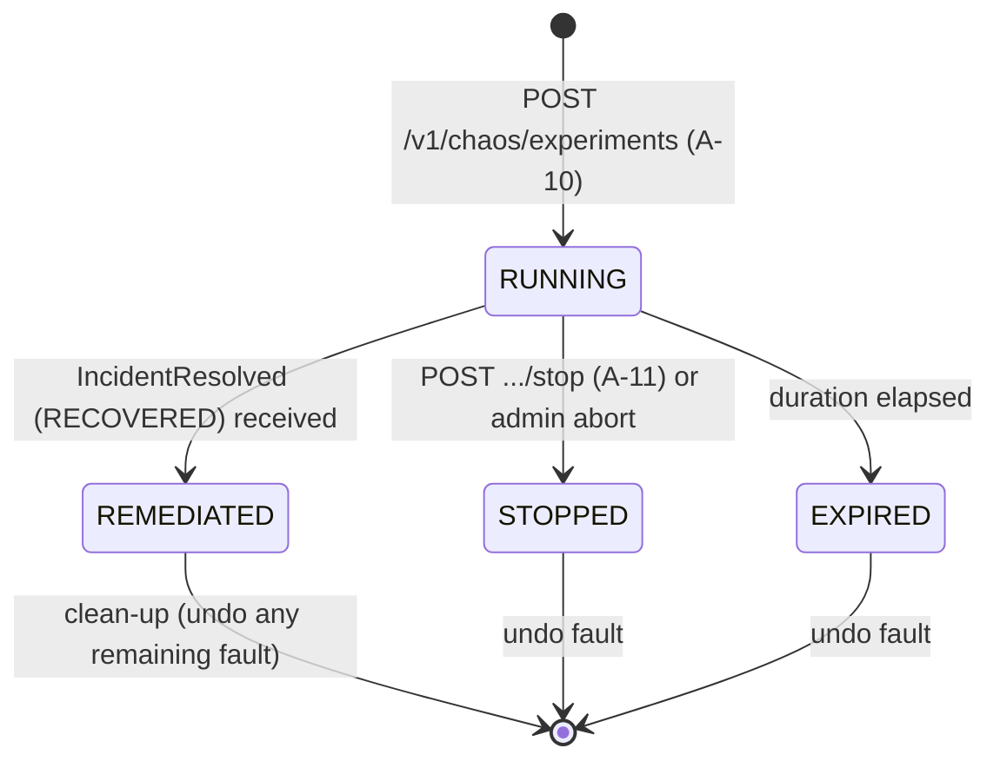

# 06 — Chaos Scenarios

> **Chaos engineering:** deliberately injecting failures in a controlled way to check that the system (and its
> people) respond well. A **chaos experiment** has a hypothesis ("if X breaks, the agent restores service within
> 3 minutes"), a controlled injection, observation, and an end.

## 1. Principles for our experiments

| Principle | How we apply it |
|---|---|
| **One experiment at a time** | `chaos-service` refuses to start a second one (`409 EXPERIMENT_ALREADY_RUNNING`). Clear cause and effect. |
| **Every fault is reversible** | Each scenario has an explicit undo, used by `POST /v1/chaos/experiments/{experiment_id}/stop`. |
| **Bounded duration** | Each experiment auto-expires (default 5 minutes; 10 for the memory leak, which needs time to grow) and cleans up. |
| **Small blast radius** | Faults target one service; data stores are never touched; no data is lost. |
| **Blind diagnosis** | The SRE agent never reads chaos-service. It sees only symptoms. |
| **Measured** | chaos-service records time to detect (`IncidentOpened` − start), action taken, and time to recover (`IncidentResolved` − start). |

## 2. The three scenarios at a glance

| | 💥 Bad deploy | 🧠 Memory leak | 🌊 Traffic spike |
|---|---|---|---|
| **Scenario ID** | `BAD_DEPLOY` | `MEMORY_LEAK` | `TRAFFIC_SPIKE` |
| **Target** | `order-service` | `market-data-service` | `order-service` (through `api-gateway`) |
| **How injected** | New rollout revision with `FAULT_PROFILE=bad-release` | `POST /internal/v1/faults` (A-12) | Load generator: 10 load accounts, ~400 requests/s |
| **Symptom users see** | ~40% of orders fail with "something went wrong" | Charts get slow, then freeze when the pod is killed | Orders take seconds; some get `503` |
| **Primary metric signal** | 5xx ratio ≫ baseline, starting right after a new revision | Memory rising linearly toward the limit; no deploy | Request rate 5–10× baseline; p95 latency high; CPU saturated |
| **Alert** | `OrderServiceHighErrorRate` | `MarketDataMemoryGrowth` | `OrderServiceHighLatency` |
| **Expected agent fix** | `rollback_deployment(order-service)` | `restart_deployment(market-data-service)` | `scale_deployment(order-service, 4–5)` |
| **Why that fix** | The cause is the new code; restarting or scaling it keeps the bug | The leak is in-process state; a fresh process starts clean; no deploy to roll back | Not a code problem; more replicas share the load |
| **Wrong fixes and why** | Scale: more copies of broken code. Restart: same broken image | Rollback: the previous revision is the same code. Scale: each replica still leaks | Rollback: no recent deploy. Restart: drops in-flight requests and doesn't add capacity |
| **Undo (manual stop)** | Roll back to the pre-experiment revision | `DELETE /internal/v1/faults` (A-13) | Stop the load generator; cancel its resting orders |
| **Success criteria** | Error ratio < 1% within 3 min of detection | Memory back to baseline; charts live again | p95 latency < 300 ms while load continues |

## 3. Scenario details

### 3.1 💥 Bad deploy (`BAD_DEPLOY`)

**Hypothesis:** if a release that breaks order placement is deployed, the agent links the error spike to the deploy
and rolls back within 3 minutes of detection.

**Injection (by chaos-service):**
1. Patch the `order-service` Deployment: set env `FAULT_PROFILE=bad-release` and annotation
   `kubernetes.io/change-cause: "release 1.4.1"`. This creates a **real new rollout revision**, exactly like a
   developer's deploy would.
2. With `bad-release`, order-service raises an unhandled error in ~40% of `POST /v1/orders` calls (returns `500`)
   and logs `ValueError: price_band not configured` — a believable "forgot a config value" bug.

> **Honesty note:** we simulate the bad code with a config flag baked into the same image, rather than building a
> separate broken image. From Kubernetes' and the agent's point of view it is indistinguishable: a new revision whose
> pods misbehave. Rolling back restores the previous pod template, without the flag.

> **GitOps note:** the patch is made live, not through Git. Argo CD's self-heal is off
> ([ADR-0014](../adr/0014-gitops-with-argo-cd.md)), so it leaves the patch in place and marks the `order-service`
> Application `OutOfSync`. When the agent rolls back, the Deployment matches Git again and the Application returns to
> `Synced`. The audience can watch this in the Argo CD UI.

**Signals:**
```promql
# 5xx ratio for order-service, alert if above 5% for 1 minute
sum(rate(http_requests_total{service="order-service",status=~"5.."}[1m]))
  / sum(rate(http_requests_total{service="order-service"}[1m])) > 0.05
```
plus deploy history showing revision 8 created ~40 s before errors started.

**Expected agent reasoning:** "Errors began right after revision 8. Traffic and memory are normal. New error message
in logs. → rollback."

### 3.2 🧠 Memory leak (`MEMORY_LEAK`)

**Hypothesis:** if market-data-service leaks memory, the agent restarts it *before* Kubernetes kills it for running
out of memory, and trading continues unaffected throughout.

**Injection:** `chaos-service` calls `POST /internal/v1/faults` on market-data-service with
`{"fault": "MEMORY_LEAK", "rate_mb_per_minute": 40}`. The service starts appending to an in-memory list on every
WebSocket broadcast (a realistic "cache that never evicts" bug). With a 512 MiB limit, it reaches the danger zone in
roughly 8–10 minutes. The internal fault endpoint exists **only** when the service is started with
`CHAOS_HOOKS_ENABLED=true` (staging and the demo prod; disabled in any real deployment) and is reachable only from
chaos-service (network policy).

**Signals:**
```promql
# Memory above 70% of the limit and still climbing
(container_memory_working_set_bytes{container="market-data-service"}
  / container_spec_memory_limit_bytes{container="market-data-service"} > 0.7)
and
(deriv(container_memory_working_set_bytes{container="market-data-service"}[5m]) > 0)
```
plus deploy history showing **no** recent revision and request rate at baseline.

**Expected agent reasoning:** "Memory has climbed in a straight line for 8 minutes with normal traffic and no deploy.
That's a leak in the running process. → restart."

**What it demonstrates beyond the agent:** **failure isolation**. Trading, portfolios and the leaderboard keep
working while market data struggles, because they own their own data and do not call market-data-service.

### 3.3 🌊 Traffic spike (`TRAFFIC_SPIKE`)

**Hypothesis:** if order traffic jumps 5–10×, the agent scales order-service up (max 5) and latency recovers while
the load continues.

**Injection:** chaos-service's built-in load generator logs in as 10 dedicated **load accounts** (`load-01` …
`load-10`, kind `LOAD`, seeded by portfolio-service like bots) through `POST /v1/bot-sessions`, then sends ~400
requests/s in total for 5 minutes through `api-gateway`: 70% `GET /v1/orders`, 30% `POST /v1/orders` for 1-share
`LIMIT` orders priced 20% away from the market (so they rest instead of moving prices). Using 10 accounts keeps each
under the gateway's per-token rate limit — just like a real flash crowd of many users. At the end, chaos-service
cancels the resting load orders.

Each order-service pod handles at most 50 requests at once (a concurrency limit) and returns `503 OVERLOADED`
beyond that — so more pods really do mean more capacity, even on one laptop.

**Signals:**
```promql
# p95 latency above 500 ms for 1 minute
histogram_quantile(0.95, sum by (le) (rate(http_request_duration_seconds_bucket{service="order-service"}[1m]))) > 0.5
```
plus request rate far above the previous hour's baseline, CPU near the limit, no recent deploy, normal memory.

**Expected agent reasoning:** "Requests are 8× normal, CPU is saturated and latency is high. No deploy, memory flat.
This is load, not a bug. → scale order-service from 2 to 5."
**Follow-up:** after the spike ends, an `OrderServiceOverProvisioned` warning (CPU < 20% with > 2 replicas for 10
minutes) lets the agent scale back down — after its 5-minute cooldown.

## 4. Experiment lifecycle (chaos-service)



Experiment record (returned by `GET /v1/chaos/experiments/{experiment_id}`, Q-23): scenario, target, status,
started/ended times, `time_to_detect_seconds`, `time_to_recover_seconds`, the agent's actions (from
`incidents.v1`), and the incident ID.

## 5. Alert rules (Prometheus) used by the agent

| Alert | Service | Expression (summary) | `for` | Severity | Label `remediable` |
|---|---|---|---|---|---|
| `OrderServiceHighErrorRate` | order-service | 5xx ratio > 5% | 1m | critical | true |
| `OrderServiceHighLatency` | order-service | p95 > 500 ms | 1m | critical | true |
| `OrderServiceOverProvisioned` | order-service | CPU < 20% and replicas > 2 | 10m | warning | true |
| `MarketDataMemoryGrowth` | market-data-service | memory > 70% of limit and rising | 2m | critical | true |
| `GatewayHighErrorRate` | api-gateway | 5xx ratio > 5% | 1m | critical | true |
| `PortfolioHighErrorRate` | portfolio-service | 5xx ratio > 5% | 1m | critical | true |
| `PodCrashLooping` | any app service | restarts > 3 in 5m | 0m | critical | true |
| `ConsumerLagHigh` | any consumer | lag > 1000 for 2m | 2m | warning | false (informational) |
| `DeadLetterMessages` | any | messages in any `.dlq` topic | 0m | warning | false |

The same alerts work for faults we did *not* script: the agent is not hard-coded to three scenarios.

## Viva Notes

**Q: Why exactly these three scenarios?**
A: Each one has a different correct fix from the allowlist — rollback, restart, scale — so together they show the
agent genuinely diagnosing rather than always doing the same thing. They are also the most common real-world causes
of incidents: bad changes, resource leaks and load.

**Q: Isn't the bad deploy "fake" because it's a flag?**
A: The mechanism is a flag, but the event is real: a genuine new Kubernetes revision whose pods fail. The agent sees
exactly what it would see after a real bad release, and the rollback is a real rollback.

**Q: How do you make sure chaos doesn't break things permanently?**
A: One experiment at a time, a fixed maximum duration, an explicit undo for every scenario, data stores never
targeted, and an admin stop button.

**Q: What does the memory-leak scenario prove besides self-healing?**
A: Failure isolation: trading, portfolios and the leaderboard keep working while market data is sick, because each
service owns its data and doesn't depend on market-data-service synchronously.

**Q: Why does scaling help on a single laptop?**
A: Each order-service pod has a concurrency limit of 50 in-flight requests. With more pods there are more slots, and
Python processes use more CPU cores. Without that limit the benefit would be much less visible.
