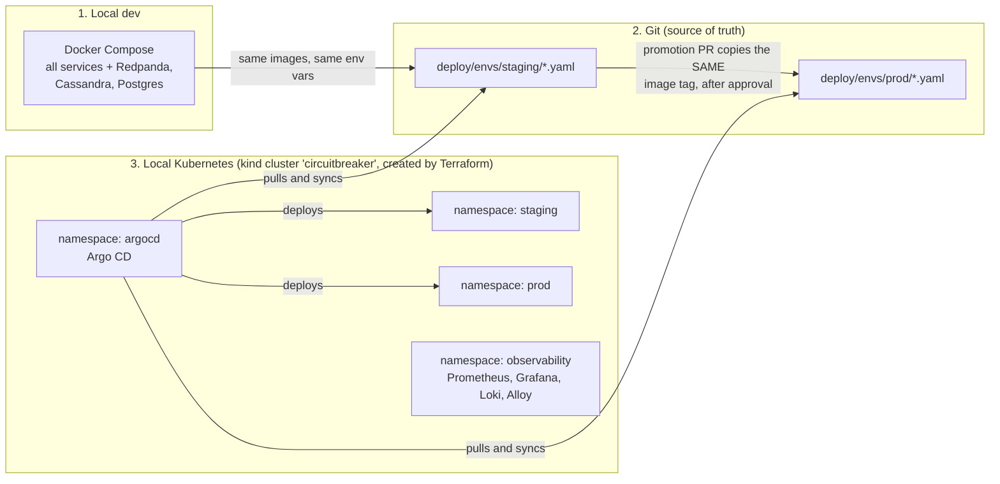

# 07 — Deployment and Environments

> **Environment:** a complete, separate running copy of the system with its own data. We have three:
> `dev` (Docker Compose on a laptop), `staging` and `prod` (namespaces in a local kind Kubernetes cluster).

## 1. The path from laptop to "production"



| | `dev` | `staging` | `prod` |
|---|---|---|---|
| Runs on | Docker Compose | kind, namespace `staging` | kind, namespace `prod` |
| Purpose | Write and debug code fast | Test releases in a production-like setup; chaos rehearsals | The live demo audience |
| Data stores | Own containers | Own Redpanda, Cassandra, Postgres in the namespace | Own Redpanda, Cassandra, Postgres in the namespace |
| Deployed by | `make up` | Argo CD, automatically, when CI commits a new image tag | Argo CD, when an approved promotion PR is merged |
| Replicas | 1 each | Defaults from Helm values | Defaults from Helm values |
| SRE agent | `DryRunPlatform` (logs only) | Live, approval **off** | Live, approval **on** by default |
| Chaos hooks (`CHAOS_HOOKS_ENABLED`) | on | on | on (it is a demo); would be off for a real exchange |
| Bots | 20 | 20 | 20 |

**Why two namespaces in one cluster instead of two clusters?** A laptop cannot run two full clusters plus all the
data stores. Namespaces give separate names, resources, secrets, RBAC and network policies. That is enough to
demonstrate staging/prod separation and promotion. The trade-off (a cluster-level failure affects both) is
documented in [ADR-0007](../adr/0007-kubernetes-kind-and-helm-umbrella.md).

## 2. Docker Compose (dev)

- One `docker-compose.yml` at the repo root starts the infrastructure (Redpanda, Cassandra, Postgres, Prometheus,
  Grafana, Loki) and all services, each built from `services/<name>/Dockerfile`.
- Host ports: `api-gateway` 8080, `order-service` 8001, `matching-engine` 8002, `market-data-service` 8003,
  `portfolio-service` 8004, `bot-traders` 8005, `sre-agent` 8006, `chaos-service` 8007, `web` 5173.
- `make up`, `make down`, `make logs s=<service>`, `make seed` (create topics, keyspaces, bot accounts).
- Hot reload: service source folders are mounted and run with `uvicorn --reload`.

## 3. Kubernetes with kind + Helm umbrella chart

> **kind** runs Kubernetes nodes as Docker containers. **Helm** packages Kubernetes YAML into reusable, configurable
> charts. An **umbrella chart** is a parent chart whose dependencies are the sub-charts of every service. It is the
> single versioned package of the whole system.

```text
charts/
└── circuitbreaker/                 # umbrella chart
    ├── Chart.yaml                  # dependencies: one sub-chart per service + data stores
    ├── values.yaml                 # shared defaults (global.instruments, image registry, resources)
    └── charts/
        ├── service/                # ONE generic sub-chart used by all 8 services
        ├── redpanda/  cassandra/  postgres/
deploy/
├── envs/
│   ├── staging/<service>.yaml      # image tag + staging settings (approval off, smaller resources)
│   └── prod/<service>.yaml         # image tag + prod settings (approval on)
└── argocd/applicationset.yaml      # one Argo CD Application per service per environment
```

- All eight services use **one shared sub-chart template**. It covers the Deployment, Service, ServiceAccount, probes,
  NetworkPolicy and ServiceMonitor, configured per service in values. Every service gets the same setup without
  extra work.
- **Argo CD renders each service separately**: the `service` sub-chart plus `deploy/envs/<env>/<service>.yaml`
  ([ADR-0014](../adr/0014-gitops-with-argo-cd.md)). A change to one service deploys only that service.
- `helm install` of the whole umbrella is still used for throw-away test clusters (CI) and quick local installs.
- **No HorizontalPodAutoscaler.** Kubernetes' autoscaler would fight the SRE agent over replica counts. The agent is
  our scaler (bounded by max replicas); this is a deliberate choice for the demo.
- Data stores run as StatefulSets per namespace. We decide in Phase 5 whether to use community charts or minimal
  in-repo templates. Licences and image availability change often, so we pick what is free and maintained then.

### Probes and resources (defaults per service)

| Setting | Value | Why |
|---|---|---|
| Liveness probe | `GET /healthz` every 10 s, fail after 3 | Restart truly stuck processes. |
| Readiness probe | `GET /readyz` every 5 s | Only route traffic once dependencies (DB, broker) are reachable. |
| Requests / limits | 100m CPU / 256–512 MiB memory (market-data: 512 MiB limit) | Small enough for a laptop; the memory limit makes the leak scenario observable. |
| Rolling update | `maxUnavailable: 0`, `maxSurge: 1` | No downtime during deploys and rollbacks. |
| Revision history | `revisionHistoryLimit: 10` | Keeps rollback targets and deploy history for the agent. |
| Change cause | The chart sets `kubernetes.io/change-cause: "release <version> (<git-sha>)"` | This is the deploy history the SRE agent reads. |

## 4. CI/CD pipeline: GitHub Actions + Argo CD (GitOps)

> **CI (Continuous Integration):** every change is automatically built and tested. **Continuous Delivery** (the
> textbook's sense): teams can automatically and continually ship finished services as containers. **Deployment** is
> the separate step of releasing those containers into an environment. In the textbook's model the release team does
> this (Mitra & Nadareishvili, Ch. 7).
> **GitOps:** Git is the source of truth for what should run. A **GitOps deployment server** keeps the cluster
> matching Git and reports **drift** (live state that differs from Git) (Ch. 7). **Argo CD** is that server here.
> **Sync / `OutOfSync`:** Argo CD's words for "made the cluster match Git" / "the cluster differs from Git".

```mermaid
flowchart LR
    PRQ["Pull request"] --> L["Lint<br/>ruff, eslint, redocly,<br/>helm lint, terraform validate"]
    L --> T["Test<br/>pytest per changed service,<br/>contract tests"]
    T --> REV["Code review<br/>by owning team"]
    REV --> M["Merge to main"]
    M --> B["Build changed images ONCE<br/>tag = git SHA, push to GHCR"]
    B --> BUMP["CI commits tag bump to<br/>deploy/envs/staging/"]
    BUMP --> AS["Argo CD syncs staging<br/>+ PostSync smoke-test Job"]
    AS --> CR["Chaos rehearsal in staging<br/>(BAD_DEPLOY must be remediated)"]
    CR --> PP["make promote: PR copies the<br/>SAME tag to deploy/envs/prod/"]
    PP --> A{"Approval by<br/>Release & Reliability<br/>(CODEOWNERS)"}
    A --> AP["Merge → Argo CD syncs prod<br/>+ PostSync smoke-test Job"]
    AP --> RB["Smoke test fails?<br/>git revert the promotion"]
```



| Principle | How the pipeline applies it |
|---|---|
| **Build once, deploy many** | The image built from a commit is tagged with its git SHA. The *same* tag is first written to staging's values and later copied to prod's. Prod never runs an image that staging didn't. |
| **Only build what changed** | Path filters (`services/order-service/**`) run each service's job only when its folder changes, so CI also deploys services independently. |
| **Everything in Git** | Helm values, image tags, Argo CD config, Terraform, dashboards and alert rules are all versioned. A deploy *is* a commit. |
| **Pull, don't push** | CI never touches the cluster. Argo CD, inside the cluster, pulls from GitHub. The cluster only needs outbound access, which is why this works for a laptop cluster ([ADR-0014](../adr/0014-gitops-with-argo-cd.md)). |
| **Fast feedback** | Lint and unit tests in under 5 minutes on every pull request. |
| **Safe release** | Rolling updates, readiness probes and PostSync smoke tests. A bad release is undone with `git revert`, or immediately by the SRE agent if it degrades at runtime. |
| **Approvals by the release team** | The prod promotion PR must be approved by the Release & Reliability Team. This mirrors the textbook's release team, which coordinates approvals and deploys into production (Ch. 2, Ch. 7). |

**Argo CD settings that matter** (full reasoning in [ADR-0014](../adr/0014-gitops-with-argo-cd.md)):

- **Automated sync on, self-heal off.** Git changes deploy automatically. Live changes, from chaos or from the SRE
  agent, are *reported* as `OutOfSync` but not reverted, so Argo CD never fights the agent or erases an experiment.
- **Ignored fields:** `spec.replicas` and the pod-template `restartedAt` annotation. These belong to the agent's
  `scale_deployment` and `restart_deployment` tools, so later syncs don't reset them.
- **One Application per service per environment.** A commit for `order-service` syncs only `order-service`.

**How a rollback interacts with Git:**

- After a chaos `BAD_DEPLOY`, the agent's rollback returns the Deployment to what Git says, and Argo CD shows
  `Synced` again.
- After a *real* bad release that came through Git, the agent's rollback stops the damage but leaves the Application
  `OutOfSync`. The incident feed then asks a human to `git revert` the release, which is the permanent fix.

## 5. Infrastructure as Code (Terraform)

> **Infrastructure as Code (IaC):** infrastructure described in versioned files and created by a tool, so any
> environment can be recreated identically. **Terraform module:** a reusable folder of Terraform code with inputs
> (variables) and outputs. **Provider:** the plug-in Terraform uses to talk to one platform (kind, Kubernetes, Helm,
> AWS). **LocalStack** emulates AWS APIs locally; it is **optional** in our design.

Terraform is the primary IaC tool for the **local platform**
([ADR-0015](../adr/0015-terraform-local-platform.md), amending [ADR-0010](../adr/0010-terraform-localstack.md)):

```text
infra/
├── modules/
│   ├── kind-cluster/   # kind provider: cluster 'circuitbreaker'
│   ├── environment/    # kubernetes provider: namespace, ResourceQuota, sre-agent Role/RoleBinding, Secrets
│   ├── argo-cd/        # helm provider: Argo CD in namespace 'argocd' + the ApplicationSet
│   └── localstack/     # OPTIONAL: aws provider → LocalStack (S3 event-archive bucket)
└── envs/
    └── local/main.tf   # calls kind-cluster, environment × {staging, prod}, argo-cd (and optionally localstack)
```

| Resource | Module / provider | Purpose |
|---|---|---|
| kind cluster `circuitbreaker` (control plane + 2 workers) | `kind-cluster` / kind (community provider, version pinned) | The Kubernetes cluster itself, created as code. |
| Namespaces `staging`, `prod`, `observability`, `argocd` with ResourceQuotas | `environment` / kubernetes | Separate, size-limited environments. |
| The `sre-agent` ServiceAccount, Role and RoleBinding per environment | `environment` / kubernetes | The agent's least-privilege permissions ([SRE agent design](05-sre-agent-design.md#defence-in-depth-kubernetes-rbac)). |
| Kubernetes Secrets: `openrouter-api-key`, `jwt-secret`, `bot-secret`, `admin-passcode`, DB passwords | `environment` / kubernetes | Values come from `TF_VAR_*` variables or a git-ignored `secrets.auto.tfvars`, never from Git. |
| Argo CD + the `ApplicationSet` | `argo-cd` / helm + kubernetes | The GitOps deployment server ([§4](#4-cicd-pipeline-github-actions--argo-cd-gitops)). |
| *Optional:* S3 bucket `circuitbreaker-<env>-event-archive` | `localstack` / aws → LocalStack | Nightly export of the market event store, to demonstrate cloud resources. ⚠️ Check LocalStack's current licence and free-tier terms before enabling it. |

- **State:** local backend; the `.tfstate` file is git-ignored. It contains secret values, so it must never be
  committed.
- **Pipeline:** every PR runs `terraform fmt -check` and `validate`. A CI job also runs `terraform apply` on
  `envs/local` inside the runner, checks that Argo CD's pods are running, then runs `terraform destroy`. This is the
  textbook's "test the environment, then clean up". On the demo laptop the Cloud Platform Team runs `make infra`
  (plan, review, apply).

### How this maps onto the textbook's AWS infrastructure

The textbook (Mitra & Nadareishvili, Ch. 7) builds three components on real AWS with Terraform modules: a network, a
managed Kubernetes service and a GitOps deployment server. A sandbox environment file uses all three.

| Textbook component (real AWS) | Our local equivalent |
|---|---|
| VPC, 4 subnets, routing, NAT (`module-aws-network`) | kind cluster's Docker network + Kubernetes namespaces and NetworkPolicies |
| EKS managed Kubernetes (`module-aws-kubernetes`) | kind cluster (`modules/kind-cluster`) |
| Argo CD via Terraform's Helm provider (`module-argo-cd`) | Argo CD via Terraform's Helm provider (`modules/argo-cd`) |
| Terraform modules called from a sandbox environment | Terraform modules called from `infra/envs/local` |
| GitHub Actions infrastructure pipeline | GitHub Actions validate + create–check–destroy test; real apply via `make infra` |

## 6. Managing change

| Change type | Process |
|---|---|
| Code change in one service | PR → CI builds the image → tag bump in `deploy/envs/staging/` → Argo CD syncs staging → promotion PR → approval → Argo CD syncs prod. Other services are not redeployed. |
| Backward-compatible API change (new optional field, new endpoint) | Same as above; the spec is updated in the same PR. |
| Breaking API change | New version path (`/v2/...`) served alongside `/v1/` until all clients move ([coding standards](../05-coding-standards.md#9-api-versioning-rules)). |
| Breaking event change | New topic `<stream>.v2` alongside v1 ([event catalog](03-event-catalog.md#versioning-rules)). |
| Database schema change | Expand-and-contract: add the new column/table → deploy code writing both → backfill → switch reads → remove the old. Never a lock-step deploy. |
| Infrastructure change | Terraform plan shown in the PR; validated and test-applied in CI; applied with `make infra` by the Cloud Platform Team. |
| Bad release in prod | PostSync smoke test fails → `git revert` the promotion and Argo CD syncs back. If it degrades later, the SRE agent rolls back at once and the feed asks for the Git revert. |

## Viva Notes

**Q: What is the difference between staging and prod in your project?**
A: Separate namespaces with their own data stores, secrets and settings. Both use the same chart, with different
values files in `deploy/envs/`. Staging gets every merged change automatically; prod gets the same image only after
a promotion PR is approved and merged.

**Q: What does "build once, deploy many" mean?**
A: We build an image once per commit and promote that exact image through the environments, by copying its tag in
Git. What we tested in staging is byte-for-byte what runs in prod.

**Q: What is GitOps, and why Argo CD?**
A: Git holds the desired state; a deployment server in the cluster pulls it in and reports drift. Argo CD is the
textbook's GitOps deployment server (Ch. 7), and pulling works for a laptop cluster that GitHub cannot reach.

**Q: Why no HorizontalPodAutoscaler?**
A: It would compete with the SRE agent for control of replica counts. For the demo the agent is the scaler, with a
hard limit of 5 replicas.

**Q: Why Terraform if you have no real cloud?**
A: To build the platform the way the textbook does (modules for the cluster and Argo CD, called from one environment
file) so it is versioned, reviewed and repeatable. Moving to real AWS means swapping the kind module for network and
EKS modules.
