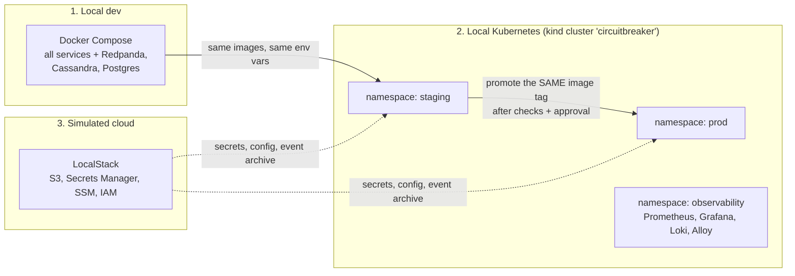
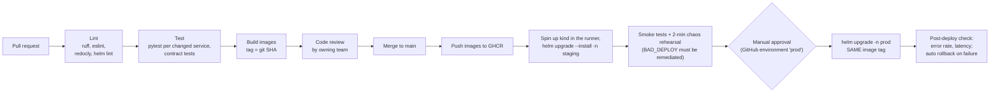

# 07 — Deployment and Environments

> **Environment:** a complete, separate running copy of the system with its own data. We have three:
> `dev` (Docker Compose on a laptop), `staging` and `prod` (namespaces in a local kind Kubernetes cluster).

## 1. The path from laptop to "production"



| | `dev` | `staging` | `prod` |
|---|---|---|---|
| Runs on | Docker Compose | kind, namespace `staging` | kind, namespace `prod` |
| Purpose | Write and debug code fast | Test releases in a production-like setup; chaos rehearsals | The live demo audience |
| Data stores | Own containers | Own Redpanda, Cassandra, Postgres in the namespace | Own Redpanda, Cassandra, Postgres in the namespace |
| Deployed by | `make up` | CI on every merge to `main` | CI after manual approval |
| Replicas | 1 each | Defaults from Helm values | Defaults from Helm values |
| SRE agent | `DryRunPlatform` (logs only) | Live, approval **off** | Live, approval **on** by default |
| Chaos hooks (`CHAOS_HOOKS_ENABLED`) | on | on | on (it is a demo); would be off for a real exchange |
| Bots | 20 | 20 | 20 |

**Why two namespaces in one cluster instead of two clusters?** A laptop cannot run two full clusters plus all data
stores. Namespaces give separate names, resources, secrets, RBAC and network policies — enough to demonstrate
staging/prod separation and promotion. The trade-off (a cluster-level failure affects both) is documented in
[ADR-0007](../adr/0007-kubernetes-kind-and-helm-umbrella.md).

## 2. Docker Compose (dev)

- One `docker-compose.yml` at the repo root starts infrastructure (Redpanda, Cassandra, Postgres, Prometheus,
  Grafana, Loki) and all services, each built from `services/<name>/Dockerfile`.
- Host ports: `api-gateway` 8080, `order-service` 8001, `matching-engine` 8002, `market-data-service` 8003,
  `portfolio-service` 8004, `bot-traders` 8005, `sre-agent` 8006, `chaos-service` 8007, `web` 5173.
- `make up`, `make down`, `make logs s=<service>`, `make seed` (create topics, keyspaces, bot accounts).
- Hot reload: service source folders are mounted and run with `uvicorn --reload`.

## 3. Kubernetes with kind + Helm umbrella chart

> **kind** runs Kubernetes nodes as Docker containers. **Helm** packages Kubernetes YAML into reusable, configurable
> charts. An **umbrella chart** is a parent chart whose dependencies are the sub-charts of every service, so the
> whole system is installed or upgraded with one command.

```text
charts/
└── circuitbreaker/                 # umbrella chart
    ├── Chart.yaml                  # dependencies: one sub-chart per service + data stores
    ├── values.yaml                 # shared defaults (global.instruments, image registry, resources)
    ├── values-staging.yaml         # staging overrides (approval off, smaller resources)
    ├── values-prod.yaml            # prod overrides (approval on)
    └── charts/
        ├── service/                # ONE generic library sub-chart used by all 8 services
        ├── redpanda/  cassandra/  postgres/
```

- All eight services use **one shared sub-chart template** (Deployment, Service, ServiceAccount, HPA-free scaling,
  probes, NetworkPolicy, ServiceMonitor), configured per service in values. Consistency for free.
- Install / upgrade: `helm upgrade --install circuitbreaker charts/circuitbreaker -n staging -f values-staging.yaml --set global.imageTag=<git-sha>`.
- **No HorizontalPodAutoscaler.** Kubernetes' autoscaler would fight the SRE agent over replica counts. The agent is
  our scaler (bounded by max replicas); this is a deliberate choice for the demo.
- Data stores run as StatefulSets per namespace. Whether we use community charts or minimal in-repo templates is
  decided in Phase 5 (license and image availability change often; we pick what is free and maintained then).

### Probes and resources (defaults per service)

| Setting | Value | Why |
|---|---|---|
| Liveness probe | `GET /healthz` every 10 s, fail after 3 | Restart truly stuck processes. |
| Readiness probe | `GET /readyz` every 5 s | Only route traffic once dependencies (DB, broker) are reachable. |
| Requests / limits | 100m CPU / 256–512 MiB memory (market-data: 512 MiB limit) | Small enough for a laptop; memory limit makes the leak scenario observable. |
| Rolling update | `maxUnavailable: 0`, `maxSurge: 1` | No downtime during deploys and rollbacks. |
| Revision history | `revisionHistoryLimit: 10` | Keeps rollback targets and deploy history for the agent. |

## 4. CI/CD pipeline (GitHub Actions)

> **CI (Continuous Integration):** every change is automatically built and tested. **CD (Continuous Delivery):**
> every change that passes can be released to an environment automatically or with one approval.



| Principle | How the pipeline applies it |
|---|---|
| **Build once, deploy many** | The image built from a commit is tagged with its git SHA and the *same* image goes to staging and then prod. Prod never runs an image that staging didn't. |
| **Only build what changed** | Path filters (`services/order-service/**`) run each service's job only when its folder changes → independent deployability in CI too. |
| **Everything in Git** | Helm values, Terraform, dashboards, alert rules — all versioned. A deploy = a commit. |
| **Fast feedback** | Lint and unit tests in < 5 minutes on every pull request. |
| **Safe release** | Rolling updates + readiness probes + automatic `helm rollback` if the post-deploy check fails. |
| **Deploy history** | Every Helm upgrade sets `kubernetes.io/change-cause` to the release (version + SHA). That is the deploy history the SRE agent reads. |

> **Where does "prod" live?** GitHub's hosted runners cannot reach a kind cluster on a student laptop. The pipeline
> therefore creates a **fresh kind cluster inside the CI runner** to prove deployability to staging and prod, and the
> same `make deploy-staging` / `make promote` targets are run against the laptop cluster for the live demo. Same
> charts, same images, same commands.

⚠️ VERIFY AGAINST TEXTBOOK — the textbook's pipeline may use a GitOps tool (e.g. Argo CD) that *pulls* changes into
the cluster rather than CI *pushing* with Helm. If so, mention it as the textbook's approach and explain our choice
(push-based, simpler for a laptop cluster) in the viva; see [ADR-0007](../adr/0007-kubernetes-kind-and-helm-umbrella.md).

## 5. Infrastructure as Code (Terraform + LocalStack)

> **Infrastructure as Code (IaC):** infrastructure described in versioned files and created by a tool, so any
> environment can be recreated identically. **LocalStack** emulates AWS APIs locally, so Terraform runs with no real
> AWS account and no cost.

```text
infra/
├── modules/
│   ├── environment/     # one call per environment: secrets, parameters, bucket, IAM, k8s namespace + RBAC
│   └── observability/   # observability namespace and Grafana dashboards as code
├── envs/
│   ├── staging/main.tf  # module "environment" { name = "staging" }
│   └── prod/main.tf     # module "environment" { name = "prod" }
└── backend/             # S3 bucket + DynamoDB lock table for Terraform state (in LocalStack)
```

| Resource (per environment) | Provider | Purpose |
|---|---|---|
| S3 bucket `circuitbreaker-<env>-event-archive` | AWS (LocalStack) | Nightly export of the market event store (backup; replay source of last resort). |
| Secrets Manager: `circuitbreaker/<env>/openrouter-api-key`, `admin-passcode`, `jwt-secret`, `bot-secret`, DB passwords | AWS (LocalStack) | Secrets never live in Git. A sync job copies them into Kubernetes Secrets. |
| SSM Parameters: `/circuitbreaker/<env>/agent/approval-default`, `/…/agent/model` | AWS (LocalStack) | Environment configuration. |
| IAM roles and policies per service | AWS (LocalStack) | Least-privilege example (e.g. only matching-engine may write the archive bucket). |
| Kubernetes namespace, ResourceQuota, the `sre-agent` Role/RoleBinding, NetworkPolicies | Kubernetes provider | The parts of the environment that live in the cluster. |
| S3 + DynamoDB for Terraform state and locking | AWS (LocalStack) | Shared, locked state, like a real team setup. |

The kind cluster itself is created by `make cluster` (a kind config file), because it is a laptop-level resource
rather than per-environment infrastructure.

⚠️ VERIFY AGAINST TEXTBOOK — the textbook builds its infrastructure on real AWS (with EKS). Check which services and
module structure it uses, so you can explain how our LocalStack + kind setup maps onto it.

## 6. Managing change

| Change type | Process |
|---|---|
| Code change in one service | PR → CI → staging → approval → prod. Other services are not redeployed. |
| Backward-compatible API change (new optional field, new endpoint) | Same as above; spec updated in the same PR. |
| Breaking API change | New version path (`/v2/...`) served alongside `/v1/` until all clients move ([coding standards](../05-coding-standards.md#9-api-versioning-rules)). |
| Breaking event change | New topic `<stream>.v2` alongside v1 ([event catalog](03-event-catalog.md#versioning-rules)). |
| Database schema change | Expand-and-contract: add new column/table → deploy code writing both → backfill → switch reads → remove old. Never a lock-step deploy. |
| Infrastructure change | Terraform plan shown in the PR, applied by CI to staging, then prod. |
| Bad release in prod | Automatic rollback by the pipeline's post-deploy check, or by the SRE agent if it degrades later. |

## Viva Notes

**Q: What is the difference between staging and prod in your project?**
A: Separate namespaces with their own data stores, secrets and settings, deployed by the same Helm chart with
different values files. Staging gets every merge automatically; prod gets the same image only after checks and a
manual approval.

**Q: What does "build once, deploy many" mean?**
A: We build an image once per commit and promote that exact image through environments, so what we tested in staging
is byte-for-byte what runs in prod.

**Q: What is an umbrella chart and why use one?**
A: A parent Helm chart that lists every service's chart as a dependency, so the whole system is installed, upgraded
or rolled back as one release with one command, while each service keeps its own values.

**Q: Why no HorizontalPodAutoscaler?**
A: It would compete with the SRE agent for control of replica counts. For the demo the agent is the scaler, with hard
limits (max 5 replicas).

**Q: Why Terraform if you have no real cloud?**
A: To practise Infrastructure as Code properly: versioned, reviewed, repeatable environments. LocalStack provides the
AWS APIs locally; switching to real AWS would mostly mean changing the provider endpoint and credentials.
