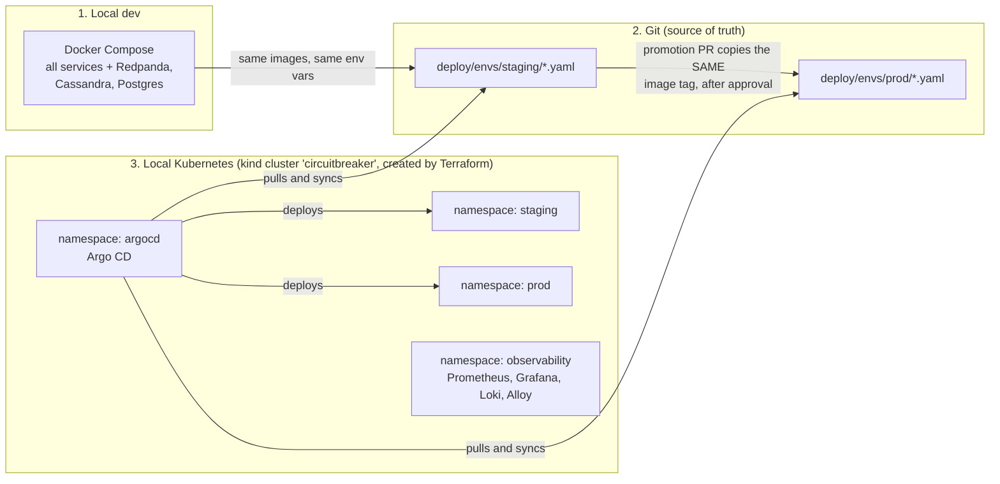
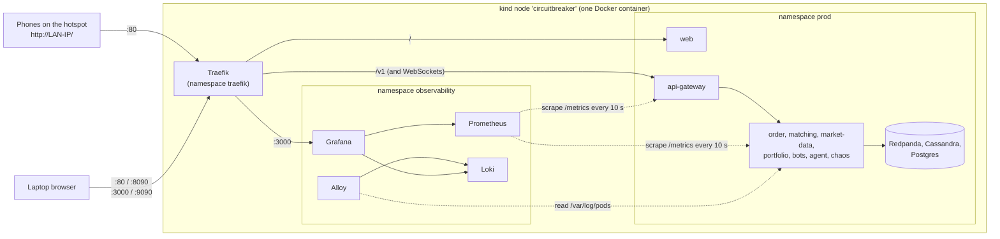

# 07 — Deployment and Environments

> **Environment:** a complete, separate running copy of the system with its own data. We have three:
> `dev` (Docker Compose on a laptop), `staging` and `prod` (namespaces in a local kind Kubernetes cluster).

## 1. The path from laptop to "production"



| | `dev` | `staging` | `prod` |
|---|---|---|---|
| Runs on | Docker Compose | kind, namespace `staging` | kind, namespace `prod` |
| Purpose | Write and debug code fast | Test releases in a production-like setup; chaos rehearsals | The live demo audience |
| Data stores | Own containers | Own Redpanda, Cassandra, Postgres in the namespace | Own Redpanda, Cassandra, Postgres in the namespace |
| Deployed by | `make up` | Argo CD, automatically, when CI commits a new image tag | Argo CD, when an approved promotion PR is merged |
| Replicas | 1 each | Defaults from Helm values | Defaults from Helm values |
| SRE agent | `DryRunPlatform` (logs only) | Live, approval **off** | Live, approval **on** by default |
| Chaos hooks (`CHAOS_HOOKS_ENABLED`) | on | on | on (it is a demo); would be off for a real exchange |
| Bots | 20 | 20 | 20 |
| Reached at | `http://localhost:5173` | `http://<laptop LAN IP>:8090` | `http://<laptop LAN IP>/` (port 80) |

**Why two namespaces in one cluster instead of two clusters?** A laptop cannot run two full clusters plus all the
data stores. Namespaces give separate names, resources, secrets, RBAC and network policies. That is enough to
demonstrate staging/prod separation and promotion. The trade-off (a cluster-level failure affects both) is
documented in [ADR-0007](../adr/0007-kubernetes-kind-and-helm-umbrella.md). Namespaces do **not** separate CPU on
one node: measured in Phase 5, starting staging and its bots raised prod's order p99 to about 5 s for two minutes
and tripped its circuit breaker twice. Phase 6's ResourceQuotas bound each namespace; until then, run staging only
when you need it (`make k8s-up env=staging`).

## 2. Docker Compose (dev)

- One `docker-compose.yml` at the repo root starts the infrastructure (Redpanda, Cassandra, Postgres, Redpanda
  Console) and all services, each built from `services/<name>/Dockerfile`. Prometheus, Grafana and Loki run only on
  Kubernetes ([§3](#3-kubernetes-with-kind--helm-umbrella-chart)); in Compose each service's `/metrics` is read
  directly.
- Host ports: `api-gateway` 8080, `order-service` 8001, `matching-engine` 8002, `market-data-service` 8003,
  `portfolio-service` 8004, `bot-traders` 8005, `sre-agent` 8006, `chaos-service` 8007, `web` 5173, Redpanda Console 8088,
  Postgres 5433. Compose has two profiles: `infra` and `app`.
- `make up`, `make down`, `make logs s=<service>`, `make infra` (only the infrastructure). Two one-shot init jobs create
  the topics and the per-service Cassandra keyspaces and roles ([developer setup](../08-developer-setup.md)); bot and load
  accounts are created by the services in later phases.
- Hot reload: service source folders are mounted and run with `uvicorn --reload`.

## 3. Kubernetes with kind + Helm umbrella chart

> **kind** runs Kubernetes nodes as Docker containers. **Helm** packages Kubernetes YAML into reusable, configurable
> charts. An **umbrella chart** is a parent chart whose dependencies are the sub-charts of every service. It is the
> single versioned package of the whole system.

```text
infra/kind/cluster.yaml             # the kind cluster: one node, host ports 80 / 8090 / 3000 / 9090
infra/platform/*.yaml               # values for Traefik, kube-prometheus-stack, Loki, Alloy (ADR-0018)
charts/
├── circuitbreaker/                 # umbrella chart
│   ├── Chart.yaml                  # dependencies: `service` 9 times (alias = service name) + the data stores
│   ├── values.yaml                 # per-service defaults (env, replicas, resources, who may call it)
│   ├── templates/                  # the Ingress, the namespace's default-deny NetworkPolicy
│   └── charts/
│       ├── service/                # ONE generic sub-chart used by all 8 services and web
│       └── redpanda/  cassandra/  postgres/   # minimal StatefulSets + init Jobs (files/ links to dev/)
└── observability/                  # our dashboards and alert rules (files from observability/)
deploy/
└── envs/
    ├── prod/global.yaml, prod/<service>.yaml        # per-environment settings and (Phase 6) image tags
    └── staging/global.yaml, staging/<service>.yaml
```

- All services use **one shared sub-chart**, included once per service under an alias, so every object is named
  after its service (Service `order-service`, port 8000: the same addresses as in Docker Compose). It renders the
  Deployment, Service, ServiceAccount, ConfigMap (settings), Secret references, NetworkPolicy and, when the
  Prometheus Operator is installed, a ServiceMonitor.
- **One service at a time (for Phase 6):** `--set global.only=order-service` renders only that service. Phase 6's
  ApplicationSet gives each service its own Argo CD Application this way, with `deploy/envs/<env>/global.yaml` and
  `deploy/envs/<env>/<service>.yaml` ([ADR-0014](../adr/0014-gitops-with-argo-cd.md)). CI checks that every
  service renders alone (`make k8s-lint`).
- **Now (Phase 5):** `make k8s-up` creates the cluster, builds and pushes changed images to a local registry
  (`localhost:5001`, tagged by git SHA), installs the platform charts, creates the namespace and its Secrets (the
  local placeholders; Terraform in Phase 6) and installs the umbrella chart into `prod` (`env=staging` for staging).
- **Data stores** are minimal in-repo StatefulSets with persistent volumes, running the Compose images; their init
  Jobs (topics, keyspaces and roles) run the same `dev/` scripts as Compose. Redpanda starts with topic
  auto-creation **off**: only the init Job creates topics, with the event catalog's partitions (found in Phase 5:
  services that started first auto-created 1-partition topics, which left every extra consumer idle). The choice of
  components and their licences: [ADR-0018](../adr/0018-kubernetes-platform-components.md).
- **No HorizontalPodAutoscaler.** The SRE agent is our scaler (bounded by max replicas); see the Viva Notes. A
  person scales by hand until Phase 7: `kubectl scale deployment/order-service --replicas=4`.



### Getting in: ingress and phones

- **Traefik** (the ingress controller) listens on the node's host ports; kind maps them to the laptop:
  **80 → prod**, **8090 → staging** (both on all network interfaces, so phones on the hotspot reach them), **3000 →
  Grafana** and **9090 → Prometheus** (laptop only).
- One Ingress per environment: `/v1/…` (including the WebSockets) goes to `api-gateway`, everything else to `web`.
  No read or write deadline on the public entry points, so WebSockets stay open (the services ping every 15 s).
  Access logs are off: WebSocket URLs carry the token.
- **Phones** use `http://<laptop LAN IP>/` exactly as with Compose (`:5173` there).
  `PUBLIC_BASE_URL=http://<LAN IP> make k8s-up` writes it into web's config, so the join QR code points there
  ([developer setup §11](../08-developer-setup.md#11-kubernetes-kind)). The environment keeps that address through
  restarts, upgrades and `make k8s-bots` (the release's own value is reused when the variable is not set);
  `make k8s-set-url url=…` changes only it, and `make k8s-status` prints the address the QR code really carries.

### Who may talk to whom: network policies

- Every namespace has a **default-deny** ingress policy; each service's policy lists its callers (for example
  order-service: `api-gateway`, `portfolio-service`), and each data store lists its owners only (Cassandra:
  order-service, matching-engine, market-data-service, sre-agent and its init Job; Postgres: portfolio-service).
  Prometheus and Traefik are let in from their namespaces.
- This is what makes the trusted `X-Trader-Id` / `X-Role` headers safe: nothing but the gateway can reach the
  services.
- **Proven, not assumed:** kind's own CNI enforces NetworkPolicy, and `make k8s-check c=netpol` checks 11
  connections: the 5 allowed ones connect, the 6 forbidden ones (a service into another service's data store, a
  bot or chaos-service going around the gateway) are refused.

### Probes, rollouts and resources

| Setting | Value | Why |
|---|---|---|
| Liveness probe | `GET /healthz` every 10 s, fail after 3 | Restart truly stuck processes. `/healthz` never checks dependencies, so a database outage cannot cause a restart loop. |
| Readiness probe | `GET /readyz` every 5 s, fail after 3 | Only route traffic once dependencies (store, broker, consumer caught up) work. |
| Startup probe | `GET /healthz` every 2 s, up to 60 s (Cassandra: TCP 9042, up to 5 min) | Liveness waits until a slow start is over. |
| Rolling update | `maxUnavailable: 0`, `maxSurge: 1`; **Recreate** for matching-engine, bot-traders, sre-agent | No downtime; the three single writers must never run twice, even for seconds. |
| `preStop` | sleep 5 s | A stopping pod keeps serving until Traefik and the other services drop it: 326 requests during a rolling restart of web and the gateway, none failed. |
| Revision history | `revisionHistoryLimit: 10` | Keeps rollback targets and deploy history for the agent. |
| Change cause | `kubernetes.io/change-cause: "release <version> (<image tag>)"` | This is the deploy history the SRE agent reads. |
| Service links | `enableServiceLinks: false` | Otherwise Service `cassandra` injects `CASSANDRA_PORT=tcp://…`, which clashes with the services' own setting (found in Phase 5). |

**Resources (measured with the 20 bots trading, prod, 2026-11-13).** Memory is the working set (what Kubernetes
compares with the limit). Requests are what the scheduler reserves; limits are the most a container may use: above
its memory limit it is killed (`OOMKilled`), above its CPU limit it is slowed down (throttled).

| Container | Replicas | Request CPU / memory | Limit CPU / memory | Measured memory |
|---|---:|---|---|---:|
| api-gateway | 2 | 100m / 96 MiB | **2000m** / 256 MiB | 48–49 MiB each |
| order-service | 2 | 100m / 96 MiB | **500m** / 256 MiB | 58–60 MiB each |
| matching-engine | 1 | 100m / 96 MiB | 1000m / 256 MiB | 59 MiB |
| market-data-service | 1 | 100m / 96 MiB | 1000m / **512 MiB** | 61 MiB |
| portfolio-service | 2 | 100m / 96 MiB | 1000m / 256 MiB | 56–59 MiB each |
| bot-traders | 1 | 100m / 96 MiB | 1000m / 256 MiB | 57 MiB |
| sre-agent, chaos-service | 1 each | 100m / 96 MiB | 1000m / 256 MiB | 49, 43 MiB |
| web (nginx) | 1 | 20m / 16 MiB | 200m / 64 MiB | 10 MiB |
| Cassandra | 1 | 250m / 1.5 GiB | 2000m / 2 GiB | 1,397 MiB (512 MB heap) |
| Redpanda | 1 | 250m / 512 MiB | 1000m / 896 MiB | 170 MiB |
| Postgres | 1 | 100m / 96 MiB | 1000m / 256 MiB | 76 MiB |
| Prometheus / Grafana / Loki / Alloy | 1 each | see `infra/platform/` | 768 / **512** / 384 / 256 MiB | 103 / 403 / 118 / 82 MiB |
| Traefik, kube-state-metrics, operator | 1 each | | 192 / 96 / 128 MiB | 25 / 16 / 26 MiB |

Three limits are deliberate, and are not "small for a laptop":

- **order-service: half a core.** order-service is deliberately the **bottleneck**, so that scaling it is the
  correct fix in the traffic-spike scenario. One replica saturates at a load the laptop can produce, and adding
  replicas visibly adds capacity: `make k8s-check c=scale` at 200 requests/s gives order p95 **9.1 s with 2
  replicas and 96 ms with 4**. The bots alone use under 0.1 core.
- **api-gateway: two cores.** Everything passes through the gateway. At one core it saturated before order-service
  did, so scaling order-service could not have helped; the front door must never be the bottleneck the scenario is
  about.
- **market-data-service: 512 MiB** (the others 256 MiB). The memory-leak scenario's timing (40 MB a minute toward
  the limit) depends on it. **Grafana: 512 MiB**: Grafana 13 was OOM-killed at 256 MiB during its first-start
  migrations.

### The RAM budget (measured)

Agreed budget: **≤ 5.0 GiB for one environment plus monitoring, ≤ 8.5 GiB for everything** (both environments and,
from Phase 6, Argo CD), with Docker Desktop given 11 GB. Measured on a fresh cluster after 10 minutes of the bots
trading (`make k8s-status` prints these numbers):

| What runs | Pods' working set | Node: processes + kernel (**the budget's measure**) | Docker Desktop shows |
|---|---:|---:|---:|
| prod + monitoring + Traefik + Kubernetes itself | 3,994 MiB (prod 2,251; kube-system 958, of which the API server 675; observability 749; Traefik 25) | **4.3 GiB** (4,063 + 357 MiB) | 5.7 GiB |
| + staging with its own bots | 6,452 MiB | **6.5 GiB** | 8.1 GiB |
| + Argo CD (Phase 6, estimate) | | about 7.0 GiB | about 8.6 GiB |
| The local image registry (outside the cluster) | | 0.04 GiB | 0.04 GiB |

**Which number counts, and why Docker's is higher.** The budget counts **process memory** (the working set of what
runs: anonymous memory plus the kernel's own). Docker Desktop's figure also includes **page cache**: copies of files
the kernel keeps in RAM because they were read recently (image layers, Cassandra's SSTables, Prometheus' and Loki's
data). The kernel gives page cache back whenever a process needs the memory, so it is not committed. Checked: after
dropping the caches on the node, file memory fell from 3.9 GiB to 1.7 GiB; the rest is cache of files the databases
are reading right now, which the kernel would also reclaim under pressure. By process memory both budgets hold;
by Docker's figure one environment is about 0.7 GiB over.

## 4. CI/CD pipeline: GitHub Actions + Argo CD (GitOps)

> **CI (Continuous Integration):** every change is automatically built and tested. **Continuous Delivery** (the
> textbook's sense): teams can automatically and continually ship finished services as containers. **Deployment** is
> the separate step of releasing those containers into an environment. In the textbook's model the release team does
> this (Mitra & Nadareishvili, Ch. 7).
> **GitOps:** Git is the source of truth for what should run. A **GitOps deployment server** keeps the cluster
> matching Git and reports **drift** (live state that differs from Git) (Ch. 7). **Argo CD** is that server here.
> **Sync / `OutOfSync`:** Argo CD's words for "made the cluster match Git" / "the cluster differs from Git".

```mermaid
flowchart LR
    PRQ["Pull request"] --> L["Lint<br/>ruff, eslint, redocly,<br/>helm lint, terraform validate"]
    L --> T["Test<br/>pytest per changed service,<br/>contract tests"]
    T --> REV["Code review<br/>by owning team"]
    REV --> M["Merge to main"]
    M --> B["Build changed images ONCE<br/>tag = git SHA, push to GHCR"]
    B --> BUMP["CI commits tag bump to<br/>deploy/envs/staging/"]
    BUMP --> AS["Argo CD syncs staging<br/>+ PostSync smoke-test Job"]
    AS --> CR["Chaos rehearsal in staging<br/>(BAD_DEPLOY must be remediated)"]
    CR --> PP["make promote: PR copies the<br/>SAME tag to deploy/envs/prod/"]
    PP --> A{"Approval by<br/>Release & Reliability<br/>(CODEOWNERS)"}
    A --> AP["Merge → Argo CD syncs prod<br/>+ PostSync smoke-test Job"]
    AP --> RB["Smoke test fails?<br/>git revert the promotion"]
```



| Principle | How the pipeline applies it |
|---|---|
| **Build once, deploy many** | The image built from a commit is tagged with its git SHA. The *same* tag is first written to staging's values and later copied to prod's. Prod never runs an image that staging didn't. |
| **Only build what changed** | Path filters (`services/order-service/**`) run each service's job only when its folder changes, so CI also deploys services independently. |
| **Everything in Git** | Helm values, image tags, Argo CD config, Terraform, dashboards and alert rules are all versioned. A deploy *is* a commit. |
| **Pull, don't push** | CI never touches the cluster. Argo CD, inside the cluster, pulls from GitHub. The cluster only needs outbound access, which is why this works for a laptop cluster ([ADR-0014](../adr/0014-gitops-with-argo-cd.md)). |
| **Fast feedback** | Lint and unit tests in under 5 minutes on every pull request. |
| **Safe release** | Rolling updates, readiness probes and PostSync smoke tests. A bad release is undone with `git revert`. If it degrades at runtime, the SRE agent rolls back at once and then opens the `git revert` pull request itself. |
| **Approvals by the release team** | The prod promotion PR must be approved by the Release & Reliability Team. This mirrors the textbook's release team, which coordinates approvals and deploys into production (Ch. 2, Ch. 7). |

**What CI checks for Kubernetes now (Phase 5).** Every pull request runs `make k8s-lint`: `helm lint`, rendering
both environments and every service on its own (`global.only`, as Argo CD will), the platform charts with our
values, schema validation of every object against Kubernetes 1.37 (kubeconform, including the Prometheus Operator's
ServiceMonitor and PrometheusRule), and the alert rules' unit tests (promtool). The full system on kind
(`make test-k8s`) does **not** fit GitHub's standard runner for a private repository (measured on PR #4: 2 CPUs,
7.9 GB): the pods' CPU *requests* add up to about 3.1 cores (prod services and stores 1.8, Kubernetes itself 0.95,
monitoring and Traefik 0.35), so the scheduler leaves Cassandra, Redpanda and the gateway `Pending`. A CI-only
profile with smaller requests and no monitoring would fit, but would test a different system from the one we demo.
So `make test-k8s` runs on the laptop, and in CI only when a pull request is labelled `k8s-smoke` (for a larger
runner).

**Argo CD settings that matter** (full reasoning in [ADR-0014](../adr/0014-gitops-with-argo-cd.md)):

- **Automated sync on, self-heal off.** Git changes deploy automatically. Live changes, from chaos or from the SRE
  agent, are *reported* as `OutOfSync` but not reverted, so Argo CD never fights the agent or erases an experiment.
- **Ignored fields:** `spec.replicas` and the pod-template `restartedAt` annotation. These belong to the agent's
  `scale_deployment` and `restart_deployment` tools, so later syncs don't reset them.
- **One Application per service per environment.** A commit for `order-service` syncs only `order-service`.

**How a rollback interacts with Git: mitigate fast, reconcile through Git**
([ADR-0016](../adr/0016-rollback-reconciles-through-git.md)):

- The agent's `rollback_deployment` first rolls back in the cluster (seconds).
- After a chaos `BAD_DEPLOY`, that already returns the Deployment to what Git says, so Argo CD shows `Synced` and no
  Git change is needed.
- After a *real* bad release that came through Git, the same tool's code then opens a `git revert` pull request for
  the tag-bump commit. When a human merges it, Argo CD syncs and the Application is `Synced` again. The pod template
  is identical, so there is no new rollout.
- To keep each revert clean, **CI writes one tag-bump commit per service per environment**.

## 5. Infrastructure as Code (Terraform)

> **Infrastructure as Code (IaC):** infrastructure described in versioned files and created by a tool, so any
> environment can be recreated identically. **Terraform module:** a reusable folder of Terraform code with inputs
> (variables) and outputs. **Provider:** the plug-in Terraform uses to talk to one platform (kind, Kubernetes, Helm,
> AWS). **LocalStack** emulates AWS APIs locally; it is **optional** in our design.

Terraform is the primary IaC tool for the **local platform**
([ADR-0015](../adr/0015-terraform-local-platform.md), amending [ADR-0010](../adr/0010-terraform-localstack.md)).
It arrives in **Phase 6**; in Phase 5 `make k8s-up` creates the same one-node cluster from `infra/kind/cluster.yaml`
and the dev Secrets from the local placeholders, and the modules take over with the same settings:

```text
infra/
├── modules/
│   ├── kind-cluster/   # kind provider: cluster 'circuitbreaker'
│   ├── environment/    # kubernetes provider: namespace, ResourceQuota, sre-agent Role/RoleBinding, Secrets
│   ├── argo-cd/        # helm provider: Argo CD in namespace 'argocd' + the ApplicationSet
│   └── localstack/     # OPTIONAL: aws provider → LocalStack (S3 event-archive bucket)
└── envs/
    └── local/main.tf   # calls kind-cluster, environment × {staging, prod}, argo-cd (and optionally localstack)
```

| Resource | Module / provider | Purpose |
|---|---|---|
| kind cluster `circuitbreaker` (one node, the settings of `infra/kind/cluster.yaml`) | `kind-cluster` / kind (community provider, version pinned) | The Kubernetes cluster itself, created as code. |
| Namespaces `staging`, `prod`, `observability`, `argocd` with ResourceQuotas | `environment` / kubernetes | Separate, size-limited environments. |
| The `sre-agent` ServiceAccount, Role and RoleBinding per environment | `environment` / kubernetes | The agent's least-privilege permissions ([SRE agent design](05-sre-agent-design.md#defence-in-depth-kubernetes-rbac)). |
| Kubernetes Secrets: `openrouter-api-key`, `jwt-secret`, `bot-secret`, `admin-passcode`, DB passwords | `environment` / kubernetes | Values come from `TF_VAR_*` variables or a git-ignored `secrets.auto.tfvars`, never from Git. |
| Argo CD + the `ApplicationSet` | `argo-cd` / helm + kubernetes | The GitOps deployment server ([§4](#4-cicd-pipeline-github-actions--argo-cd-gitops)). |
| *Optional:* S3 bucket `circuitbreaker-<env>-event-archive` | `localstack` / aws → LocalStack | Nightly export of the market event store, to demonstrate cloud resources. ⚠️ Check LocalStack's current licence and free-tier terms before enabling it. |

- **State:** local backend; the `.tfstate` file is git-ignored. It contains secret values, so it must never be
  committed.
- **Pipeline:** every PR runs `terraform fmt -check` and `validate`. A CI job also runs `terraform apply` on
  `envs/local` inside the runner, checks that Argo CD's pods are running, then runs `terraform destroy`. This is the
  textbook's "test the environment, then clean up". On the demo laptop the Cloud Platform Team runs `make platform`
  (plan, review, apply).

### How this maps onto the textbook's AWS infrastructure

The textbook (Mitra & Nadareishvili, Ch. 7) builds three components on real AWS with Terraform modules: a network, a
managed Kubernetes service and a GitOps deployment server. A sandbox environment file uses all three.

| Textbook component (real AWS) | Our local equivalent |
|---|---|
| VPC, 4 subnets, routing, NAT (`module-aws-network`) | kind cluster's Docker network + Kubernetes namespaces and NetworkPolicies |
| EKS managed Kubernetes (`module-aws-kubernetes`) | kind cluster (`modules/kind-cluster`) |
| Argo CD via Terraform's Helm provider (`module-argo-cd`) | Argo CD via Terraform's Helm provider (`modules/argo-cd`) |
| Terraform modules called from a sandbox environment | Terraform modules called from `infra/envs/local` |
| GitHub Actions infrastructure pipeline | GitHub Actions validate + create–check–destroy test; real apply via `make platform` |

## 6. Managing change

| Change type | Process |
|---|---|
| Code change in one service | PR → CI builds the image → tag bump in `deploy/envs/staging/` → Argo CD syncs staging → promotion PR → approval → Argo CD syncs prod. Other services are not redeployed. |
| Backward-compatible API change (new optional field, new endpoint) | Same as above; the spec is updated in the same PR. |
| Breaking API change | New version path (`/v2/...`) served alongside `/v1/` until all clients move ([coding standards](../05-coding-standards.md#9-api-versioning-rules)). |
| Breaking event change | New topic `<stream>.v2` alongside v1 ([event catalog](03-event-catalog.md#versioning-rules)). |
| Database schema change | Expand-and-contract: add the new column/table → deploy code writing both → backfill → switch reads → remove the old. Never a lock-step deploy. |
| Infrastructure change | Terraform plan shown in the PR; validated and test-applied in CI; applied with `make platform` by the Cloud Platform Team. |
| Bad release in prod | PostSync smoke test fails → `git revert` the promotion and Argo CD syncs back. If it degrades later, the SRE agent rolls back at once and opens the `git revert` pull request; Release & Reliability approves and merges it. |

## Viva Notes

**Q: What is the difference between staging and prod in your project?**
A: Separate namespaces with their own data stores, secrets and settings. Both use the same chart, with different
values files in `deploy/envs/`. Staging gets every merged change automatically; prod gets the same image only after
a promotion PR is approved and merged.

**Q: What does "build once, deploy many" mean?**
A: We build an image once per commit and promote that exact image through the environments, by copying its tag in
Git. What we tested in staging is byte-for-byte what runs in prod.

**Q: What is GitOps, and why Argo CD?**
A: Git holds the desired state; a deployment server in the cluster pulls it in and reports drift. Argo CD is the
textbook's GitOps deployment server (Ch. 7), and pulling works for a laptop cluster that GitHub cannot reach.

**Q: Why not HPA?**
A: The HorizontalPodAutoscaler sees only CPU and memory. The SRE agent sees error rates, deploy history and business
metrics, and explains its decision, so it can tell a traffic spike (scale) from a bad release (roll back) or a leak
(restart). Running both would make them fight over the replica count. We show that more replicas mean more capacity
(order p95 9.1 s at 2 replicas, 96 ms at 4); in Phase 7 the agent makes that call.

**Q: Your cluster uses 4.3 GiB, but Docker Desktop shows 5.7 GiB. Which is right?**
A: Both, measuring different things. 4.3 GiB is what the processes hold. Docker also counts page cache, files the
kernel keeps in RAM because they were read recently (images, database files), which it gives back as soon as a
process needs memory. We budget process memory, and we checked that dropping the cache removes most of the gap.
