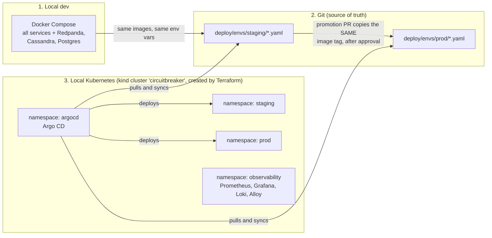
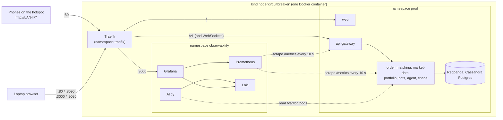
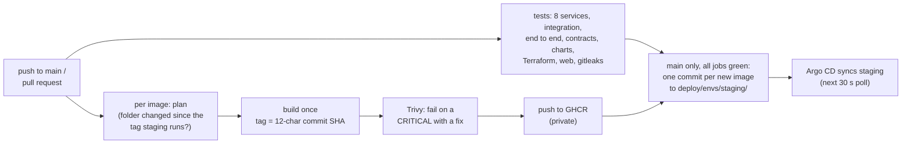
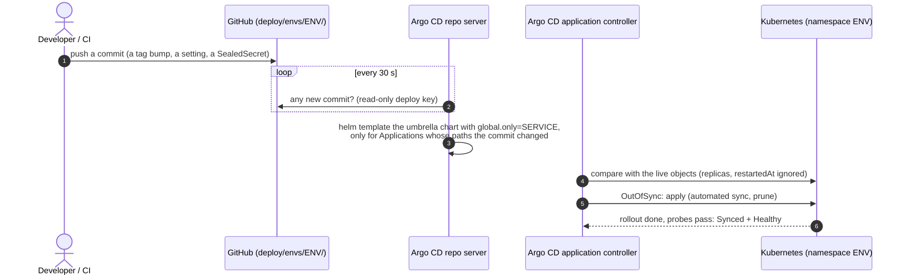

# 07 — Deployment and Environments

> **Environment:** a complete, separate running copy of the system with its own data. We have three:
> `dev` (Docker Compose on a laptop), `staging` and `prod` (namespaces in a local kind Kubernetes cluster).

## 1. The path from laptop to "production"



| | `dev` | `staging` | `prod` |
|---|---|---|---|
| Runs on | Docker Compose | kind, namespace `staging` | kind, namespace `prod` |
| Purpose | Write and debug code fast | Test releases in a production-like setup; chaos rehearsals | The live demo audience |
| Data stores | Own containers | Own Redpanda, Cassandra, Postgres in the namespace | Own Redpanda, Cassandra, Postgres in the namespace |
| Deployed by | `make up` | Argo CD, automatically, when CI commits a new image tag | Argo CD, when an approved promotion PR is merged |
| Replicas | 1 each | Defaults from Helm values | Defaults from Helm values |
| SRE agent | `DryRunPlatform` (logs only) | Live, approval **off** | Live, approval **on** by default |
| Chaos hooks (`CHAOS_HOOKS_ENABLED`) | on | on | on (it is a demo); would be off for a real exchange |
| Bots | 20 | 20 | 20 |
| Reached at | `http://localhost:5173` | `http://<laptop LAN IP>:8090` | `http://<laptop LAN IP>/` (port 80) |

**Why two namespaces in one cluster instead of two clusters?** A laptop cannot run two full clusters plus all the
data stores. Namespaces give separate names, resources, secrets, RBAC and network policies. That is enough to
demonstrate staging/prod separation and promotion. The trade-off (a cluster-level failure affects both) is
documented in [ADR-0007](../adr/0007-kubernetes-kind-and-helm-umbrella.md). Namespaces do **not** separate CPU on
one node: measured in Phase 5, starting staging and its bots raised prod's order p99 to about 5 s for two minutes
and tripped its circuit breaker twice. Phase 6 gives each namespace a **ResourceQuota**, but measured against the
chart it is a ceiling on what a namespace may *claim* (a runaway scale, a second copy of the system), not a share
of the CPU: one environment's CPU limits add up to 17.7 cores on a 12-core laptop, so a quota both environments fit
under cannot keep staging off prod's cores. Real separation would need lower limits in staging, which would make it
behave unlike prod. So the rule stays: **run staging only when you need it** (the demo profile, section 3's RAM
table).

## 2. Docker Compose (dev)

- One `docker-compose.yml` at the repo root starts the infrastructure (Redpanda, Cassandra, Postgres, Redpanda
  Console) and all services, each built from `services/<name>/Dockerfile`. Prometheus, Grafana and Loki run only on
  Kubernetes ([§3](#3-kubernetes-with-kind--helm-umbrella-chart)); in Compose each service's `/metrics` is read
  directly.
- Host ports: `api-gateway` 8080, `order-service` 8001, `matching-engine` 8002, `market-data-service` 8003,
  `portfolio-service` 8004, `bot-traders` 8005, `sre-agent` 8006, `chaos-service` 8007, `web` 5173, Redpanda Console 8088,
  Postgres 5433. Compose has two profiles: `infra` and `app`.
- `make up`, `make down`, `make logs s=<service>`, `make infra` (only the infrastructure). Two one-shot init jobs create
  the topics and the per-service Cassandra keyspaces and roles ([developer setup](../08-developer-setup.md)); bot and load
  accounts are created by the services in later phases.
- Hot reload: service source folders are mounted and run with `uvicorn --reload`.

## 3. Kubernetes with kind + Helm umbrella chart

> **kind** runs Kubernetes nodes as Docker containers. **Helm** packages Kubernetes YAML into reusable, configurable
> charts. An **umbrella chart** is a parent chart whose dependencies are the sub-charts of every service. It is the
> single versioned package of the whole system.

```text
infra/kind/cluster.yaml             # the kind cluster: one node, host ports 80 / 8090 / 3000 / 9090
infra/platform/*.yaml               # values for Traefik, kube-prometheus-stack, Loki, Alloy, Argo CD, Sealed Secrets
infra/modules/, infra/envs/local/   # Terraform: the platform as code (section 5)
charts/
├── circuitbreaker/                 # umbrella chart
│   ├── Chart.yaml                  # dependencies: `service` 9 times (alias = service name) + the data stores
│   ├── values.yaml                 # per-service defaults (env, replicas, resources, who may call it)
│   ├── templates/                  # the Ingress (the default-deny policy is Terraform's, section 5)
│   └── charts/
│       ├── service/                # ONE generic sub-chart used by all 8 services and web
│       └── redpanda/  cassandra/  postgres/   # minimal StatefulSets + init Jobs (files/ links to dev/)
└── observability/                  # our dashboards and alert rules (files from observability/)
deploy/
└── envs/
    ├── prod/global.yaml, prod/<service>.yaml        # per-environment settings and the image tags Argo CD deploys
    ├── prod/sealed/<secret>.yaml                    # the environment's Secrets, encrypted (ADR-0019)
    └── staging/...                                  # the same for staging
```

- All services use **one shared sub-chart**, included once per service under an alias, so every object is named
  after its service (Service `order-service`, port 8000: the same addresses as in Docker Compose). It renders the
  Deployment, Service, ServiceAccount, ConfigMap (settings), Secret references, NetworkPolicy and, when the
  Prometheus Operator is installed, a ServiceMonitor.
- **One service at a time:** `--set global.only=order-service` renders only that service. The ApplicationSet gives
  each service its own Argo CD Application this way, with `deploy/envs/<env>/global.yaml` and
  `deploy/envs/<env>/<service>.yaml` ([ADR-0014](../adr/0014-gitops-with-argo-cd.md)). CI checks that every
  service renders alone (`make k8s-lint`).
- **Deployed by Argo CD from Git (Phase 6):** `make platform` builds the platform with Terraform (section 5) and
  Argo CD deploys `staging` and `prod` from `deploy/envs/` (section 4). Nobody runs `helm` or `kubectl apply` on
  them.
- **Developing (`make k8s-up`):** in a namespace Argo CD does **not** manage, it builds and pushes changed images
  to the local registry (`localhost:5001`, tagged by git SHA), creates the Secrets from the local placeholders and
  installs the umbrella chart, as in Phase 5. With no cluster at all it first applies the Terraform root without
  Argo CD. In a namespace Argo CD manages, it deploys nothing: it starts a stopped cluster and waits until Argo CD
  reports it `Synced` and `Healthy`.
- **Operator settings, outside Git:** the join QR code's address (tonight's hotspot) and the bots on or off are not
  releases. They live in the ConfigMap `operator-settings` of each namespace (`make k8s-set-url`, `make k8s-bots`),
  which the chart reads with optional references and which Argo CD never owns, so a sync neither resets the
  address nor stops the bots.
- **Data stores** are minimal in-repo StatefulSets with persistent volumes, running the Compose images; their init
  Jobs (topics, keyspaces and roles) run the same `dev/` scripts as Compose. Redpanda starts with topic
  auto-creation **off**: only the init Job creates topics, with the event catalog's partitions (found in Phase 5:
  services that started first auto-created 1-partition topics, which left every extra consumer idle). The choice of
  components and their licences: [ADR-0018](../adr/0018-kubernetes-platform-components.md).
- **No HorizontalPodAutoscaler.** The SRE agent is our scaler (bounded by max replicas); see the Viva Notes. A
  person scales by hand until Phase 7: `kubectl scale deployment/order-service --replicas=4`.



### Getting in: ingress and phones

- **Traefik** (the ingress controller) listens on the node's host ports; kind maps them to the laptop:
  **80 → prod**, **8090 → staging** (both on all network interfaces, so phones on the hotspot reach them), **3000 →
  Grafana** and **9090 → Prometheus** (laptop only).
- One Ingress per environment: `/v1/…` (including the WebSockets) goes to `api-gateway`, everything else to `web`.
  No read or write deadline on the public entry points, so WebSockets stay open (the services ping every 15 s).
  Access logs are off: WebSocket URLs carry the token.
- **Phones** use `http://<laptop LAN IP>/` exactly as with Compose (`:5173` there).
  `PUBLIC_BASE_URL=http://<LAN IP> make k8s-up` writes it into web's config, so the join QR code points there
  ([developer setup §11](../08-developer-setup.md#11-kubernetes-kind)). The environment keeps that address through
  restarts, upgrades and `make k8s-bots` (the release's own value is reused when the variable is not set);
  `make k8s-set-url url=…` changes only it, and `make k8s-status` prints the address the QR code really carries.

### Who may talk to whom: network policies

- Every namespace has a **default-deny** ingress policy; each service's policy lists its callers (for example
  order-service: `api-gateway`, `portfolio-service`), and each data store lists its owners only (Cassandra:
  order-service, matching-engine, market-data-service, sre-agent and its init Job; Postgres: portfolio-service).
  Prometheus and Traefik are let in from their namespaces.
- This is what makes the trusted `X-Trader-Id` / `X-Role` headers safe: nothing but the gateway can reach the
  services.
- **Proven, not assumed:** kind's own CNI enforces NetworkPolicy, and `make k8s-check c=netpol` checks 11
  connections: the 5 allowed ones connect, the 6 forbidden ones (a service into another service's data store, a
  bot or chaos-service going around the gateway) are refused.

### Probes, rollouts and resources

| Setting | Value | Why |
|---|---|---|
| Liveness probe | `GET /healthz` every 10 s, fail after 3 | Restart truly stuck processes. `/healthz` never checks dependencies, so a database outage cannot cause a restart loop. |
| Readiness probe | `GET /readyz` every 5 s, fail after 3 | Only route traffic once the pod can answer correctly: its store and broker work, and its consumer has caught up only where an answer depends on it (not order-service or portfolio-service; [coding standards §7](../05-coding-standards.md#7-standard-operational-endpoints)). |
| Startup probe | `GET /healthz` every 2 s, up to 60 s (Cassandra: TCP 9042, up to 5 min) | Liveness waits until a slow start is over. |
| Rolling update | `maxUnavailable: 0`, `maxSurge: 1`; **Recreate** for matching-engine, bot-traders, sre-agent | No downtime; the three single writers must never run twice, even for seconds. |
| `preStop` | sleep 5 s | A stopping pod keeps serving until Traefik and the other services drop it: 326 requests during a rolling restart of web and the gateway, none failed. |
| Revision history | `revisionHistoryLimit: 10` | Keeps rollback targets and deploy history for the agent. |
| Change cause | `kubernetes.io/change-cause: "release <version> (<image tag>)"` | This is the deploy history the SRE agent reads. |
| Service links | `enableServiceLinks: false` | Otherwise Service `cassandra` injects `CASSANDRA_PORT=tcp://…`, which clashes with the services' own setting (found in Phase 5). |

**Resources (measured with the 20 bots trading, prod, 2026-11-13).** Memory is the working set (what Kubernetes
compares with the limit). Requests are what the scheduler reserves; limits are the most a container may use: above
its memory limit it is killed (`OOMKilled`), above its CPU limit it is slowed down (throttled).

| Container | Replicas | Request CPU / memory | Limit CPU / memory | Measured memory |
|---|---:|---|---|---:|
| api-gateway | 2 | 100m / 96 MiB | **2000m** / 256 MiB | 48–49 MiB each |
| order-service | 2 | 100m / 96 MiB | **500m** / 256 MiB | 58–60 MiB each |
| matching-engine | 1 | 100m / 96 MiB | 1000m / **384 MiB** | 124–138 MiB (an hour of finished orders) |
| market-data-service | 1 | 100m / 96 MiB | 1000m / **512 MiB** | 61 MiB |
| portfolio-service | 2 | 100m / 96 MiB | 1000m / 256 MiB | 56–59 MiB each |
| bot-traders | 1 | 100m / 96 MiB | 1000m / 256 MiB | 57 MiB |
| sre-agent, chaos-service | 1 each | 100m / 96 MiB | 1000m / 256 MiB | 49, 43 MiB |
| web (nginx) | 1 | 20m / 16 MiB | 200m / 64 MiB | 10 MiB |
| Cassandra | 1 | 250m / 1.5 GiB | 2000m / 2 GiB | 944–991 MiB process memory (512 MB heap); see its budget below |
| Redpanda | 1 | 250m / 512 MiB | 1000m / 896 MiB | 170 MiB |
| Postgres | 1 | 100m / 96 MiB | 1000m / 256 MiB | 76 MiB |
| Prometheus / Grafana / Loki / Alloy | 1 each | see `infra/platform/` | 768 / **512** / 384 / 256 MiB | 103 / 403 / 118 / 82 MiB |
| Traefik, kube-state-metrics, operator | 1 each | | 192 / 96 / 128 MiB | 25 / 16 / 26 MiB |

Four limits are deliberate, and are not "small for a laptop":

- **order-service: half a core.** order-service is deliberately the **bottleneck**, so that scaling it is the
  correct fix in the traffic-spike scenario. One replica saturates at a load the laptop can produce, and adding
  replicas visibly adds capacity: `make k8s-check c=scale` at 200 requests/s gives order p95 **9.1 s with 2
  replicas and 96 ms with 4**. The bots alone use under 0.1 core.
- **api-gateway: two cores.** Everything passes through the gateway. At one core it saturated before order-service
  did, so scaling order-service could not have helped; the front door must never be the bottleneck the scenario is
  about.
- **market-data-service: 512 MiB** (the others 256 MiB). The memory-leak scenario's timing (40 MB a minute toward
  the limit) depends on it. **Grafana: 512 MiB**: Grafana 13 was OOM-killed at 256 MiB during its first-start
  migrations.
- **matching-engine: 384 MiB.** The engine remembers every order it finished in the last hour (ADR-0017 note "A
  memory of one hour"), about 250 bytes each, and about 280 more each while a snapshot is written. Measured: 124–138
  MiB over 60 minutes at 40 orders a second plus the bots (about 100,000 orders remembered). The 5-minute traffic
  spike (110 requests/s, chaos scenarios §3.3) adds about 33,000; measured after a 40-orders/s soak followed by an
  hour of calibration runs (panic sells at 100–150 requests/s, 18 minutes in all), about 107,000 orders
  remembered, plus time-travel seek tests: 304 MiB, peak 313 MiB, no restart. That is three times what one demo
  spike adds. It is well above the 530 bytes per order the model above predicts: Python keeps the memory it freed
  after building snapshots and answering seeks. A snapshot answer (Q-15, up to 5 MB) is built at most twice at a
  time, to bound that extra. Before the one-hour memory,
  the engine kept every order ever seen and was OOM-killed at 256 MiB after about 600,000.

### Load balancing per connection

A Kubernetes Service spreads **connections**, not requests: when a client opens a TCP connection to the Service's
address, kube-proxy picks one ready pod for it, and every request on that connection goes to that pod until it closes.
api-gateway keeps a pool of keep-alive connections to each service (httpx, up to 100, an idle one closed after 2 s).
Under steady load the connections are never idle, so they are never closed: they stay with the pods they were opened
to. Measured in the traffic spike (2026-11-26): after scaling order-service from 2 to 5, the three new pods were ready
within 7 s but got 2–13% of the orders for minutes (their fair share is 60%), while the two old pods stayed at their
CPU limit with a p95 of about 2.2 s. They got load only when connections happened to be reopened, for example after a
request timed out.

**What we do:** order-service closes the connection of every request it turns away with `503 OVERLOADED`
(`Connection: close`). The gateway opens a new connection for its next request, and kube-proxy may place it on any
ready pod, so an overloaded pod sheds connections exactly while it is overloaded, and only then.
`gateway_upstream_connections_opened_total{upstream}` counts the connections the gateway opens. Measured
(2026-11-26, the panic sell at 110 requests/s, 5 runs, order-service ready at once in both columns):

| After the scale from 2 to 5 | Keep-alive only | Close on overload |
|---|---|---|
| Orders on the 3 new pods, 60 s after the scale (a fair share is 60%) | 7–38% (median 10%) | 16–45% (median 38%) |
| A trader's orders under 500 ms again | 0–232 s (median 54 s) | 1–120 s (median 7 s) |
| Click → recovered | 83–235 s (median 132 s) | 69–182 s (median 81 s) |
| The 2 old pods during the overload: p95, share of 5xx | 1.1–2.2 s, 4–22% | 1.0–2.3 s, 10–28% |
| The gateway's new connections to order-service | not counted yet | 13–50 a second during the overload (quiet: 0.3) |

The overload itself is no worse (the alert fired 38–44 s after the click, as before), and a new connection inside
the node costs a TCP handshake. Moving the load is likely, not certain: only turned-away requests reconnect, and one
run in five still recovered slowly (182 s, its new pods got 9–27%). Readiness that no longer waits for the consumer
made it matter ([coding standards §7](../05-coding-standards.md#7-standard-operational-endpoints)): before, the old
pods got slow enough while the new ones caught up that requests timed out and connections were reopened anyway.

**Alternatives we did not take:**

| Option | What it does | Why not here |
|---|---|---|
| A service mesh (Linkerd, Istio) | A proxy container beside every pod balances each **request** (layer 7) across the ready pods | A proxy's memory in each of 20-odd pods plus a control plane on one 16 GB laptop, and a new component to explain and operate: the platform-level answer for a real cluster |
| The gateway balances itself | It reads the pods' addresses (a headless Service) and picks one per request | Re-implements what a mesh does, in our code |
| Recycle the gateway's connections on a timer | Every connection is closed after N seconds or N requests | Costs reconnects when nothing is wrong; tuning N trades speed against waste |

### Cassandra's memory budget

An OOM-killed Cassandra stops the whole exchange, so its memory must have a ceiling below its 2 GiB limit by
construction, not by luck. Cassandra's start-up scripts size it for the **machine**, not the container: on this
12-core laptop they chose 12 GC threads (on a 2-CPU quota), allowed 2,735 MB of direct memory (more than the whole
limit), and the preloaded allocator (jemalloc) made 48 memory arenas. The profiling PR (2026-11-23) measured where the
memory goes with the JVM's Native Memory Tracking, set every part from the container's size
(`dev/cassandra/entrypoint.sh`, used by Compose and the chart alike), and measured again. Each run was the same
16 minutes: 7 minutes of the bots, 4 minutes of 60 orders/s on top (`load_orders.py`), 5 minutes after.

| Part (MiB) | Stock settings, measured | Ours, measured | Cap | Setting, and why |
|---|---:|---:|---:|---|
| Heap | 512 | 512 | 512 | `MAX_HEAP_SIZE`; touched in full at start. Live data after a collection fell from 300–414 to 169–188: memtables moved off it |
| Memtables (writes not yet on disk) | inside the heap, up to 128 | off the heap (in the next row) | 128 off + 64 on | `memtable_allocation_type: offheap_objects`: the garbage collector no longer copies them |
| Direct buffers and other native memory Java allocates | 137–141 | 97–104 | 192 (direct) | `-XX:MaxDirectMemorySize=192M` (stock: 2,735, above the limit). Direct buffers in use: 58–63 |
| GC data structures | 77 | 56 | | 2 GC threads instead of 12 |
| Thread stacks | 76 (126–137 threads) | 31 (85–91 threads) | | `concurrent_reads` 8, `concurrent_writes` 16, one compactor, `-XX:ActiveProcessorCount=2` |
| Class metadata, compiled code, symbols | 114 | 108 | 128 + 64 | `-XX:MaxMetaspaceSize=128M`, `-XX:ReservedCodeCacheSize=64M` |
| Other JVM areas | 18 | 18 | | |
| Native memory outside the JVM (allocator, native libraries) | 358–465 | 126–165 | | `MALLOC_CONF`: 2 arenas, no huge pages for the allocator's memory, freed memory returned within 2 s |
| **Process memory (what an OOM kill counts)** | **1,280–1,387** | **944–991** | **≈ 1,350 (sum of caps)** | 0.7 GiB below the 2,048 limit even if every part filled up |
| Page cache (recently read files) | 343–536 | 293–614 | | The kernel gives it back under pressure; never the cause of an OOM kill |

The commit log is capped too (`commitlog_total_space: 256MiB`; it had reached 5.7 GB on the long-running cluster):
that is disk, not memory, but an unbounded log means an unbounded replay after a restart. `-XX:+ExitOnOutOfMemoryError`
replaces the stock behaviour, where a heap OutOfMemoryError killed one thread and the JVM went on (seen when an ad-hoc
query scanned the old snapshot table): now it exits and Kubernetes restarts it.

**Garbage collection, same 16 minutes:**

| | Stock settings | Ours |
|---|---:|---:|
| Pauses | 124 (4 of them full collections) | 37 (no full collection) |
| Pause p95 / max | 287 / 615 ms | 146 / 147 ms |
| Time paused | 1.15% | 0.31% |
| Order POST p95 at 60 orders/s, median and worst 5-second window | 139 / 578 ms | 52 / 267 ms |
| Mac load average (median, 12 cores) | 7.2 | 6.6 |

**Longer runs, and the condition.** Over the 60-minute soak (40 orders/s plus the bots, Mac load median 6.3): 362
pauses, p95 151 ms, p99 230 ms, max 306 ms, 0.73% of the time paused; process memory 975–1,016 MiB the whole hour,
968–1,056 MiB over three hours. The 19-hour cluster before the fix paused 7–10.5% of the time, p95 up to 806 ms and
once 3.9 s. The young collections take 60–150 ms with two GC threads; when the Mac itself is saturated they stretch:
during the spike calibration (Mac load up to 15–20) the longest was 699 ms, and a third 16-minute run (G1 left to
size the young generation itself, otherwise the same) measured 203, 240 and 641 ms in the one minute the Mac's load
reached 12–16, with no gain otherwise, so Cassandra's own young-generation setting stays. So the bound we can state is
**p95 about 150 ms and no pause above about 300 ms on a quiet laptop**; the proposed p99 below 100 ms and maximum of
200 ms were not reached. Hence the runbook's first step: mains power, other apps closed, host load checked.

### The RAM budget (measured)

Agreed budget: **≤ 5.5 GiB for one environment plus monitoring**, measured as process memory after heavy testing
(raised from 5.0 GiB on 2026-11-23, reason below), **≤ 8.5 GiB for everything** (both environments and, from Phase 6,
Argo CD), with Docker Desktop given 11 GB. Measured on a fresh cluster after 10 minutes of the bots trading, and on one
after heavy testing (`make k8s-status` prints these numbers):

| What runs | Pods' working set | Node: processes + kernel (**the budget's measure**) | Docker Desktop shows |
|---|---:|---:|---:|
| prod + monitoring + Traefik + Kubernetes itself | 3,994 MiB (prod 2,251; kube-system 958, of which the API server 675; observability 749; Traefik 25) | **4.3 GiB** (4,063 + 357 MiB) | 5.7 GiB |
| prod + monitoring after 3 hours: the bots, a 60-minute soak at 40 orders/s and an hour of spike calibration (2026-11-23) | 5,928 MiB (prod 3,237; observability 1,365; kube-system 1,232) | **5.16 GiB** (5,097 + 182 MiB) | 6.4 GiB |
| + staging with its own bots | 6,452 MiB | **6.5 GiB** | 8.1 GiB |
| **The full (demo) profile** (Phase 6, measured 2026-11-24): prod and staging (bots off), monitoring, Traefik, Argo CD, Sealed Secrets, after hours of syncs and tests | 6,628 MiB (prod 1,796; staging 1,718; kube-system 1,552, of which the API server 1,030; observability 1,060; Argo CD 432; Sealed Secrets 32; Traefik 46) | **6.3 GiB** (6,175 + 238) | 7.4 GiB of the 10.7 GiB Docker has |
| The slim **ci** profile on GitHub's runner: staging only (bots off), no monitoring, Argo CD; right after every smoke test passed (2026-11-24, two runs) | not recorded | not recorded | 3.17–3.18 GiB of the runner's 7.75 GiB (`docker stats` on the node) |
| The local image registry (outside the cluster) | | 0.04 GiB | 0.04 GiB |

**Which number counts, and why Docker's is higher.** The budget counts **process memory** (the working set of what
runs: anonymous memory plus the kernel's own). Docker Desktop's figure also includes **page cache**: copies of files
the kernel keeps in RAM because they were read recently (image layers, Cassandra's SSTables, Prometheus' and Loki's
data). The kernel gives page cache back whenever a process needs the memory, so it is not committed. Checked: after
dropping the caches on the node, file memory fell from 3.9 GiB to 1.7 GiB; the rest is cache of files the databases
are reading right now, which the kernel would also reclaim under pressure. By process memory both budgets hold;
by Docker's figure one environment is about 0.7 GiB over.

**Why the budget is 5.5 GiB, not 5.0.** After the Cassandra fix (300–600 MiB less), a cluster that has run the soak and
the spike tests still measured 5.16 GiB: memory that fills up to a cap with use rather than leaks. Redpanda reaches its
512 MB reservation (441 MiB, 174 on a fresh cluster), Loki its 24-hour retention (285 MiB), Grafana 458 MiB, the
engine its hour of finished orders after a spike (224 MiB), and market-data keeps what it freed after parsing large
snapshots (214 MiB). The one large lever measured was Redpanda at `--memory=256M`: 441 → 170 MiB, enough to fit 5.0,
but in the same 110-requests/s spike the 5-replica client p95 went from 291 to 568 ms, above the 500 ms line the
traffic-spike scenario needs to recover below (one run on a noisy laptop, so not all of it is Redpanda). The owner
chose latency margin over 0.3 GiB: Redpanda stays at 512M and the budget is 5.5 GiB.

## 4. CI/CD pipeline: GitHub Actions + Argo CD (GitOps)

> **CI (Continuous Integration):** every change is automatically built and tested. **Continuous Delivery** (the
> textbook's sense): teams can automatically and continually ship finished services as containers. **Deployment** is
> the separate step of releasing those containers into an environment. In the textbook's model the release team does
> this (Mitra & Nadareishvili, Ch. 7).
> **GitOps:** Git is the source of truth for what should run. A **GitOps deployment server** keeps the cluster
> matching Git and reports **drift** (live state that differs from Git) (Ch. 7). **Argo CD** is that server here.
> **Sync / `OutOfSync`:** Argo CD's words for "made the cluster match Git" / "the cluster differs from Git".

```mermaid
flowchart LR
    PRQ["Pull request"] --> L["Lint<br/>ruff, eslint, redocly,<br/>helm lint, terraform validate"]
    L --> T["Test<br/>pytest per changed service,<br/>contract tests"]
    T --> REV["Code review<br/>by owning team"]
    REV --> M["Merge to main"]
    M --> B["Build changed images ONCE<br/>tag = git SHA, push to GHCR"]
    B --> BUMP["CI commits tag bump to<br/>deploy/envs/staging/"]
    BUMP --> AS["Argo CD syncs staging<br/>+ PostSync smoke-test Job"]
    AS --> CR["Chaos rehearsal in staging<br/>(BAD_DEPLOY must be remediated)"]
    CR --> PP["make promote: PR copies the<br/>SAME tag to deploy/envs/prod/"]
    PP --> A{"A person merges<br/>the promotion PR<br/>(the human gate)"}
    A --> AP["Argo CD syncs prod<br/>+ PostSync smoke-test Job"]
    AP --> RB["Smoke test fails?<br/>git revert the promotion"]
```



| Principle | How the pipeline applies it |
|---|---|
| **Build once, deploy many** | The image built from a commit is tagged with its git SHA. The *same* tag is first written to staging's values and later copied to prod's. Prod never runs an image that staging didn't. |
| **Only build what changed** | CI compares each image's folder at the commit staging runs with the new commit (git trees). Only a changed folder is built, tagged and bumped, so services also deploy independently. |
| **Everything in Git** | Helm values, image tags, Argo CD config, Terraform, dashboards and alert rules are all versioned. A deploy *is* a commit. |
| **Pull, don't push** | CI never touches the cluster. Argo CD, inside the cluster, pulls from GitHub. The cluster only needs outbound access, which is why this works for a laptop cluster ([ADR-0014](../adr/0014-gitops-with-argo-cd.md)). |
| **Fast feedback** | Lint and unit tests in under 5 minutes on every pull request. |
| **Safe release** | Rolling updates, readiness probes and PostSync smoke tests. A bad release is undone with `git revert`. If it degrades at runtime, the SRE agent rolls back at once and then opens the `git revert` pull request itself. |
| **A human gate for prod** | Prod changes only when a person **merges the promotion PR** (`make promote`). In the textbook's model a release team coordinates approvals and deploys into production (Ch. 2, Ch. 7). Here the team with access is one person (the owner's decision, 2026-11-24), so the gate is the merge itself; a team of several people would also require a code owner's approval on `deploy/envs/prod/`, which GitHub's rulesets support. |

**What CI checks for Kubernetes now (Phase 5).** Every pull request runs `make k8s-lint`: `helm lint`, rendering
both environments and every service on its own (`global.only`, as Argo CD will), the platform charts with our
values, schema validation of every object against Kubernetes 1.37 (kubeconform, including the Prometheus Operator's
ServiceMonitor and PrometheusRule), and the alert rules' unit tests (promtool). The full system on kind
(`make test-k8s`) does **not** fit GitHub's standard runner for a private repository (measured on PR #4: 2 CPUs,
7.9 GB): the pods' CPU *requests* add up to about 3.1 cores (prod services and stores 1.8, Kubernetes itself 0.95,
monitoring and Traefik 0.35), so the scheduler leaves Cassandra, Redpanda and the gateway `Pending`. A CI-only
profile with smaller requests and no monitoring would fit, but would test a different system from the one we demo.
So `make test-k8s` runs on the laptop, and in CI only when a pull request is labelled `k8s-smoke` (for a larger
runner). **Reversed in Phase 6, the owner's decision (2026-11-23):** a slim profile does run in CI now, because it
tests something the demo profile cannot test there, the GitOps plumbing (Terraform → Argo CD → sync → smoke test), and
not performance (see "The slim ci profile" below). The demo profile stays the full system.

**Argo CD settings that matter** (full reasoning in [ADR-0014](../adr/0014-gitops-with-argo-cd.md)):

- **Automated sync on, self-heal off.** Git changes deploy automatically. Live changes, from chaos or from the SRE
  agent, are *reported* as `OutOfSync` but not reverted, so Argo CD never fights the agent or erases an experiment.
- **Ignored fields:** `spec.replicas` and the pod-template `restartedAt` annotation. These belong to the agent's
  `scale_deployment` and `restart_deployment` tools, so later syncs don't reset them.
- **One Application per service per environment, each with its own paths.** A commit for `order-service` syncs only
  `order-service`. The paths (`manifest-generate-paths`) are what make that true: without them, any commit re-synced
  every drifted Application (measured; [ADR-0014](../adr/0014-gitops-with-argo-cd.md) amendment).
- **Polls Git every 30 s** (a laptop gets no webhooks); `make sync` asks at once.
- **At most 2 kubectl runs and 4 sync operations at a time** (Argo CD's defaults: 20 and 10). Found while testing
  (2026-11-24): a commit that changed every service's pod template started 18 syncs together. The application
  controller went from about 180 MiB to OOM-killed at its 768 MiB limit, and again on every restart, because it
  resumes them all; for 20 minutes nothing synced. With the caps, the same 9 syncs queued and finished in 91 s, with
  the controller at most 224 MiB. Argo CD also never retries an automated sync to a revision it has already
  attempted, so the Applications whose sync died stayed `OutOfSync`: `make sync env=<env> apply=yes` starts their
  syncs. It is opt-in, never automatic: after the SRE agent's rollback of a release from Git, an Application waits
  `OutOfSync` for its revert pull request on purpose (ADR-0016).
  *Phase 7 (2026-11-24): the controller was OOM-killed once more at 750 MiB, during the first prod release (9
  Applications with a PostSync smoke Job each); its limit is now 1 GiB (owner's decision). It idles at about 330 MiB.*

### CI as built (Phase 6)



| Step | What it does | Why |
|---|---|---|
| Plan (`scripts/gitops_images.py plan`) | Compares the image's folder (`services/<name>/`, `web/`) at the commit staging runs (its tag) with the new commit, as git trees | The folder *is* the build context: identical trees are identical inputs, so an unchanged image keeps its tag and is neither rebuilt nor redeployed |
| Build | `docker build --pull` twice, natively: `amd64` on `ubuntu-latest` and `arm64` on `ubuntu-24.04-arm`, tagged `ghcr.io/kaizer-1/circuitbreaker/<name>:<12-char SHA>-<arch>`, labelled with the repository and commit. A last job joins them into one tag, `<12-char SHA>`, an **image index**: one name, one image per architecture, and each node pulls its own | One image per change, named after the commit it came from. The demo laptop is Apple Silicon (`arm64`); GitHub's standard runners are `amd64` (below) |
| Scan | Trivy (below), on each architecture's image | A known, fixable critical hole never reaches a cluster |
| Push | To GHCR with the job's own `GITHUB_TOKEN` (`packages: write` for this job only). Pull requests from this repository push too | A pull request's images can be tried on staging before merging. They run nowhere until a commit names their tag |
| Tag bump (`deploy-staging` job) | Only on `main`, only after **every** job passed: `gitops_images.py bump` writes the registry and tag into `deploy/envs/staging/<name>.yaml`, one commit per image, and pushes | What reaches staging was tested and scanned; one commit per service keeps each `git revert` clean (ADR-0016) |
| No loop | Pushes to `main` that change only `deploy/envs/**` do not start CI (`paths-ignore`) | The tag bumps and promotions change nothing to test or build |
| Documentation only (2026-11-26) | A first job, `changes` (`tools/ci_changes.py`), compares the change with its base. When every changed file is documentation (under `docs/`, or a `.md` file anywhere), the image builds and manifests, the integration tests and the end-to-end run are skipped, and on `main` so is the tag bump (nothing new to deploy). Lint, unit and contract tests, the chart and Terraform checks, web and gitleaks still run. With no base to compare (a new branch, a force push) or a diff that fails, everything runs | Documentation cannot change an image or what the system does. The checks that do read documentation still run (the event catalog is compared with the event schemas) |

**Found while testing (2026-11-24): the first images could not run on the laptop.** CI built them on GitHub's
standard runner (`amd64`); the laptop's kind node is `arm64`, and containerd refused the pull: "no match for platform
in manifest". It was found on the pull request, before anything reached staging, by pulling a pull request's image
with the sealed token. Fixed by building each image natively on both architectures (GitHub's `arm64` runners are
available to private repositories since January 2026), not by emulation, which would make every Python build several
times slower.

**Measured on PR #10 (2026-11-24).** The 18 builds (9 images × 2 architectures, each with both Trivy steps and the
push) ran side by side in 35–101 s each (web, with its Node build, the slowest); joining each pair under one tag took
10–19 s more. The images were in GHCR 2 min 30 s after the run started. The whole run, which waits for the end-to-end
job, takes about 10 minutes. With staging pointed at those images (one commit per service, as CI's job does), all 12
staging pods ran them 91 s after the sync started, and a demo trade settled on them. The next run of the pull request
found every folder unchanged since the tag staging runs, so it built and scanned but pushed nothing.

**Documentation-only changes, measured.** Before the rule, PR #15 (the README alone) ran the full pipeline: 46 jobs,
10 minutes, 29.8 runner-minutes, of which the end-to-end run took 9.9 and the 27 image jobs 10.1. The rule was added at
the owner's request (2026-11-26): a public repository's Actions minutes are free, but the wait is not.

A pull request that changes code always builds and scans all nine images, so a Dockerfile change or a new
vulnerability in a base image shows before merging. On `main` only the changed ones are built. Because our pull requests are merged with merge
commits, a pull request's commits stay in `main`'s history: if staging was tested with a pull request's images, `main`
finds those folders unchanged and keeps exactly the images that were tested (squash merges would lose the commit,
and the plan would simply build again).

> **Dated note (2026-11-24): Trivy is the owner's exception to the design freeze**, recorded as the owner's decision.
> Reason: it also serves the owner's Kubernetes-security course (image scanning, the software supply chain). It is a
> CI step, not a running component. **Trivy** scans an image's operating-system packages and language libraries for
> known vulnerabilities (CVEs). The gate: a **CRITICAL** vulnerability **with a fixed version available** fails the
> job; HIGH ones are listed in the log, and so are critical ones with no fix yet (nothing to upgrade to, so failing
> would only block every change). Trivy itself is pinned to 0.76.2 and its download checked against the release's
> SHA-256: in March 2026 a malicious Trivy release (v0.69.4) was published with stolen credentials (CVE-2026-33634),
> which a floating version would have run. `make scan s=<image>` runs the same gate on the laptop.
> **First result:** web's runtime image (nginx 1.30, Alpine) had 5 CRITICAL vulnerabilities with fixes: 4 in nginx,
> fixed only in nginx's mainline branch, and 1 in brotli. Web now uses `nginx-unprivileged:1.31.7-alpine3.24` (nginx
> recommends mainline) and runs `apk upgrade` while building: 0 HIGH or CRITICAL with a fix. The 8 Python images had
> none. **Limit:** an image that does not change is not scanned again on `main`; the next pull request (which scans
> all nine, freshly built) is where a newly published CVE shows.

**GHCR and the pull secret.** The packages are private. The cluster pulls them with the SealedSecret `ghcr-pull`
(section 5): a **classic** token of the owner with only `read:packages` and an expiry date. Each service's file in
`deploy/envs/<env>/` names its registry next to its tag, so a service moves from the local registry to GHCR in the
same commit that gives it a GHCR tag (and `make promote` copies both).

**The `main` ruleset and the deploy key.** A **ruleset** is GitHub's set of rules for a branch. On `main`:

| Rule | Setting | Why |
|---|---|---|
| Deletion, force-push | blocked | History in Git is the deploy history; it is never rewritten |
| Pull request | required, 0 approvals, merge commits only | Only the owner has access to the repository (the owner's decision, 2026-11-24), so the human gate for prod is **merging the promotion PR**. A team of several people would add a required code-owner approval on `deploy/envs/prod/` (rulesets support it; `.github/CODEOWNERS` already names the owner). Merge commits keep a pull request's commits, which "build once" looks up |
| Restrict updates | only the bypass list below may change `main` at all | With 0 approvals, anyone with write access could merge a pull request through the API. This rule is what makes ADR-0016's promise ("the SRE agent's GitHub App can open revert pull requests but never merge them") GitHub's to enforce, not only the agent's code (it has no merge tool) |

Bypass list:

| Who | Mode | For |
|---|---|---|
| The repository's admin role (the owner) | `pull_request`: only by merging a pull request, never by pushing | Merging pull requests, the human gate. Because "restrict updates" applies to everyone not bypassing, the plain merge button stays blocked: the owner merges by choosing the bypass, `gh pr merge <n> --merge --admin` (on the website, "Merge without waiting for requirements to be met"). Found on the first merge after the rule (PR #11, 2026-11-24) |
| Deploy keys | `always` | CI's `deploy-staging` job pushes the tag bumps with a **deploy key** (an SSH key for this one repository, write access) |

The SRE agent's GitHub App (Phase 7, [ADR-0016](../adr/0016-rollback-reconciles-through-git.md)) is **never** on the
list, so GitHub refuses both its merge and its push to `main`: its revert pull requests always wait for a person.
The bypass is a deliberate act each time: a pull request that passes every check still says "blocked" until the owner
merges it with `--admin`, and even the owner cannot push to `main` directly.
Phase 7 adds a test that GitHub refuses the App's attempt to merge or push.

**The known trade-off: a deploy key bypasses `always`.** A leaked CI deploy key could push **anything** to `main`,
not only tag bumps, and skip the pull request (GitHub's bypass entry cannot limit what a push contains). Three things
keep that risk small:

- The private key lives only in the GitHub **environment** `gitops`, which hands it to workflow runs on `main` alone.
  A pull request's run, or a workflow edited on another branch, never sees it.
- The bypass covers *every* deploy key of the repository (it cannot name one). Argo CD's deploy key is read-only, so
  it cannot push anyway. Any future write deploy key would bypass too: add none.
- If it leaks: delete the deploy key on GitHub (pushes stop at once), make a new one, put it in `gitops`, and look at
  `main`'s history since the leak (every push is a commit in Git).

### Releasing to prod: `make promote` (Phase 6)

```bash
make promote s="order-service web"   # or s=all; dry=yes shows the commits and pushes nothing
```

It starts a branch from `origin/main` in a temporary worktree, so the checkout you are working in is never touched.
For each service whose image staging runs differs from prod's, it makes **one commit** that copies the registry and
the tag from `deploy/envs/staging/<service>.yaml` into `deploy/envs/prod/<service>.yaml`. Then it pushes the branch and
opens a pull request listing each service with its old and new tag. Nothing is rebuilt: prod gets the exact image
staging tested ("build once"). **Merging that pull request is the release.** Argo CD syncs prod within 30 s
(`make sync env=prod` for at once), and each synced service's PostSync smoke test runs. Rolling one service back is
`git revert <its commit>` in a new pull request; because there is one commit per service, a revert touches nothing
else. Prod moves from the local registry to GHCR this way too, one service at a time, because the registry is copied
with the tag. The first real release (2026-11-24, pull request #12, reviewed: nine one-line tag changes in
`deploy/envs/prod/`) did exactly that: after the merge, prod was Synced and Healthy in 72 s with all nine PostSync smoke
tests passed (1.3–3.7 s each), every service on `ghcr.io/kaizer-1/circuitbreaker/<service>:a3e1a35f85c2`, and
`make k8s-prepull` found all 34 images already on the node.

### PostSync smoke tests (Phase 6)

> **Hook:** a Kubernetes object Argo CD runs at a fixed point of a sync instead of keeping it in sync. A
> **PostSync** hook runs after every other object of the sync is applied and healthy.

Each service's chart carries a Job, `smoke-<service>`, as Argo CD's PostSync hook (`charts/circuitbreaker/charts/
service/templates/smoke-job.yaml`). So after Argo CD syncs a service and its rollout is healthy, the Job checks the
whole environment through the public API, as a client would (`scripts/smoke.py`, carried inside the Job on a
`python:3.12-slim` image pinned by digest):

| Environment | What the smoke test does | Why |
|---|---|---|
| staging | Two load-test accounts trade one share with each other at a price inside the book's gap, then both portfolios must settle exactly (cash by the fill price, shares by one, nothing left reserved). The pair hands the same share back and forth; when neither holds one, it buys one from `bot-20` | The whole write path: gateway, order-service, portfolio's reservation, the engine, settlement |
| prod | The gateway, the five instruments and every order book answer; then a load-test account places a LIMIT buy at half the last price (far below any seller), sees it rest with exactly that cash reserved, cancels it, and sees the reservation released | Prod is the live demo: nothing may trade, and nothing may reach the leaderboard (load-test accounts are never ranked) |

Each service's Job uses its own accounts (`load-71` … `load-88`) and, from its account number, its own ticker, so at
most two Jobs share a book. They can still meet: a book matches by price and time, not by account, and when Argo CD
syncs several services at once (a fresh environment, or CI bumping several tags in one push) their Jobs run
together. CI's first full run showed it: nine Jobs on one ticker took each other's fills and left orders that closed
the gap. So an attempt whose two orders do not both fill within 10 s cancels what is still open, waits until both
have finished, and tries again after a random 1–5 s pause (up to 5 attempts). The check stays exact anyway: an
account's cash moves only with its own orders, so each side must settle by its own fill price. Nine trade tests at
once against the laptop's staging, three rounds: 27 of 27 passed (in round 1 two Jobs met on ASTRYX, withdrew and
passed on the next attempt); nine place-and-cancel tests at once against prod: 9 of 9. A failing smoke test fails
the sync: Argo CD shows the sync as failed and retries it (up to 5 times), and the
Job's log stays until the next sync of that service. Only a service that actually syncs runs its test; a commit that
does not change a service's objects does not. `make k8s-up`, which has no Argo CD, turns the Job off. Measured on the laptop
(2026-11-24): after a sync of api-gateway in both environments, staging's trade passed in 10 s and prod's
place-and-cancel in 14 s (each Job from start to end). With portfolio-service stopped in staging, a sync of web
failed: its smoke test gave up after its 300 s wait and Argo CD marked the sync `Failed`. Restored, the same sync
succeeded 25 s after it started.

### The slim ci profile: the platform tested in CI (Phase 6)

`.github/workflows/platform.yml` runs on every pull request that changes the platform (`infra/`), the charts or
staging's settings. On GitHub's runner (2 CPUs, about 7 GB) it builds the same platform from the same Terraform,
with `profile = "ci"`:

| Step | What happens |
|---|---|
| 1 | Terraform: the kind cluster and the `staging` namespace (quota, default-deny policy, the agent's Role) |
| 2 | Throwaway Secrets: the sealing key never leaves the laptop, so the SealedSecrets in Git cannot be decrypted here; the GHCR login is the job's own short-lived token (`packages: read`) |
| 3 | Terraform: Argo CD, reading this pull request's commit over HTTPS with the job's token |
| 4 | Every Application `Synced` and `Healthy`, every sync `Succeeded`, so every service's PostSync smoke test passed |
| 5 | Terraform destroys it all (always, even after a failure) |

The ci profile leaves out what the runner cannot carry or does not need: prod, monitoring, the Sealed Secrets
controller and the ingress. It also lowers the **CPU requests** (`deploy/profiles/ci.yaml`): staging asks for
0.34 cores instead of about 1.8, because the scheduler adds up requests and the full ones leave pods `Pending` on
2 CPUs. Images, limits and settings are staging's. It tests the plumbing, not performance; the demo profile stays
the full system (the owner's decision, 2026-11-23). Measured on GitHub's runner (2 CPUs, 7.75 GiB; run on `1a6a3bd`,
2026-11-24):

| Step | Seconds |
|---|---:|
| 1. Cluster and staging namespace (Terraform) | 61 |
| 3. Argo CD (Terraform) | 38 |
| 4. All 12 Applications Synced and Healthy, all 9 PostSync smoke tests passed | 130 |
| 5. Destroy (Terraform), of which Argo CD removing its Applications took 41 | 70 |
| **The whole job**, with checkout and charts | **308** (5 min 8 s) |

The node used 3.17 GiB once synced. The previous run (`140c95a`) synced in 127 s with the same memory; the run on
`a5bc1ea` (with the 10 s settle check) took 179 s for step 4, 77 s to destroy, 6 min 26 s in all.

Its first runs found three faults (and one race in the check itself), all fixed:

- **"Synced and Healthy" came before the smoke tests had finished.** An Application already reports Synced and
  Healthy while its PostSync Job runs, so the check (and `make k8s-up`'s wait) now also waits while a sync is
  `Running`. A later run started the check before the ApplicationSet had generated any Application and found "none
  unsettled": now no Applications counts as not settled, and settled must hold for 10 s.
- **`terraform destroy` hung on the `argocd` namespace.** The ApplicationSet controller gives every Application Argo
  CD's `resources-finalizer`: on delete, Argo CD first removes what the Application deployed, then lets it go. It
  does so only while Argo CD runs and the Application's project exists (Argo CD v3.6.2,
  `finalizeApplicationDeletion`, looks the project up first). Terraform removed the AppProject and the
  ApplicationSets in one Helm uninstall, then Argo CD, so the Applications never went. The `argo-cd` module now has a
  destroy-time step that runs first (`k8s.py argo-teardown`): it deletes the ApplicationSets, then the Applications,
  and waits until Argo CD has removed them and what they deployed.
- **The smoke tests of services synced together took each other's fills** (all nine traded CALVERA); see "PostSync
  smoke tests" above for the retry that replaced the wrong "never meet in the book" assumption.

### GitOps as built (Phase 6)



**Who owns which part of the running system:**

| What | Owner | Changed by |
|---|---|---|
| The platform: cluster, namespaces, quotas, policies, Traefik, monitoring, Sealed Secrets, Argo CD | Terraform (`infra/`) | `make platform` |
| What runs in `staging` and `prod`: images, settings, data stores, the ingress, dashboards and alerts | Git (`deploy/envs/`, `charts/`) through Argo CD | a commit (CI's tag bump; a promotion PR for prod) |
| Secrets | Git, encrypted (`deploy/envs/<env>/sealed/`, ADR-0019) | `make seal` + a commit |
| Replica counts, restarts | The SRE agent (Phase 7) or a person; Argo CD ignores them | `scale_deployment`, `restart_deployment` |
| Tonight's settings: the QR code's address, the bots on or off | The operator (ConfigMap `operator-settings`, never in Git) | `make k8s-set-url`, `make k8s-bots` |

**Measured: push to running (2026-11-23, staging, one service, no `make sync`).** `make k8s-check c=gitops-push`
commits a pod annotation on web, pushes, and times Argo CD until the Application has synced that commit and web is
`Healthy` again; then it `git revert`s the commit and times the way back:

| Run | Push → `Synced` | Push → `Healthy` | Revert → `Synced` | Revert → `Healthy` |
|---|---:|---:|---:|---:|
| 1 | 86 s | 88 s | 33 s | 36 s |
| 2 | 57 s | 59 s | 35 s | 38 s |

Most of it is waiting for the next poll (up to 30 s) plus rendering the chart; web's rolling update adds 2–3 s. CI's
own build and push before the commit (PR 6b) comes on top. In both runs an order-service drifted by hand was left
alone by the unrelated commit, and in the agent-safety check (`make k8s-check c=gitops`) a scale (2 → 3) and a
restart by hand stayed through two polls with the Application still `Synced`, while a changed pod template was
reported `OutOfSync`, left in place, and back to `Synced` after `kubectl rollout undo`.

**How a rollback interacts with Git: mitigate fast, reconcile through Git**
([ADR-0016](../adr/0016-rollback-reconciles-through-git.md)):

- The agent's `rollback_deployment` first rolls back in the cluster (seconds).
- After a chaos `BAD_DEPLOY`, that already returns the Deployment to what Git says, so Argo CD shows `Synced` and no
  Git change is needed.
- After a *real* bad release that came through Git, the same tool's code then opens a `git revert` pull request for
  the tag-bump commit. When a human merges it, Argo CD syncs and the Application is `Synced` again. The pod template
  is identical, so there is no new rollout.
- To keep each revert clean, **CI writes one tag-bump commit per service per environment**.

### The demo without the internet: prepull

The demo runs on a phone hotspot with no internet. Pods pull images with `imagePullPolicy: IfNotPresent`: a restarted
or rescheduled pod starts from the node's copy and needs no registry. So the day before, `make k8s-prepull` puts every
image the demo needs on the node: those of every running pod, every image both environments' charts name in Git, and
the Sealed Secrets controller, pinned by digest. Our images come from GHCR with the sealed pull token; it also warns
about any container that pulls on every start (`Always`). Kubernetes deletes unused images when the node's disk
passes 85%, so the runbook runs it again on the day.

`make k8s-check c=offline` proves it. It runs the prepull, then cuts the node off from the internet: everything it,
or any pod, sends to a non-private address is refused, while the LAN and the cluster stay reachable. It checks a
registry pull and `https://ghcr.io` now fail. It then deletes every pod of the environment, Traefik, monitoring,
Argo CD and the Sealed Secrets controller, waits for all of them to start again, checks no image pull was attempted,
and settles a demo trade. Measured on prod (2026-11-24, images still from the local registry): every pod back and the
trade settled, with no pull errors; then on staging, running the images CI pushed to GHCR: every pod back 66 s after they were deleted, no pull, the trade settled.
Argo CD cannot reach GitHub while offline. The running system does not need it:
the cluster keeps running what it last synced.

## 5. Infrastructure as Code (Terraform)

> **Infrastructure as Code (IaC):** infrastructure described in versioned files and created by a tool, so any
> environment can be recreated identically. **Terraform module:** a reusable folder of Terraform code with inputs
> (variables) and outputs. **Provider:** the plug-in Terraform uses to talk to one platform (kind, Kubernetes, Helm,
> AWS). **LocalStack** emulates AWS APIs locally; it is **optional** in our design.

Terraform is the primary IaC tool for the **local platform**
([ADR-0015](../adr/0015-terraform-local-platform.md), amending [ADR-0010](../adr/0010-terraform-localstack.md)),
built in **Phase 6**. `make platform` plans, asks, and applies `infra/envs/local`; from nothing it builds the whole
platform, and on a running one it changes only what differs (`make platform-plan` shows that first).

```text
infra/
├── kind/cluster.yaml        # the cluster's settings: read by the kind-cluster module (the only copy)
├── platform/*.yaml          # values for Traefik, kube-prometheus-stack, Loki, Alloy, Argo CD, Sealed Secrets
├── sealed-secrets/sealing-cert.pem   # the sealing key's PUBLIC certificate (sealing needs only this)
├── modules/
│   ├── kind-cluster/        # kind provider (tehcyx/kind 0.13.0): the cluster; connects the local registry
│   ├── environment/         # kubernetes provider: namespace, ResourceQuota, default-deny policy, sre-agent and chaos-service Roles
│   ├── platform-charts/     # helm provider: Traefik, kube-prometheus-stack, Loki, Alloy; Grafana's admin Secret
│   ├── sealed-secrets/      # helm provider: the controller, after restoring the backed-up key
│   └── argo-cd/             # helm + kubernetes: Argo CD, its repository key, the AppProject and ApplicationSets
└── envs/local/              # main.tf calls them all; terraform.tfstate (git-ignored); .terraform.lock.hcl
```

| Resource | Module / provider | Purpose |
|---|---|---|
| kind cluster `circuitbreaker` (one node, `infra/kind/cluster.yaml`) | `kind-cluster` / kind (community provider, pinned 0.13.0) | The Kubernetes cluster itself, created as code. |
| Namespaces `staging` and `prod`, each with a ResourceQuota, the default-deny ingress policy, the `sre-agent` Role + RoleBinding and the `chaos-service` Role + RoleBinding | `environment` / kubernetes 3.5.0 | Two environments with a ceiling on what each may claim (section 3) and least privilege: the agent's ([SRE agent design](05-sre-agent-design.md#defence-in-depth-kubernetes-rbac)), and chaos-service's, which names one object: `get`/`patch` on `deployments/order-service` and its `scale` ([ADR-0020](../adr/0020-chaos-triggers-through-each-targets-own-hook.md)). The chart creates the ServiceAccounts. Only these two pods mount a token (`kubernetesApi: true`); every other pod has none. |
| Traefik, kube-prometheus-stack, Loki, Alloy (ADR-0018), from the verified chart cache | `platform-charts` / helm 3.3.0 | The Phase 5 platform, now as code. |
| The Sealed Secrets controller (0.41.2, by digest) | `sealed-secrets` / helm | Decrypts the SealedSecrets in Git ([ADR-0019](../adr/0019-sealed-secrets-for-gitops.md)). |
| Argo CD (chart 10.18.2 = v3.6.2), its repository key, the AppProject `circuitbreaker`, the ApplicationSets | `argo-cd` / helm + kubernetes | The GitOps deployment server (section 4). |
| *Optional, not built:* S3 bucket in LocalStack | `localstack` | On the runbook's Later list. ⚠️ Check LocalStack's licence and free-tier terms before enabling it. |

**Measured (2026-11-23, from a deleted cluster):** the platform without Argo CD (20 resources) and then Argo CD
(4 more) took about 5 and 2 minutes; Argo CD then brought all 29 Applications to `Synced` and `Healthy` in about
2.5 minutes. Afterwards `terraform plan` reports **no changes**.

- **State: local and git-ignored.** `infra/envs/local/terraform.tfstate` lists every resource with its attributes,
  **including secret values in plain text**: the Argo CD deploy key, Grafana's password, the cluster's client key.
  That is why it is never committed (ADR-0015). One person applies, so it needs no locking or shared storage; a
  team would keep it in an encrypted remote backend. `make k8s-reset` deletes it with the cluster it described.
- **Secrets.** The services' Secrets are **SealedSecrets in Git**, `deploy/envs/<env>/sealed/`
  ([ADR-0019](../adr/0019-sealed-secrets-for-gitops.md)); Terraform holds only the two bootstrap secrets that must
  exist before Argo CD can read Git (its own deploy key and Grafana's password), from the git-ignored
  `infra/envs/local/secrets.auto.tfvars` (copy the `.example`).
- **Developing without GitOps.** `make k8s-up` on a laptop with no cluster applies the same root with
  `gitops_environments=[]`: the same platform, no Argo CD, so it can deploy local builds. `make platform
  envs="staging"` hands only staging to Argo CD and leaves prod to `make k8s-up`.
- **Pipeline:** every PR runs `terraform fmt -check` and `terraform validate` (CI job `terraform`). The
  create–check–destroy test of `envs/local` in a runner is PR 6c's (a slim profile; the full system does not fit
  the runner, section 4).

### Secrets: sealing, backing up the key, rotating

| Task | How | Notes |
|---|---|---|
| Seal an environment's secrets | `make seal env=prod` | Reads `private/secrets/prod.json` (git-ignored, mode 600), makes any missing value at random, and seals only what changed into `deploy/envs/prod/sealed/` with the public certificate. Commit; Argo CD syncs them. |
| **Back up the sealing key** | `make sealing-key-backup` (a person) | Writes the controller's private key to `private/sealed-secrets/sealing-key.json` (mode 600). **Copy it off the laptop** (an encrypted USB stick or a password manager): a dead laptop must not take the only copy. Re-run after any key rotation. |
| Restore the key on a new cluster | Automatic in `make platform` | Before the controller starts, the backup is applied with `kubectl` (so the private key never enters Terraform's state); with an active key present, the controller makes no new one. |
| **Restore drill** | `make k8s-check c=sealed-drill` | Deletes the controller's key, shows a SealedSecret made before cannot be decrypted, restores the backup, shows it decrypts to the same value. Running Secrets are never touched. |
| Rotate one secret | Edit (or delete, for a new random) its value in `private/secrets/<env>.json`, or `make seal env=<env> rotate="jwt-secret"`; commit | Argo CD updates the Secret; pods read environment variables at start, so restart the services that use it (`kubectl rollout restart`, ignored by Argo CD). A database password also needs the role changed in the database (`ALTER ROLE` / `ALTER USER`) first. |
| Rotate the sealing key | Set `keycutofftime` in `infra/platform/sealed-secrets.yaml` to now (`LC_ALL=C date -R`) and `make platform`: the controller restarts with `--key-cutoff-time` and makes a new key, keeping the old ones. Then `make sealing-cert`, `make seal env=staging` and `env=prod` (a new certificate re-seals every file), commit, `make sealing-key-backup` | Verified on the cluster (2026-11-23): a new key appeared, the controller served a new certificate, and every existing SealedSecret still decrypted with the old key. The setting can stay: it only makes a key when the newest is older than the cutoff. After a **leak**, rotating the key is not enough: the old ciphertext is in Git history, so every secret value must change too. |
| GHCR pull token | `make ghcr-token` (a person) | Prompts for the token without echoing it. Refuses anything but a **classic** token with exactly `read:packages` and an expiry date: it asks GitHub for the token's scopes and expiry. Sealed as `ghcr-pull` (type `kubernetes.io/dockerconfigjson`) for both environments. `sealed_secrets.py check` warns 14 days before it expires; to renew, make a new token, run `make ghcr-token`, commit. Images already on the node keep working after it expires; only new pulls fail. |
| Lost key, no backup | `make sealing-cert` (the new key's certificate), then `make seal` for both environments: a new certificate re-seals every file | Possible only because the plaintext source exists. Without it too, every credential must be changed (new values, `ALTER ROLE` for the databases). |

### How this maps onto the textbook's AWS infrastructure

The textbook (Mitra & Nadareishvili, Ch. 7) builds three components on real AWS with Terraform modules: a network, a
managed Kubernetes service and a GitOps deployment server. A sandbox environment file uses all three.

| Textbook component (real AWS) | Our local equivalent |
|---|---|
| VPC, 4 subnets, routing, NAT (`module-aws-network`) | kind cluster's Docker network + Kubernetes namespaces and NetworkPolicies |
| EKS managed Kubernetes (`module-aws-kubernetes`) | kind cluster (`modules/kind-cluster`) |
| Argo CD via Terraform's Helm provider (`module-argo-cd`) | Argo CD via Terraform's Helm provider (`modules/argo-cd`) |
| Terraform modules called from a sandbox environment | Terraform modules called from `infra/envs/local` |
| GitHub Actions infrastructure pipeline | GitHub Actions validate + create–check–destroy test; real apply via `make platform` |

## 6. Managing change

| Change type | Process |
|---|---|
| Code change in one service | PR → CI builds the image → tag bump in `deploy/envs/staging/` → Argo CD syncs staging (+ smoke test) → `make promote` → a person merges the promotion PR → Argo CD syncs prod (+ smoke test). Other services are not redeployed. |
| Backward-compatible API change (new optional field, new endpoint) | Same as above; the spec is updated in the same PR. |
| Breaking API change | New version path (`/v2/...`) served alongside `/v1/` until all clients move ([coding standards](../05-coding-standards.md#9-api-versioning-rules)). |
| Breaking event change | New topic `<stream>.v2` alongside v1 ([event catalog](03-event-catalog.md#versioning-rules)). |
| Database schema change | Expand-and-contract: add the new column/table → deploy code writing both → backfill → switch reads → remove the old. Never a lock-step deploy. |
| Infrastructure change | Terraform plan shown in the PR; validated and test-applied in CI; applied with `make platform` by the Cloud Platform Team. |
| Bad release in prod | PostSync smoke test fails → `git revert` the promotion and Argo CD syncs back. If it degrades later, the SRE agent rolls back at once and opens the `git revert` pull request; Release & Reliability approves and merges it. |

## Viva Notes

**Q: CI scans images with Trivy. Why fail only on CRITICAL vulnerabilities that have a fix?**
A: The gate should block what we can act on. A critical hole with a fixed version means "upgrade before
deploying", so the build fails and we upgrade (it happened at once: web's nginx base had five). One with no fix
yet cannot be upgraded away, so failing would block every change for nothing; it stays visible in the report.

**Q: CI's deploy key may push to `main` without a pull request. Isn't that a hole?**
A: Yes, a known trade-off. A deploy key on the bypass list bypasses always, so a leaked one could push anything, not
only tag bumps. We keep it in the `gitops` environment, which releases it only to workflow runs on `main`, so a pull
request or another branch cannot read it; Argo CD's key is read-only; and if it leaks we delete the key on GitHub,
which stops it at once, and check `main`'s history.

**Q: `main` needs a pull request for every change. How does CI commit tag bumps to it?**
A: With a deploy key that the ruleset lets bypass. Only CI's job on `main` can read that key (it is in the `gitops`
environment), and only after every test passed. The SRE agent's GitHub App is never allowed to bypass: its revert
pull requests wait for a person.

**Q: What is the difference between staging and prod in your project?**
A: Separate namespaces with their own data stores, secrets and settings. Both use the same chart, with different
values files in `deploy/envs/`. Staging gets every merged change automatically; prod gets the same image only after
a promotion PR is approved and merged.

**Q: What does "build once, deploy many" mean?**
A: We build an image once per commit and promote that exact image through the environments, by copying its tag in
Git. What we tested in staging is byte-for-byte what runs in prod.

**Q: What is GitOps, and why Argo CD?**
A: Git holds the desired state; a deployment server in the cluster pulls it in and reports drift. Argo CD is the
textbook's GitOps deployment server (Ch. 7), and pulling works for a laptop cluster that GitHub cannot reach.

**Q: You scaled order-service from 2 to 5 pods, but the new pods got almost no traffic. Why?**
A: A Kubernetes Service balances connections, not requests. The gateway reuses keep-alive connections, and under load
they never close, so they stay with the two old pods. Our fix is in the overloaded service: when it turns a request
away (`503 OVERLOADED`) it also closes that connection, and the gateway's next connection may land on a new pod. The
platform-level answer is a service mesh, which balances every request; we did not add one, for the memory and the
extra moving parts on a single laptop.

**Q: A pull request that changes only documentation skips the image builds and the end-to-end run. Isn't that risky?**
A: Those jobs test what documentation cannot change: the images and what the running system does. Every check that
does read documentation still runs (the event catalog against the event schemas, retired names, gitleaks), and so do
lint and unit tests. The rule only says "documentation only" when every changed file is under `docs/` or a `.md` file;
anything else, or a change it cannot compare with its base, runs everything.

**Q: Why not HPA?**
A: The HorizontalPodAutoscaler sees only CPU and memory. The SRE agent sees error rates, deploy history and business
metrics, and explains its decision, so it can tell a traffic spike (scale) from a bad release (roll back) or a leak
(restart). Running both would make them fight over the replica count. We show that more replicas mean more capacity
(order p95 9.1 s at 2 replicas, 96 ms at 4); in Phase 7 the agent makes that call.

**Q: Your cluster uses 4.3 GiB, but Docker Desktop shows 5.7 GiB. Which is right?**
A: Both, measuring different things. 4.3 GiB is what the processes hold. Docker also counts page cache, files the
kernel keeps in RAM because they were read recently (images, database files), which it gives back as soon as a
process needs memory. We budget process memory, and we checked that dropping the cache removes most of the gap.

**Q: Cassandra has a 512 MB heap. Why did it use 1.3 GB, and how do you know it cannot be OOM-killed?**
A: A JVM uses memory outside its heap too: GC bookkeeping, a stack per thread, direct buffers, compiled code, and the
native allocator's own pools. Cassandra's start-up scripts sized all of those for the 12-core laptop, not the 2-CPU,
2 GiB container. We measured every part with the JVM's Native Memory Tracking, capped each one for the container, and
measured again: 944–991 MiB under load, and about 1.35 GiB if every cap filled at once, still 0.7 GiB below the limit.
Page cache comes on top, but the kernel reclaims it before it would kill anything.
