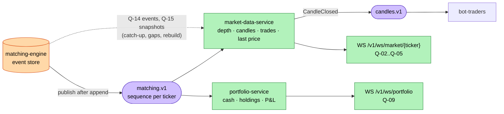
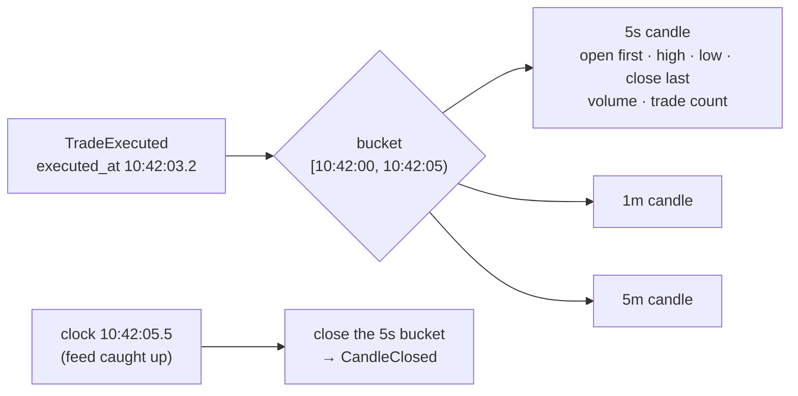
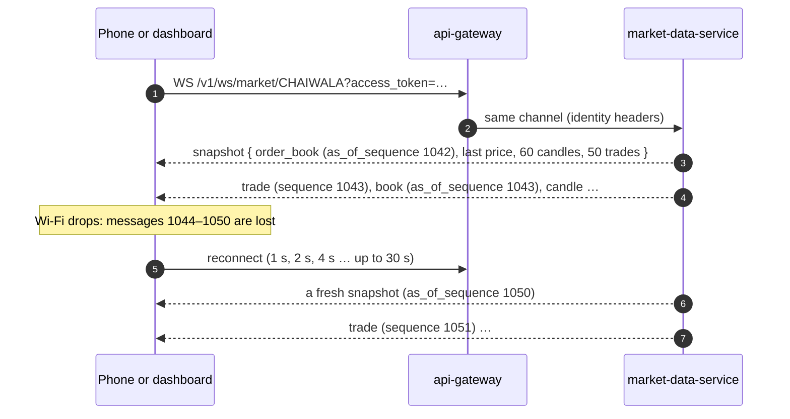

# 08 — The Read Side: How Events Become Candles and Portfolios

> **Read side (CQRS):** the models built only to answer queries, from the events the write side publishes. They hold
> no facts of their own, so they can be thrown away and rebuilt at any time
> ([event sourcing and CQRS](04-event-sourcing-and-cqrs.md)).
>
> **Projection:** the code that turns a stream of events into a read model, by applying each event in order.

Two services build read models from `matching.v1`: **market-data-service** (candles, depth, trades, last prices, the
live market WebSocket) and **portfolio-service** (cash, holdings, P&L and the portfolio WebSocket). This page says how
each projection works, why it is always rebuildable, and how a client that loses its connection catches up with no gaps
and no duplicates.

## 1. Why the read side can be rebuilt at any time

Every `matching.v1` event carries a per-ticker `sequence`: strictly increasing and with no gaps, assigned by the engine
when it stores the event. The engine's event store keeps every event forever and is readable through its internal API
(Q-14). So a read model is fully described by "the events up to sequence N, applied in order", and:

- **A repeat changes nothing.** market-data skips any event at or below the last sequence it applied; portfolio-service
  records each `event_id` in the same SQL transaction as its change.
- **A gap is never silent.** If market-data receives sequence 1,045 when it has 1,042, it reads 1,043 and 1,044 from the
  event store first. The live feed is only the fast path; the event store is the truth.
- **Dropping the tables is safe.** On start, market-data loads what it saved (if anything) and reads every later event
  from the event store. With empty tables that is the whole history, so the same candles come back. Redpanda's 7-day
  retention does not matter: the rebuild never reads Redpanda.

## 2. market-data-service: from events to depth and candles

### Depth (the order book, aggregated)

| Event | Effect on the depth |
|---|---|
| `OrderAccepted` (LIMIT) | Adds the order at its limit price. A MARKET order never rests, so it never shows. |
| `TradeExecuted` | Sets both orders' remaining quantity from the event (`buy_order_remaining_quantity`, …); 0 removes the order |
| `OrderCancelled` (any reason) | Removes what is left of the order |
| `OrderCancelRejected`, `OrderExpired` | Nothing (they are about orders that are not in the book) |

**Never a crossed book.** The engine handles one command at a time: it accepts an incoming order, then emits its trades.
Between the two, a projection holds an incoming buy priced at or above the best ask. Depth therefore leaves the incoming
order out while it still crosses. Once its trades are applied it is gone, or rests without crossing. A property test
drives random orders through a reference exchange and checks after **every** event that the depth is never crossed, and
after every command that it equals the exchange's book level by level.

### Candles

- **Event time, not arrival time.** A trade belongs to the bucket that contains its `executed_at`. Buckets are aligned to
  the Unix epoch, so 1m buckets start on the minute.
- **No gaps.** A bucket without trades is flat at the previous close (open = high = low = close, volume 0). Before the
  first trade the previous close is the reference price. Every ticker has flat 5s candles from the moment the service
  starts, which is the heartbeat the bots act on.
- **Closing.** A bucket closes when a later event's time passes it, or when the clock is 0.5 s past its end and the live
  feed has no lag (otherwise a trade for it may still be on the way). Each closed candle is stored and published as
  `CandleClosed` with a deterministic ID.
- **Late trades are corrected.** If the engine republishes a trade after a crash, it can arrive for a bucket the clock
  already closed. The candle is corrected, and so are the flat candles after it that carried the old close. The stored
  candles stay exactly what the trades say. Bots ignore the corrected `CandleClosed`, which has the same ID.

A property test runs random trades and clock ticks, with the clock sometimes far ahead of the trades. It checks that
the live and stored candles always equal `rebuild()`, a separate function that derives candles from the trades alone.

### Saving

Each event's changes are written in **one logged batch**: the candles it changed, its trade, and the new `sequence` in
`last_prices`. The stored sequence therefore always matches the stored candles. After a crash the service resumes at
exactly that sequence and reads the rest from the event store.

### Replicas

Each replica reads **every** partition of `matching.v1`, with no consumer group, because each serves its own WebSocket
clients. Replicas write the same candles (upserts with the same key), and duplicate `CandleClosed` share an ID.

## 3. portfolio-service: from trades to portfolios

portfolio-service settles each `TradeExecuted` in one SQL transaction: buyer cash and shares, seller shares and cash, the
reservations, and the event ID. Its read side is the **portfolio view** (Q-09) computed from those rows: holdings valued
at the last traded price, unrealised P&L per holding = (last price − average cost) × quantity, net worth = cash +
Σ holdings at last price, and P&L = net worth − starting value.

**Pushing changes to the right phone (Q-10).** portfolio-service runs 2 replicas. A phone's WebSocket lands on one of
them, but the trade that changes its portfolio may be settled by the other, because each replica settles the partitions
it owns. So every committed change sends a Postgres `NOTIFY` naming the trader. Every replica `LISTEN`s and pushes a
fresh `portfolio` (plus `fill` or `order_closed`) to the sockets it holds for that trader. `NOTIFY` is delivered only
when the transaction commits, so a phone never sees a change that was rolled back. When prices move, portfolios that hold
that ticker are re-valued at most once a second.

## 4. Snapshot, then updates: resyncing a client

The snapshot is built and the client registered in one step, with nothing in between, so the first update always
follows the snapshot's sequence. The client keeps the highest sequence it has. It drops anything at or below it,
replaces the book with a newer one, and replaces a candle that has the same `bucket_start`. After a disconnect it does
not try to replay what it missed: it takes a new snapshot. A test connects two clients, disconnects one for a while,
reconnects it, and checks both end with the same book, the same last 50 trades (no gap, no duplicate) and the same
candles. In the web app these rules are one reducer, `web/src/market/marketState.ts`, and the reconnect with back-off
is `web/src/market/stream.ts`; both have their own tests ([web README](../../web/README.md#live-data)).

## 5. Eventual consistency in practice

The read side is updated *after* the write side, usually within milliseconds:

| What you may notice | Why | What the UI does |
|---|---|---|
| The chart moves a few ms before your portfolio | market-data and portfolio-service consume the same event independently | Nothing: both converge |
| A just-placed order is `PENDING` | The engine has not answered yet | Shows "pending" until `OPEN` or a fill arrives |
| Charts freeze, trading goes on | market-data is down (memory-leak scenario) | "Market data reconnecting"; the snapshot after the restart is complete |

## Viva Notes

**Q: What is the difference between the write side and the read side?**
A: The write side (order-service, matching-engine) decides and records facts as events. The read side (market-data,
portfolio, order status) only applies those events to build views shaped for screens. It holds no facts, so it can be
rebuilt from the event store.

**Q: How can you be sure a rebuilt read model equals the live one?**
A: Events have a gap-free sequence per ticker and are applied strictly in order. Repeats are skipped and gaps filled from
the event store. A property test shows live and rebuilt candles are equal under any interleaving of trades and clock
ticks.

**Q: Why snapshot + updates over WebSockets instead of replaying missed messages?**
A: A snapshot is small and always complete. Replaying needs the server to remember what each client missed. Every update
carries a sequence, so the client knows exactly which updates the snapshot already contains.

**Q: Why can the published order book never look crossed?**
A: Only the incoming order of the command being applied can cross the book, and only until its trades are applied.
Depth leaves it out while it crosses. A property test checks this after every single event.

**Q: Why does portfolio-service use Postgres LISTEN/NOTIFY?**
A: A trader's socket may be on a replica that did not settle the trade. NOTIFY tells every replica after the commit,
using the database portfolio-service already owns, so no new infrastructure is needed.
