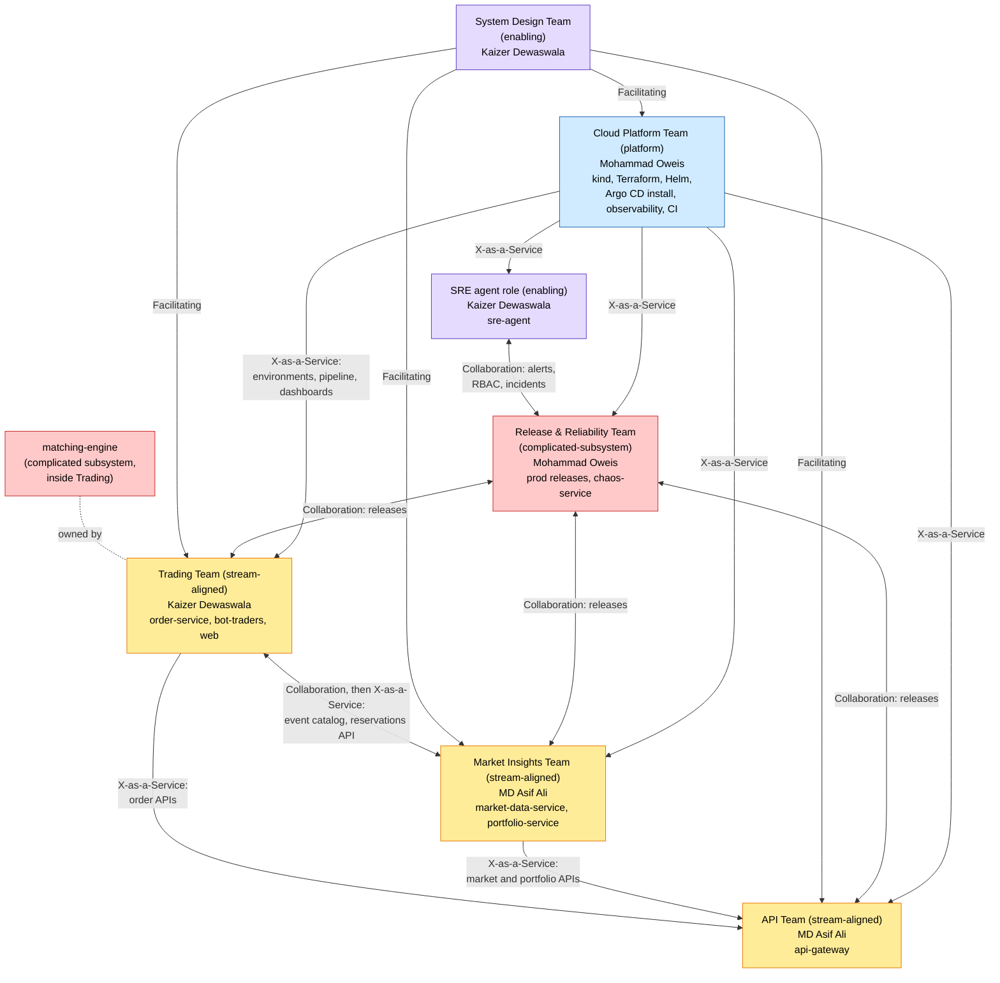

# 04 — Team Topology

> **Operating model:** the set of people, processes and tools behind a system: who is responsible for what, and how
> decisions get made. The textbook calls it the "operating system" for the solution and designs it *before* the
> services (Mitra & Nadareishvili, Ch. 2).
>
> **Team Topologies** (Matthew Skelton and Manuel Pais) is a design language for teams and how they work together.
> The textbook uses three parts of it: **team types**, **interaction modes** and **diagramming** (Ch. 2).
>
> **Four team types**
> - **Stream-aligned:** owns and runs a deliverable and keeps delivering a "stream" of changes to it ("you build it,
>   you run it"). Microservices teams are usually stream-aligned.
> - **Enabling:** specialists who support other teams in a consulting style and help them see the bigger picture.
> - **Complicated-subsystem:** owns a domain that is hard to understand and needs expertise that can't be spread
>   across every team.
> - **Platform:** like enabling, but delivers **self-service** tools and infrastructure, treated as a product whose
>   customers are the other teams.
>
> **Three interaction modes**
> - **Collaboration:** two teams work closely together to learn, discover and innovate. High coordination, hard to
>   scale.
> - **Facilitating:** one-directional; one team supports another in reaching its own goal.
> - **X-as-a-Service:** consumer–provider. One team offers a process, document, library, API or platform that others
>   use with minimal coordination. It scales well and fits platform teams naturally.
>
> **Conway's law:** systems end up mirroring the communication structure of the organisation that builds them. The
> **inverse Conway manoeuvre** designs the teams first, so that the architecture you want emerges (Ch. 2).

## Why team design matters for microservices

The point of microservices is to **reduce coordination costs**, and most coordination cost lies *between* teams, not
inside them (Ch. 2). The textbook therefore records four key decisions about teams. We adopt all four:

| Textbook key decision (Ch. 2) | How we apply it |
|---|---|
| **Team size is limited:** 5–8 people per team, never more than 8; the system design team 3–5 | We follow the *principle* of small, autonomous teams. Our real team is 3 people, so each person plays several team roles ([below](#our-real-team-3-people-many-roles)). |
| **Team membership:** cross-functional, and only people who add value to the team's output | Each owner does design, code, tests and operations for their services. |
| **Design teams before the architecture**, and keep improving the team design for the life of the system | Teams were designed in Phase 0, alongside the bounded contexts. This document is versioned like code. |
| **Microservice ownership:** each microservice is owned by exactly **one** team, which designs, builds and runs it for its lifetime | Every service README names one owning team and one owner. |

## Designing our topology: the textbook's five steps

The textbook builds its team topology in five steps (Ch. 2). We follow the same steps.

### Step 1 — System Design Team (enabling)

| Property | Value |
|---|---|
| Team type | Enabling |
| Size | Textbook: 3–5 · Ours: **Kaizer Dewaswala** |
| Responsibilities | Design the team structures; establish standards, incentives and "guardrails"; continually improve the system by measuring it |
| Our artefacts | This document, [coding standards](05-coding-standards.md), [ADRs](adr/README.md), the [event catalog](03-architecture/03-event-catalog.md) rules, the [roadmap metrics](07-roadmap.md#measuring-progress) |
| Interactions | **Facilitating** the stream-aligned teams; **enabling** the Cloud Platform Team so the platform fits the system's goals |

### Step 2 — Microservices team template (stream-aligned)

The textbook defines a *template* (think "class") that real microservices teams are created from (think
"instances") (Ch. 2).

| Property | Value |
|---|---|
| Team type | Stream-aligned |
| Size | Textbook: 5–8 · Ours: 1 person per team |
| Responsibilities | Design and develop its microservice(s); test, build and deliver them; troubleshoot them |
| Rule | A team may own several services, but a service is never owned by more than one team |

**Instances of the template:**

| Team | Owner | Owns |
|---|---|---|
| **Trading Team** | **Kaizer Dewaswala** | `order-service`, `matching-engine`, `bot-traders`, `web` |
| **Market Insights Team** | **MD Asif Ali** | `market-data-service` (including time travel and replay), `portfolio-service` |

**The matching engine is treated as a complicated subsystem inside the Trading Team.** Price-time matching,
single-writer ordering and event-sourced replay need specialist knowledge. In a larger organisation it would get its
own complicated-subsystem team. Here the Trading Team owns it but works on it with that level of care (it gets the
most design and test effort; see [competitive analysis](02-domain/01-event-storming.md#phase-5--competitive-analysis)).

**Why `web` is with Trading:** the trader's main journey (join → look → order → watch it fill) is the trading stream.
One owner for the UI and the order flow avoids a frontend/backend hand-off for every feature.

### Step 3 — Platform team: Cloud Platform Team (platform)

| Property | Value |
|---|---|
| Team type | Platform, interacting through **X-as-a-Service** |
| Size | Textbook: 5–8 · Ours: **Mohammad Oweis** |
| Responsibilities (textbook list, adapted) | Design and develop the network infrastructure (kind's Docker network, namespaces, NetworkPolicies); design and develop the application infrastructure (kind cluster, Helm umbrella chart with the shared service sub-chart, Prometheus/Grafana/Loki/Alloy, CI workflow templates); provide tools for building a new environment (Terraform `infra/`, `make infra`); update the infrastructure when required |
| Offered as a service | Any team gets a working environment, deploy pipeline and dashboards without asking for a meeting |

### Step 4 — Enabling and complicated-subsystem teams

**Release & Reliability Team (complicated-subsystem)**, based on the textbook's **release team**:

| Property | Value |
|---|---|
| Team type | Complicated-subsystem |
| Size | Textbook: 5–8 · Ours: **Mohammad Oweis** |
| Responsibilities | Release microservices to `prod`: approve promotion PRs to `deploy/envs/prod/` (CODEOWNERS), run Argo CD sync and `git revert` rollbacks ([ADR-0014](adr/0014-gitops-with-argo-cd.md)); coordinate approvals for releases; own **`chaos-service`** and the chaos rehearsals that gate promotion |
| Interactions | **Collaboration** with the stream-aligned teams and the API Team on releases; **collaboration** with the SRE agent role on alerts, RBAC and incident follow-ups |

In the textbook, microservices teams deliver a built and tested container, and the release team deploys it after
tests and approvals (Ch. 2, Ch. 7). The book also names the trade-off: at scale, a release team becomes a
coordination bottleneck, and deployment should then move to the microservices teams. We already reduce that risk:
**staging is fully self-service** (Argo CD syncs every merge), and only the prod promotion needs Release &
Reliability's approval.

**SRE agent (enabling role)** — **Kaizer Dewaswala**, owns `sre-agent`. It works in **collaboration** with Release &
Reliability: alert rules, RBAC, rollout history, Git follow-ups after an emergency rollback. It also *enables* every
team by giving each incident a first diagnosis in plain English. The agent itself is a project extension beyond the
textbook ([SRE agent design](03-architecture/05-sre-agent-design.md)).

### Step 5 — Consumer team: API Team (stream-aligned)

| Property | Value |
|---|---|
| Team type | Stream-aligned (a consumer-facing team) |
| Size | Textbook: 5–8 · Ours: **MD Asif Ali** |
| Responsibilities (textbook list) | Design, develop and maintain the **APIs at the boundary of the system**; connect the API to the internal microservices |
| Owns | **`api-gateway`**: the public `/v1` API, WebSocket channels, sessions/JWT, rate limits, blocking `/internal/`; curator of `api/shared/common.yaml` |
| Interactions | Consumes the microservices teams' services through **X-as-a-Service**: they keep their internal APIs and events invocable and documented, so the API Team can use them self-service |

As in the textbook, consumers (the `web` app, the bots, the presenter screen) call the API Team's API and **never
call microservices directly** (Ch. 2; see [microservices vs APIs](03-architecture/01-system-architecture.md#4-microservices-vs-apis)).
**Why MD Asif Ali:** Market Insights already owns most of what consumers read and stream (charts, depth, portfolio,
leaderboard, WebSockets), so the boundary API and its biggest upstreams share an owner. It also balances the load,
because the platform and release roles already sit with one person.

## The topology diagram

Colours follow the textbook's convention, taken from the Team Topologies website: stream-aligned = yellow,
enabling = violet, platform = light blue, complicated-subsystem = red (Ch. 2).

## Our real team: 3 people, many roles

The textbook's team sizes (5–8; 3–5 for system design) assume a real organisation. We are **3 people**, so each
person plays several team roles. The topology still tells us who decides, who is consulted and how work is handed
over, and it shows how the design would scale: each role could become a real 5–8 person team without changing the
architecture.

| Person | Team roles | Services and assets owned |
|---|---|---|
| **Kaizer Dewaswala** | System Design Team (enabling) · Trading Team (stream-aligned, incl. the matching-engine complicated subsystem) · SRE agent role (enabling) | `order-service`, `matching-engine`, `bot-traders`, `web`, `sre-agent`; standards, ADR process |
| **MD Asif Ali** | Market Insights Team (stream-aligned) · API Team (stream-aligned, consumer-facing) | `market-data-service`, `portfolio-service`, `api-gateway`; `api/shared/common.yaml` |
| **Mohammad Oweis** | Cloud Platform Team (platform) · Release & Reliability Team (complicated-subsystem) | kind cluster, Terraform `infra/`, Helm charts, observability, CI templates, Argo CD, prod releases, `chaos-service` |

## Interaction modes over time

| Pair | Phases 1–2 (discovery) | Phase 3 onwards (steady state) | Interface |
|---|---|---|---|
| Trading ↔ Market Insights | **Collaboration** on the event catalog and reservation API | **X-as-a-Service** | `matching.v1` events; `POST /internal/v1/reservations` |
| Trading, Market Insights → API Team | **Collaboration** on the public `/v1` API shape | **X-as-a-Service** | Internal specs in `api/`; `POST /internal/v1/accounts` |
| System Design → all teams | **Facilitating** (standards, ADRs, event-catalog rules) | **X-as-a-Service** ("patterns as a service": coding standards, templates) | [Coding standards](05-coding-standards.md), [ADRs](adr/README.md) |
| Cloud Platform → all teams | **Facilitating** (Dockerfiles, probes, metrics) | **X-as-a-Service** (shared Helm sub-chart, CI templates, dashboards, `make infra`) | `charts/circuitbreaker/charts/service`, CI workflow templates, Grafana dashboards |
| Release & Reliability ↔ stream-aligned teams | **Collaboration** on release and chaos-rehearsal criteria | **Collaboration** for prod promotions only (staging is self-service) | Promotion PRs to `deploy/envs/prod/`; `/v1/chaos/...` |
| SRE agent role ↔ Release & Reliability | **Collaboration** (alert rules, RBAC, rollout history) | **X-as-a-Service** (agent consumes alerts; humans consume the incident feed and Git follow-ups) | Prometheus alert label `remediable=true`; `sre-agent` Role; `incidents.v1` |

Collaboration is expensive, so we time-box it. Once an interface is agreed and written down (event catalog, OpenAPI
spec), we move to X-as-a-Service and change it only through versioned contracts.

## How this reduces coordination

| Without this topology | With it |
|---|---|
| Any change to orders needs the portfolio and charts owners in the room | Order changes stay inside Trading; Market Insights only sees versioned events |
| Every client knows every service's address and shape | Clients see one API at the boundary, owned by the API Team; services can change behind it |
| Every developer writes their own Dockerfile, Helm chart and CI pipeline | One shared sub-chart, CI template and Terraform platform, owned by Cloud Platform |
| Releases depend on whoever has cluster access | Releases are commits; Argo CD deploys; Release & Reliability approves prod |
| Nobody "owns" a failing service at 2 a.m. | Each service README names its owner; alerts carry a `team` label |
| Agreement by meeting | Agreement by contract: [event catalog](03-architecture/03-event-catalog.md) and [`api/`](../api/README.md) |

---

## Owner study guide: Kaizer Dewaswala — System Design, Trading, SRE agent

**You own:** `order-service`, `matching-engine`, `bot-traders`, `web` and `sre-agent`. As the System Design Team you
also own the standards, the ADR process and this team design.

**Your story in one paragraph.** You build the path from "I want to buy" to "I bought". The phone (`web`) sends an
order through `api-gateway` to **order-service**, which checks it, asks portfolio-service to *reserve* the money or
shares, saves it, and publishes `OrderPlaced` on `orders.v1`. The **matching-engine** reads orders one ticker at a
time, matches them by **price-time priority**, writes every result as an event to its **Cassandra event store**, and
publishes `OrderAccepted`, `TradeExecuted`, `OrderCancelled` and `OrderCancelRejected` on `matching.v1`.
**bot-traders** runs 20 bots that use the same public API, so the market is always alive. Separately, you build the
**sre-agent**, which watches alerts, gathers evidence and lets an LLM (via OpenRouter) pick one of four safe fixes.
As system designer, you keep the teams, standards and guardrails coherent.

| Service | Responsibility | Data | Produces | Consumes |
|---|---|---|---|---|
| `order-service` | Validate, reserve, track status | Cassandra `order_service` | `OrderPlaced`, `OrderCancelRequested` | `OrderAccepted`, `TradeExecuted`, `OrderCancelled`, `OrderCancelRejected` |
| `matching-engine` | Order books, matching, event store | Cassandra `matching_engine` | `OrderAccepted`, `TradeExecuted`, `OrderCancelled`, `OrderCancelRejected` | `OrderPlaced`, `OrderCancelRequested` |
| `bot-traders` | 20 bots, 4 strategies | none (memory) | — (calls public API) | `CandleClosed` |
| `web` | Trader UI, presenter view, chaos panel, incident feed | browser only | — | public API + WebSockets |
| `sre-agent` | Detect, diagnose, remediate, explain | Cassandra `sre_agent` | `IncidentOpened`, `Remediation*`, `IncidentResolved` | Prometheus, Loki, Kubernetes API |

**Concepts you must be able to explain:**

- Matching: price-time priority, partial fills, and why the matching engine is a single writer per ticker.
- Event sourcing: decide vs apply, snapshots, replay.
- Reliability of messaging: the outbox pattern and idempotent consumers.
- Order flow: why cancel is asynchronous (the cancel/fill race), the sync reservation trade-off (ADR-0011), and 202
  Accepted.
- The SRE agent: its four tools, guardrails, RBAC and approval toggle; why it never sees chaos data; how it coexists
  with Argo CD.
- The textbook's five team-design steps and the Universal Sizing Formula.

**Read first:** [sequence diagrams](01-seeds/03-sequence-diagrams.md) §2–4 and §6 ·
[service sizing](02-domain/03-service-sizing.md) ·
[event sourcing and CQRS](03-architecture/04-event-sourcing-and-cqrs.md) ·
[SRE agent design](03-architecture/05-sre-agent-design.md) · ADRs
[0005](adr/0005-event-sourcing-for-matching-engine.md), [0009](adr/0009-sre-agent-fixed-tool-allowlist.md),
[0011](adr/0011-synchronous-reservation-over-saga.md), [0013](adr/0013-openrouter-llm-gateway.md).

**Likely viva questions for you:** Why is matching single-threaded per ticker? · What happens if the engine crashes
between storing and publishing? · How does the agent tell a memory leak from a bad deploy? · What stops the agent
from deleting a database? · What are the five steps of the textbook's team design?

---

## Owner study guide: MD Asif Ali — Market Insights and API Team

**You own:** `market-data-service` (including time travel and replay), `portfolio-service` and `api-gateway`.

**Your story in one paragraph.** You turn the matching engine's stream of facts into things people can *see*, and
you own the door they see it through. You are the **read side of CQRS**:

- **market-data-service** listens to `matching.v1` and builds candles (5s/1m/5m), order-book depth, recent trades
  and last prices. It streams them to every phone over WebSockets and publishes `CandleClosed` for the bots. It also
  does **time travel**: it fetches a snapshot and the events after it from matching-engine's internal API and
  rebuilds the book at any past moment, without touching the live market.
- **portfolio-service** owns every trader's account in Postgres. It opens accounts with ₹1,00,000, *reserves* cash
  or shares when order-service asks (enforcing no margin and no short selling), *settles* each `TradeExecuted` in
  one SQL transaction, releases leftovers, and ranks everyone on the leaderboard.
- As the **API Team**, you own **api-gateway**: the single public `/v1` API that every consumer calls. It handles
  sessions/JWT, routing, rate limits, the WebSocket proxy, and blocking `/internal/`, so that no client ever calls a
  microservice directly.

| Service | Responsibility | Data | Produces | Consumes |
|---|---|---|---|---|
| `market-data-service` | Candles, depth, trades, live streams, time travel, replay | Cassandra `market_data` | `CandleClosed` | `OrderAccepted`, `TradeExecuted`, `OrderCancelled`; matching-engine `/internal/v1/events`, `/internal/v1/snapshots/{ticker}` |
| `portfolio-service` | Accounts, reservations, settlement, leaderboard | Postgres `portfolio` | — (local events only) | `OrderAccepted`, `TradeExecuted`, `OrderCancelled` |
| `api-gateway` | Public entry: JWT sessions, routing, rate limits, WS proxy | none | — | portfolio-service `/internal/v1/accounts`; routes to all services |

**Concepts you must be able to explain:**

- CQRS read models and eventual consistency.
- Replay and time travel: replay applies events and never re-runs matching; snapshots; why time travel is a query.
- Cassandra modelling: partition and clustering keys, one table per query.
- Postgres: why portfolio uses it (ACID, CHECK constraints) and idempotent settlement with `processed_events` in the
  same transaction.
- Reservations: the lifecycle (ACTIVE → CONSUMED / RELEASED) and the market-order protection price.
- Failure isolation: why charts can fail while trading continues (memory-leak scenario).
- The API at the boundary: why consumers never call microservices directly, JWTs, and why the gateway strips
  identity headers.
- Open Host Service and the small shared kernel (`common.yaml`).

**Read first:** [sequence diagrams](01-seeds/03-sequence-diagrams.md) §1, §3, §5 ·
[data ownership](03-architecture/02-data-ownership.md) ·
[event sourcing and CQRS](03-architecture/04-event-sourcing-and-cqrs.md) ·
[microservices vs APIs](03-architecture/01-system-architecture.md#4-microservices-vs-apis) · [`api/`](../api/README.md) ·
ADRs [0004](adr/0004-cassandra-event-store.md), [0006](adr/0006-cqrs-portfolio-read-model.md),
[0011](adr/0011-synchronous-reservation-over-saga.md), [0012](adr/0012-prices-in-integer-paise.md).

**Likely viva questions for you:** How does time travel work step by step? · What is eventual consistency and where do
users notice it? · How do you avoid settling the same trade twice? · What is the difference between an API and a
microservice? · Why not let market-data read the event store directly?

---

## Owner study guide: Mohammad Oweis — Cloud Platform and Release & Reliability

**You own:** the platform (Terraform-created kind cluster, namespaces, RBAC, Secrets, Helm umbrella chart),
observability (Prometheus, Grafana, Loki, Alloy), CI (GitHub Actions), Argo CD and prod releases, and
`chaos-service`.

**Your story in one paragraph.** You make it possible for the other teams to ship safely without thinking about
infrastructure.

- **As the Cloud Platform Team:** **Terraform modules** build the whole local platform (kind cluster, namespaces,
  agent RBAC, Secrets, Argo CD), mirroring the textbook's network → Kubernetes → GitOps server modules. **One shared
  Helm sub-chart** is used by every service. **Dashboards and alert rules** are relied on by both humans and the SRE
  agent.
- **As the Release & Reliability Team:** you own the release path. CI builds each image once and commits its tag;
  **Argo CD** syncs staging; you approve the **promotion PR** to prod; and a `git revert` is the rollback. You also
  run **chaos-service**, which breaks things on purpose (a bad deploy, a memory leak, a traffic spike) and measures
  how quickly the system heals.

| Component | Responsibility | Data | Produces | Consumes |
|---|---|---|---|---|
| Platform (Terraform) | kind cluster, namespaces, quotas, RBAC, Secrets, Argo CD install | Terraform state (local, git-ignored) | — | — |
| Observability | Metrics, logs, dashboards, alert rules | Prometheus TSDB, Loki | Alerts | `/metrics` of every service, container logs |
| CI | Lint, test, build once, tag bump | GHCR images | Commits to `deploy/envs/staging/` | Git |
| Releases (Argo CD) | Sync staging, approve and sync prod promotions, revert bad releases | Git (`deploy/`) | Deploy history (change-cause) | Git |
| `chaos-service` | Chaos experiments and measurements | memory + Loki | — (local events only) | `incidents.v1` (all six events) |

**Concepts you must be able to explain:**

- Team types: platform team and X-as-a-Service; the release team as a complicated subsystem and its scaling
  trade-off.
- Infrastructure as Code: Terraform modules and providers, and the textbook's infrastructure mapped to ours.
- Delivery: GitOps and Argo CD (sync, drift, why self-heal is off); staging vs prod and "build once, deploy many".
- Kubernetes: the umbrella chart; rolling updates, readiness/liveness probes, revisions; why there is no HPA.
- Observability: Prometheus scraping and alert rules (`for:` durations); golden signals (RED).
- Measurement: DORA metrics, MTTR and MTTD.
- Chaos engineering principles: hypothesis, blast radius, reversibility.

**Read first:** [system architecture](03-architecture/01-system-architecture.md) ·
[deployment and environments](03-architecture/07-deployment-and-environments.md) ·
[chaos scenarios](03-architecture/06-chaos-scenarios.md) · ADRs
[0007](adr/0007-kubernetes-kind-and-helm-umbrella.md), [0008](adr/0008-observability-stack.md),
[0014](adr/0014-gitops-with-argo-cd.md), [0015](adr/0015-terraform-local-platform.md).

**Likely viva questions for you:** What is the difference between staging and prod here? · What is GitOps and why
Argo CD? · How does your Terraform map to the textbook's AWS setup? · Why does the bad-deploy scenario create a real
revision? · How do you measure whether the microservices transformation is working?

---

## Viva Notes

**Q: What are the textbook's five steps for designing a team topology?**
A: Establish a system design team; create a microservices team template; define platform teams; add enabling and
complicated-subsystem teams; add key consumer teams (Ch. 2). Ours: System Design, the Trading and Market Insights
teams from the template, Cloud Platform, Release & Reliability, and the API Team.

**Q: What are the four team types and three interaction modes, and where do you use each?**
A: Stream-aligned (Trading, Market Insights, API), enabling (System Design, the SRE agent role), platform (Cloud
Platform), complicated-subsystem (Release & Reliability; the matching engine inside Trading). The modes are
collaboration (releases, early contract work), facilitating (System Design coaching teams) and X-as-a-Service (the
platform, and services consumed by the API Team).

**Q: The textbook says teams of 5–8. You are three people — does this still make sense?**
A: Yes. Each of us plays several team roles, and the topology still defines ownership, decisions and hand-offs. It
also shows how the design scales: each role could become a full team without changing the architecture.

**Q: Why does the API Team own `api-gateway`?**
A: In the textbook, the API team owns the APIs at the system boundary and connects them to the internal
microservices; consumers never call microservices directly. Our gateway is exactly that boundary.

**Q: How does your team design reduce coordination costs?**
A: Every service has one owner, contracts are written down and versioned, the platform is self-service, staging
deploys are automatic, and only prod promotions need a release approval. Most changes need no meeting.
