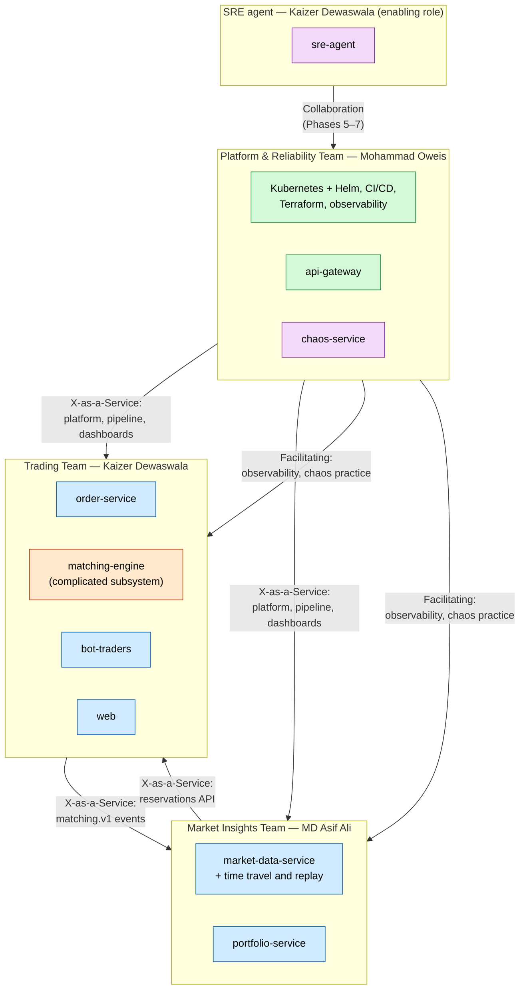

# 04 — Team Topology

> **Team Topologies** (Matthew Skelton and Manuel Pais) is a model for organising software teams so that work flows
> fast with little hand-off. It defines:
>
> **Four team types**
> - **Stream-aligned team** — owns a slice of the product end to end (a "stream" of user value). Most teams are this.
> - **Platform team** — provides internal services (deploy, monitor, run) that stream-aligned teams consume
>   *self-service*, so they don't have to build infrastructure themselves.
> - **Enabling team** — experts who help other teams learn a new capability, then step back.
> - **Complicated-subsystem team** — owns a part that needs deep specialist knowledge (here: the matching engine).
>
> **Three interaction modes**
> - **Collaboration** — two teams work closely together for a limited time to discover something new. High
>   bandwidth, high coordination cost; should be temporary.
> - **X-as-a-Service** — one team consumes what another provides through a clear interface, with minimal
>   coordination. The goal state.
> - **Facilitating** — one team (usually enabling) coaches another.
>
> **Cognitive load** — how much a team must hold in its head. Team boundaries should keep it manageable.
> **Conway's law** — systems end up mirroring the communication structure of the organisation that builds them.
> The **reverse Conway manoeuvre** is designing teams deliberately so the architecture you want emerges.

## Why team design matters for microservices

The point of microservices is to **reduce coordination costs**: each team should be able to change, test and deploy
its services without waiting for others. That only works if service boundaries and team boundaries line up. We
therefore designed teams and services together: every service has exactly one owning team, and the contracts between
teams are the same as the contracts between services (events and APIs).

⚠️ VERIFY AGAINST TEXTBOOK — check how the textbook connects Team Topologies to its own operating-model guidance
(and any terms it uses, e.g. for team "interaction" or "operating model") and align wording for the viva.

## Our three teams (3 people, so each "team" is one owner)

Our project has three members, so each team is one person. The model still applies: it tells us who decides, who
is consulted, and how we hand work to each other. Where one person plays two team types, we say so.

| Team | Owner | Team type(s) | Owns |
|---|---|---|---|
| **Trading Team** | **Kaizer Dewaswala** | Stream-aligned (the trading experience) + complicated-subsystem (the matching engine) | `order-service`, `matching-engine`, `bot-traders`, `web` |
| **Market Insights Team** | **MD Asif Ali** | Stream-aligned (seeing the market and your results) | `market-data-service`, `portfolio-service`, time-travel replay |
| **Platform & Reliability Team** | **Mohammad Oweis** | Platform + enabling | Kubernetes/kind, Helm umbrella chart, observability (Prometheus, Grafana, Loki), CI/CD (GitHub Actions), Terraform/LocalStack, `chaos-service`, `api-gateway` |
| *SRE agent (role)* | **Kaizer Dewaswala** | Enabling, in collaboration with Platform & Reliability | `sre-agent` |

**Why `api-gateway` is with Platform & Reliability:** it is shared infrastructure that every team consumes
(routing, auth, rate limits, WebSocket proxy) and contains no trading logic — a classic platform component.

**Why `web` is with Trading:** the trader's main journey (join → look → order → watch it fill) is the trading stream;
one owner for the UI and the order flow avoids a frontend/backend hand-off for every feature.

## Interaction modes over time

| Pair | Phase 1–2 (discovery) | Phase 3 onwards (steady state) | Interface |
|---|---|---|---|
| Trading ↔ Market Insights | **Collaboration** on the event catalog and reservation API | **X-as-a-Service** | `matching.v1` events; `POST /internal/v1/reservations`; `POST /internal/v1/accounts` |
| Platform & Reliability → Trading, Market Insights | **Facilitating** (how to write a Dockerfile, health probes, metrics) | **X-as-a-Service** (shared Helm sub-chart, CI templates, dashboards) | `charts/circuitbreaker/charts/service`, CI workflow templates, Grafana dashboards |
| SRE agent (Kaizer) ↔ Platform & Reliability | **Collaboration** (alert rules, RBAC, rollout history access) | **X-as-a-Service** (agent consumes alerts; platform consumes the agent's incidents) | Prometheus alert labels `remediable=true`; `sre-agent` Role; `incidents.v1` |
| chaos-service (Platform & Reliability) → all | **Facilitating** (designing experiments with each service owner) | Self-service from the Chaos Panel | `/v1/chaos/...`, `/internal/v1/faults` |

Collaboration is expensive, so we time-box it: once an interface is agreed and written down (event catalog, OpenAPI
spec), we move to X-as-a-Service and change it only through versioned contracts.

## How this reduces coordination

| Without this topology | With it |
|---|---|
| Any change to orders needs the portfolio and charts owners in the room | Order changes stay inside Trading; Market Insights only sees versioned events |
| Every developer writes their own Dockerfile, Helm chart, CI pipeline | One shared sub-chart and CI template, owned by Platform & Reliability |
| Nobody "owns" a failing service at 2 a.m. | Each service README names its owner; alerts carry a `team` label |
| Agreement by meeting | Agreement by contract: [event catalog](03-architecture/03-event-catalog.md) and [`api/`](../api/README.md) |

---

## Owner study guide: Kaizer Dewaswala — Trading Team + SRE agent

**You own:** `order-service`, `matching-engine`, `bot-traders`, `web`, and `sre-agent`.

**Your story in one paragraph.** You build the path from "I want to buy" to "I bought". The phone (`web`) sends an
order through `api-gateway` to **order-service**, which checks it, asks portfolio-service to *reserve* the money or
shares, saves it, and publishes `OrderPlaced` on `orders.v1`. The **matching-engine** reads orders one ticker at a
time, matches them by **price-time priority**, writes every result as an event to its **Cassandra event store**, and
publishes `OrderAccepted`, `TradeExecuted`, `OrderCancelled`, `OrderCancelRejected` on `matching.v1`. **bot-traders**
runs 20 bots that use the same public API so the market is always alive. Separately, you build the **sre-agent**,
which watches alerts, gathers evidence and lets an LLM (via OpenRouter) pick one of four safe fixes.

| Service | Responsibility | Data | Produces | Consumes |
|---|---|---|---|---|
| `order-service` | Validate, reserve, track status | Cassandra `order_service` | `OrderPlaced`, `OrderCancelRequested` | `OrderAccepted`, `TradeExecuted`, `OrderCancelled`, `OrderCancelRejected` |
| `matching-engine` | Order books, matching, event store | Cassandra `matching_engine` | `OrderAccepted`, `TradeExecuted`, `OrderCancelled`, `OrderCancelRejected` | `OrderPlaced`, `OrderCancelRequested` |
| `bot-traders` | 20 bots, 4 strategies | none (memory) | — (calls public API) | `CandleClosed` |
| `web` | Trader UI, presenter view, chaos panel, incident feed | browser only | — | public API + WebSockets |
| `sre-agent` | Detect, diagnose, remediate, explain | Cassandra `sre_agent` | `IncidentOpened`, `Remediation*`, `IncidentResolved` | Prometheus, Loki, Kubernetes API |

**Concepts you must be able to explain:** price-time priority; partial fills; why the matching engine is a single
writer per ticker; event sourcing (decide vs apply, snapshots, replay); the outbox pattern; idempotent consumers;
why cancel is asynchronous (the cancel/fill race); the sync reservation trade-off (ADR-0011); 202 Accepted; the agent's
four tools, guardrails, RBAC and approval toggle; why the agent never sees chaos data.

**Read first:** [sequence diagrams](01-seeds/03-sequence-diagrams.md) §2–4 and §6 ·
[event sourcing and CQRS](03-architecture/04-event-sourcing-and-cqrs.md) ·
[SRE agent design](03-architecture/05-sre-agent-design.md) · ADRs
[0005](adr/0005-event-sourcing-for-matching-engine.md), [0009](adr/0009-sre-agent-fixed-tool-allowlist.md),
[0011](adr/0011-synchronous-reservation-over-saga.md), [0013](adr/0013-openrouter-llm-gateway.md).

**Likely viva questions for you:** Why is matching single-threaded per ticker? · What happens if the engine crashes
between storing and publishing? · How does the agent tell a memory leak from a bad deploy? · What stops the agent
from deleting a database?

---

## Owner study guide: MD Asif Ali — Market Insights Team

**You own:** `market-data-service` (including time travel and replay) and `portfolio-service`.

**Your story in one paragraph.** You turn the matching engine's stream of facts into things people can *see*. You are
the **read side of CQRS**. **market-data-service** listens to `matching.v1` and builds candles (5s/1m/5m), order-book
depth, recent trades and last prices; it streams them to every phone over WebSockets and publishes `CandleClosed` for
the bots. It also does **time travel**: it fetches a snapshot and the events after it from matching-engine's internal
API and rebuilds the book at any past moment, without touching the live market. **portfolio-service** owns every
trader's account in Postgres: it opens accounts with ₹1,00,000, *reserves* cash or shares when order-service asks
(enforcing no margin and no short selling), *settles* each `TradeExecuted` in one SQL transaction, releases leftovers,
and ranks everyone on the leaderboard.

| Service | Responsibility | Data | Produces | Consumes |
|---|---|---|---|---|
| `market-data-service` | Candles, depth, trades, live streams, time travel, replay | Cassandra `market_data` | `CandleClosed` | `OrderAccepted`, `TradeExecuted`, `OrderCancelled`; matching-engine `/internal/v1/events`, `/internal/v1/snapshots/{ticker}` |
| `portfolio-service` | Accounts, reservations, settlement, leaderboard | Postgres `portfolio` | — (local events only) | `OrderAccepted`, `TradeExecuted`, `OrderCancelled` |

**Concepts you must be able to explain:** CQRS read models and eventual consistency; replay applies events, never
re-runs matching; snapshots; why time travel is a query; Cassandra partition and clustering keys (one table per query);
why portfolio uses Postgres (ACID, CHECK constraints); idempotent settlement with `processed_events` in the same
transaction; reservation lifecycle (ACTIVE → CONSUMED / RELEASED); market-order protection price; why charts can fail
while trading continues (memory-leak scenario = failure isolation).

**Read first:** [sequence diagrams](01-seeds/03-sequence-diagrams.md) §1, §3, §5 ·
[data ownership](03-architecture/02-data-ownership.md) ·
[event sourcing and CQRS](03-architecture/04-event-sourcing-and-cqrs.md) · ADRs
[0004](adr/0004-cassandra-event-store.md), [0006](adr/0006-cqrs-portfolio-read-model.md),
[0011](adr/0011-synchronous-reservation-over-saga.md), [0012](adr/0012-prices-in-integer-paise.md).

**Likely viva questions for you:** How does time travel work step by step? · What is eventual consistency and where do
users notice it? · How do you avoid settling the same trade twice? · Why not let market-data read the event store
directly?

---

## Owner study guide: Mohammad Oweis — Platform & Reliability Team

**You own:** the platform (kind cluster, Helm umbrella chart, staging/prod namespaces), observability (Prometheus,
Grafana, Loki, Alloy), CI/CD (GitHub Actions), Infrastructure as Code (Terraform + LocalStack), `api-gateway` and
`chaos-service`.

**Your story in one paragraph.** You make it possible for the other two teams to ship safely without thinking about
infrastructure. You provide **one shared Helm sub-chart** every service uses, an **umbrella chart** that deploys the
whole system, a **pipeline** that builds each image once and promotes the same image from `staging` to `prod`,
**Terraform** that creates secrets, parameters, buckets and Kubernetes namespaces/RBAC, and **dashboards and alert
rules** that both humans and the SRE agent rely on. You run the front door, **api-gateway** (sessions/JWT, routing,
rate limits, blocking `/internal/`). And you run **chaos-service**, which breaks things on purpose — a bad deploy, a
memory leak, a traffic spike — and measures how quickly the system heals.

| Component | Responsibility | Data | Produces | Consumes |
|---|---|---|---|---|
| `api-gateway` | Public entry: JWT sessions, routing, rate limits, WS proxy | none | — | portfolio-service `/internal/v1/accounts` |
| `chaos-service` | Chaos experiments and measurements | memory + Loki | — (local events only) | `incidents.v1` (all six events) |
| Platform | kind, Helm, namespaces, RBAC, network policies | Terraform state (LocalStack S3) | — | — |
| Observability | Metrics, logs, dashboards, alert rules | Prometheus TSDB, Loki | Alerts | `/metrics` of every service, container logs |
| CI/CD | Lint, test, build, deploy, promote, auto-rollback | GHCR images | Deploy history (change-cause) | Git |

**Concepts you must be able to explain:** platform team and X-as-a-Service; staging vs prod and "build once, deploy
many"; umbrella chart; rolling updates, readiness/liveness probes, rollbacks and revisions; why no HPA; IaC and why
LocalStack; Prometheus scraping and alert rules (`for:` durations); golden signals (RED); DORA metrics and MTTR;
chaos-engineering principles (hypothesis, blast radius, reversibility); JWTs and why the gateway strips identity
headers.

**Read first:** [system architecture](03-architecture/01-system-architecture.md) ·
[deployment and environments](03-architecture/07-deployment-and-environments.md) ·
[chaos scenarios](03-architecture/06-chaos-scenarios.md) · ADRs
[0007](adr/0007-kubernetes-kind-and-helm-umbrella.md), [0008](adr/0008-observability-stack.md),
[0010](adr/0010-terraform-localstack.md).

**Likely viva questions for you:** What is the difference between staging and prod here? · How would you move from
LocalStack to real AWS? · Why does the bad-deploy scenario create a real revision? · How do you measure whether the
microservices transformation is working?

---

## Viva Notes

**Q: What are the four Team Topologies team types, and where do you use each?**
A: Stream-aligned (Trading, Market Insights), platform (Platform & Reliability), enabling (Platform & Reliability for
observability/chaos practice; the SRE-agent role), complicated-subsystem (the matching engine within Trading).

**Q: What are the three interaction modes?**
A: Collaboration (close joint work, temporary), X-as-a-Service (consume through a clear interface — our steady state),
facilitating (coaching). We collaborated on contracts early, then moved to X-as-a-Service.

**Q: How does Conway's law apply here?**
A: Our services mirror our team boundaries: each team owns whole services and talks to other teams through the same
events and APIs the services use. We designed teams and services together on purpose (reverse Conway manoeuvre).

**Q: One person per team — does Team Topologies still make sense?**
A: Yes: it still defines who owns and decides what, and how we hand work over. It also shows how the design would
scale: each "team" could grow to 5–8 people without changing the architecture.

**Q: How does your team design reduce coordination costs?**
A: Every service has one owner, contracts are written down and versioned, and the platform is self-service, so most
changes need no meeting with another team.
