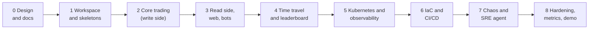

# 07 — Roadmap

Nine phases, each ending with something that runs (from Phase 1) and a clear **"done when"** check. Owners:
**K** = Kaizer Dewaswala (Trading + SRE agent), **A** = MD Asif Ali (Market Insights),
**O** = Mohammad Oweis (Platform & Reliability).

| Phase | Goal | Main work (owner) | Done when |
|---|---|---|---|
| **0 — Design and documentation** | Agree on what to build and why | All docs, ADRs, OpenAPI specs, service READMEs (all) | All docs written; specs pass `redocly lint` with 0 errors; consistency check passes; every owner has reviewed their study guide; every ⚠️ VERIFY marker checked against the textbook |
| **1 — Developer workspace and skeletons** | Everyone can run everything locally | Makefile, Docker Compose with Redpanda/Cassandra/Postgres, `make seed` (O); FastAPI skeleton per service with `/healthz`, `/readyz`, `/metrics` (each owner); `contracts/events/*.schema.json`; CI lint + unit tests; CODEOWNERS (O); mock server from specs (K) | `make up` starts all services healthy; CI green on a PR; each service's OpenAPI matches its spec in a contract test |
| **2 — Core trading (write side)** | Orders become trades and balances change correctly | order-service + matching-engine with event store, snapshots, outbox (K); portfolio accounts, reservations, settlement, orphan release (A) | In Compose: join → place order → match → settle works end to end; matching `domain/` has 100% branch coverage; property test "replay rebuilds the same book" passes; duplicate events don't change balances |
| **3 — Read side, web and bots** | A live, watchable market | market-data candles, depth, trades, WebSockets, `CandleClosed` (A); web join/trade/charts/portfolio (K); bot-traders with 4 strategies (K) | 5 phones + 20 bots trade for 10 minutes with no errors; charts update live; spec contract tests green |
| **4 — Time travel and leaderboard** | Show event sourcing to an audience | Q-12 time travel, Q-13 replay stream (A); leaderboard (A); time-travel UI (K) | Time-travel book equals the live book recorded at 3 sampled moments; replay at 10× plays smoothly |
| **5 — Kubernetes and observability** | Production-like platform | kind cluster, Helm umbrella chart, staging/prod namespaces, network policies (O); Prometheus, Grafana, Loki, Alloy, dashboards, alert rules (O); probes and metrics in every service (all) | `helm upgrade --install` works for both namespaces; dashboards show golden signals for all 8 services; alert fires on a synthetic error burst |
| **6 — IaC and CI/CD** | Repeatable environments and releases | Terraform modules against LocalStack, secrets sync (O); GitHub Actions: build once → staging → smoke → approval → prod → auto-rollback (O) | A merged PR reaches prod via the pipeline with no manual `kubectl`; `terraform plan` shows no drift; a deliberately failing deploy is auto-rolled back |
| **7 — Chaos and SRE agent** | Self-healing, explained | chaos-service with 3 scenarios (O); sre-agent loop, evidence collector, OpenRouter client, guardrails, approval, incident feed (K); feed UI (K) | In staging, each scenario is fixed by the expected action within 3 minutes of detection, 3 runs in a row; guardrail tests prove out-of-allowlist requests are declined; agent survives LLM outage (do_nothing + escalate) |
| **8 — Hardening, measurement and demo** | Ready for the viva | Load test, runbook, transformation metrics report, demo script and rehearsal (all) | Two full demo rehearsals without manual fixes; metrics report produced; all viva notes reviewed |

## Phase status

| Phase | Status |
|---|---|
| 0 | 🟡 In review (docs written; textbook checks pending) |
| 1–8 | ⚪ Not started |

## Measuring progress

> How do we know the move to microservices is actually working? We measure delivery speed and stability (DORA) and
> how independent the services really are.

⚠️ VERIFY AGAINST TEXTBOOK — check which measures the textbook recommends for "measuring microservices transformation
progress" and add or rename metrics to match.

| Metric | Type | How we measure it | Target by Phase 8 |
|---|---|---|---|
| **Deployment frequency** | DORA | Count of prod deploys per week (GitHub Actions) | ≥ 5 per week across services |
| **Lead time for changes** | DORA | Merge → running in prod (pipeline timestamps) | < 30 minutes |
| **Change failure rate** | DORA | Deploys followed by rollback or incident within 1 hour | < 15% |
| **Time to restore service (MTTR)** | DORA | `IncidentResolved.time_to_recover_seconds` + chaos-service measurements | < 3 minutes for the 3 scenarios |
| **Independent deploy ratio** | Architecture | % of deploys that changed exactly one service | > 80% |
| **Cross-service change ratio** | Architecture | % of PRs touching more than one `services/*` folder | < 20% |
| **Contract breakages** | Architecture | Contract-test failures caught in CI (good) vs found in staging (bad) | 0 in staging |
| **Shared-data violations** | Architecture | Any service credential with access to another keyspace/DB | 0 (checked by a test) |

## Viva Notes

**Q: What is the order of phases and why?**
A: Workspace first so everyone can run things; then the write side (the source of truth), then read models that depend
on it; then platform, automation, and finally chaos and the agent, which need the platform's metrics and deploy history.

**Q: What does "done when" mean and why have it?**
A: An objective check that a phase is finished — no "almost done". It also tells examiners exactly what to expect.

**Q: Why is the SRE agent so late in the roadmap?**
A: It depends on everything else: metrics and alerts (Phase 5), real rollouts and history (Phases 5–6), and chaos to
test against (Phase 7). Building it earlier would mean mocking all of that.

**Q: What are the DORA metrics?**
A: Deployment frequency, lead time for changes, change failure rate and time to restore service — four measures of
delivery speed and stability.
