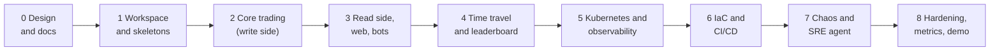

# 07 — Roadmap

Nine phases, each ending with something that runs (from Phase 1) and a clear **"done when"** check. Owners:
**K** = Kaizer Dewaswala (System Design, Trading, SRE agent), **A** = MD Asif Ali (Market Insights, API Team),
**O** = Mohammad Oweis (Cloud Platform, Release & Reliability).

| Phase | Goal | Main work (owner) | Done when |
|---|---|---|---|
| **0 — Design and documentation** | Agree on what to build and why | All docs, ADRs, OpenAPI specs, service READMEs (all) | All docs written; specs pass `redocly lint` with 0 errors; consistency check passes; every owner has reviewed their study guide; every textbook-verification marker resolved against the textbook chapters or a cited standard source |
| **1 — Developer workspace and skeletons** | Everyone can run everything locally | `make doctor`, Makefile and pre-commit hooks incl. gitleaks (K, O); Docker Compose with Redpanda/Cassandra/Postgres, init jobs for topics and per-service keyspaces/roles, `infra` and `app` profiles (O); a FastAPI skeleton per service with `/healthz`, `/readyz`, `/metrics`, JSON logs, correlation ID and a `501` stub for every spec operation, plus a contract test per service (each owner); gateway proxy and `/v1/system/status` (A); web System Status page (K); CI lint, types, tests, Docker builds and gitleaks; CODEOWNERS (O). *Moved to later phases: `contracts/events/*.schema.json` to Phase 2 (first producers) and the mock server from the specs to Phase 3 (when web needs it).* | Fresh clone → `make doctor` → `make up` → all healthy and the System Status page all green; `make lint` and `make test` pass with 0 errors; each service's contract test passes against its spec; stopping a container turns it red on the status page and restarting turns it green; resource use is measured ([developer setup](08-developer-setup.md#7-resource-use-measured)) |
| **2 — Core trading (write side)** | Orders become trades and balances change correctly | `contracts/events/*.schema.json` and event contract tests (K, A); order-service + matching-engine with event store, snapshots, outbox (K); portfolio accounts, reservations, settlement, orphan release (A); api-gateway sessions/JWT, routing, rate limits, `/internal/` blocking (A) | In Compose: join → place order → match → settle works end to end; matching `domain/` has 100% branch coverage; property test "replay rebuilds the same book" passes; duplicate events don't change balances |
| **3 — Read side, web and bots** | A live, watchable market | mock server generated from the specs (K); market-data candles, depth, trades, WebSockets, `CandleClosed` (A); gateway WebSocket proxy (A); web join/trade/charts/portfolio (K); bot-traders with 4 strategies (K) | 5 phones + 20 bots trade for 10 minutes with no errors; charts update live; spec contract tests green |
| **4 — Time travel and leaderboard** | Show event sourcing to an audience | Q-12 time travel, Q-13 replay stream (A); leaderboard (A); time-travel UI (K) | Time-travel book equals the live book recorded at 3 sampled moments; replay at 10× plays smoothly |
| **5 — Kubernetes and observability** | Production-like platform | kind cluster and `make k8s-up` (one node; owner's decision 2026-11-13: the Terraform modules move to Phase 6) (O); Helm umbrella chart with the shared service sub-chart and network policies (O); Traefik ingress for phones (O); Prometheus, Grafana, Loki, Alloy, dashboards, alert rules (O); probes and metrics in every service (all); no autoscaler: capacity shown by scaling by hand (owner's decision) | `make k8s-up` builds everything from nothing; the umbrella installs in both namespaces; dashboards show business and golden signals; one order followed by correlation ID in Loki; every Phase 7 alert fires from a real trigger within ~30 s of its condition; memory within the agreed budget (measured) |
| **6 — IaC, CI/CD and GitOps** | Repeatable environments and releases | Terraform `kind-cluster` and `environment` modules (the Phase 5 cluster settings; namespaces with ResourceQuotas, agent RBAC, Secrets; `make platform`) (O); Terraform `argo-cd` module (Argo CD via the Helm provider) + `ApplicationSet` (O); GitHub Actions: build once → tag bump in `deploy/envs/staging/` → Argo CD sync + PostSync smoke tests → `make promote` PR → Release & Reliability approval → Argo CD syncs prod (O); CI create–check–destroy test of `infra/envs/local` (O); optional LocalStack module (O) | A merged PR reaches prod through commits only, with no manual `kubectl` or `helm`; Argo CD shows every Application `Synced` and `Healthy`; `terraform plan` shows no changes; a deliberately failing release is undone by `git revert` and Argo CD re-syncs |
| **7 — Chaos and SRE agent** | Self-healing, explained | chaos-service with 3 scenarios (O), the `TRAFFIC_SPIKE` burst as a **panic sell** (bots dump shares at market: a visible crash plus the traffic the agent scales for; owner's direction, 2026-11-04; its trigger needs an ADR, [chaos scenarios §3.3](03-architecture/06-chaos-scenarios.md#33--traffic-spike-traffic_spike)) (O, K); sre-agent loop, evidence collector, OpenRouter client, guardrails, approval, incident feed (K); feed UI (K); rollback's Git step: Argo CD pre-check + revert PR via a GitHub App (K); `main` ruleset and read-only Argo CD account (O); agent + Argo CD coexistence checks (K, O) | A projector **Incident view** Grafana dashboard (about 6 large panels, one per chaos scenario) with annotations for every deploy and every SRE agent action (owner's note, 2026-11-13) (K). In staging, each scenario is fixed by the expected action within 3 minutes of detection, 3 runs in a row; guardrail tests prove out-of-allowlist requests are declined; agent survives LLM outage (do_nothing + escalate); after a `BAD_DEPLOY` rollback the Argo CD Application returns to `Synced` (`git_reconciliation: NOT_NEEDED`), and scale/restart create no `OutOfSync`; in a Git-delivered bad-release rehearsal the rollback opens a `git revert` PR whose merge returns the Application to `Synced` with no new rollout |
| **8 — Hardening, measurement and demo** | Ready for the viva | Load test, runbook, transformation metrics report, demo script and rehearsal (all); pre-recorded clip of the Git-delivered bad release → rollback → `git revert` PR path (K, O) | Two full demo rehearsals without manual fixes; metrics report produced; all viva notes reviewed |

## Phase status

| Phase | Status |
|---|---|
| 0 | 🔒 Design frozen on 2026-11-03 (owners still to review their study guides) |
| 1 | 🟢 Built and verified (2026-11-03); CI green on GitHub |
| 2 | 🟢 Built and verified (2026-11-04): `make demo-trade`; `make test-e2e` (join → trade → settle, `kill -9` of the engine mid-workload with an identical book hash, the fail-closed orphan rule with Redpanda stopped); matching `domain/` at 100% branch coverage; replay and duplicate-event property tests at 1,000 examples in CI and 25,000 in `make test-deep`. Design changes made while building: [ADR-0017](adr/0017-fail-closed-orphan-release.md) (fail-closed orphan release) and self-trade prevention |
| 3 | 🟢 Built and verified (2026-11-05): market-data read side (candles, depth, trades, last price) with WebSockets (snapshot, then updates in sequence); portfolio Q-10 pushes via Postgres LISTEN/NOTIFY; the gateway's WebSocket proxy; 20 bots with 4 strategies (10-minute live check: 2,895 book samples, never crossed, 0 refused orders, 0 5xx); the presenter dashboard and the phone pages in two skins ([visual direction](design/visual-direction.md)); `make mock`; `make test-e2e` 4/4 including the bots for 60 s. **Still to do:** the 5-real-phones check, on the demo hotspot ([developer setup §10](08-developer-setup.md#10-phones-on-a-hotspot-demo-day)). **Found on 2026-11-14: phone ordering over the LAN never worked in Phase 3.** The page made its order key with `crypto.randomUUID()`, which browsers offer only in a secure context (https or localhost); a phone opens plain `http://<LAN IP>`, so the order failed before any request was sent, and the page hid the error. Every test had run on localhost, which is a secure context. Fixed in `v0.5.1-demoable` (a UUID from `crypto.getRandomValues`, real error messages, `make test-phone` on a non-secure origin in CI; the rule is now in [coding standards §6](05-coding-standards.md#6-testing-rules)). Changes made while building: `recent_trades` in the Q-06 snapshot; Cassandra driver protocol v4 (v5 failed under load); the 60 s publish rule enforced by a non-idempotent producer ([ADR-0017](adr/0017-fail-closed-orphan-release.md) note) |
| 4 | 🟢 Built and verified (2026-11-12): time travel (Q-12) with a proof hash equal to the live engine's, replay (Q-13) at 1–60× with pause and speed, the leaderboard (Q-11), the presenter's time-travel screen in both skins, the nickname blocklist and the leaderboard toggle. `make test-e2e` 9/9: three moments recorded from the live engine rebuilt with the same hash, rewind to now verified on all five tickers, a replay's end hash and fills equal to the engine's, four replays at once without slowing orders down (p95 20 ms vs 24 ms). Seeks over an hour of trading: p50 41 ms, p95 70 ms. Changes made while building: cancels and expiry requests have no time limit ([ADR-0017](adr/0017-fail-closed-orphan-release.md) note); Q-12 counts a moment up to 2 s ahead as now; close code `4422`; replay frames carry every fill; bots rebalanced so prices stay within ±10% (30-minute check: −1.5% to +2.2%) |
| 5 | 🟢 Built and verified (2026-11-13): the whole system on a one-node kind cluster from `make k8s-up` (`make test-k8s` from nothing: every pod ready, demo trade, bots, trades on the dashboard, one order followed in Loki); Traefik ingress with phones on `http://<LAN IP>/`; Prometheus, Grafana (business, system and follow-an-order dashboards as code), Loki and Alloy; 10 alert rules with promtool tests, each fired by a real trigger; NetworkPolicies proven (11 connections); a deleted pod replaced in 10 s with nothing lost; 2 → 4 order-service replicas take order p95 from 9.1 s to 96 ms. Memory: 4.3 GiB for prod with monitoring (process memory), 6.5 GiB with staging too. Changes made while building: [ADR-0018](adr/0018-kubernetes-platform-components.md) (platform components), one node and Terraform in Phase 6 ([ADR-0015](adr/0015-terraform-local-platform.md) amendment), topics created only by the init job, correlation IDs carried through event consumers, the alert timing (30 s) and `OrderServiceCircuitOpen`, data stores excluded from the agent's alerts |
| 5½ | 🟢 Pre-chaos hardening (2026-11-14, PR #7): an open-orders table (Q-07 `status=open` reads only what is open: p95 2.8 s → 0.4 s on a long history), an outbox that reads 1 tombstone per pass instead of about 2,500, the engine's memory of finished orders bounded to one hour of event time, the traffic spike as a panic sell, idempotent bot retries, makers re-quoting a filled side at once. Measured: scaling order-service 2 → 5 cuts the spike's p95 from over 10 s to 1–2 s, not yet below 500 ms ([chaos scenarios §3.3](03-architecture/06-chaos-scenarios.md)) |
| Before 6 | 🟢 Profiling (2026-11-23, PR #8): every stage of an order placement timed, py-spy, fresh vs 19-hour cluster. The wait was in Cassandra, not downstream of order-service: the snapshot table grew without bound (now one partition per ticker per hour, thinned, a 24-hour time-travel horizon; events never deleted) and Cassandra was sized for the laptop, not its container (now a measured memory budget: about 1 GiB process memory, GC paused 0.7% of the time instead of 7–10%). Order POST p95 in the 60-minute soak 281 → 50 ms. The traffic spike calibrated on the laptop: **110 requests/s**, 2 replicas ≥ 8.5 s, 5 replicas 168–407 ms ([chaos scenarios §3.3](03-architecture/06-chaos-scenarios.md)) |
| 6–8 | ⚪ Not started |

## Design freeze

The Phase 0 design was **frozen on 2026-11-03**. From now until Phase 7, phases add **code, not design**:

- **Not allowed:** new scope. That means no new services, agent tools, infrastructure components, integrations, or
  ADRs that add capability.
- **Allowed:** fixing errors and inconsistencies found while coding, in the same PR as the code (docs stay the
  source of truth).
- **Allowed:** a superseding ADR only if implementation proves a frozen decision *unworkable*. It replaces the
  decision; it does not extend it.
- Ideas that come up meanwhile go to a "Later" list in the Phase 8 runbook, not into the design.

## Measuring progress

> How do we know the move to microservices is actually working? We measure delivery speed and stability with the
> **DORA "four key metrics"**, then add metrics specific to CircuitBreaker's self-healing goal and to how independent
> the services really are.
>
> **Source:** the four key metrics come from N. Forsgren, J. Humble and G. Kim, *Accelerate: The Science of Lean
> Software and DevOps* (IT Revolution, 2018), the DORA research programme. They are a standard industry source, not
> the textbook. Later DORA reports rename the fourth metric "failed deployment recovery time"; we keep the
> *Accelerate* name.

| Metric | Type | How we measure it | Target by Phase 8 |
|---|---|---|---|
| **Deployment frequency** | DORA | Count of prod promotion merges per week (`git log deploy/envs/prod/`) | ≥ 5 per week across services |
| **Lead time for changes** | DORA | Merge to `main` → Argo CD reports the prod Application `Synced` with that tag | < 30 minutes (excluding approval wait) |
| **Change failure rate** | DORA | Promotions followed by a `git revert` or an incident within 1 hour | < 15% |
| **Time to restore service** | DORA | `IncidentResolved.time_to_recover_seconds` + chaos-service measurements | < 3 minutes for the 3 scenarios |
| **Incidents auto-remediated** | CircuitBreaker | Share of incidents resolved `RECOVERED` after an agent action (approved or not) rather than `ESCALATED` (`sre_agent_incidents_total{resolution}`) | ≥ 90% of chaos runs |
| **Mean time to detect (MTTD)** | CircuitBreaker | Chaos experiment start → `IncidentOpened` (recorded by chaos-service) | < 90 seconds |
| **Independent deploy ratio** | Architecture | % of promotions that changed exactly one service | > 80% |
| **Cross-service change ratio** | Architecture | % of PRs touching more than one `services/*` folder | < 20% |
| **Contract breakages** | Architecture | Contract-test failures caught in CI (good) vs found in staging (bad) | 0 in staging |
| **Shared-data violations** | Architecture | Any service credential with access to another keyspace/DB | 0 (checked by a test) |

## Viva Notes

**Q: What is the order of phases and why?**
A: Workspace first so everyone can run things; then the write side (the source of truth), then read models that depend
on it; then platform, automation, and finally chaos and the agent, which need the platform's metrics and deploy history.

**Q: What does "done when" mean and why have it?**
A: An objective check that a phase is finished — no "almost done". It also tells examiners exactly what to expect.

**Q: Why is the SRE agent so late in the roadmap?**
A: It depends on everything else: metrics and alerts (Phase 5), real rollouts and history (Phases 5–6), and chaos to
test against (Phase 7). Building it earlier would mean mocking all of that.

**Q: What are the DORA metrics, and where do they come from?**
A: Deployment frequency, lead time for changes, change failure rate and time to restore service: two measures of
speed and two of stability, from Forsgren, Humble and Kim's *Accelerate* (2018). We add mean time to detect and the
share of incidents the agent fixed.
