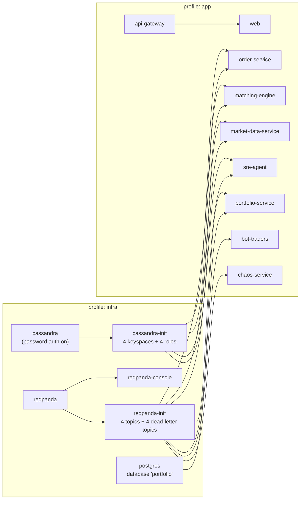

# 08 — Developer Setup

> **Goal:** from a fresh clone, one command starts every service and every piece of infrastructure on your laptop, all
> healthy. This page says what you need, what each command does, which ports are used, how much memory it takes
> (measured), and what to do when something goes wrong.
>
> **Terms used here**
> - **Docker Compose:** runs several containers together from one file, `docker-compose.yml`.
> - **Profile (Compose):** a label that lets you start only part of the file. We have two: `infra` (Redpanda, Cassandra,
>   Postgres and their setup jobs) and `app` (the 8 services and the web app).
> - **Init job:** a container that does one task and exits. Ours create the Redpanda topics and the Cassandra keyspaces.
> - **Healthcheck:** a command Docker runs to ask a container "are you OK?". `depends_on: service_healthy` makes a
>   container wait until the ones it needs are healthy.
> - **Lockfile (`uv.lock`, `package-lock.json`):** the exact version of every dependency, so every machine and CI
>   build the same thing.
> - **Stub:** an endpoint that exists in the API spec but has no logic yet; it answers `501 Not Implemented`.
> - **Contract test:** a test that compares the running app with its OpenAPI spec, in both directions.
> - **Umbrella project (local):** the repository root (`docker-compose.yml` + `Makefile`) that pulls every service together
>   so the whole system runs as one ([coding standards §2](05-coding-standards.md#the-umbrella-project-our-interpretation)).

## 1. Prerequisites

Run `make doctor`. It prints the version of each tool and tells you how to fix anything missing.

| Tool | Version | Why | Install (macOS) |
|---|---|---|---|
| Docker Desktop (Docker + Compose v2) | Compose v2 (`docker compose`), **10 GB RAM** allocated | Runs everything | <https://docs.docker.com/get-docker/> |
| Python | 3.12 | All backend services | `uv python install 3.12` |
| uv | ≥ 0.10 | Python dependencies and virtual environments | `brew install uv` |
| Node.js | **≥ 22.12, 24 LTS recommended** | Web app (Vite 8, ESLint 10 and Vitest 5 need 22.12+) | `brew install node@24 && brew link --overwrite --force node@24` |
| kind, kubectl, Helm | any current | Installed and checked now; the cluster arrives in Phase 5 | `brew install kind kubectl helm` |
| make | GNU Make 3.81+ (the macOS one is fine) | Developer entry point | `xcode-select --install` |
| gitleaks, pre-commit | any current | Secret scanning and the commit hooks | `brew install gitleaks pre-commit` |

`make doctor` warns, and does not fail, when Docker has less than about 10 GB. See [§7](#7-resource-use-measured) for why
10 GB and what is actually used.

## 2. First run

```bash
git clone <repository-url> CircuitBreaker && cd CircuitBreaker
make doctor      # check the tools
make up          # build the 9 images and start everything (about a minute)
make status      # combined health of every service and dependency, as JSON
```

Then open:

| URL | What you should see |
|---|---|
| <http://localhost:5173> | **System Status** (sign in with the local passcode `cb-dev-admin-passcode`): "All systems healthy", 8 service cards and 3 dependencies, all green |
| <http://localhost:8088> | Redpanda Console: the 4 topics and their dead-letter topics |
| `make status` | The same report as JSON (it signs in as admin first; the endpoint is admin-only) |

The first run also downloads the base images (Redpanda, Cassandra, Postgres, Python, Node, nginx), so it takes several
minutes depending on your connection. Later runs reuse Docker's cache; from an empty data state on a warm cache,
`make up` reached all 15 containers healthy in **32–51 seconds** on the reference machine.

For development you will also want `make setup` (creates each service's virtual environment, installs the web
dependencies, and installs the git hooks). `make up` does not need it, because the images build from the lockfiles.

### What `make up` starts, in order



A service only starts after the init jobs it needs have finished and its database is healthy. Its own
`/readyz` then checks that it can really log in and use its own keyspace or database and that its Redpanda topics
exist, so "healthy" means "can do its job", not just "the process started".

## 3. Make targets

`make help` prints this list. Targets that work per service accept `s=<service>`, for example `make test s=order-service`.

| Target | What it does |
|---|---|
| `make doctor` | Checks the prerequisites and prints their versions |
| `make setup` | `uv sync` in every service, `npm ci` in `web/`, and installs the git hooks |
| `make infra` | Starts **only** the infrastructure (profile `infra`): Redpanda, Cassandra, Postgres and the init jobs |
| `make up` | Builds and starts everything (both profiles) and waits until every container is healthy |
| `make down` | Stops everything; data volumes are kept |
| `make reset` | Stops everything and **deletes all data volumes**; asks you to type `yes` first |
| `make demo-reset` | **Rehearsal start.** Like `make reset` (asks for `yes`; `CONFIRM=yes make demo-reset` skips the question), then builds and starts everything and checks the starting state: five empty books with no history, only the seeded accounts (`bot-01`…`bot-20` with ₹5,00,000 and 1,000 shares of each ticker, `load-01`…`load-10`), no human accounts. Every rehearsal starts from the same state |
| `make ps` | Shows the container status |
| `make logs s=<service>` | Follows logs (all services if `s` is omitted) |
| `make build` | Builds the Docker images (`s=<service>` for one) |
| `make lint` | `ruff check`, `ruff format --check` and `mypy` per service, `redocly lint`, the template-drift check, and web ESLint + Prettier |
| `make fmt` | Auto-fixes and formats Python (ruff) and web (Prettier) |
| `make test` | `pytest` per service (unit, property, smoke and contract tests; matching-engine also enforces 100% branch coverage of `domain/`) and `vitest` for the web app |
| `make test-integration` | Integration tests against real Cassandra/Postgres/Redpanda started by testcontainers (needs Docker); `s=<service>` for one |
| `make test-deep` | Property tests (Hypothesis) at 25,000 examples each instead of 1,000; slow |
| `make bots` | With `make up` running: the 20 bots start trading (they are off by default). `make bots seed=42` repeats a rehearsal's bot choices; `activity=1.5` makes them busier. `make up` turns them off again (the default) |
| `make bots-stop` | The bots stop trading; their container keeps running, idle |
| `make demo-trade` | With `make up` running: two traders join, a bot sells to one, who sells to the other, all through the gateway; prints the trades, the three portfolios and the order statuses |
| `make test-e2e` | With `make up` running (~7 min): join → trade → settle with exact balances; `kill -9` of the matching engine mid-workload, then the same book hash after a rebuild; the orphan rule with Redpanda stopped (`REJECTED` after 60 s, the hung send never delivered, money held until the engine answers); the 20 bots for 60 s (`scripts/bots_check.py`: candles with trades for all 5 tickers, the book never crossed in the engine or in market-data, no refused bot order, no 5xx) |
| `make status` | Signs in as admin (`ADMIN_PASSCODE`, default the local placeholder) and prints the gateway's `/v1/system/status` |

> **Not the same as the Terraform target.** `make infra` means *the Compose infrastructure*. The Terraform platform from
> [ADR-0015](adr/0015-terraform-local-platform.md) (kind cluster, namespaces, Argo CD) will be `make platform`; it
> arrives in Phase 5.

## 4. Ports

| Host port | Container port | What |
|---|---|---|
| 5173 | 8080 | `web` (nginx, unprivileged) |
| 8080 | 8000 | `api-gateway` (the public API) |
| 8001–8007 | 8000 | `order-service`, `matching-engine`, `market-data-service`, `portfolio-service`, `bot-traders`, `sre-agent`, `chaos-service` |
| 19092 | 19092 | Redpanda Kafka API for tools on your laptop (inside Docker, services use `redpanda:9092`) |
| 8088 | 8080 | Redpanda Console |
| 9042 | 9042 | Cassandra |
| 5433 | 5432 | Postgres (host port 5433 so a Postgres you installed yourself on 5432 is never confused with this one) |

Every service listens on 8000 inside its container ([system architecture](03-architecture/01-system-architecture.md#container-inventory)).

## 5. Local credentials (development only)

These placeholders exist only in the local Compose setup and are never used outside it. Real environments get their
secrets from Kubernetes Secrets created by Terraform ([ADR-0015](adr/0015-terraform-local-platform.md)).

| What | Login |
|---|---|
| Cassandra administrator (init job only) | `cassandra` / `cassandra` |
| Cassandra role of a service | `<keyspace>_role` / `cb_dev_<keyspace>`, for example `order_service_role` / `cb_dev_order_service`. Allowed on **its own keyspace only**. |
| Postgres administrator | `postgres` / `postgres` |
| Postgres role of portfolio-service | `portfolio_service` / `cb_dev_portfolio`. Owns the `portfolio` database; nobody else can connect to it. |
| Gateway secrets | `JWT_SECRET=cb-dev-jwt-secret-for-local-compose-only`, `BOT_SECRET=cb-dev-bot-secret`, `ADMIN_PASSCODE=cb-dev-admin-passcode` (log in as admin with any nickname and this passcode) |

To run a service outside Docker, copy its `.env.example` to `.env` (git-ignored) and run
`uv run uvicorn <package>.main:create_app --factory --reload` inside its folder.

## 6. How the services are built

All 8 services have the same shape ([coding standards §3](05-coding-standards.md#3-folder-layout-inside-every-service)).
Each file has one of three origins:

| Origin | Files | How it stays right |
|---|---|---|
| **Copied from the template**, identical in every service | `src/<package>/runtime/` (settings, JSON logging, Problem Details, middleware, metrics, health and readiness checks, and since Phase 2 the event envelope and the Kafka publisher/consumer with the dead-letter rule), `Dockerfile`, `.dockerignore`, `.python-version`, the shared tests | `tools/check_template_drift.py` (in `make lint` and CI) fails if any copy differs; `--sync` copies the template's files to every service. See [duplication over coupling](05-coding-standards.md#duplication-over-coupling-why-the-services-share-no-library). |
| **Generated from the OpenAPI spec**, then owned by the service | `src/<package>/api/stubs.py`: one `501` stub per operation | `tests/contract/` compares the app with `api/<service>.yaml`, both ways |
| **Written per service** | `config.py`, `main.py`, `business_metrics.py`, `pyproject.toml`, `tests/conftest.py`, `.env.example` | Rendered by `tools/scaffold.py` from the service table; reviewed like any code |

What every service exposes in Phase 1:

| Endpoint | Behaviour |
|---|---|
| `GET /healthz` | `200 {"status":"ok"}`. Never checks dependencies. |
| `GET /readyz` | `200` when its Redpanda topics exist and its own Cassandra keyspace or Postgres database works; otherwise `503` with the reason per dependency |
| `GET /metrics` | Prometheus: `http_requests_total`, `http_request_duration_seconds`, `http_requests_in_flight`, event counters, process memory, and the business metrics the docs name |
| every operation in its spec | `501` with a Problem Details body (`code: NOT_IMPLEMENTED`) |

Every log line is one JSON object with the `correlation_id`. The gateway issues the ID; every other service passes it
through and returns it in the `X-Correlation-Id` header.

## 7. Resource use (measured)

Measured with `docker stats` on 2026-11-03 (Apple silicon, Docker Desktop with 10 GB), after `make up` from an empty
data state and about a minute of idle. Phase 1 has no business logic, so this is the **floor**; it will grow in later phases.

| Container | Memory used | Limit | Notes |
|---|---:|---:|---|
| cassandra | 1,346 MiB | 2,048 MiB | 512 MB JVM heap plus off-heap memory; peaked at 1,373 MiB while starting |
| redpanda | 150 MiB | 896 MiB | `--memory 512M --smp 1` |
| redpanda-console | 36 MiB | 256 MiB | development tool |
| postgres | 24 MiB | 256 MiB | |
| 7 backend services (each) | 38–40 MiB | 192 MiB | `api-gateway` 40, the other six 38–39 |
| web (nginx) | 10 MiB | 64 MiB | |
| **Whole stack, idle** | **about 1.8 GiB** | | **peak 1.9 GiB** while starting, including the two init jobs |

- **CPU:** under 1% per container when idle.
- **Images:** 90 MB (`web`) and 230–270 MB (each service) on disk.
- **Startup:** `make up` from empty volumes took **32–51 s** with a warm Docker cache.

**Requirement.** Phase 1 needs **at least 4 GB** for Docker (1.9 GiB used plus image builds and the host). We keep the
recommendation and the `make doctor` warning at **10 GB** because Phase 5 runs `staging` and `prod` copies of the data
stores in kind, which will need much more; we will re-measure then. The limits above are the caps in `docker-compose.yml`.

## 8. Adding a new service

1. Write its API in `api/<service>.yaml` (every operation needs `operationId` and `x-seeds-id`) and run `npx @redocly/cli lint`.
2. Add an entry to `SERVICES` in `tools/scaffold.py`: summary, topics, and `cassandra` keyspace or `postgres` database.
3. `python3 tools/scaffold.py <service>`. This creates `services/<service>/`, generates the stubs from the spec, locks
   the dependencies and formats the code.
4. Add its container to `docker-compose.yml` (copy a neighbour; give it the next port, 8008 and up) and to the gateway's
   `SERVICE_UPSTREAMS` if it should appear on the status page.
5. If it owns a Cassandra keyspace, add the keyspace to `dev/cassandra/init-keyspaces.sh`; if it uses new topics, to
   `dev/redpanda/create-topics.sh` and the [event catalog](03-architecture/03-event-catalog.md).
6. Add the service to the CI matrix in `.github/workflows/ci.yml` and to the table in `Makefile` (`SERVICES`).
7. Run `make lint test`, then `make up`.
8. Write `services/<service>/README.md` and update [the data ownership doc](03-architecture/02-data-ownership.md).

## 9. Troubleshooting

| Symptom | Likely cause | Fix |
|---|---|---|
| `make up` seems stuck on `cassandra` | Cassandra is slow to start (first start 30–60 s on a laptop). Its healthcheck has a 60 s grace period and `make up` waits up to 7 minutes. | Wait. Check with `make logs s=cassandra`. |
| Containers exit with code 137, or `docker inspect <name> --format '{{.State.OOMKilled}}'` prints `true` | Docker ran out of memory | Docker Desktop → Settings → Resources → Memory ≥ 10 GB, then `make down && make up` |
| `port is already allocated` or `address already in use` | Another program uses 5173, 8080, 8001–8007, 8088, 9042 or 19092 | Find it with `lsof -nP -iTCP:<port> -sTCP:LISTEN`, stop it, or change the left-hand port in `docker-compose.yml` |
| The portfolio service cannot log in to Postgres from your laptop | You may be reaching your own Postgres on 5432 | Use host port **5433** (`POSTGRES_PORT=5433`) |
| A service stays `starting` or `not_ready` | A dependency is down, or the init jobs failed | `curl localhost:8080/v1/system/status`: the `checks` show which one. `make logs s=redpanda-init` or `s=cassandra-init` for the init jobs. |
| After changing a Cassandra role or password, services cannot log in | The Cassandra data volume still holds the old roles | `make reset` (wipes data) and `make up` |
| `make doctor` says Node is too old although you installed a newer one | An older Homebrew Node formula is still linked | `brew unlink node@20 && brew link --overwrite --force node@24`, then open a new terminal |
| `make lint` fails with `DRIFT` | A file that must be identical in every service was changed in one | Change `services/order-service` (the template) and run `python3 tools/check_template_drift.py --sync`, or revert; see [§6](#6-how-the-services-are-built) |
| The pre-commit hook rejects a commit | Lint error, a secret was detected, or `private/` / `CLAUDE.md` was staged | Read the message; `git restore --staged <file>` for the last case |

## Viva Notes

**Q: What does "umbrella project" mean in your repository?**
A: It is our interpretation of the term, not the textbook's: the repository root with `docker-compose.yml` and a
`Makefile` that pulls every service together so the whole system starts with one command. On Kubernetes the same role
is played by the Helm umbrella chart.

**Q: Why do the services return 501 instead of a fake answer or being left out?**
A: Contract first. The skeletons implement the whole API surface from the OpenAPI specs, and a contract test fails if the
app and its spec disagree. A client gets an honest "not built yet" in the standard error format, and each operation
is replaced by real logic without changing its URL.

**Q: Why one Cassandra keyspace and one login per service, if there is only one Cassandra container?**
A: A shared server is a cost decision; a shared database is an architecture decision. Each service's role can use only
its own keyspace, which we tested: a role writing to another service's keyspace is refused. So the data-ownership rule is
enforced by the database, not just by convention.

**Q: Why multi-stage Dockerfiles and a non-root user?**
A: The build stage has the package manager and build tools; the final image only has Python and the installed
environment, so it is smaller and has less to attack. Running as a non-root user means a compromised process cannot
change the container or reach host resources as root.

**Q: What did you measure, and what did it change?**
A: With `docker stats` we measured about 1.8 GiB for the whole idle stack. Cassandra peaked at 1.37 GiB of its 1.5 GiB
limit, which was too close, so we raised its limit to 2 GiB. We kept the 10 GB recommendation because Phase 5 adds more
data stores.
