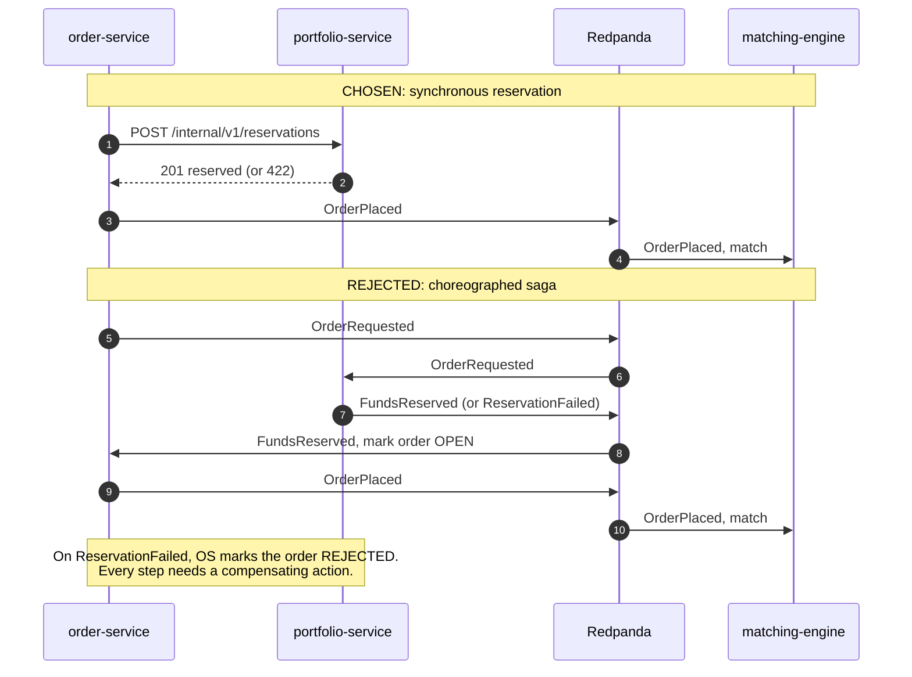

# 0011 — Synchronous Reservation instead of an Asynchronous Saga

- **Status:** Accepted — orphan clean-up (supporting rule 3) amended by [ADR-0017](0017-fail-closed-orphan-release.md)
  (money is released only when the matching engine confirms the order can never trade; the 60 s publish limit stays)
- **Date:** 2026-11-02
- **Deciders:** Kaizer Dewaswala, MD Asif Ali, Mohammad Oweis

## Context

Market rules forbid **margin** (spending cash you don't have) and **short selling** (selling shares you don't own).
The check must happen *before* an order can trade, and two simultaneous orders must not both spend the same rupees.
Cash and holdings are owned by `portfolio-service`; orders by `order-service`; matching by `matching-engine`.
So "place an order" spans two services' data.

> **Saga:** a multi-step business process across services, coordinated by events, where each step has a
> **compensating action** that undoes it if a later step fails. There is no distributed transaction.

## Decision

`order-service` calls `portfolio-service` **synchronously** — `POST /internal/v1/reservations` (A-06) — before it
stores and publishes `OrderPlaced`. portfolio-service checks and reserves cash/shares in one SQL transaction and answers
`201` (reserved) or `422` (`INSUFFICIENT_FUNDS` / `INSUFFICIENT_SHARES`). Only then is the order published. Later,
`TradeExecuted` consumes the reservation and `OrderCancelled` or order completion releases the leftover (A-09).

Supporting rules:

1. **Idempotent by `order_id`** — a retried reservation returns the existing one (`200`), never a second reservation.
2. **Short timeout + circuit breaker** — 500 ms timeout; after 5 consecutive failures, order-service fails fast with
   `503 DEPENDENCY_UNAVAILABLE` for 10 s.
3. **Orphan clean-up** — if order-service crashes after reserving but before storing the order, the reservation would
   lock money forever. So: portfolio-service releases any reservation for which it has not seen an `OrderAccepted`
   (it consumes `matching.v1`) within **120 s**; and order-service's outbox relay **never publishes an `OrderPlaced`
   older than 60 s** — it marks such orders `REJECTED` (reason `PUBLISH_TIMEOUT`) instead. Because 60 s < 120 s, an
   order can never reach the engine after its reservation was released.

   > **Amended by [ADR-0017](0017-fail-closed-orphan-release.md) (2026-11-04).** The 120 s timer only covers delays inside
   > order-service, not an engine that is down or crashed before publishing. portfolio-service now asks for an expiry
   > at 120 s and releases only on the engine's answer (`OrderCancelled` `ORDER_EXPIRED` or `OrderExpired`).

## The two options compared

| Criterion | **Sync reservation (chosen)** | Async saga |
|---|---|---|
| User feedback on "not enough cash" | Immediate `422` in the same request | Later, via WebSocket; the UI must handle "accepted, then rejected" |
| Steps and events | 1 HTTP call | 2 extra events, 2 extra consumers, saga state in order-service |
| Compensation logic | Only release on cancel/finish (already needed) | Plus: undo reservation if order placement fails, time-outs per step |
| Coupling of **availability** | If portfolio-service is down, **no new orders** (fail fast, 503) | Orders queue in Redpanda and complete when portfolio recovers |
| Latency | +1 network hop (~a few ms) | Several broker hops (tens of ms) |
| Ease of explaining and testing | High | Medium–low (many interleavings) |
| Consistency | Strong at the moment of acceptance | Eventual; the order is "pending" until the saga finishes |

## Alternatives considered

| Alternative | Why rejected |
|---|---|
| **Choreographed saga** (above) | Better availability decoupling, but much more complexity and a worse user experience for the most common error. |
| **Orchestrated saga** (order-service drives steps via commands) | Clearer than choreography, but still needs saga state, timeouts and compensations. |
| **Distributed transaction (two-phase commit)** | Locks across services and databases; poor availability; not supported by Redpanda/Cassandra. |
| **Matching engine checks balances** | Would need a copy of all balances inside the engine → duplicated ownership of money, and the engine gets slower and bigger. |
| **Check balances, but don't reserve** | Two orders placed at the same time could both pass the check and overspend. |

## Consequences

- ✅ Simple, fast, strongly consistent at acceptance; clear `422` errors on the phone.
- ✅ "No margin, no short selling" enforced by one aggregate (`Account`) with database constraints.
- ❌ **Temporal coupling:** order placement depends on portfolio-service being up. Mitigations: 2 replicas, the circuit
  breaker, readiness probes, and the agent can scale or restart portfolio-service.
- ❌ portfolio-service is not a *pure* read model (ADR-0006) — it also accepts reservation commands.
- ❌ Orphaned reservations are possible after a crash — handled by the 60 s / 120 s rule above.

**When we would switch to a saga:** if portfolio availability became the main source of failed orders, or if placing an
order needed more than one other service (e.g. risk checks + fees + funds), the saga's decoupling would be worth its
complexity.

## Viva Notes

**Q: Why didn't you use a saga, which is the "microservices way"?**
A: A saga trades simplicity and immediate feedback for availability decoupling. We have one dependency, a sub-second
check, and a user waiting on a phone, so a synchronous call with a circuit breaker is the simpler correct choice. We
documented exactly when we'd switch.

**Q: What happens if portfolio-service is down?**
A: Order placement fails fast with 503 thanks to the circuit breaker; trading resumes as soon as it recovers. Market
data, time travel and existing resting orders are unaffected.

**Q: What is a compensating action? Do you have any?**
A: An action that undoes an earlier step. Releasing a reservation when an order is cancelled, or when it was orphaned
by a crash, is our compensating action.

**Q: Why the 60-second and 120-second numbers?** *(Rule changed by ADR-0017: at 120 s portfolio asks for an expiry
instead of releasing; see its Viva Notes.)*
A: The relay gives up publishing after 60 s; portfolio releases unconfirmed reservations after 120 s. Because 60 < 120,
an order can never be matched after its reserved money was handed back.
