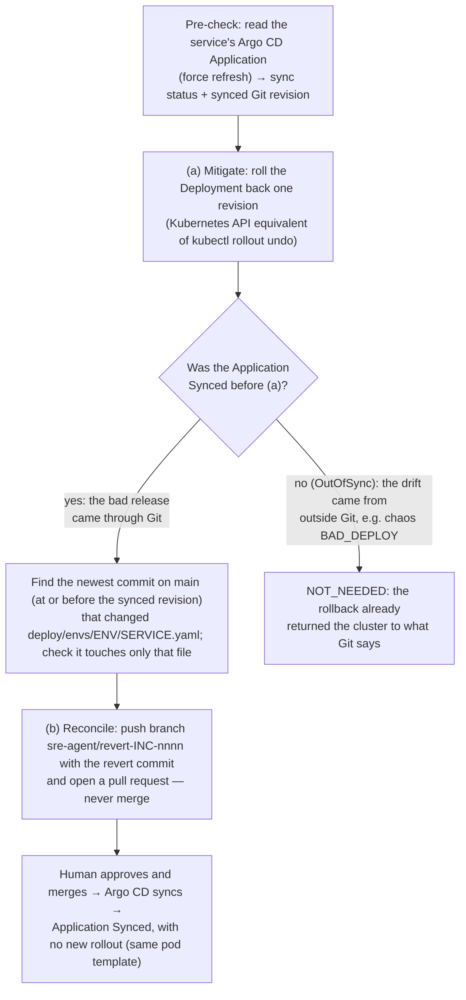

# 0016 — Rollback Mitigates in the Cluster, Then Reconciles Through Git

- **Status:** Accepted — amends [ADR-0014](0014-gitops-with-argo-cd.md) (a human no longer has to notice and revert
  a bad release by hand) and extends the *implementation* of `rollback_deployment` from
  [ADR-0009](0009-sre-agent-fixed-tool-allowlist.md). The agent still has exactly four tools.
- **Date:** 2026-11-03
- **Deciders:** Kaizer Dewaswala (owner), Mohammad Oweis, MD Asif Ali

## Context

With GitOps, Git is the source of truth (ADR-0014). The agent's `rollback_deployment` rolls the Deployment back
through the Kubernetes API, the equivalent of `kubectl rollout undo`. That is fast, but when the bad release came
**through Git**, Git still names the bad image tag afterwards:

- the Argo CD Application stays `OutOfSync`;
- the next commit to that service's values file, or anyone turning self-heal on, would bring the bad release back;
- the permanent fix depended on a human noticing a message on the incident feed.

## Decision

`rollback_deployment` performs **two deterministic steps**, both in ordinary code. The LLM still only chooses among
the same four tools. It does not choose, word or trigger the Git step.

| Detail | Rule |
|---|---|
| Revert commit | Same shape as `git revert <sha>`: message `Revert "<original message>"` + `This reverts commit <sha>.`. It restores `deploy/envs/<env>/<service>.yaml` to its content before that commit. CI writes **one tag-bump commit per service per environment**, so the revert touches nothing else. |
| Pull request | Title `Revert <service> in <env> to <good tag> (INC-nnnn)`. Labels `sre-agent`, `revert`. The body holds the incident ID, the evidence summary and the agent's explanation (shown as quoted, untrusted text). |
| Who merges | Always a human. In `prod`, the Release & Reliability Team (CODEOWNERS on `deploy/envs/prod/`); in `staging`, the owning team. *As built (2026-11-24, owner's decision): the owner, the only person with access to the repository.* |
| Order of steps | (a) always runs first and does not wait for (b). Mitigation takes seconds; reconciliation goes through review. |
| If (b) fails | (GitHub unreachable, commit check fails, the file changed since): the rollback **stays**. `git_reconciliation.status = FAILED`, and the incident escalates with "manual `git revert` needed". |
| Recorded in | `RemediationExecuted.data.git_reconciliation` and the `Remediation` API object: `status` (`PR_OPENED`, `NOT_NEEDED`, `FAILED`), `reverted_commit`, `pull_request_url`, `reason`. |

**Credentials (not visible to the LLM):**

- A **GitHub App** installed on this repository only, with *contents: write* (to push the revert branch) and
  *pull requests: write*. A repository ruleset protects `main`, and the App is **not** on its bypass list, so it can
  open pull requests but never merge them. *As built (2026-11-24): the ruleset requires a pull request with 0
  approvals (only the owner has access) and **restricts updates** to `main` to its bypass list: the admin role, only
  by merging a pull request, and deploy keys (CI's tag bumps). GitHub itself therefore refuses the App's merge or push.
  Tested 2026-11-26 (`make github-rules-check`, 26 of 26): as the App, GitHub allowed a commit, a branch and a pull
  request, and refused with a rule violation the merge, a push to `main` (API and `git push`) and creating, moving or
  deleting a release tag; it cannot edit the rulesets (no Administration permission). Release tags `v*` have their
  own rulesets (no one deletes or moves them, only the admin creates them), so the App can never touch the demo's
  fallback tags ([deployment doc §4](../03-architecture/07-deployment-and-environments.md#4-cicd-pipeline-github-actions--argo-cd-gitops)).
  `make github-app` seals its credentials only after GitHub confirms these limits.*
- A read-only **Argo CD account** `sre-agent` whose Argo CD RBAC allows `get` on Applications only.

**New guardrail G11 (Git step):**

- it may only touch `deploy/envs/<env>/<service>.yaml` for the *same* service and environment as the rollback;
- it may only revert a single-file commit;
- there is at most one open revert pull request per service;
- branch names must start with `sre-agent/`;
- it never merges.

## Alternatives considered

| Alternative | Why rejected |
|---|---|
| **A human reverts by hand** (ADR-0014 as first written) | Git stays wrong until someone notices, and any later sync can bring the bad release back. |
| **Revert in Git only, no in-cluster rollback** | Pure GitOps, but PR + review + merge + Argo CD polling takes minutes. It would miss the "fixed within 3 minutes of detection" target while users keep getting errors. |
| **The agent commits the revert straight to `main`** | Bypasses review and needs a credential that can write to the protected branch. That is a much broader power than opening a pull request. |
| **A fifth LLM tool `open_revert_pr`** | Widens the allowlist (ADR-0009). Also, the LLM could forget to call it. Reconciliation must happen every time a Git-delivered release is rolled back, so it belongs in deterministic code. |
| **Turn Argo CD self-heal on after the revert** | Doesn't solve the problem: until Git changes, self-heal would re-apply the *bad* release. |

## Consequences

- ✅ Git and the cluster converge again without anyone having to remember: **mitigate fast, reconcile through Git**.
- ✅ The LLM's choices and the four-tool allowlist are unchanged. The Git step is fixed code with fixed inputs.
- ✅ Every emergency rollback leaves a reviewable audit trail (incident → pull request → merge commit).
- ✅ The chaos `BAD_DEPLOY` scenario still works unchanged: its pre-check finds drift from outside Git, so no pull request is opened.
- ❌ The agent gains a narrow write credential to GitHub, which is new attack surface. Mitigated: pull requests only,
  a ruleset with no bypass, deterministic content, and guardrail G11.
- ❌ It depends on GitHub and Argo CD being reachable. If they aren't, the reconciliation fails, but mitigation still happens.
- ❌ A pull request can go stale if someone fixes forward first. The incident links it, and a human closes it.

## Viva Notes

**Q: What does `rollback_deployment` do now?**
A: Two deterministic steps. First it rolls the Deployment back through the Kubernetes API, which stops the damage in
seconds. Then, if the bad version came from Git, it opens a `git revert` pull request so that Git matches the cluster
again. Our motto: **mitigate fast, reconcile through Git**.

**Q: Isn't opening a pull request a fifth tool?**
A: No. The LLM still picks one of the same four tools. The pull request is part of how our code carries out
`rollback_deployment`; the LLM cannot trigger it on its own, change its content or skip it.

**Q: Why a pull request and not a direct commit?**
A: Git stays under human control. The agent's credential cannot merge into the protected `main`, and a reviewer sees
exactly what will change before Argo CD applies it.

**Q: How do you give an AI write access safely?**
A: **The agent can propose, only a human can merge.** Its GitHub App can push a revert branch and open a pull request,
but the ruleset on `main` doesn't let it merge. The pull request's content is generated by fixed code, not by the
LLM.

**Q: Why no pull request in the chaos bad-deploy demo?**
A: Chaos patches the live Deployment, so Git never contained the bad version. The pre-check sees the Application was
already `OutOfSync`, and after the rollback the cluster matches Git again, so there is nothing to revert.
