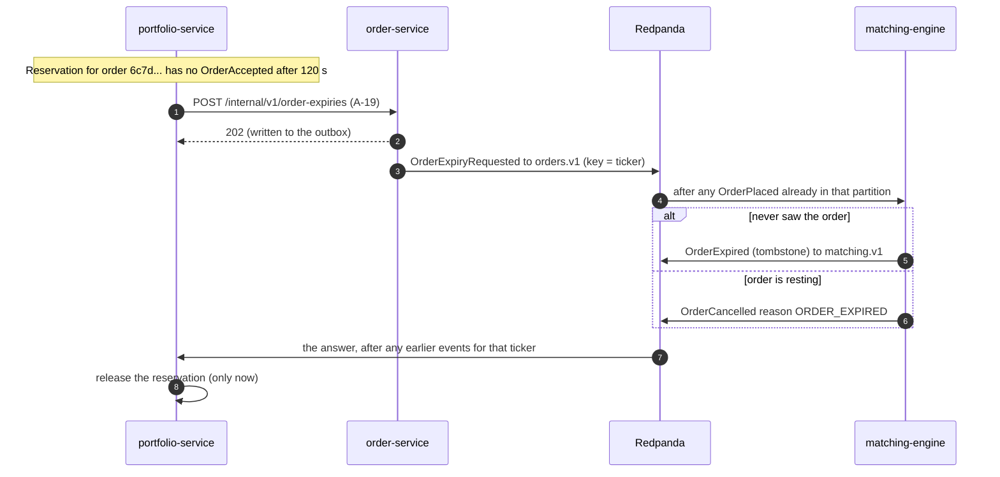

# 0017 — Fail-Closed Release of Orphaned Reservations

- **Status:** Accepted — amends [ADR-0011](0011-synchronous-reservation-over-saga.md): replaces its supporting rule 3
  (orphan clean-up by a 120 s timer). The synchronous reservation, idempotency by `order_id`, the circuit breaker and the
  60 s publish limit all stay.
- **Date:** 2026-11-04
- **Deciders:** Kaizer Dewaswala (owner, Trading); for review by MD Asif Ali (portfolio-service) and Mohammad Oweis

## Context

ADR-0011 lets portfolio-service release any reservation that has seen no `OrderAccepted` within 120 s, and stops
order-service's outbox relay from publishing an `OrderPlaced` older than 60 s. It argues that because 60 s < 120 s, an
order can never reach the engine after its money was released.

While building Phase 2 we found that this only covers delays **inside order-service**. A wall-clock timer in
portfolio-service cannot know what the engine has decided or is about to decide:

| Case | What goes wrong with a 120 s timer |
|---|---|
| The engine is down or slow for more than 60 s while an `OrderPlaced` waits in `orders.v1` | Portfolio releases at 120 s; the engine comes back and matches the order on money that was handed back. |
| The engine appended `OrderAccepted` and a `TradeExecuted` to its store, then crashed before publishing them | Portfolio sees nothing, releases; on restart the engine publishes trades for released money. |
| portfolio-service's own consumer is behind | The `OrderAccepted` was published but not yet read; portfolio releases anyway. |

In each case a trade can settle against cash the trader may already have spent again, which breaks "no margin".

> **Fail-closed:** when a component is unsure, it chooses the *safe* outcome even if it is less convenient. Here the
> safe outcome is "keep the money reserved". The opposite, *fail-open*, would release it and hope.

## Decision

**Money is released only after the matching engine confirms it will never trade the order.** Nobody else decides.

1. **Sweeper (portfolio-service, policy P-15).** A reservation with no `OrderAccepted` after 120 s is not released. The
   sweeper asks order-service for an expiry: `POST /internal/v1/order-expiries` with `order_id`, `trader_id`, `ticker`
   (**A-19**). If order-service is down, the sweeper simply tries again on its next cycle (every 10 s). It records
   `expiry_requested_at` once order-service has accepted the request.
2. **Request (order-service).** order-service writes an `OrderExpiryRequested` into its outbox, exactly like a cancel
   request, and the relay publishes it to `orders.v1` with key = ticker. It does this even if it has no record of the
   order (it may have crashed before storing it). The `event_id` is derived from the `order_id` (UUIDv5), so repeated
   requests are one command to the engine.
3. **Answer (matching-engine, policy P-14),** as normal events in the event store and on `matching.v1`:

   | The engine's state for that order ID | Answer |
   |---|---|
   | Resting in the book | `OrderCancelled`, reason `ORDER_EXPIRED` (the rest of the order) |
   | Never seen | `OrderExpired`: a **tombstone**. The ID is remembered as dead and any later `OrderPlaced` with it is refused (no events) |
   | Already finished (filled, cancelled or expired) | Nothing: its earlier events already settled or released the money |

4. **Release (portfolio-service, policy P-06)** happens only on engine events: an order's remaining quantity reaching 0
   in a `TradeExecuted`, `OrderCancelled` (any reason) or `OrderExpired`. If the engine is down, the money stays
   reserved until it is back.

### Why the order of messages makes this safe

- `OrderPlaced` and `OrderExpiryRequested` for an order use the same key (its ticker), so they are in the **same
  `orders.v1` partition**, which the engine reads strictly in order. If an `OrderPlaced` was appended before the expiry
  request, the engine handles it first; the expiry then finds the order resting (cancel) or finished (nothing to do).
- If an `OrderPlaced` is appended **after** the expiry request (a relay that hung past 60 s, or a retried send), the
  engine has already written the tombstone and refuses it.
- All the engine's answers go to the same `matching.v1` partition in `sequence` order, so portfolio-service reads an
  order's `OrderAccepted` and trades before the answer to its expiry.
- This needs two things to stay true, both recorded in the [event catalog](../03-architecture/03-event-catalog.md):
  every producer uses the default key partitioner, and topics never change their partition count.

So no timing assumption is left: crashes and delays of any length can only make the release **later**, never unsafe.

### What happens in each failure

| Failure | Result |
|---|---|
| order-service crashes after reserving, before storing the order | No order exists; at 120 s the sweeper asks for an expiry; the engine never saw it → `OrderExpired` → released. |
| order-service crashes after storing, before publishing; back within 60 s | The relay publishes `OrderPlaced` as normal. |
| … back after 60 s | The relay marks the order `REJECTED` (`PUBLISH_TIMEOUT`) and never publishes it; expiry → `OrderExpired` → released. |
| The engine is down for minutes | `OrderPlaced` and then the expiry request wait in order. The engine returns, accepts (and may trade) the order while the money is still reserved, then cancels the rest (`ORDER_EXPIRED`) → leftover released. |
| The engine crashed between storing and publishing | On restart it publishes the stored events, then answers the expiry, in order. |
| portfolio-service is behind on `matching.v1` | Its sweeper skips that partition until it has caught up (see below), so it does not expire an order whose `OrderAccepted` is merely unread. |
| order-service is down at 120 s | A-19 fails; the sweeper retries on its next cycle. |

**Sweeper scope.** Each portfolio-service replica only sweeps tickers whose `matching.v1` partition it currently
consumes, and only while that partition has no lag. This is not needed for safety (the engine's answer is), but it
avoids cancelling an order that was accepted and is still resting just because portfolio-service had not read the
`OrderAccepted` yet.

The 60 s publish limit in order-service stays. It is no longer what protects the money; it is what tells a trader
quickly (`REJECTED`, `PUBLISH_TIMEOUT`) that an order did not get through.

## Alternatives considered

| Alternative | Why rejected |
|---|---|
| **Keep ADR-0011's timer and document the gap** | Leaves a real path to trading on released money; the brief requires that it can never happen. |
| **Engine refuses orders older than 90 s; sweeper waits until its consumer has no lag** | Narrows the gap but keeps a timing assumption: an engine that crashes after storing a decision and stays down for more than 30 s can still publish trades for money that was released. |
| **portfolio-service publishes the expiry request to `orders.v1` itself** | Two producers on one topic, so two owners of one contract. order-service already owns `orders.v1` and has the outbox that makes publishing reliable. |
| **portfolio-service asks the engine over HTTP** | The engine cannot answer safely: an `OrderPlaced` might still be waiting in its partition. Only a message *in the same partition* is ordered after it. |
| **Saga with compensations** (rejected in ADR-0011) | Still the bigger change; the expiry request is one extra command, not a new process. |

## Consequences

- ✅ No trade can execute against released money, whatever the timing, crashes or delays. A property test drives
  random crashes, delays and late publishes through a model of the three services and checks exactly this.
- ✅ The engine's answer is an event, so expiries are in the event store, the audit trail and time travel.
- ❌ **Fail-closed has a price:** while the engine is down, orphaned money stays reserved. That is the intended trade:
  money is briefly unavailable rather than possibly spent twice.
- ❌ portfolio-service and order-service now call each other: order-service → portfolio-service for reservations (on the
  request path) and portfolio-service → order-service for expiries (background sweeper only). No request ever waits in a
  cycle, but A-19 is one more internal contract between the two teams.
- ❌ Two more event types (`OrderExpiryRequested`, `OrderExpired`), one more cancel reason (`ORDER_EXPIRED`), one more
  internal endpoint and action ID (A-19, from J-36).
- ❌ The engine must remember every order ID it has seen per ticker (also in snapshots), to tell "never seen" from
  "finished". That is about 100 bytes per order (≈ 10 MB for 100,000 orders): fine for a demo; a real exchange would
  start fresh each trading day.
- ❌ An order that was accepted but whose `OrderAccepted` took more than 120 s to reach portfolio-service is cancelled
  (`ORDER_EXPIRED`). The sweeper scope above makes this rare.

## Viva Notes

**Q: What was wrong with releasing orphaned reservations after 120 s?**
A: A timer only knows how long it has waited, not what the engine decided. If the engine was down, or crashed after
storing a trade but before publishing it, portfolio could release money that was about to be traded.

**Q: What does "fail-closed" mean here?**
A: When portfolio is not sure an order is dead, it keeps the money reserved. Money is released only when the matching
engine, the only component that knows, confirms that the order can never trade.

**Q: Why does the expiry request go through order-service and Redpanda instead of an HTTP call to the engine?**
A: Safety comes from ordering. The request must be in the same partition as the order's `OrderPlaced`, so the engine
handles it after any `OrderPlaced` that was already sent. An HTTP call would overtake messages still waiting in the
partition. And `orders.v1` has one producer, order-service, which already has an outbox.

**Q: What is a tombstone and why do you need one?**
A: A stored event saying "this order ID is dead". If a delayed copy of the `OrderPlaced` arrives after the expiry,
the engine sees the tombstone and refuses it, so the released money can never be used by that order.

**Q: What does this cost?**
A: If the engine is down, orphaned money stays locked until it returns. portfolio and order-service now call each other
(one direction only in the background), and there are two more events and one more internal endpoint.
