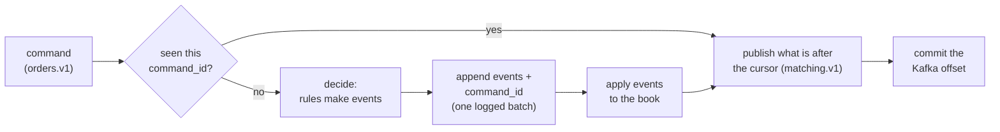

# How matching works

> A walkthrough of what the matching engine does with each order, using one small CHAIWALA book. Rules, events and
> field names are those of the [event catalog](../../../docs/03-architecture/03-event-catalog.md); prices are integer
> paise ([ADR-0012](../../../docs/adr/0012-prices-in-integer-paise.md)), so 24550 means ₹245.50.

**Terms**

- **Order book:** for one ticker, the list of orders waiting to trade. **Bids** are buy orders (highest price
  first), **asks** are sell orders (lowest price first). A **price level** is all the orders at one price.
- **Resting order:** an order sitting in the book. **Incoming (aggressor) order:** the one being matched now.
- **Crossing:** a buy price at or above a sell price, so they can trade.
- **Sequence:** per ticker, every event gets the next number (1, 2, 3, …). The book's state is "everything up to
  sequence N".

## The rules

| Rule | What it means |
|---|---|
| **Price priority** | The incoming order meets the best opposite price first (lowest ask for a buy, highest bid for a sell). |
| **Time priority** | At the same price, the order accepted first (lower `accepted_sequence`) trades first. |
| **Resting price** | A trade always happens at the **resting** order's price. A buyer willing to pay more pays less (price improvement). |
| **Partial fills** | An order can trade in pieces; a LIMIT remainder rests in the book, keeping its place in the queue. |
| **MARKET protection** | A MARKET order never trades beyond its protection price (last price ± 10%); what cannot fill is cancelled (`UNFILLED_MARKET_ORDER`). A MARKET order never rests. |
| **Self-trade prevention** | If the next resting order to match belongs to the **same trader**, the incoming order's remainder is cancelled (`SELF_TRADE_PREVENTED`, "cancel newest"). Trades before that point stand. |
| **Cancel** | The engine removes whatever is left (`OrderCancelled`, `USER_REQUESTED`) or says why it can't (`OrderCancelRejected`). |
| **Expiry (fail-closed)** | portfolio-service's request to make sure an orphaned order can never trade ([ADR-0017](../../../docs/adr/0017-fail-closed-orphan-release.md)): cancel it if it is resting (`ORDER_EXPIRED`), or record an `OrderExpired` **tombstone** if the engine never saw it. |

## Decide, then apply

For every command the engine first **decides** (runs the rules above and produces events, changing nothing), then
stores the events, then **applies** them to the book. Replay after a crash only applies stored events and never
re-runs the rules ([ES and CQRS](../../../docs/03-architecture/04-event-sourcing-and-cqrs.md#4-how-the-event-store-works)).

## A worked example

**The book before** (CHAIWALA, last sequence 1040):

| Bids (buy) | | | Asks (sell) | | |
|---|---|---|---|---|---|
| **Price** | **Order** | **Qty** | **Price** | **Order** | **Qty** |
| 24500 | Bot-01, accepted at 988 | 40 | 24550 | Bot-03, accepted at 995 | 20 |
| 24450 | Meera, accepted at 1002 | 10 | 24650 | Bot-05, accepted at 1010 | 15 |

Best bid 24500 < best ask 24550: the book is not crossed.

### 1. Raju: BUY 50 LIMIT 24600 (sequence diagram 3)

The best ask, 24550, is at or below 24600, so they cross. The next ask, 24650, is above 24600, so matching stops.

| Seq | Event | Details |
|---|---|---|
| 1041 | `OrderAccepted` | Raju BUY 50 @ 24600 |
| 1042 | `TradeExecuted` | 20 @ **24550** (Bot-03's price); buy remaining 30, sell remaining 0 |

Raju's remaining 30 **rests** at 24600, the new best bid. He offered ₹246.00 but paid ₹245.50: the ₹0.50 × 20 = ₹10
he had reserved extra is released by portfolio-service when his order finishes.

### 2. Bot-07: SELL 40 MARKET, protection 22095

The last price is 24550, so the protection price is 24550 − 10% = 22095 (rounded down to the 5-paise tick). The
order sweeps bids from the highest down, and every bid is above 22095.

| Seq | Event | Details |
|---|---|---|
| 1043 | `OrderAccepted` | Bot-07 SELL 40 MARKET, protection 22095 |
| 1044 | `TradeExecuted` | 30 @ 24600 with Raju; buy remaining 0, sell remaining 10 |
| 1045 | `TradeExecuted` | 10 @ 24500 with Bot-01 (time priority: it is first at 24500); buy remaining 30, sell remaining 0 |

Fully filled, so there is no cancel. Meera's bid at 24450 was never reached.

### 3. Bot-01: SELL 60 LIMIT 24450 (self-trade prevention)

The best bid, 24500, crosses 24450, but it is **Bot-01's own** bid. Trading with yourself (a *wash trade*) would fake
volume and move the price without any real change of owner, so the engine stops before it.

| Seq | Event | Details |
|---|---|---|
| 1046 | `OrderAccepted` | Bot-01 SELL 60 @ 24450 |
| 1047 | `OrderCancelled` | 60, reason `SELF_TRADE_PREVENTED`; the resting bid is untouched |

### 4. Meera cancels her bid

| Seq | Event | Details |
|---|---|---|
| 1048 | `OrderCancelled` | Meera's 10 @ 24450, reason `USER_REQUESTED` |

A second cancel of the same order would get `OrderCancelRejected` with `ALREADY_CANCELLED`.

### 5. An expiry for an order the engine never saw

order-service crashed after reserving money for order `6c7d…` and before sending it. 120 s later portfolio-service
asked for an expiry.

| Seq | Event | Details |
|---|---|---|
| 1049 | `OrderExpired` | `6c7d…` is now a tombstone; portfolio-service may release the money |

If a delayed copy of `OrderPlaced 6c7d…` arrives later, the engine refuses it: no `OrderAccepted`, no trade.

**The book after** (last sequence 1049):

| Bids (buy) | | | Asks (sell) | | |
|---|---|---|---|---|---|
| **Price** | **Order** | **Qty** | **Price** | **Order** | **Qty** |
| 24500 | Bot-01, accepted at 988 | 30 | 24650 | Bot-05, accepted at 1010 | 15 |

Every number above can be checked: each order's quantity equals what it traded plus what rests plus what was
cancelled (for example Raju: 20 + 30 = 50), and cash and shares only moved between traders.

## How we know it is right

| Check | Where |
|---|---|
| One example test per rule (including every step above) | `tests/unit/domain/` |
| 100% branch coverage of `domain/`, enforced by `pytest` | `pyproject.toml` (`--cov-fail-under=100`) |
| Properties over thousands of random workloads: never crossed, fills within remaining, trade prices within both limits, no self-trades, cash and shares conserved, nothing negative, quantities accounted for, gapless sequences | `tests/property/test_book_properties.py` |
| Replay: from the start, from any snapshot, through the stored JSON, twice, always the same hash | `tests/property/test_replay.py` |
| Crash at any storage, publish or commit step (also while recovering), rebuild, same books, nothing lost or doubled | `tests/property/test_crash_recovery.py` |
| Fail-closed: no trade ever settles against released money, under crashes, outages and late messages (and the old 120 s timer is shown to fail) | `tests/property/test_system_model.py` |

## Viva Notes

**Q: Why does a trade happen at the resting order's price and not the incoming one's?**
A: The resting order was there first and published its price; the incoming order accepted it by crossing. Any better
price the incoming trader offered is their gain (price improvement), which keeps the rule fair and predictable.

**Q: Why is it called price-time priority?**
A: Price first: the best price always trades first. Time second: among orders at the same price, the earliest
accepted one trades first. Our engine reads time from `accepted_sequence`, not a clock, so it is exact and replayable.

**Q: What is self-trade prevention and why "cancel newest"?**
A: It stops a trader's buy and sell orders from trading with each other (a wash trade), which would create fake volume.
We cancel the incoming (newest) order's remainder, so a resting order never loses its place because of its owner's
new order.

**Q: How does a MARKET order avoid trading at a crazy price on a thin book?**
A: It carries a protection price (last price ± 10%). The engine stops matching at that price and cancels the rest, so
the worst price is known in advance, which also lets portfolio-service reserve the right amount of cash.

**Q: How can you show the book after a restart is exactly the book before it?**
A: Q-16 returns a `state_hash`: a SHA-256 of the canonical book. We read it, kill the engine with `kill -9`, let it
rebuild from Cassandra, and read it again: the two hashes are identical. Property tests do the same at random crash
points thousands of times.
